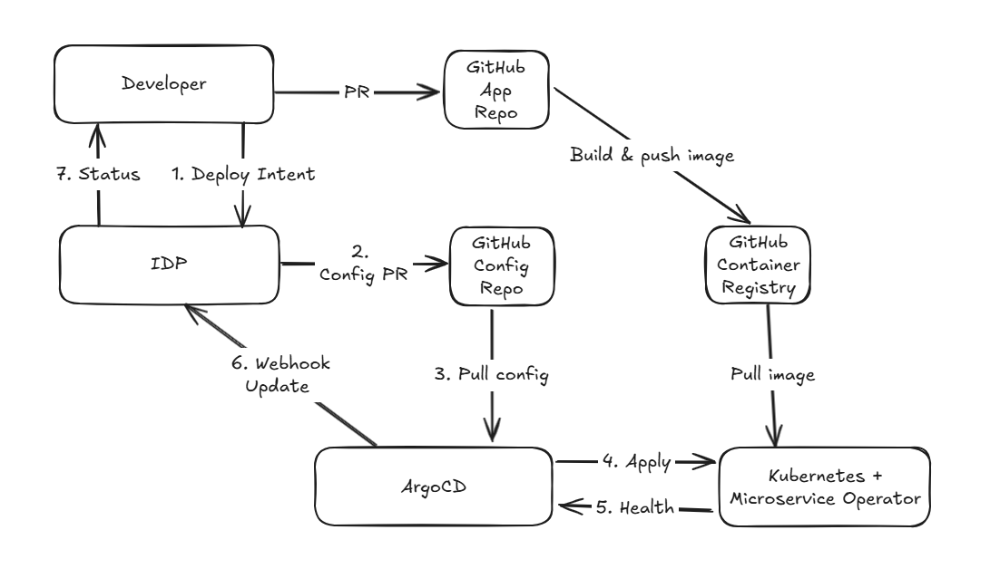

# Day 01 - After writing microservices: why we still need platform engineering

## Introduction

Two years ago, I wrote a series for the [iThome Ironman competition](https://ithelp.ithome.com.tw/users/20168953/ironman/7881) ([GitHub](https://github.com/yrw9281/IT30.Todo.Microservices)) about building a Todo system, covering DDD, Clean Architecture, and Microservices. The focus then was on splitting services apart and getting them to work together. This time, I want to pick up the next question: once the services are written, how does the team deliver them?

At the end of the previous series, we had assembled Account, Todo, BFF, and Web into a Todo microservices system that could run locally. Seeing a row of services come up after running `docker compose up -d` was certainly worth celebrating. But suppose we need to hand over a fix for "creating a todo item sometimes times out" for the team to test tomorrow. Who needs to do what next?

Who gets the image? Who changes the configuration when Staging differs from the local environment? If someone manually changes the replica count in the middle of the night, will the next deployment overwrite it? When a service starts successfully but users still encounter failures, where do we look for answers? These questions come to the surface once microservice development wraps up.

This series will not present platform engineering as some magical product or pretend that every team needs a large platform department. We will start with the Todo microservices from the previous series and turn delivery work that used to depend on experienced colleagues into paths the team can reuse.

## What should you know before starting?

You do not need to read the entire previous series first. The articles that follow will treat the Todo system as an already containerized application: it has several services that call one another, and it can run locally with Docker.

Familiarity with containerization, including `docker` and Container Images, as well as HTTP APIs, will make the series easier to follow.

You do not need to know all of Kubernetes, but I recommend at least knowing what problems Pods, Deployments, Services, and Namespaces solve. Day 02 will fill in the context, starting with how declarative APIs and Controllers work.

## Why isn't a working system finished yet?

Getting a system running locally solves some important problems: services can be built, containers can connect to one another, and there is somewhere to verify basic functionality. But it does not yet answer how the team can deliver repeatedly and reliably. As a system grows from two services to twenty, these seemingly small decisions start to get tangled together:

- What Kubernetes resources does each service need, and which Namespace should they go in?
- Who maintains the differences between Dev, Staging, and Prod, and how do we keep their configurations from gradually drifting apart?
- Once a new image passes its tests, who has permission to let it into the cluster?
- After a release, is the service `Healthy`, or has the YAML merely been applied? Where should failures be reported?
- When people create services through self-service, how do we prevent a single YAML file from taking excessive permissions or damaging cluster resources?

If the answer is a Wiki page, a few commands sent in private messages, or asking a particular senior colleague to handle it, the process is far from ideal. It concentrates both deployment management and risk in the hands of a few people.

## What should platform engineering deliver?

The goal of platform engineering is to package an organization's repeatedly validated practices into an internal product, not to ask developers to learn more tools. That product has users, interfaces, defaults, and clear limits.

For the Todo system, what a developer usually wants to express is:

```text
I want to deploy todo-api.
It should use this image that has passed CI, expose this port,
and run in the Todo team's environment.
```

Developers should not have to decide on `Deployment` labels, `Service` selectors, OpenTelemetry settings, Argo CD sync strategies, and RBAC permissions from scratch every time. These details matter and are easy to get wrong, which is why the platform should provide consistent defaults for them.

A platform should also leave room for flexibility. A good design separates what service owners should decide from what the platform should provide consistently:

| Intent expressed by the service owner | Consistent capabilities provided by the platform |
| --- | --- |
| Image, port, required environment variables, service name | Resource naming, health checks, security defaults, telemetry |
| Target deployment environment | Git review, synchronization, status feedback |
| Acceptable scaling range | RBAC, Policy, mTLS, and audit trails |

The diagram below shows the control flow we aim to assemble by the end of the series. We will not build the entire architecture at the outset. We will add a piece each day and check exactly what problem each component solves in the delivery process.



## What stages will the series cover?

We plan to start with Kubernetes and deployment basics, working out which resources run services, handle service discovery, and accept external traffic once services enter the cluster. Then we will introduce GitOps, storing environment configuration in Git and having Argo CD sync reviewed changes to the cluster.

Once services are live, checking that a Deployment exists is not enough. We will use Metrics, Logs, Traces, and OpenTelemetry to collect observability data so the team can investigate latency and errors. Then we will return to CI to clarify the handoffs between code testing, Container Images, and GitOps configuration.

Only after those foundations are ready will we start designing the IDP to accept service requirements. Its backend will generate Git changes, the `Microservice` CRD and Operator will turn intent into Kubernetes resources, and status will return to somewhere developers can see it.

Finally, we will add the security boundaries that self-service needs: team Namespaces and RBAC, Policy checks before resources enter the cluster, and traffic management and mTLS between services. Each stage will first address the problems left by the previous one. We will not rush to put every tool into the system at once.

The next article starts with Kubernetes' declarative API and Reconcile Loop. Understanding how Controllers continually bring actual state closer to desired state will give the GitOps and Operator concepts that follow meaning beyond their names.
