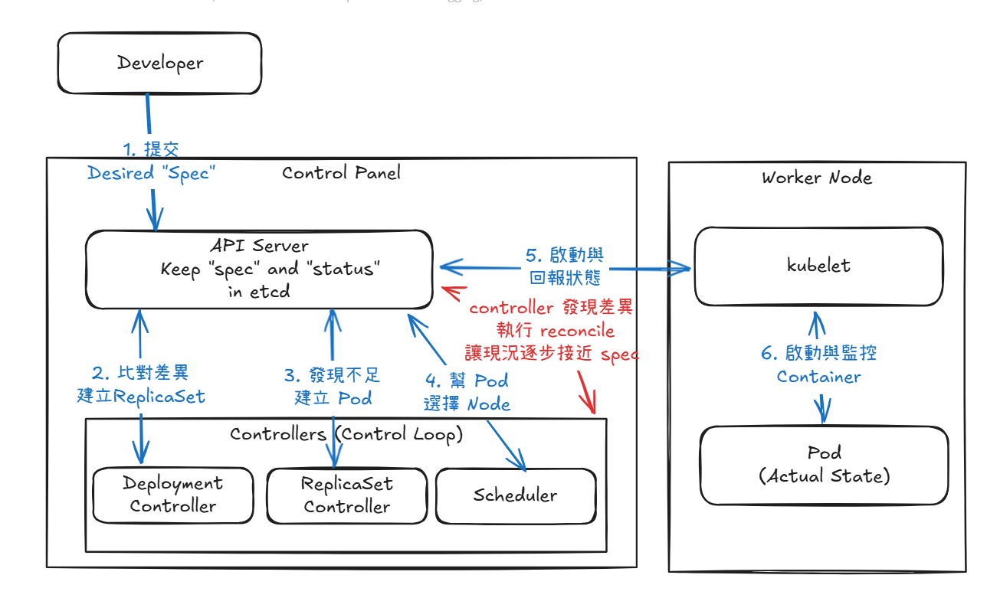

# Day 02 - How Kubernetes maintains desired state: declarative APIs and control loops

Suppose `todo-api` needs two replicas, and one container stops because it runs out of memory. The remaining replica can still handle some traffic, but the service no longer meets its original requirements. If someone has to log in to a host, find the failed container, and restart it every time, this quickly becomes a burden as the number of services and replicas grows.

With Kubernetes, we describe the target state first, and the cluster continually compares it with the current state. This design is called a declarative API. GitOps and Operators, which we will cover later, build on the same concept.

## Imperative vs. declarative management

Issuing commands directly to a host, such as running restart, is imperative management: we explicitly tell the system "which action to take now." It works well for one-off tasks and gives us immediate results.

However, a command does not record the state the service should maintain afterward. If a container stops again, a node fails, or someone manually changes the replica count, the system does not know what state it should restore. Someone still has to intervene.

Kubernetes uses declarative management. A user, CI, or a GitOps controller introduced later submits a resource definition describing the state the service should maintain. Take `todo-api` as an example: `replicas: 2` means the service should maintain two replicas, not just create two Pods when the YAML is submitted.

```yaml
apiVersion: apps/v1
kind: Deployment
metadata:
  name: todo-api
spec:
  replicas: 2
  selector:
    matchLabels:
      app: todo-api
  template:
    metadata:
      labels:
        app: todo-api
    spec:
      containers:
        - name: todo-api
          image: todo-api:0.1.0
```

The API Server receives this YAML and stores the resource's `spec` and `status` in etcd. If only one healthy Pod remains, the Deployment controller detects the shortfall and starts creating a replacement Pod.

## The controller's control loop

Kubernetes does not maintain services through a script that finishes once deployment is complete. When a resource's `spec` changes, a Pod is deleted, or the kubelet reports a new Pod status, the relevant controller receives an event. It reads the resource definition and current state. If it finds a difference, it runs `reconcile` to create, update, or delete resources, gradually bringing the current state closer to `spec`.

A single `reconcile` is one round of processing by the controller, not an endless loop. After finishing that round, the controller waits for the next event. The overall pattern of repeatedly observing and addressing differences is the control loop.

A controller acts only on resource definitions; it does not evaluate the application's business logic. If the image is wrong, the readiness probe is misconfigured, or a migration will damage data, the controller may still keep retrying. Along with describing the target state, the YAML must correctly define the application's health conditions.

## `spec` is the target; `status` is the current observation

The Deployment YAML above is what we submit to Kubernetes. Its `spec` is the input: the replica count, image, labels, and other conditions we want the cluster to maintain.

After the resource is created, the controller writes its observations back to the same resource's `status`. Developers usually do not fill in this section manually. Instead, they read it with commands such as `kubectl get deployment todo-api -n todo -o yaml`. If the target is two replicas and one is available, the output will include something like this:

```yaml
# Example observations written by the Deployment controller
status:
  replicas: 2
  readyReplicas: 1
  availableReplicas: 1
  conditions:
    - type: Available
      status: "False"
      reason: MinimumReplicasUnavailable
```

These two sections answer different questions:

- `spec.replicas: 2`: How many replicas do we want to maintain?
- `status.availableReplicas: 1`: How many replicas can actually serve requests right now?

When the two differ, the cluster has not yet met the requirements in `spec`, and the controller will keep working on the difference. So we need to check whether the resource has actually become available, as well as whether it was created successfully.

## Using the `todo-api` Deployment above as an example



When one Pod is deleted, the ReplicaSet controller again detects that there are fewer than two replicas and creates a replacement Pod. The controller also runs reconcile again when a Node fails, the Deployment's `spec` changes, or a new Pod cannot start.

## Why create a Deployment instead of a Pod directly?

Creating a `Pod` directly can start a container, but it does not define a replica count, an update strategy, or how to maintain it afterward. Once the Pod stops, Kubernetes will not know whether it needs to create a new one.

A `Deployment` defines these rules. The Deployment controller manages version updates and creates a `ReplicaSet`, which maintains the specified number of Pods. This set of resources supports rollout, rollback, horizontal scaling, and self-healing.

When reading Kubernetes YAML, check the `kind` and ask three questions: What state should this resource maintain? Which controller handles it? Which `status` field should we inspect when something goes wrong?

## What to watch in the control loop

After deployment, we can watch whether `spec.replicas` and `status.availableReplicas` converge. After we delete one `todo-api` Pod, the ReplicaSet controller should create a replacement replica, bringing the number of available replicas back to two.

If the image cannot be pulled, the Pod may have been created, but `availableReplicas` will not increase. In that case, we need to inspect `status`, rather than just check whether the resource exists.

With an understanding of how Deployments, ReplicaSets, and controllers maintain state, we can examine each resource's responsibilities when bringing a service online in the next article.
