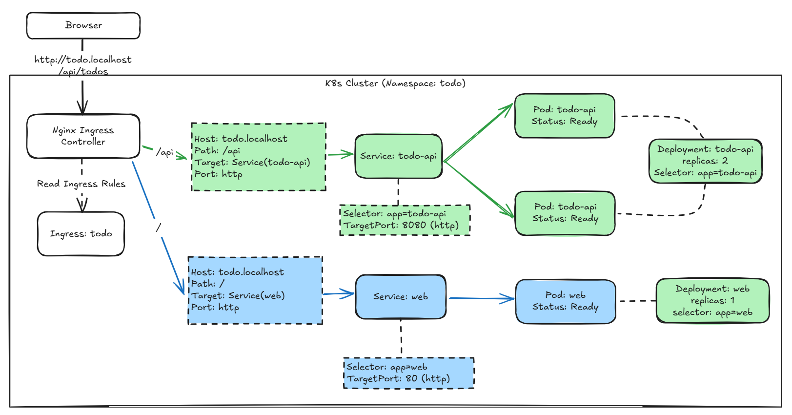

# Day 03 - What Deployment, Service, and Ingress each do when deploying a service

The `Deployment` from Day 02 already handles one thing: when `todo-api` loses a replica, Kubernetes creates a new Pod to replace it. But a Pod is not a fixed host. Its IP may change when it is recreated, and it may not yet be ready to handle requests. If the frontend stores a Pod IP directly, that address will stop working the next time the Pod is recreated.

We simplify the Todo system into two components that provide functionality to users: `web` serves the web pages, and `todo-api` provides the API. Today, we use their manifests to see which part each of the three resource types handles, starting with how services are found and how external traffic enters the cluster. Tomorrow, we will look at how to apply the same set of configurations to different environments.

## Where does a request go?

When a user opens `http://todo.localhost/api/todos`, the request follows this path:

```text
Browser
  -> NGINX Ingress Controller
  -> todo Ingress
  -> todo-api Service
  -> todo-api Pod
```

The browser does not connect directly to a Pod. An `Ingress` selects a backend `Service` based on the host and path. The `Service` then routes traffic to available Pods with matching labels. The `Deployment` keeps the specified number of these Pods running. Each has a different responsibility, but their names, labels, and ports must match up.

## Deployment creates API Pods

The following is another example of the `todo-api` `Deployment`. We have already covered how Deployment and ReplicaSet maintain the replica count. Here, we will focus on the labels that the Service will use and the probes that determine whether a Pod can receive traffic.

```yaml
apiVersion: apps/v1
kind: Deployment
metadata:
  name: todo-api
  namespace: todo
spec:
  replicas: 2
  selector:
    matchLabels:
      app: todo-api
  template:
    metadata:
      labels:
        app: todo-api
    spec:
      containers:
        - name: todo-api
          image: todo-api:0.1.0
          ports:
            - name: http
              containerPort: 8080
          readinessProbe:
            httpGet:
              path: /health/ready
              port: http
          livenessProbe:
            httpGet:
              path: /health/live
              port: http
            initialDelaySeconds: 10
```

Until `readinessProbe` succeeds, the Pod is `NotReady`. The EndpointSlice created by the Service controller does not list it as an endpoint ready to receive traffic, so an API that has just started and has not finished initializing will not immediately receive requests.

`livenessProbe` handles a different issue. When it keeps failing, the kubelet restarts the container. Both probes point to HTTP endpoints, but they are configured separately so the application can distinguish between "temporarily not accepting traffic" and "the process needs to be restarted."

## Service provides a stable service name

Pod IPs change, but a `Service` name does not. The following `Service` example selects Pods labeled `app: todo-api` and provides the name `todo-api` in the `todo` Namespace.

```yaml
apiVersion: v1
kind: Service
metadata:
  name: todo-api
  namespace: todo
spec:
  selector:
    app: todo-api
  ports:
    - name: http
      port: 8080
      targetPort: http
```

This Service receives incoming traffic on port `8080` and forwards it to the container's `http` port. `http` is the name assigned to `containerPort: 8080` above, so both ultimately connect to the API's port `8080`. You can also set `targetPort` directly to `8080`. We use a name here to make the mapping between the Service and the container clearer.

This is also where the most common problem occurs: successfully creating a `Service` does not mean it actually has Pods behind it. If the selector does not match the Pod labels, or the Pods are not ready yet, the EndpointSlice will have no addresses to forward traffic to. Redeploying usually does not help in this situation. Checking the labels and probe results first is faster.

`web` uses the same pattern for its own `Deployment` and `Service`, except that it listens on port `80` and uses the label `app: web`.

## Ingress routes URL paths to two Services

An `Ingress` is just a set of HTTP routing rules. The Ingress Controller actually receives the traffic. This example uses the NGINX Ingress Controller, so `ingressClassName` is set to `nginx`. If the cluster does not have the corresponding controller installed, creating an `Ingress` resource will not make `todo.localhost` start serving requests.

This `Ingress` routes `/api` on `todo.localhost` to the API and all other paths to the web pages:

```yaml
apiVersion: networking.k8s.io/v1
kind: Ingress
metadata:
  name: todo
  namespace: todo
spec:
  ingressClassName: nginx
  rules:
    - host: todo.localhost
      http:
        paths:
          - path: /api
            pathType: Prefix
            backend:
              service:
                name: todo-api
                port:
                  name: http
          - path: /
            pathType: Prefix
            backend:
              service:
                name: web
                port:
                  name: http
```

With `pathType: Prefix`, `/api/todos` also matches the `/api` rule. The `/` rule is a fallback, so a browser request for the home page goes to the `web` Service. Ingress does not know the Pod IPs and does not need to. It only needs the backend Service names and ports.

These basic rules are enough to start with. TLS, authentication, rate limiting, and other NGINX annotations each have their uses, but putting them all into the first example would make the routing relationships harder to see.

## The complete diagram

This diagram shows how external requests flow through the NGINX Ingress Controller, Ingress, and Service to Ready Pods, and how those resources relate to each other.



## How do we verify the route after deployment?

After building and loading the local images:

```bash
kubectl rollout status deployment/todo-api -n todo
kubectl rollout status deployment/web -n todo

kubectl get deployment,service,ingress -n todo
kubectl get endpointslice -n todo -l kubernetes.io/service-name=todo-api
```

The EndpointSlice for `todo-api` should list the ready API Pods. If there are no endpoints, check the Pod status and events first:

```bash
kubectl get pods -n todo -l app=todo-api
kubectl describe pod <todo-api-pod-name> -n todo
```

If the cluster does not yet have the NGINX Ingress Controller installed, you can still test the API directly through the Service (assuming a KinD environment):

```bash
kubectl port-forward service/todo-api 8080:8080 -n todo
curl http://127.0.0.1:8080/api/todos
```

These resources can use local images or pull images from a container registry. The relationships between the resources are the same in either case. In the next article, we will use this fixed YAML as a starting point to work out which settings should be shared and which should change across Dev, Staging, and Prod.
