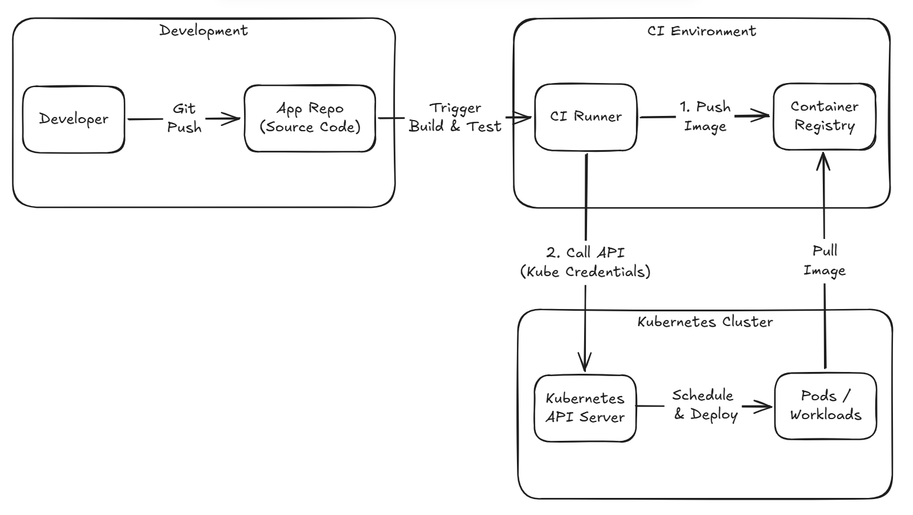
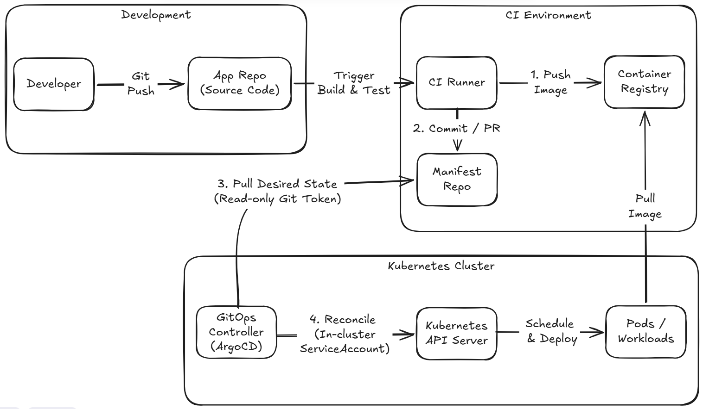

# Day 06 - How GitOps uses Git to manage deployment state

## Introduction

From Day 02 through Day 05, we briefly covered several basic problems Kubernetes aims to solve and how it addresses them. A controller uses a control loop to keep bringing the actual state closer to the declared `spec`; `Deployment`, `Service`, and `Ingress` handle workloads, service discovery, and HTTP routing, respectively; Kustomize keeps shared configuration and environment-specific differences from being mixed into a single YAML file; and CRDs let teams express service intent through custom resources such as `Microservice`.

These resources answer the question, "What state should the cluster maintain?" They leave another delivery question unanswered: which version of those declarations should a particular environment be using now?

Suppose the Todo team fixes an issue on Friday night that occasionally causes requests to create to-do items to time out, then runs `kubectl set image` directly in Production. The fix takes effect immediately, but Git still contains the old image. The next time the team rebuilds the environment, handles an incident, or wants to know why this version entered Production, should they trust the terminal history, CI logs, or the resources currently in the cluster?

GitOps addresses this problem by keeping the environment's desired state in a Git history that can be reviewed, traced, and used to rebuild the environment. A controller inside the cluster maintains its state according to those declarations.

## YAML in Git alone does not make it GitOps

Keeping Kubernetes YAML in Git is a good habit, but it might only be a backup. GitOps has at least three requirements:

1. The Git repository holds the environment's desired state and is the source the deployment process actually uses.
2. Environment changes enter this desired state through commits and reviews.
3. A controller inside the cluster continuously compares Git with the cluster and handles differences according to the synchronization policy.

Here, "single source of truth" refers to what the environment should become. It does not mean Git and Kubernetes are identical at every instant. Kubernetes stores the observed state; the GitOps controller reads the declarations in Git, compares them with the cluster's current state, and runs `reconcile`.

```text
Git: the environment's desired state
Kubernetes: observations of the environment
GitOps controller: compare the two and handle differences according to policy
```

GitOps therefore does not replace Kubernetes with Git. Git provides a reviewable change history, while Kubernetes controllers still bring resource state into convergence. The GitOps controller connects the two.

## Push-based and pull-based deployment: permissions and trust boundaries

Traditional deployments often use a push-based process: after CI finishes the build and tests, it calls the Kubernetes API directly using a kubeconfig or cloud credentials.



This approach works, but the CI runner needs credentials that can modify the target cluster. If multiple pipelines can deploy to Production, their permissions, credential rotation, and audit records must each be managed.

GitOps often uses a pull-based process. CI still validates source code and produces container images, but it no longer operates the cluster directly for deployment. CI records the version to deploy in Git through a commit or pull request. A controller running inside the cluster pulls the approved configuration and synchronizes resources using its own restricted Kubernetes permissions.



The two models differ both in who sends the request first and in where the trust boundary sits:

- CI can have permission to push images and update the configuration repository without holding broad Production cluster credentials.
- The GitOps controller only needs to read the approved configuration repository, usually with Git read permissions alone, and access the Kubernetes API inside the cluster within its scope of responsibility.
- When people inspect a deployment, they start with the configuration change's commit and review instead of searching individual runners for commands that were executed.

Pull-based deployment is not inherently secure. Risks remain if the controller has excessive Kubernetes permissions or the configuration repository lacks branch protection and review. GitOps separates permissions so teams can govern them individually; it does not automatically eliminate permission problems.

## Source code and environment configuration need separate tracking

First, distinguish the responsibilities of these two kinds of commits. Source code changes describe how the application works; environment configuration changes describe which known version should run in which environment and which Kubernetes resources to maintain.

For the Todo system, we can treat these as two logical scopes:

```text
Application source code
  Code, tests, and Dockerfiles for Account, Todo, BFF, and Web

Environment configuration
  Kubernetes manifests, Kustomize overlays, and GitOps controller deployment declarations for each environment
```

This does not require two separate repositories. A monorepo works too, provided reviews, directory boundaries, and permissions can distinguish the two kinds of changes. The point is to avoid automatically equating "the code has passed its tests" with "this image has been approved for a particular environment."

Suppose Staging needs to move from `0.1.0` to `0.1.1`. The configuration change should explicitly show the change in the image reference. Reviewers can then assess the scope of the upgrade directly. If the deployment causes problems, the team can also return to that commit to revert the change or investigate it. CI should not implicitly decide the deployment version at runtime.

Environment configuration should not store plaintext passwords, tokens, or private URLs either. Git can hold Secret names, External Secret references, or encrypted data approved by the team. The actual sensitive values should still be handled by a dedicated Secret management mechanism.

## Drift is not an exception; it is a governance issue to settle in advance

Configuration drift is one of the easiest situations to spot with GitOps. For example, Git declares that `todo-api` should maintain three replicas in Production, but someone manually scales it to five while troubleshooting:

```text
Desired replicas in Git: 3
Observed replicas in the cluster: 5
-> Drift detected
```

The controller can detect this difference, but technology cannot automatically decide how the team should handle it. Automatic correction maintains consistency, but it may also overwrite temporary actions taken during incident response. At a minimum, the team needs to define:

- Which environments allow the controller to correct drift automatically.
- Who is responsible for writing necessary changes back to Git after emergency actions are complete.
- Who can suspend synchronization and how to keep records during the suspension.

If a manual adjustment is temporary, it should eventually be reflected in Git or explicitly undone. Otherwise, the next synchronization, rebuild, or deployment may well return the environment to the old declaration without anyone noticing.

## GitOps makes the deployment process reproducible

Keeping desired state in Git offers more than the ability to view diffs. When an environment needs to be rebuilt, the team does not have to rely on one engineer remembering the last commands they ran. When a deployment goes wrong, the team can also investigate through configuration commits, reviews, and controller events.

Git itself, however, does not read commits, much less apply YAML to Kubernetes. The next article will use Argo CD as the GitOps controller to continuously synchronize Git's environment declarations to the cluster and distinguish between resources being synchronized and a service actually being healthy.
