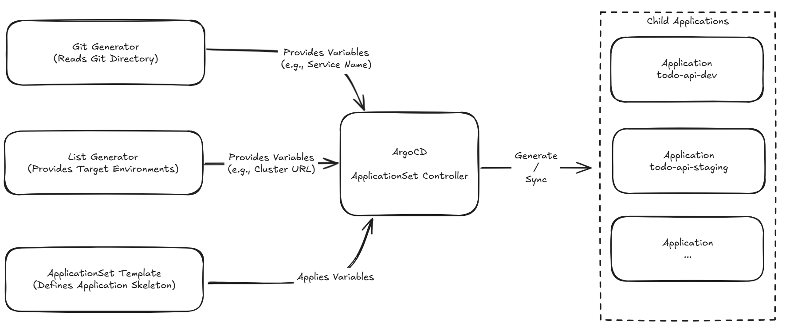

# Day 08 - Managing multiple services and environments with Argo CD ApplicationSet

## Recap of the previous day

The `Application` from Day 07 can already sync a Git path to a fixed cluster and Namespace. This approach is straightforward when you start with one service: `todo-api` has one `Application` in Dev, and you create another for each of Staging and Production.

As the number of services and environments grows, the maintenance cost becomes apparent. If each service has three environments, ten services require thirty `Application` manifests. Most differ only in their service name, Git path, and destination, yet each repeats the `project`, repository, sync policy, and finalizer. Missing an update in one manifest or specifying the wrong Namespace can cause deployment behavior to drift without anyone noticing.

Argo CD's `ApplicationSet` manages this kind of repetition when it follows a consistent set of rules. It takes a list of services or environments, generates multiple `Application` resources from a template, and keeps the generated resources consistent with that list.

## `ApplicationSet` manages `Application` resources

`ApplicationSet` does not create `Deployment` or `Service` resources directly. Its controller first generates child `Application` resources through a generator. Each `Application` then reads Git, syncs resources, and assesses their health.

```text
Service catalog or environment list
        │
        ▼
ApplicationSet generator
        │
        ▼
Multiple Argo CD Applications
        │
        ▼
Each Application synchronizes Kubernetes resources
```

The diagram below shows the flow. The Git generator and List generator supply variables for services and environments, respectively. The ApplicationSet controller inserts those variables into the template to generate the corresponding child `Application` resources. A child `Application` is an output of this process, not another configuration to maintain by hand.



For example, `todo-api-dev` is an Application generated automatically by ApplicationSet from its template, rather than one you maintain by hand. Even if you edit its deployment destination or sync settings directly, the ApplicationSet controller will restore them to the template's values the next time it runs reconcile.

To change settings shared by all Applications, edit the ApplicationSet;
to add or remove services or environments, edit the service directories or environment list that the generator reads.

## Git generator: listing services to deploy by directory structure

Day 04 used `apps/<service>/overlays/<environment>` to separate services and environments. Besides organizing Kustomize configuration, this directory structure can serve as a deployment list: whenever an overlay directory matches the convention, the Git generator can create an `Application` for it.

The following example assumes that the configuration repository has this directory structure:

```text
apps/
  todo-api/
    overlays/
      dev/
      staging/
  web/
    overlays/
      dev/
      staging/
```

`directories.path` finds all overlay directories. The template extracts the service and environment names from each path to form the `Application` name, source path, and Namespace.

```yaml
apiVersion: argoproj.io/v1alpha1
kind: ApplicationSet
metadata:
  name: todo-applications
  namespace: argocd
spec:
  goTemplate: true
  generators:
    - git:
        repoURL: https://github.com/example/todo-platform-config.git
        revision: main
        directories:
          - path: apps/*/overlays/*
  template:
    metadata:
      name: '{{ index .path.segments 1 }}-{{ .path.basename }}'
    spec:
      project: todo
      source:
        repoURL: https://github.com/example/todo-platform-config.git
        targetRevision: main
        path: '{{ .path.path }}'
      destination:
        server: https://kubernetes.default.svc
        namespace: 'todo-{{ .path.basename }}'
      syncPolicy:
        automated:
          prune: true
          selfHeal: true
```

In the YAML above, we enabled goTemplate: true so that we can use the index syntax to select a specific directory level. For the path `apps/todo-api/overlays/dev`, Argo CD splits it into an array at each slash, with indexes starting at 0:

- {{ index .path.segments 0 }}: apps
- {{ index .path.segments 1 }}: todo-api (extracts the service name)
- {{ index .path.segments 2 }}: overlays

Argo CD also provides the .path.basename variable, which always represents the last directory in the path, dev in this case.

With {{ index .path.segments 1 }}-{{ .path.basename }}, we can automatically give the Application the exact name todo-api-dev, point its source path to that overlay, and set its destination Namespace to todo-dev.

This makes directory naming a contract. Renaming `prod` to `production` changes the Application name and Namespace as well as moving the directory. Before letting the generator derive settings from paths, settle on naming conventions and include directory changes in code review.

## List generator: explicitly listing controlled deployment destinations

Git paths work well for identifying which service configurations exist, but they may not be suitable for deciding which cluster to deploy to. In a multi-cluster setup, the cluster API server, region, and Namespace are usually data the platform needs to control explicitly, rather than derive from arbitrary directory names.

The List generator can list these destinations directly in the `ApplicationSet`:

```yaml
generators:
  - list:
      elements:
        - environment: dev
          cluster: https://kubernetes.default.svc
          namespace: todo-dev
        - environment: staging
          cluster: https://staging.example.internal
          namespace: todo-staging
```

The template can use `{{ .environment }}`, `{{ .cluster }}`, and `{{ .namespace }}` to populate the corresponding fields. Service configuration still lives in Git; the List generator simply supplies a reviewed environment list to the template. In practice, to generate Applications from combinations of Git directories (service sources) and List entries (environment destinations), use the Matrix generator to combine them so that every generated entry has an explicit source and destination.

Generating destinations automatically does not justify relaxing their restrictions. The `AppProject` from Day 07 should still restrict the allowed `server`, Namespace, and Git repository. Otherwise, one change to the environment list could cause the same configuration to sync to a cluster the team should not be operating.

## Defining responsibilities: ApplicationSet handles deployment assignment, Kustomize handles content

ApplicationSet works well when every service follows the same deployment contract, but its template is not the place to put every difference. If you handle exceptions such as different rollout strategies, data migration sequences, or workloads that need extra permissions through extensive nested conditionals (if-else) in the template, it becomes difficult to predict what configuration a directory will produce.

When designing the setup, we should clearly separate the responsibilities of ApplicationSet and Kustomize:

ApplicationSet handles deployment assignment rules: it concerns itself with which services deploy to which environments. This includes the Git source path, destination cluster and Namespace, and Argo CD sync policy (Sync Policy).

Kustomize handles resource specifications: it concerns itself with the service's own configuration. This includes the Deployment replica count, image tag, environment-specific ConfigMaps and Secrets, and resource limits.

A simple test is whether a reviewer can look at a service's overlay and environment data and immediately say which Application it will generate, which path it will read, and where it will deploy. If the answer is no, for example because they also need to account for numerous if-else exceptions, the design has crossed that boundary. Move service-specific differences, such as special volume mounts or environment variables, back into the Kustomize overlay. If the deployment assignment logic really is different, split it into another ApplicationSet, or first bring the team back to an agreed deployment contract.

## Conclusion

The YAML above illustrates the relationships between fields and cannot be applied as is. When introducing ApplicationSet, first inspect the child `Application` resources the controller actually generates in a non-production environment, then enable automated sync.

Acceptance checks should confirm at least the following:

- Adding an `apps/todo-api/overlays/staging` directory that matches the rules generates only `todo-api-staging`.
- The generated Application points to the expected Git path, cluster, and Namespace.
- Paths that do not follow the directory convention are excluded.
- Before removing an overlay, confirm whether `prune` will delete the corresponding resources and whether that matches the team's expectations.
- Debugging tip: if Applications are not generated as expected after applying the configuration, use `kubectl describe applicationset <name> -n argocd` to inspect the controller's error events (Events). This usually helps you quickly identify template rendering failures or Git path mismatches.

ApplicationSet reduces repetitive maintenance. After a service syncs to a cluster, the team still needs to know whether it is working and where any problems occur. The next article will build that investigation path with Metrics, Logs, and Traces.
