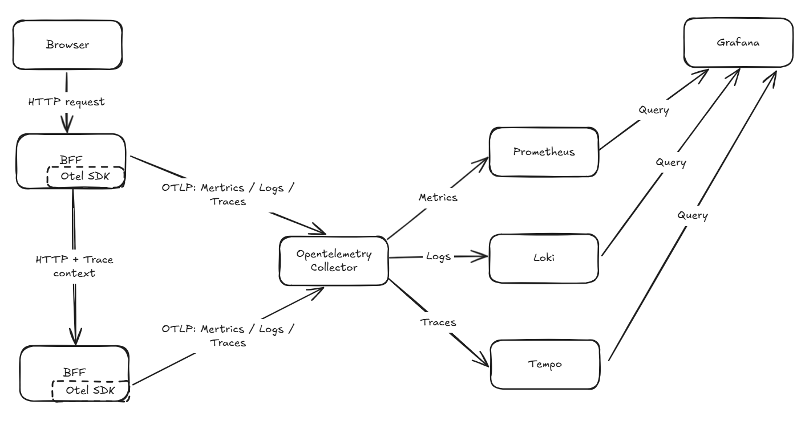

# Day 10 - OpenTelemetry data formats and components

OpenTelemetry (OTel) is an open-source observability framework for generating, collecting, and exporting metrics, logs, and traces. It does not store data or provide dashboards; Prometheus, Loki, Jaeger, and various SaaS backends still handle data storage, while Grafana handles queries and visualization. OTel provides shared data formats, field names, and transport mechanisms so applications do not each have to depend on a specific vendor's SDK.

## How a request and its telemetry flow

We will continue using the Todo system as our example. In earlier articles, we configured the Ingress to route `/api` directly to `todo-api`. This time, to verify Trace Context propagation across services, we add a `todo-bff` service between the web entry point and the API: the browser calls the BFF first, and the BFF then calls `todo-api` over HTTP. For now, this BFF only forwards requests to the Todo API; it is not intended to add another layer of business logic. It gives us a real service-to-service call so we can check whether the trace for a single request connects the BFF to the API.

Todo data currently lives in the API process's memory, so this flow has no database calls or database spans. Both the BFF and `todo-api` also send the metrics, logs, and traces generated during execution to the OpenTelemetry Collector using the OpenTelemetry Protocol (OTLP). After processing the data, the Collector forwards it to the respective backends.



The Collector does not handle the HTTP requests that the BFF sends to `todo-api`. It receives telemetry that the services send separately. This is why the Collector can help us see a problem when a service encounters an error, but cannot automatically make the failed request succeed.

## How Trace Context propagates across services

A request's trace consists of multiple spans. The BFF creates a span when it handles an HTTP request; when it calls `todo-api`, `todo-api` creates another span. The business logic for creating a Todo also creates a `todo.create` span. These spans share the same `trace ID`, allowing the backend to arrange them into a single call path.

The BFF does not send the entire trace to `todo-api`. Instead, it writes the current context into an HTTP header. After reading this context, `todo-api` attaches its server span beneath the HTTP client span created when the BFF calls the API. By default, OTel uses the `traceparent` header defined by W3C Trace Context; common HTTP instrumentation libraries can inject and read this header automatically.

```text
Trace ID: 4bf92f3577b34da6a3ce929d0e0e4736

Parent span passed in by the browser
└─ todo-bff：POST /api/{**path}       # server span
   └─ todo-bff → todo-api：POST       # HTTP client span
      └─ todo-api：POST /api/todos    # server span
         └─ todo.create               # Custom business span in the API
```

The BFF creates a server span after receiving a request. When it calls `todo-api`, `HttpClient` creates a client span and writes that client span's ID into the outgoing request's `traceparent`. The API's server span therefore becomes a child of the client span, not a direct child of the BFF's server span.

If the context is not propagated, the BFF and `todo-api` will still each produce a trace, but the backend will treat them as two unrelated requests. During verification, check separately that spans are created and that context propagates across services.

## What the API, SDK, OTLP, and Collector each do

OTel separates how an application generates telemetry from where that data is sent:

| Component | Role | Use in the Todo system |
| --- | --- | --- |
| API | Provides programming interfaces for creating spans, metrics, and logs | Applications use the same interfaces to record business events |
| SDK | Implements the API and handles sampling, processing, and exporting | The BFF and `todo-api` configure resources and exporters at startup |
| Instrumentation library | Generates telemetry for common packages such as HTTP frameworks and database clients | Creates common spans, such as HTTP spans |
| Semantic Conventions | Defines the names and meanings of common operations and attributes | Ensures different services use the same fields for HTTP methods, routes, and status codes |
| OTLP | Defines telemetry data formats and transport mechanisms | The communication protocol between applications and the Collector |
| Collector | Receives, processes, and forwards telemetry | Handles retries, batching, sensitive-data redaction, and backend connection settings |

Instrumentation can start in two places. If the HTTP framework or database client you use is already supported, adding the corresponding instrumentation library usually gives you data such as HTTP requests and SQL calls. This is a suitable way to establish basic observability for a service.

Other information is known only to the application. For example, "creating a Todo was rejected because the title did not meet the rules" is not an event that an HTTP framework can identify. You need to explicitly create a span, log, or metric in the code. Automatic instrumentation and code instrumentation can be used together: the former handles shared components, while the latter adds business meaning.

## Use consistent fields for service names, environments, and versions

Having the same OTel data format does not mean field contents will be consistent. Fields such as the HTTP method, route, and database operation in `todo-api` can follow Semantic Conventions; service names, deployment environments, and versions should be expressed as resource attributes.

Resource attributes describe the service or workload that generates telemetry and are usually determined at application startup. Routes, response statuses, and error types that vary with each HTTP request are attributes of spans, metric datapoints, or log records.

The Todo system's BFF and API both configure the following resource attributes at startup and send telemetry to the Collector over OTLP:

```yaml
# Resource attributes for todo-api; todo-bff uses its own service.name
service.name: todo-api
service.namespace: todo
service.version: "0.1.0"
deployment.environment.name: staging
```

| Field | Purpose |
| --- | --- |
| `service.name` | Query metrics, logs, and traces for the same service, such as `todo-api`. Set it explicitly to prevent the SDK from using `unknown_service`. |
| `service.namespace` | Distinguish logical groups of services; it does not have to match the Kubernetes Namespace. |
| `service.version` | Compare error rates and latency across deployed versions. |
| `deployment.environment.name` | Distinguish staging from other environments to avoid mixing their data. |

`trace_id` is an identifier generated for each request. It should appear in the trace and related logs, and must not be used as a resource attribute or metric label. Metrics should only use fields with a finite set of values, such as service names, environments, normalized routes, and status codes; keep request IDs, user IDs, and raw URL paths in traces or logs.

Request bodies, the `Authorization` header, tokens, email addresses, and Todo contents should not be written to telemetry. Filtering in the Collector is the last line of defense. To keep this data out of centralized backends, the application itself must avoid generating it.

## The Collector keeps shared settings in one place

In small or local environments, applications can send telemetry directly to backends. As the number of services grows, however, each service has to configure its own retries, batching, sensitive-field filtering, and backend endpoints for metrics, logs, and traces. These settings can easily drift apart.

The Collector receives telemetry in OTLP and other formats, processes or filters it, and forwards it to one or more backends. Applications only need to configure an OTLP endpoint; they do not need to know the connection details for Prometheus, Loki, or the tracing backend.

The Collector can remove sensitive attributes before forwarding data, but that does not mean applications can write sensitive data into spans or logs in the first place. Applications must avoid creating unnecessary data, and the Collector must then inspect and filter it. Both are necessary.

An OTLP response only indicates whether a single transfer between two adjacent nodes was accepted. For example, a successful response from the Collector to an application does not establish that the data has been written to the final backend. Transfers from the Collector to backends still need to be handled separately.

## Next: configure the Collector pipeline

The next article will build on the data flow defined here to configure the Collector's receivers, processors, and exporters. Applications will send data to an OTLP receiver, after which the Collector will handle memory protection, common attributes, sensitive fields, and batch forwarding in sequence.

## Further reading

- [OpenTelemetry documentation: What is OpenTelemetry?](https://opentelemetry.io/docs/what-is-opentelemetry/)
- [OpenTelemetry documentation: Context propagation](https://opentelemetry.io/docs/concepts/context-propagation/)
- [OpenTelemetry documentation: Resources](https://opentelemetry.io/docs/concepts/resources/)
- [OpenTelemetry documentation: Collector](https://opentelemetry.io/docs/collector/)
