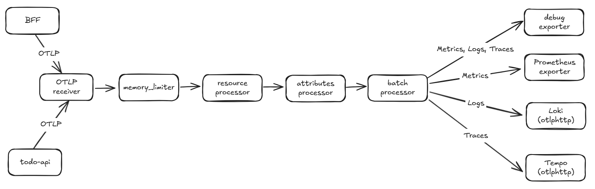

# Day 11 - Deploying and configuring the OpenTelemetry Collector

Today we'll try deploying an OpenTelemetry Collector Gateway. Services only need to send metrics, logs, and traces to a single OTLP endpoint. The Collector then adds platform fields, removes specified sensitive attributes, batches the data, and routes it by signal type. Prometheus scrapes metrics, logs go to Loki, and traces go to Tempo. We also keep the `debug` exporter so we can inspect what the Collector actually receives in a controlled test environment.

## Receiving OTLP from services through a Gateway

There are three common ways to deploy the Collector:

| Mode | Kubernetes deployment | Suitable data |
| --- | --- | --- |
| Agent | One `DaemonSet` per node | Host-local data such as container logs and node information |
| Gateway | A centralized `Deployment` | OTLP data sent by applications |
| Hybrid | Agents forward data to a Gateway | Environments where both node data and application telemetry need centralized processing |

The Todo system's services send OTLP data themselves, so we'll start with a Gateway. This configuration creates a `Deployment` and uses a `Service` to expose OTLP/gRPC on port `4317` and OTLP/HTTP on port `4318`.



The `Service` only delivers data to the Collector Pod. Once data enters the Collector, it passes through the receiver, processors, and exporters in the order listed in `service.pipelines`. Declaring a processor in the configuration file is not enough; it must be included in a pipeline to run.

## Creating the Namespace and Collector configuration

First, create a separate Namespace:

```yaml
apiVersion: v1
kind: Namespace
metadata:
  name: observability
```

Next, create `otel-collector-config.yaml`. The OTLP receiver enables both gRPC and HTTP. Each of the three signals has its own pipeline, with the same processing order.

```yaml
apiVersion: v1
kind: ConfigMap
metadata:
  name: otel-collector-config
  namespace: observability
data:
  config.yaml: |
    extensions:
      health_check:
        endpoint: 0.0.0.0:13133

    receivers:
      otlp:
        protocols:
          grpc:
            endpoint: 0.0.0.0:4317
          http:
            endpoint: 0.0.0.0:4318

    processors:
      memory_limiter:
        check_interval: 1s
        limit_mib: 192
        spike_limit_mib: 64
      resource/platform:
        attributes:
          - key: platform.name
            value: todo-platform
            action: upsert
      attributes/remove-sensitive:
        actions:
          - key: enduser.id
            action: delete
          - key: authorization
            action: delete
          - key: http.request.header.authorization
            action: delete
      batch:
        timeout: 5s
        send_batch_size: 1024

    exporters:
      debug:
        verbosity: detailed
      prometheus:
        endpoint: 0.0.0.0:8889
        resource_to_telemetry_conversion:
          enabled: true
      otlphttp/tempo:
        endpoint: http://tempo.observability.svc:4318
      otlphttp/loki:
        endpoint: http://loki.observability.svc:3100/otlp

    service:
      extensions: [health_check]
      pipelines:
        traces:
          receivers: [otlp]
          processors: [memory_limiter, resource/platform, attributes/remove-sensitive, batch]
          exporters: [debug, otlphttp/tempo]
        metrics:
          receivers: [otlp]
          processors: [memory_limiter, resource/platform, attributes/remove-sensitive, batch]
          exporters: [debug, prometheus]
        logs:
          receivers: [otlp]
          processors: [memory_limiter, resource/platform, attributes/remove-sensitive, batch]
          exporters: [debug, otlphttp/loki]
```

`memory_limiter` limits intake based on the Collector's available memory to prevent a large volume of telemetry from causing the Pod to restart due to insufficient memory. `resource/platform` adds `platform.name=todo-platform` to the resource attributes of each data item. `attributes/remove-sensitive` removes the listed fields before handing data to the exporters, and `batch` combines the processed data before sending it. All three pipelines use the same processor order, but traces, metrics, and logs use different exporters.

The Prometheus exporter exposes a metrics endpoint on `:8889`, which Prometheus scrapes. The Collector actively sends logs and traces to Loki and Tempo over OTLP/HTTP. The `otlphttp/loki` endpoint uses `/otlp` as its base path, and the logs pipeline appends `/v1/logs`, sending data to `http://loki.observability.svc:3100/otlp/v1/logs`. Loki therefore needs a version and configuration that support native OTLP logs. The `debug` exporter only lets us inspect processed content; it cannot replace a backend that stores data and supports queries.

## Deploying the Collector and Service

The following manifest mounts the configuration file in the Collector container and exposes both OTLP ports. The health check is only for Kubernetes probes; it has no Service port for other Pods to access.

```yaml
apiVersion: apps/v1
kind: Deployment
metadata:
  name: otel-collector
  namespace: observability
spec:
  replicas: 1
  selector:
    matchLabels:
      app: otel-collector
  template:
    metadata:
      labels:
        app: otel-collector
    spec:
      securityContext:
        runAsNonRoot: true
        seccompProfile:
          type: RuntimeDefault
      containers:
        - name: otel-collector
          image: otel/opentelemetry-collector:0.161.0
          args:
            - --config=/conf/config.yaml
          ports:
            - name: otlp-grpc
              containerPort: 4317
            - name: otlp-http
              containerPort: 4318
            - name: health
              containerPort: 13133
            - name: prometheus
              containerPort: 8889
          resources:
            requests:
              cpu: 100m
              memory: 128Mi
            limits:
              cpu: 500m
              memory: 256Mi
          readinessProbe:
            httpGet:
              path: /
              port: health
          livenessProbe:
            httpGet:
              path: /
              port: health
            initialDelaySeconds: 10
          securityContext:
            allowPrivilegeEscalation: false
            capabilities:
              drop:
                - ALL
            readOnlyRootFilesystem: true
            runAsUser: 10001
            runAsGroup: 10001
          volumeMounts:
            - name: config
              mountPath: /conf
              readOnly: true
      volumes:
        - name: config
          configMap:
            name: otel-collector-config
---
apiVersion: v1
kind: Service
metadata:
  name: otel-collector
  namespace: observability
spec:
  selector:
    app: otel-collector
  ports:
    - name: otlp-grpc
      port: 4317
      targetPort: otlp-grpc
    - name: otlp-http
      port: 4318
      targetPort: otlp-http
    - name: prometheus
      port: 8889
      targetPort: prometheus
```

Apply the three files in order:

```bash
kubectl apply -f namespace.yaml
kubectl apply -f otel-collector-config.yaml
kubectl apply -f otel-collector.yaml

kubectl rollout status deployment/otel-collector -n observability
kubectl get deployment,service -n observability
```

Applications inside the cluster can use these endpoints:

```text
otel-collector.observability.svc:4317
http://otel-collector.observability.svc:4318
otel-collector.observability.svc:8889
```

## Sending a test trace and checking the results

First, check the health check endpoint:

```bash
kubectl port-forward deployment/otel-collector 13133:13133 -n observability
curl --fail http://127.0.0.1:13133/
```

Next, install the official `telemetrygen` tool and send one trace to the Collector. If you run the command outside the cluster, open another terminal to forward the gRPC port:

```bash
kubectl port-forward service/otel-collector 4317:4317 -n observability
```

```bash
go install github.com/open-telemetry/opentelemetry-collector-contrib/cmd/telemetrygen@latest
$(go env GOPATH)/bin/telemetrygen traces \
  --otlp-insecure \
  --otlp-endpoint 127.0.0.1:4317 \
  --service todo-api \
  --traces 1
```

Check the Collector logs:

```bash
kubectl logs deployment/otel-collector -n observability
```

The `debug` exporter's output should include `service.name: todo-api` and `platform.name: todo-platform`. If the application or test tool sends `enduser.id`, `authorization`, or `http.request.header.authorization`, those attributes should not appear in the output. After checking this content, query the same batch of data in Prometheus, Loki, and Tempo. This verifies that the exporters connect to working backends, rather than only confirming that data reaches the Collector.

The `debug` exporter's output may itself contain telemetry content, so it is only suitable for controlled development environments. Real services should still avoid writing passwords, tokens, email addresses, the `Authorization` header, or Todo content into telemetry.

## Next: connecting traces across services

The Collector can now receive and process telemetry, but BFF and `todo-api` still need to propagate `traceparent` correctly so the backend can treat spans from both services as part of the same request. The next article will start with this HTTP context propagation to build a trace across services.
