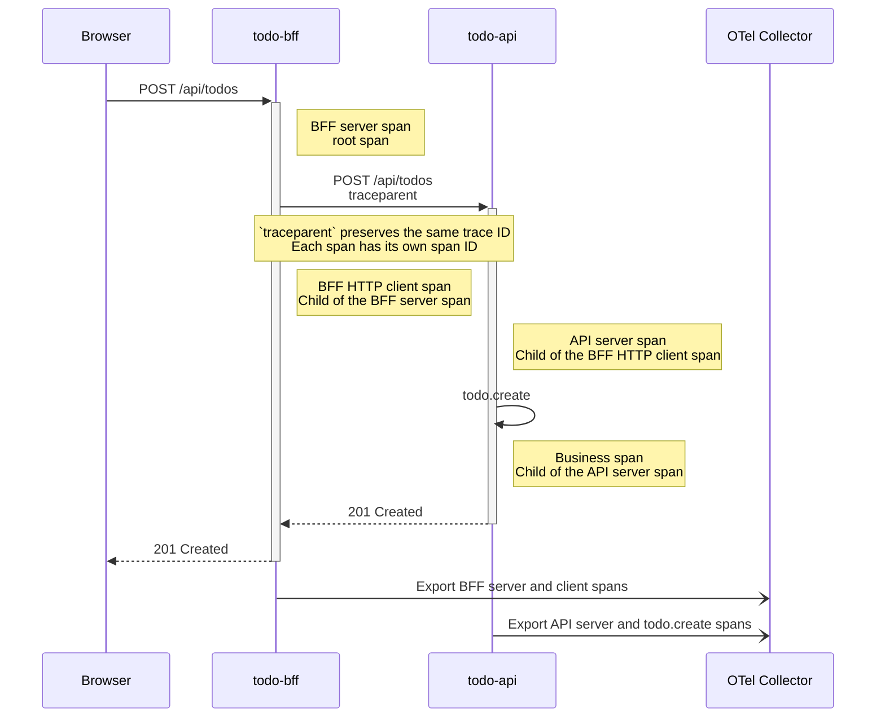

# Day 12 - Finding microservice bottlenecks with distributed tracing

## Why one operation spans several services

In the previous post, we got the OpenTelemetry Collector receiving data, but the Collector cannot tell whether the two HTTP requests involved when the BFF calls `todo-api` belong to the same operation. Suppose a user adds a todo item and waits two seconds for the screen to respond.

The BFF and `todo-api` each have a log entry. Looking at timestamps alone, it is hard to tell whether that time went into forwarding the request, API logic, or resources further downstream.

Distributed tracing connects this operation through a single trace. Each span in the trace represents a piece of work and records its start time, end time, name, status, and parent-child relationships. This example starts with the path from the browser through the BFF to `todo-api`. Todo data currently lives in memory, with no database, so we will not pretend there is a database span.



If context propagates correctly, this trace will contain a BFF server span, an HTTP client span for the BFF's call to the API, and the API's server span. `todo.create` is an additional business span created by the API to mark the section of code that creates a todo item. Finding the longest span gives us enough clues to decide which layer to investigate next.

## `traceparent` connects services

By default, services pass the current tracing state through the `traceparent` HTTP header defined by the W3C Trace Context specification. It is a hexadecimal string separated by hyphens (`-`), with four parts in the standard format:

```text
traceparent: 00-4bf92f3577b34da6a3ce929d0e0e4736-00f067aa0ba902b7-01
             |  |                                |                |
      Version-  Trace ID                         - Parent ID      - Trace Flags
```

The parts mean the following:

- Version (00): The current W3C specification version, fixed at 00 (1 byte).
- Trace ID (4bf9...4736): The globally unique identifier for the entire trace (16 bytes). This ID travels from the BFF through the API to the database, and all related spans share it.
- Parent ID (00f0...02b7): The span ID that initiated this request (8 bytes). When the BFF calls the API, this field contains the BFF's client span ID. The API uses it as its parent when it receives the request, establishing the precise parent-child hierarchy.
- Trace Flags (01): The control state of this trace (1 byte). The most common value is 01, which means the request is sampled. Downstream services that see 01 also record spans and export them to the Collector; 00 means not to record them, saving resources.

When an entry point receives a request without `traceparent`, instrumentation creates a new root span. When the BFF receives a valid header, it creates its own server span using the header's `trace-id`. When the BFF then calls `todo-api`, `HttpClient` instrumentation writes the current context into the outgoing request. The API's ASP.NET Core instrumentation reads the header and creates a child span within the same trace.

There is no need to assemble the header yourself. ASP.NET Core and `HttpClient` already cover these two HTTP boundaries. Handling it manually makes it easier to miss the format, sampling flags, or context.

Message queues, background workers, gRPC, and asynchronous work you handle yourself are a different matter. When introducing them, test separately that propagation is complete.

`traceparent` only passes tracing relationships; it cannot authenticate identity. Baggage is another W3C standard used alongside Trace Context to pass application-defined key-value information between services. It also travels downstream with requests, so passwords, JWTs, email addresses, usernames, and unvalidated input should never go in it.

## Export traces from the BFF and API

Both services use the same resource attributes so the backend can query by service, version, and environment. Their OTLP endpoints both point to the Collector's gRPC service.

```yaml
env:
  - name: OTEL_SERVICE_NAME
    value: todo-bff
  - name: OTEL_SERVICE_VERSION
    value: "0.1.0"
  - name: DEPLOYMENT_ENVIRONMENT
    value: development
  - name: OTEL_EXPORTER_OTLP_ENDPOINT
    value: http://otel-collector.observability.svc:4317
```

The BFF registers ASP.NET Core and `HttpClient` instrumentation. The API registers ASP.NET Core instrumentation and adds its custom `ActivitySource` to the tracing provider. The `serviceName`, `serviceVersion`, and `deploymentEnvironment` below are read from the respective environment variables declared in the YAML above. If they are unset, the code uses the service's defaults.

```csharp
builder.Services.AddOpenTelemetry()
    .ConfigureResource(resource => resource
        .AddService(serviceName: serviceName, serviceVersion: serviceVersion)
        .AddAttributes([
            new KeyValuePair<string, object>("service.namespace", "todo"),
            new KeyValuePair<string, object>(
                "deployment.environment.name", deploymentEnvironment)
        ]))
    .WithTracing(tracing => tracing
        .AddAspNetCoreInstrumentation()
        .AddHttpClientInstrumentation()
        .AddOtlpExporter());
```

`todo-api` also creates a `todo.create` activity in the handler that creates a todo:

```csharp
using var activity = activitySource.StartActivity("todo.create");

if (string.IsNullOrWhiteSpace(request.Title))
{
    activity?.SetStatus(ActivityStatusCode.Error, "Todo title is empty.");
    return Results.ValidationProblem(new Dictionary<string, string[]>
    {
        ["title"] = ["The todo title must not be blank."]
    });
}
```

Manual spans like this are useful for business logic that instrumentation cannot see. Do not set the full todo contents, email addresses, or the `Authorization` header as tags. Traces are usually exported to a centralized backend, so fields used to describe a problem should have low sensitivity and low cardinality.

## Verify context propagation with a fixed trace ID

After deploying the Collector, BFF, and API, first forward the BFF service's port:

```bash
kubectl port-forward service/todo-bff 8080:8080 -n todo
```

Send a create-todo request from another terminal. We specify a fixed trace ID here to make it easy to find the same trace in the Collector logs:

```bash
curl --fail \
  -H 'content-type: application/json' \
  -H 'traceparent: 00-4bf92f3577b34da6a3ce929d0e0e4736-00f067aa0ba902b7-01' \
  --data '{"title":"trace-test"}' \
  http://127.0.0.1:8080/api/todos
```

Then check the Collector:

```bash
kubectl logs deployment/otel-collector -n observability
```

The `debug` exporter should output the same `Trace ID`, `4bf92f3577b34da6a3ce929d0e0e4736`, with `todo-bff`'s server and client spans and `todo-api`'s server and `todo.create` spans. If the BFF and API show different trace IDs, first check whether the BFF really calls the API through `HttpClient`, whether the services have the corresponding instrumentation enabled, and whether the Collector endpoint is reachable.

You cannot simply add span durations together. The BFF server span already includes the time spent waiting for the downstream API to respond. To find a bottleneck, compare spans at the same level or find the child span that actually takes the longest. Database operations will only appear as child spans in this trace after you add database client instrumentation.

In the next post, we will put these traces alongside metrics and logs in a single query interface, so troubleshooting does not have to rely solely on Collector logs.
