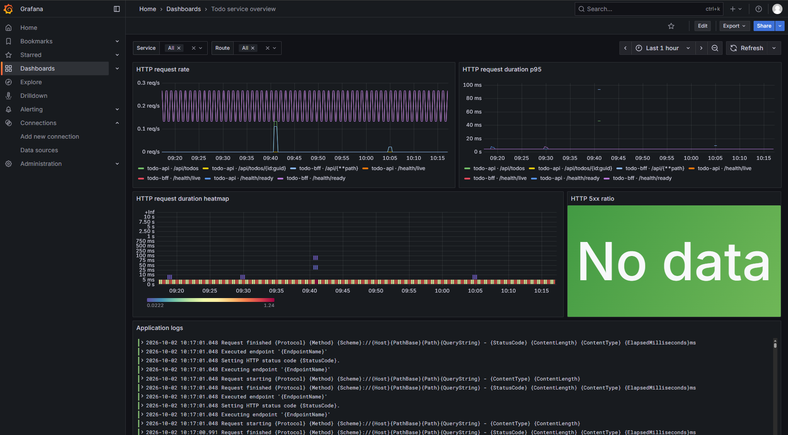
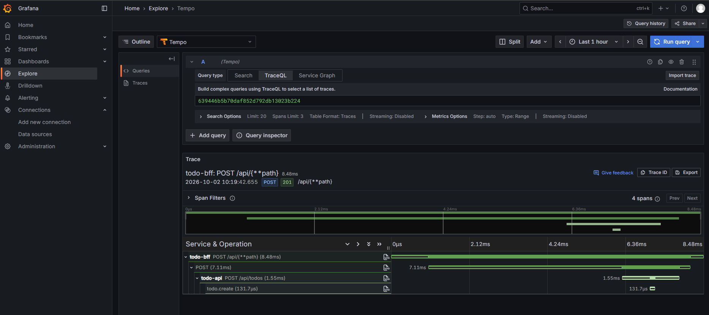

# Day 13 - Viewing Prometheus, Loki, and trace data in Grafana

The previous post connected a Create Todo request into a single trace. Searching the Collector's `debug` log for the `Trace ID` only confirms that the data arrived. To find out when latency started and which service it affects, we still need time series and a query interface.

This post deploys Prometheus, Loki, Tempo, and Grafana to give the Todo system's metrics, logs, and traces a consistent place to query them. The setup deliberately uses a single replica and stores data in `emptyDir`, making it suitable for validating data flow locally or in a test cluster. Data disappears when a Pod is recreated, so this storage design cannot be used as is in production.

## Sending the three signal types to separate backends through the Collector

The Todo API and BFF send OTLP data to the Collector. The Collector routes metrics, logs, and traces to different backends by signal type:

* Prometheus: The Collector's Prometheus exporter exposes metrics on `:8889`, and Prometheus scrapes them every 15 seconds. To let the dashboard filter by service name, the exporter converts resource attributes into Prometheus labels (for example, `service.name` becomes `service_name`).
* Loki: Loki supports OTLP logs natively, and the Collector sends logs to its `/otlp` endpoint. Use only stable fields such as `service.name` or the environment as labels. Avoid turning `trace_id`, Todo titles, the `Authorization` header, or user data into labels.
* Tempo: Tempo stores complete traces so we can inspect the relationships between BFF and API spans.

## Provisioning Grafana datasources and a dashboard

Grafana loads three datasources at startup. The dashboard uses Kubernetes Service names, so it does not need the actual Pod IP addresses in the cluster:

```yaml
datasources:
  - name: Prometheus
    uid: prometheus
    type: prometheus
    url: http://prometheus.observability.svc:9090
  - name: Loki
    uid: loki
    type: loki
    url: http://loki.observability.svc:3100
  - name: Tempo
    uid: tempo
    type: tempo
    url: http://tempo.observability.svc:3200

```

This configuration also connects Tempo's Trace-to-Logs to Loki. When you click Logs on the trace details page, Grafana passes in `service.name` and the Trace ID. Whether the query finds any data still depends on whether the application actually emitted the corresponding logs.

The first dashboard focuses on four things related to Create Todo: HTTP request rate, HTTP request duration p95, HTTP 5xx ratio, and application logs.

Both `service` and `route` are dashboard variables. The following PromQL is used by the p95 panel. `http_route` is the normalized route supplied by ASP.NET Core instrumentation, so each Todo ID does not become a new time series:

```promql
histogram_quantile(
  0.95,
  sum by (le, http_route) (
    rate(
      http_server_request_duration_seconds_bucket{
        service_name=~"$service",
        http_route=~"$route"
      }[$__rate_interval]
    )
  )
)

```

The 5xx ratio is calculated from the same counter, without putting `trace_id` or request IDs into metric labels:

```promql
sum(
  rate(
    http_server_request_duration_seconds_count{
      service_name=~"$service",
      http_route=~"$route",
      http_response_status_code=~"5.."
    }[$__rate_interval]
  )
)
/
sum(
  rate(
    http_server_request_duration_seconds_count{
      service_name=~"$service",
      http_route=~"$route"
    }[$__rate_interval]
  )
)

```

The dashboard JSON saves these panels, variables, and datasource UIDs together. Its title after import is `Todo service overview`, and there is no need to create the panels manually:

```json
{
  "title": "Todo service overview",
  "uid": "todo-service-overview",
  "templating": {
    "list": [
      {
        "name": "service",
        "definition": "label_values(http_server_request_duration_seconds_count, service_name)"
      },
      {
        "name": "route",
        "definition": "label_values(http_server_request_duration_seconds_count{service_name=~\"$service\"}, http_route)"
      }
    ]
  }
}

```

## Generating data and querying it in Grafana

First, confirm that the Collector, Prometheus, Loki, Tempo, and Grafana are all ready:

```bash
kubectl get deployment -n observability

```

Expose Grafana locally:

```bash
kubectl port-forward service/grafana 3000:3000 -n observability

```

Open `[http://127.0.0.1:3000](http://127.0.0.1:3000)` in your browser and sign in with the test environment credentials, `admin` / `admin`. Open `Todo service overview` and select `todo-api` or `todo-bff` first. If there is no data, confirm that the services actually have their OTLP endpoints pointed at the Collector, and wait at least one 15-second scrape interval.

Next, forward the BFF service port and create a few test records:

```bash
kubectl port-forward service/todo-bff 8080:8080 -n todo

```

```bash
for title in trace-one trace-two trace-three; do
  curl --fail \
    -H 'content-type: application/json' \
    --data "{\"title\":\"$title\"}" \
    http://127.0.0.1:8080/api/todos
done

```

Return to the dashboard and select `todo-api` and `/api/todos`. The request rate will show POST traffic. Because `todo-api` writes `Todo created.` when creating a Todo, the Application logs panel should show three events in the same time window (the example does not write Todo titles to the log). The p95 and 5xx ratio calculations use `rate()`. With only a few scattered requests, p95 may temporarily have no value. Send more requests or widen the dashboard's time range before interpreting the results. When there are no 5xx responses, the 5xx ratio has no series to display; this does not mean the query failed.

The image below shows a simple dashboard I put together.



## Opening a trace in Grafana

The dashboard uses metrics to identify the scope of the impact, while a trace breaks down the time spent on a single request. Select the Tempo datasource in Grafana Explore and use TraceQL to find traces for `todo-api`:

```traceql
{ resource.service.name = "todo-api" }

```

Select a trace from the requests you just created. You should see the `todo-bff` HTTP server span, the HTTP client span for the BFF's call to the API, the `todo-api` HTTP server span, and the `todo.create` activity. All four share the same Trace ID. When you click Trace-to-Logs, Grafana asks Loki to query logs for the same service and Trace ID.



Todo data is currently stored in memory, so there are no database spans in the trace. This is not missing data in the dashboard. Once a database is actually connected, we will need to extend the design to cover database client instrumentation, query fields, and retention policies.

## Limitations of this setup

Prometheus, Loki, Tempo, and Grafana each run as a single Pod here, without persistent volumes. Their purpose is to confirm that OpenTelemetry data can be received, stored, and queried. This setup does not address production capacity, HA, retention, account permissions, or backups.

The dashboard also only displays the HTTP metrics and `Todo created.` logs that the current services actually produce. Without telemetry for a database, deployment versions, or GitOps revisions, we cannot add panels just to make the dashboard look complete. Once those data sources are added, we can have the dashboard answer the corresponding questions.

I could not connect to the K8s environment while back home for the Mid-Autumn Festival, so I left the test screenshots for another day (now added). The next post will put the checks that code should pass before merging into CI, to keep changes that do not build or fail tests from entering the delivery pipeline.
