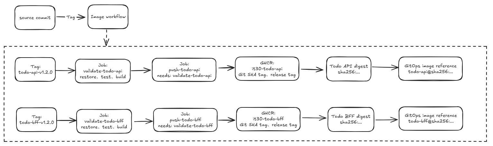
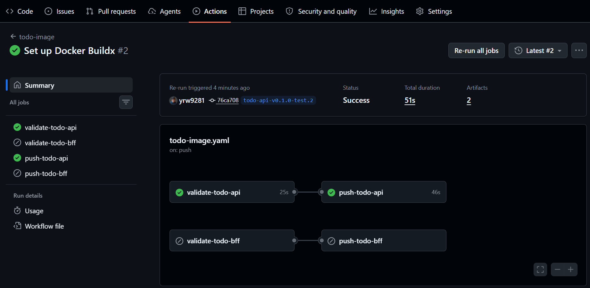
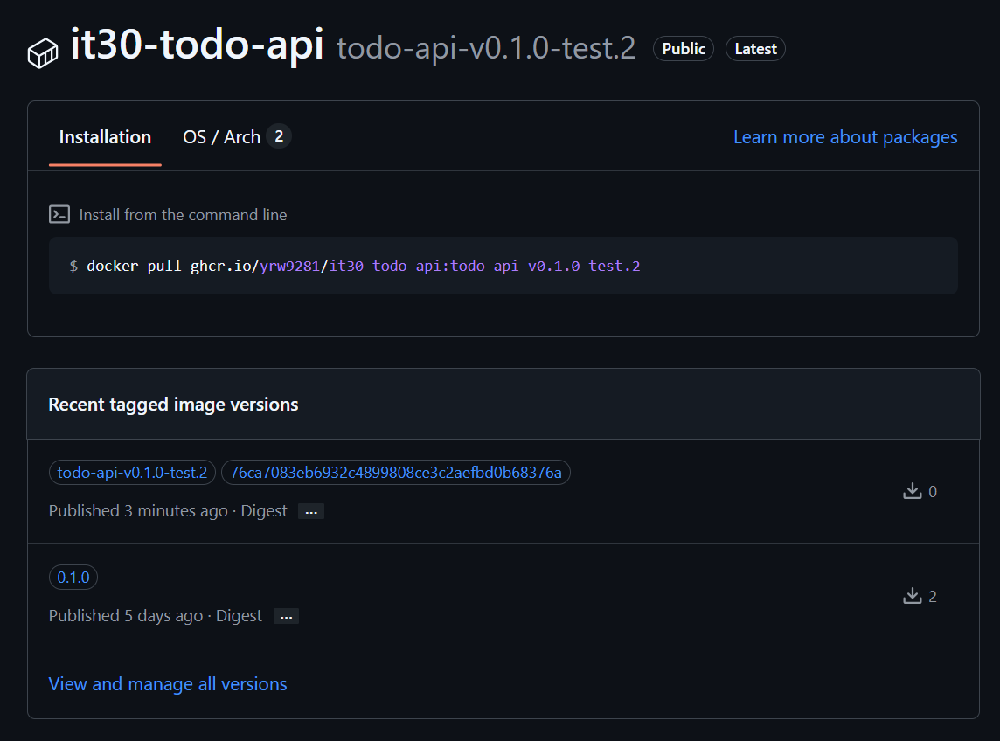

# Day 15 - Building Docker images in CI and managing tags

## From source code that passes checks to a deployable image

The Day 14 Pull Request (PR) CI runs restore, test, and build for `Todo.Api` and `Todo.Bff`. Passing those checks does not make the code ready to hand off to GitOps: a Kubernetes `Deployment` needs a container image it can pull.

Once the image is built, identifying its version becomes an immediate concern. If someone says Production is running `todo-api:v1.2.0`, we still do not know whether the current container contains exactly what was checked earlier. Tags in a container registry can be repointed; `v1.2.0`, Git SHA tags, and even `latest` are not immutable content identifiers.

This article uses the service name as a release tag prefix. Creating `todo-api-v1.2.0` makes GitHub Actions build and push only `Todo.Api`; creating `todo-bff-v1.2.0` triggers the work for `Todo.Bff`. The workflow retains the release tag, the source commit's SHA tag, and the image digest so that subsequent GitOps changes can select the exact content to deploy.

## Use tags for lookup and digests for deployment

The same image can have several tags, but tags and digests have different uses:

| Identifier | Main use | Can the content change? |
| --- | --- | --- |
| Release tag, such as `todo-api-v1.2.0` | Release notes, version communication, and selecting the service to publish | Yes |
| Git SHA tag, such as `a1b2c3d` | Tracing an image back to its source revision | Yes |
| Digest, such as `sha256:...` | Specifying the exact image manifest at deployment time | No |

Git SHA tags and release tags are human-readable lookup references; both can still be pushed again. Deployment configuration should use `image@sha256:...` because the registry calculates the digest from the content. Even if someone later overwrites the same tag, the merged configuration will still point to the image that was originally reviewed.

The diagram below shows this relationship for the Todo API and BFF. Both services can be released from the same source commit, but each has its own release tag, Git SHA tag, and digest. Creating the API's release tag does not also publish the BFF.



## How the existing Dockerfiles produce runtime images

The Todo API and BFF each have a multi-stage Dockerfile. The build stage uses the `.NET SDK` to restore and publish; the final stage switches to an ASP.NET runtime image and copies only the output from `/app/publish`.

Here is the relevant part of the `Todo.Api` Dockerfile:

```dockerfile
FROM mcr.microsoft.com/dotnet/sdk:8.0 AS build
WORKDIR /src
COPY Todo.Api.csproj .
RUN dotnet restore
COPY . .
RUN dotnet publish --configuration Release --output /app/publish

FROM mcr.microsoft.com/dotnet/aspnet:8.0
WORKDIR /app
COPY --from=build /app/publish .
ENV ASPNETCORE_URLS=http://+:8080
EXPOSE 8080
ENTRYPOINT ["dotnet", "Todo.Api.dll"]
```

`Todo.Bff` uses the same stages, with `Todo.Bff.csproj` as its project and `Todo.Bff.dll` as its entry point. The SDK, source code, and NuGet cache are not copied into the final runtime stage. However, a multi-stage build does not handle secrets on its own. Tokens, passwords, and other sensitive values must not be written into build layers through `ARG` or `ENV`.

You can first check locally that both images build:

```bash
docker build \
  -t ghcr.io/yrw9281/it30-todo-api:local \
  src/0-todo-microservices/Todo.Api

docker build \
  -t ghcr.io/yrw9281/it30-todo-bff:local \
  src/0-todo-microservices/Todo.Bff
```

Each command uses its project's directory as the build context, matching `COPY Todo.Api.csproj .` and `COPY Todo.Bff.csproj .` in the Dockerfiles.

## The release workflow validates before pushing to GHCR

The PR workflow keeps `contents: read` and should not have publishing permissions. Publishing is triggered by service-specific release tags: `todo-api-v*` checks and pushes only the API, while `todo-bff-v*` handles only the BFF. This lets the services release and roll back independently, without rebuilding the BFF for an API fix.

```yaml
name: todo-image

on:
  push:
    tags:
      - "todo-api-v*"
      - "todo-bff-v*"

permissions:
  contents: read

jobs:
  validate-todo-api:
    if: startsWith(github.ref_name, 'todo-api-v')
    runs-on: ubuntu-latest
    steps:
      - uses: actions/checkout@v4
      - uses: actions/setup-dotnet@v4
        with:
          dotnet-version: 8.0.x
      - run: dotnet restore src/0-todo-microservices/Todo.Api/Todo.Api.csproj
      - run: dotnet test src/0-todo-microservices/Todo.Api/Todo.Api.csproj --configuration Release --no-restore
      - run: dotnet build src/0-todo-microservices/Todo.Api/Todo.Api.csproj --configuration Release --no-restore

  push-todo-api:
    if: startsWith(github.ref_name, 'todo-api-v') && needs.validate-todo-api.result == 'success'
    needs: validate-todo-api
    runs-on: ubuntu-latest
    permissions:
      contents: read
      packages: write
    steps:
      - uses: actions/checkout@v4
      - uses: docker/setup-buildx-action@v3
      - uses: docker/login-action@v3
        with:
          registry: ghcr.io
          username: ${{ github.actor }}
          password: ${{ secrets.GITHUB_TOKEN }}
      - id: image
        uses: docker/build-push-action@v6
        with:
          context: ./src/0-todo-microservices/Todo.Api
          push: true
          tags: |
            ghcr.io/yrw9281/it30-todo-api:${{ github.sha }}
            ghcr.io/yrw9281/it30-todo-api:${{ github.ref_name }}
          provenance: true
          sbom: true
      - run: 'echo "todo-api digest: ${{ steps.image.outputs.digest }}"'

  validate-todo-bff:
    if: startsWith(github.ref_name, 'todo-bff-v')
    runs-on: ubuntu-latest
    steps:
      - uses: actions/checkout@v4
      - uses: actions/setup-dotnet@v4
        with:
          dotnet-version: 8.0.x
      - run: dotnet restore src/0-todo-microservices/Todo.Bff/Todo.Bff.csproj
      - run: dotnet test src/0-todo-microservices/Todo.Bff/Todo.Bff.csproj --configuration Release --no-restore
      - run: dotnet build src/0-todo-microservices/Todo.Bff/Todo.Bff.csproj --configuration Release --no-restore

  push-todo-bff:
    if: startsWith(github.ref_name, 'todo-bff-v') && needs.validate-todo-bff.result == 'success'
    needs: validate-todo-bff
    runs-on: ubuntu-latest
    permissions:
      contents: read
      packages: write
    steps:
      - uses: actions/checkout@v4
      - uses: docker/setup-buildx-action@v3
      - uses: docker/login-action@v3
        with:
          registry: ghcr.io
          username: ${{ github.actor }}
          password: ${{ secrets.GITHUB_TOKEN }}
      - id: image
        uses: docker/build-push-action@v6
        with:
          context: ./src/0-todo-microservices/Todo.Bff
          push: true
          tags: |
            ghcr.io/yrw9281/it30-todo-bff:${{ github.sha }}
            ghcr.io/yrw9281/it30-todo-bff:${{ github.ref_name }}
          provenance: true
          sbom: true
      - run: 'echo "todo-bff digest: ${{ steps.image.outputs.digest }}"'
```

The workflow uses `github.ref_name` to choose which pair of validation and publishing jobs to run. Although the two sets of steps are similar, each service's job names, project paths, and image repository are listed explicitly, so a reviewer can see directly which service a release tag will affect. `GITHUB_TOKEN` is a short-lived token for the repository workflow. It receives `packages: write` only in jobs that need to push, so there is no need to switch to a long-lived Personal Access Token (PAT).

## Grant the workflow write access to GHCR packages

You do not need to create `GITHUB_TOKEN` manually or store it in a repository secret. GitHub Actions automatically provides this short-lived token for each workflow run, and `packages: write` determines whether the publishing job can use it to push images.

However, giving a workflow `packages: write` does not guarantee that it can write to an existing GHCR package. If `it30-todo-api` or `it30-todo-bff` was previously created using a PAT, another repository, or a different workflow, the package may not have granted access to the current repository. In that case, the build can complete, but the push fails with `denied: permission_denied: write_package`.

If you encounter this error, open the relevant package under Packages on GitHub, then go to Package settings and Manage Actions access. Add `yrw9281/IT30.Platform.Engineering` and grant Write access. If the page offers Repository source or an option to link a repository, link it to the same repository as well. `todo-api` and `todo-bff` are separate packages, so check their permissions individually.

The repository's Settings → Actions → General → Workflow permissions must also be free of restrictions imposed by organization or repository policies. Once you have granted package access, rerun the failed job from the failed Actions run. Only the package permissions on GitHub have changed, so you do not need to create a new release tag.

`provenance: true` and `sbom: true` ask Buildx to create provenance and Software Bill of Materials (SBOM) attestations. These provide build information for later verification, but they do not mean the image has passed a vulnerability scan, nor do they decide which dependency risks are acceptable.

## Use the digest as the promotion handoff

Suppose the workflow produces the following mapping for the API:

```text
source commit: a1b2c3d
release tag:   todo-api-v1.2.0
image tag:     ghcr.io/yrw9281/it30-todo-api:a1b2c3d
image digest:  ghcr.io/yrw9281/it30-todo-api@sha256:******
```

When promoting to Staging or Production, carry over the digest on the last line instead of having the environment resolve `todo-api-v1.2.0` again. A rollback only requires changing the deployment configuration back to a known-good digest; there is no need to rebuild the old source.

The current GHCR manifests still use the `:0.1.0` tag. They let a local or test cluster pull the existing images, but do not yet include GitOps configuration for promotion by digest. The next article will explain how to hand off the digest produced by CI through a reviewable configuration change, rather than having CI call the Kubernetes API directly.

If a GHCR package is private, the cluster must pull the image using its own read-only identity. This credential is separate from CI's `GITHUB_TOKEN`. It should be limited to `read:packages` for the target package and supplied to the workload through an image pull Secret in the target Namespace. The GHCR manifests' README already describes how to create and reference `ghcr-pull-secret`.

## Verify that images and their sources can be traced

After the release workflow finishes pushing, use the tag to inspect the digest reported by the registry:

```bash
docker buildx imagetools inspect \
  ghcr.io/yrw9281/it30-todo-api:todo-api-v1.2.0
```

For acceptance, you should be able to trace a deployed digest back to its image manifest, the corresponding GitHub Actions run, and the source commit. In the other direction, you should also be able to answer whether a given source commit has produced a particular image. If you rely only on tags to guess the version, this delivery chain still lacks an immutable reference.

For example, `todo-api-v0.1.0-test.2` makes GitHub Actions run only `validate-todo-api` and `push-todo-api`. The BFF jobs are skipped, confirming that the release tag did not trigger work for an unrelated service.



After publishing succeeds, GitHub Packages lists the same release tag and source commit SHA tag. People can use these two tags to look up the version; deployment configuration should still use the image's digest.



## Next steps

CI can now produce traceable images, but it should not deploy them directly. The next article will explain how to hand off a digest through a GitOps configuration Pull Request, letting review and Argo CD determine when it enters which environment.
