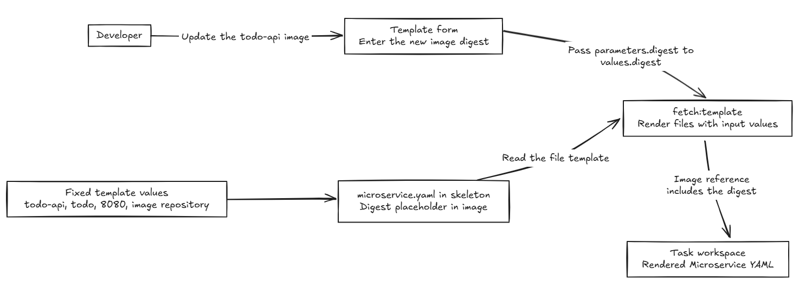
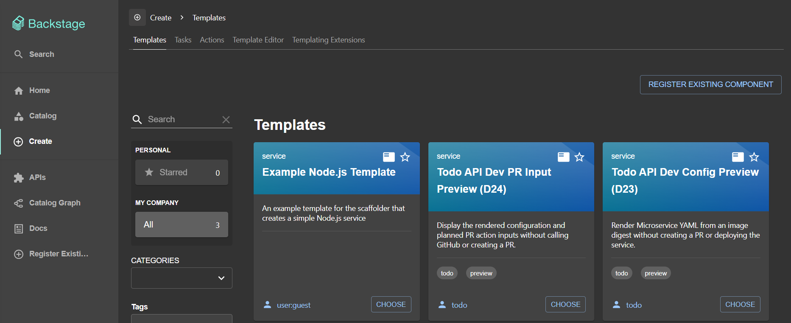
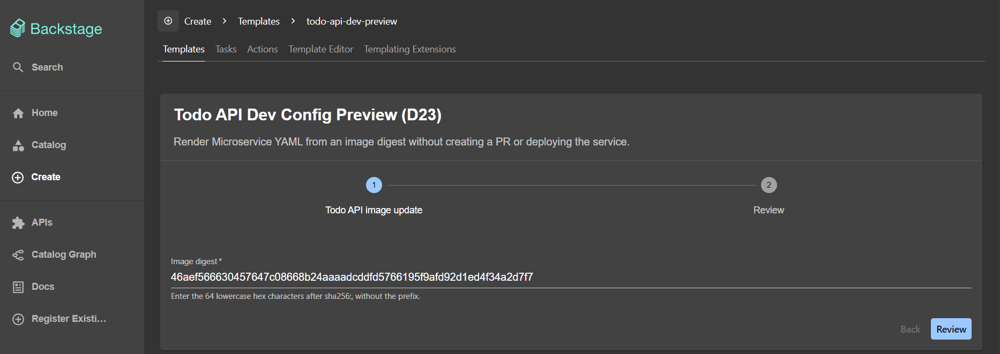
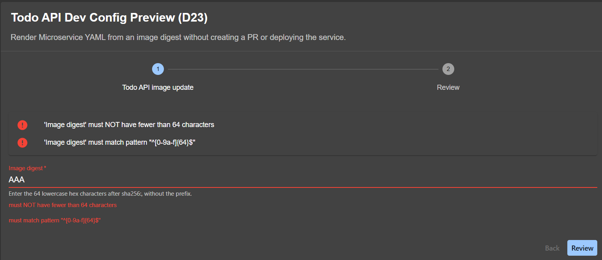
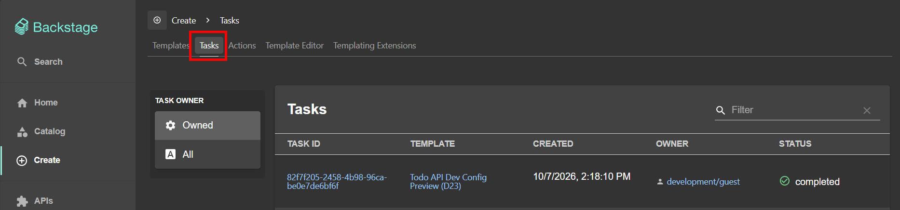
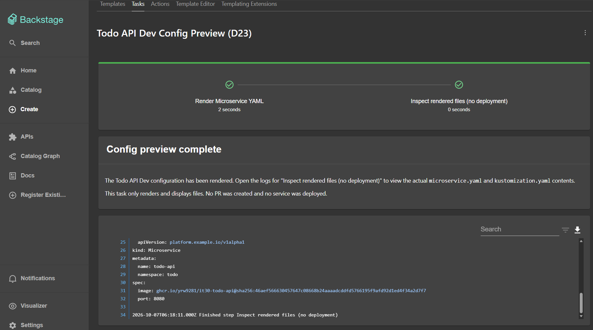

# Day 23 - Collect service settings with Backstage Software Templates

In the previous post, we had the Operator report whether the new version of the Todo API was ready. To update a version, though, developers still have to prepare the `Microservice` YAML first. If all we are changing is the image, while the service name, Namespace, and port stay the same, do we need to fill out the entire configuration again every time?

Day 17 introduced Backstage's Software Catalog and Software Templates: the Catalog helps us find services and the teams responsible for them, while Templates collect input and run specified tasks. Today we will focus on Templates and prepare a version-update template for `todo-api`. Developers will only need to enter the digest produced by CI, and the template will generate the `Microservice` configuration.

## Decide what configuration the template should generate

To reduce repeated input, we will first fix the values that will not change this time: the service is `todo-api`, Dev uses the existing `todo` Namespace, the port is `8080`, and the image repository is `ghcr.io/yrw9281/it30-todo-api`. The new version's digest is the only value we need from the form.

By putting these values in `microservice.yaml` and leaving a variable where the digest belongs, we can reuse this file to generate the configuration for each version update:

```yaml
apiVersion: platform.example.io/v1alpha1
kind: Microservice
metadata:
  name: todo-api
  namespace: todo
spec:
  image: ghcr.io/yrw9281/it30-todo-api@sha256:${{ values.digest }}
  port: 8080
```

`${{ values.digest }}` is the part to replace. When the template runs, it replaces this variable with the string entered by the user. This process is called rendering. After replacement, `spec.image` points to the new digest, while the service name, Namespace, and port keep their original values. A file containing variables cannot be submitted directly to Kubernetes; use the rendered YAML.

The files for this example also include a `kustomization.yaml`, placed alongside `microservice.yaml` in the `skeleton` directory. It lists the resources Kustomize should read and has no values to replace, so it will appear unchanged in the task log after generation:

```yaml
apiVersion: kustomize.config.k8s.io/v1beta1
kind: Kustomization
resources:
  - microservice.yaml
```

Now that we know what to generate, we can define the form and the steps that produce these files.

## Define the form and generation steps in one Template

We want developers to see the generated configuration on the task page after entering a digest. All of this is defined in one `Template`: `spec.parameters` determines what the form collects, `spec.steps` generates the files and displays their contents, and `spec.output` sets the result message shown when the task finishes. Here is the complete `template.yaml` used for this walkthrough:

```yaml
apiVersion: scaffolder.backstage.io/v1beta3
kind: Template
metadata:
  name: todo-api-dev-preview
  title: Todo API Dev Config Preview (D23)
  description: Render Microservice YAML from an image digest without creating a PR or deploying the service.
  tags:
    - todo
    - preview
spec:
  owner: todo
  type: service
  parameters:
    - title: Todo API image update
      required:
        - digest
      additionalProperties: false
      properties:
        digest:
          title: Image digest
          description: "Enter the 64 lowercase hex characters after sha256:, without the prefix."
          type: string
          minLength: 64
          maxLength: 64
          pattern: "^[0-9a-f]{64}$"
  steps:
    - id: render
      name: Render Microservice YAML
      action: fetch:template
      input:
        url: ./skeleton
        values:
          digest: ${{ parameters.digest }}
    - id: inspect
      name: Inspect rendered files (no deployment)
      action: debug:log
      input:
        message: Preview only. No Git changes or Kubernetes writes were performed.
        listWorkspace: with-contents
  output:
    text:
      - title: Config preview complete
        content: |
          The Todo API Dev configuration has been rendered. Open the logs for
          "Inspect rendered files (no deployment)" to view the actual
          `microservice.yaml` and `kustomization.yaml` contents.

          This task only renders and displays files. No PR was created and no service was deployed.
```

The form only collects `digest`, so we use `required` to make it mandatory, then use `minLength`, `maxLength`, and `pattern` to require a string of 64 lowercase hexadecimal characters. `additionalProperties: false` rejects extra parameters, so users cannot specify a Namespace or port by sending an additional parameter.

Since the image in `microservice.yaml` already includes `@sha256:`, the form only needs the 64 characters after `sha256:` in the CI output. Including the prefix would violate the field's length and format requirements and prevent the user from proceeding to create a task.

Once the form input passes validation, the `render` step runs `fetch:template`. This is the Backstage action for reading file templates and filling in variables. `url: ./skeleton` tells it to process the `skeleton` directory next to the template, where we placed `microservice.yaml` and `kustomization.yaml` earlier.

When reading the files, `fetch:template` also retrieves the values in `input.values`. We use `${{ parameters.digest }}` to get the digest from the form and put it in `input.values.digest`, making it available in `microservice.yaml` through `${{ values.digest }}`. The two expressions read from different places: `parameters` contains the form input, while `values` contains the values passed to the file templates.

After generating the files, we still need to see their contents in Backstage, so we follow with the `inspect` step. It runs `debug:log` and uses `listWorkspace: with-contents` to write the filenames and contents from the working directory to the log. This step only displays the files; it does not deploy them.

`output.text` provides the result message after the task finishes. Both `Config preview complete` on the screen and the text below it come from here. They tell users that the configuration has been generated and that they should open the log for `Inspect rendered files (no deployment)` to view its contents.

## How does form input become YAML?

Putting the configuration together: a developer enters a digest, `fetch:template` reads `microservice.yaml` and replaces its variables, then places the generated files in this task's working directory. After this step, the working directory contains a `Microservice` YAML file with the digest filled into the image:



## Preview a configuration in Backstage

The form's field constraints and generation logic use the configuration above. Today's walkthrough only generates files; it does not commit to Git or update the cluster.

The `Create` page in Backstage shows the Templates available to us:



After selecting the template we created today, the only field to fill in is `Image digest`. Paste the digest's 64 lowercase hexadecimal characters, without `sha256:`, then click `Review` to check the input and create the task after confirming. There is no need to re-enter the service name, Namespace, or port here:



If we enter `AAA` and click `Review`, the form reports both that the input is shorter than 64 characters and that it does not match the lowercase hexadecimal format. We stay on this page to correct the input. Only after replacing it with a digest in the required format can we continue to review and create the task:



After the task is created, Backstage runs the steps to generate the files and display their contents in sequence. If we leave the execution screen, we can find this task again through `Tasks` on the page. The `completed` status means the template task has finished; it does not yet mean that the Todo API has been updated:



Open the task and check the log for `Inspect rendered files (no deployment)` to see the actual generated `microservice.yaml`. On the screen, `spec.image` contains the digest from the form, while the service name is still `todo-api`, the Namespace is still `todo`, and the port is still `8080`:



This lets us trace the form input through to the generated files. However, the field constraints only reject input with the wrong length or characters. They do not check whether the image exists or which CI run it came from, so we still need to use the Todo API's CI output when filling in the form.

Today we put the configuration that would otherwise need to be filled in repeatedly for version updates into a template. Developers provide only the digest, and the Template generates the `Microservice` YAML according to its configuration. The next post will handle this generated output: having the template propose changes through a Git Pull Request (PR), pass configuration checks and human review, then enter the deployment source.
