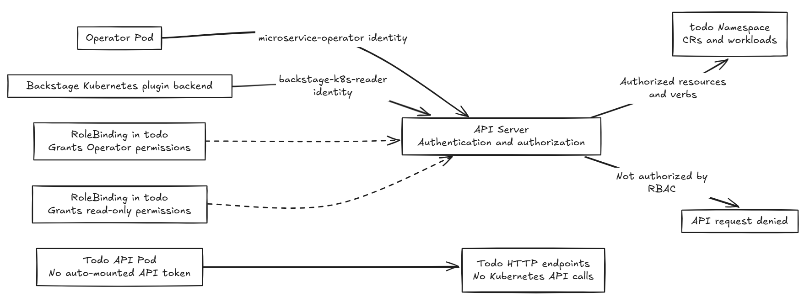

# Day 27 - What Kubernetes RBAC and namespaces can isolate

The previous article let developers check the deployment status of `todo-api` in Backstage. The query backend only needs to read workloads, the Operator needs to update resources, and the Todo API only handles HTTP requests. If they all share administrator credentials, a problem in any component could let it change resources it should not manage. Today, we'll use namespaces and role-based access control (RBAC) to explain how to separate these permissions.

## Namespaces define resource scope without automatically isolating access

Namespaces provide a naming and management scope for most Kubernetes resources. Different namespaces can each have a `Deployment` named `todo-api`, so you need to check the namespace, resource type, and name together when performing operations. This does not automatically restrict API access or prevent Pods from connecting across namespaces.

The Todo dev environment continues to use the `todo` namespace. API authorization still determines who can operate on its resources. `Node`, `Namespace` itself, and Custom Resource Definitions (CRDs) are cluster-scoped resources and do not belong to any namespace.

## Which identity does the API server see?

When the API server receives a request, it authenticates the identity first, then checks authorization. The Operator's Pod uses `serviceAccountName` to select `microservice-operator` in `todo`, whose full identity is `system:serviceaccount:todo:microservice-operator`. A `ServiceAccount` provides an identity; it does not automatically grant management permissions.

Backstage's Pod runs in the `backstage` namespace, but its Kubernetes plugin uses the token for `backstage-k8s-reader` in `todo`. Where the program runs does not determine its API permissions. The namespace containing a `ServiceAccount` does not automatically restrict the scope it can access, either.

The plugin currently uses a shared query identity. It does not turn the person logged into Backstage into a Kubernetes user. Neither the Catalog's `owner: todo` nor the label selector is an authorization rule. Backstage authentication and its permission policy must control who can open a service page.

The Todo API does not need to call the Kubernetes API, so the Operator sets `automountServiceAccountToken: false` on the Pod it generates for the API, preventing automatic mounting of an API token. This does not affect HTTP calls from the BFF and has no bearing on the Operator's own API credentials.

## A `Role` defines rules; a `RoleBinding` grants them to an identity

A `Role` defines API rules within a namespace, including API groups, resources, and verbs. A `RoleBinding` grants those rules to a user, group, or `ServiceAccount`. A `Role` alone, without a corresponding binding, does not grant permissions.

For example, the reader's `RoleBinding` is in `todo` and grants the `Role` to `backstage-k8s-reader`. It allows `get`, `list`, and `watch` on specified resources: reading a single object, retrieving a list, and watching for changes.

A `ClusterRole` can define shared rules or cluster-scoped permissions. The binding determines the actual scope:

| Authorization method | Effective scope |
| --- | --- |
| A `RoleBinding` references a `Role` in the same namespace | The namespace containing the binding |
| A `RoleBinding` references a `ClusterRole` | Resources in the namespace containing the binding; this does not grant permissions on cluster-scoped resources |
| A `ClusterRoleBinding` references a `ClusterRole` | Resources covered by the rules; namespace-scoped rules apply across all namespaces |

A `ClusterRole` does not necessarily grant administrator permissions; it can define read-only rules. RBAC permissions are additive, with no deny rule to cancel permissions granted by another binding. You therefore cannot assess access by looking at just one restricted `RoleBinding`.

The Operator and Backstage call the same API server but use different identities and rules:

## Determine least privilege from each component's work

Least privilege means granting only the capabilities needed to complete a task. In the current delivery flow, each component has the following responsibilities:

| Component or identity | Capabilities needed for its work | Boundaries to keep in mind |
| --- | --- | --- |
| Todo API | Handle HTTP requests | Does not need Kubernetes API permissions |
| `microservice-operator` | Process Custom Resources (CRs), write back `status`, manage workloads, and monitor health | Its authorization covers `todo`, not just `todo-api` |
| Argo CD | Read Git configuration and sync target resources | Needs restrictions in both Argo CD configuration and Kubernetes authorization |
| `backstage-k8s-reader` | Query specified resource types with read-only access | A selector does not narrow API permissions |
| Backstage template backend | Generate configuration and open Git Pull Requests (PRs) | Git permissions are not Kubernetes permissions |

The Operator's write permissions for `Deployment` and `Service` cover the entire `todo` namespace. Its code checks ownership through `ownerReferences` to avoid overwriting externally managed resources with the same name. This is a safeguard in the code, not per-service isolation enforced by RBAC.

Argo CD's `AppProject` restricts Git sources, deployment destinations, and resource types, while RBAC restricts the API operations available to the sync identity. The Todo project currently fixes the repository and the `todo` destination, but it allows all namespace-scoped resource types as well as `Namespace` resources. This is still not a complete least-privilege design.

Based on the existing Operator and reader `Role`/`RoleBinding` configurations, the expected results below assume no other permissions have been granted. These are not results from tests run against the cluster for this article:

| Identity and API operation | Expected result | Basis |
| --- | --- | --- |
| Operator updates a `Deployment` in `todo` | Allowed | Has `update` on `deployments` |
| Operator updates a `Deployment` in `default` | Not allowed | The existing binding only grants rules scoped to `todo` |
| Operator reads a `Secret` in `todo` | Not allowed | The `Role` has no read rules for `secrets` |
| Backstage reader lists Pods in `todo` | Allowed | Has `list` on `pods` |
| Backstage reader updates a `Deployment` in `todo` | Not allowed | Has only read-only verbs |
| Backstage reader reads a `Microservice` in `todo` | Not allowed | Read access to this CR type has not yet been granted |

When you encounter `Forbidden`, check the request's identity, resource, verb, and applicable bindings. Being able to query something with your own administrator credentials does not mean the plugin can query it, too. Do not simply give it administrator permissions.

## What isolation needs attention beyond API permissions?

RBAC does not inspect HTTP requests from the BFF to the Todo API or limit CPU or memory. To restrict connections between Pods, configure `NetworkPolicy` separately and confirm that the cluster's networking implementation supports it. Use `ResourceQuota` for aggregate resource quotas in a namespace. Container resource requirements and limits are handled through requests/limits and `LimitRange`.

These mechanisms are not enabled automatically when you create a namespace. When sharing a namespace or Node, you also need to consider resource contention and container execution privileges. Limited API authorization for individual components does not mean team isolation is complete.

An identity's permission to create a `Deployment` does not mean its configuration meets platform requirements. The next article will use Gatekeeper to explain how resource policies check these details.
