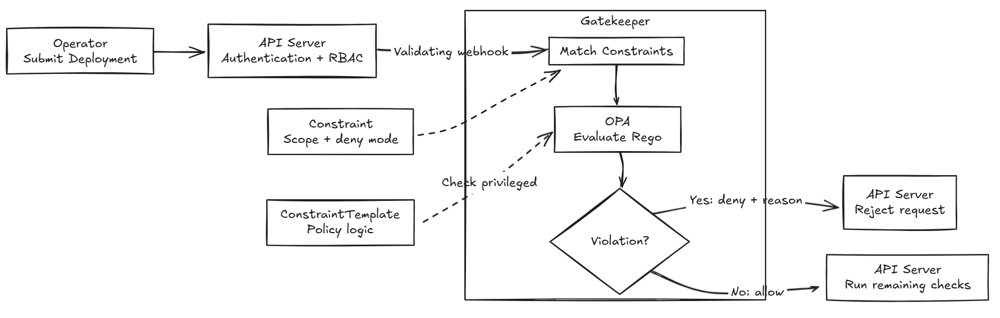

# Day 28 - How Gatekeeper checks Kubernetes resource configurations

The previous article covered "who can use the Kubernetes API," with permissions assigned through role-based access control (RBAC). Today, we'll look at "whether the submitted resource contents meet our requirements," which is where policy checks come in. Permission to create a `Deployment` does not mean every `Deployment` configuration will be accepted.

The Todo API only needs to handle HTTP requests. It does not need to access host devices. If a deployment configuration gives the container those permissions, we'd want to reject it before deployment. We'll use this scenario to explain how Kubernetes checks resource contents and how Gatekeeper enforces a team's deployment rules.

## Why restrict container permissions?

When a `Deployment` passes Kubernetes field validation, it means the configuration follows the format for that resource type. It does not mean it meets the team's deployment requirements. Kubernetes provides many advanced options, but some are designed for system components or specialized workloads that ordinary services may not need.

We can start with a specific rule: "Containers for the Todo API must not enable `privileged` mode."

Containers are normally restricted by Linux permission and isolation mechanisms. Setting `securityContext.privileged` to `true` relaxes several security restrictions, allowing a container to access resources such as host devices. This is called privileged mode, and it grants more permissions than simply running a program as `root` inside a container.

These extra permissions serve no purpose for the Todo API, but they could allow an attacker who compromises the container to affect the host. That's why we prohibit this mode. System components that need to access host devices require a separate assessment; we cannot apply the same requirement to them without one.

Deployment requirements like these are called policies. If they only exist in documentation, someone has to remember to check them in every review. We can also write the requirements as executable rules, have the system check them, and maintain them through version control, review, and testing. This approach is called Policy as Code.

## When does Kubernetes check?

When the Operator asks the API Server to create a `Deployment`, the API Server first authenticates the Operator, then checks whether it has permission to create the resource. After authorization, the request also goes through admission control, which checks the request contents before the resource is written.

Admission has two types of functions: mutation and validation. Mutation can add or adjust fields in a resource; validation determines whether the configuration meets the requirements. We're implementing validation here: if a container enables `privileged` mode, reject the request so the submitter can fix the configuration.

In addition to Kubernetes' built-in checks, the API Server can ask an external service to help with validation through a webhook. Here, a webhook means that while processing a request, the API Server calls a registered validation service, sends it the resource contents, and receives an allow or deny response. This happens before the resource is written; it is not a notification sent after deployment is complete.

To check our deployment requirement through a webhook, the validation service needs to read the container configuration and determine whether `privileged` is enabled. OPA can make that determination.

## OPA evaluates rules against data

Open Policy Agent (OPA) is an open-source policy engine. You provide the data to check and the rules, and it evaluates the data according to those rules. OPA is not limited to Kubernetes. It can also evaluate matters such as API access and CI configuration.

For the Todo API, we give OPA the container configuration so it can check whether `privileged` is enabled and return the names of violating containers along with the reasons. OPA only evaluates the result. The system integrating OPA decides which resources to check and whether to reject a request.

OPA uses the Rego language to describe policies. For this rule, the Rego program needs to check each container's `privileged` field, find containers whose value is `true`, and return violation messages. It does not create or update a `Deployment`.

OPA alone, however, is not yet connected to Kubernetes admission. We still need a component that receives webhook requests, manages policies, and returns evaluation results to the API Server.

## Gatekeeper connects policy checks to Kubernetes

Gatekeeper integrates OPA into the Kubernetes admission process. It runs in the cluster and provides a validating webhook, allowing the API Server to ask it to check resources during admission.

When Gatekeeper receives a validation request, it finds the rules that apply to the resource and evaluates it for violations. If a rule requires violating requests to be rejected, Gatekeeper returns a denial and the reason to the API Server, and the resource creation or update will fail.

So the API Server asks Gatekeeper to validate the resource contents, and Gatekeeper uses OPA to evaluate policies. Whether the Operator, Argo CD, or a user submits a resource, it must pass the same validation if it falls within the scope of the checks.

The diagram below shows this process using the Operator's submission of the Todo API's `Deployment` as an example. It assumes the rule uses `deny` mode and illustrates how the process works, not results from an actual cluster test. The next section explains the roles of `ConstraintTemplate` and Constraint.

## How do we tell Gatekeeper what to check?

Gatekeeper manages validation policies through Kubernetes resources, primarily `ConstraintTemplate` and Constraint. The former defines how to check; the latter specifies which resources to check and what to do when a violation is found.

Kubernetes distinguishes resources by their kind, such as `Deployment`, `Pod`, and `Service`. Gatekeeper rules are themselves resources, so they also need their own resource kinds.

A `ConstraintTemplate` defines the checking logic, the resource kind for that type of rule, and the parameters it accepts. For example, a Template that prohibits `privileged` contains the Rego logic described earlier: check each container and report the names of containers that enable this mode. Gatekeeper creates a corresponding Custom Resource Definition (CRD) from the Template so Kubernetes recognizes this type of rule.

With this CRD in place, the platform team can create actual rule resources, collectively called Constraints. A Constraint's `spec.match` specifies which resource kinds and Namespaces to check, while `spec.enforcementAction` determines what happens when a violation is found. If the checking logic needs parameters, they are supplied through `spec.parameters`.

Suppose we want to reject a `Deployment` in `todo` that enables `privileged`. We first define a Template that checks the container configuration. Then we create a Constraint, scope it to `Deployment` resources in the `todo` Namespace, and set `spec.enforcementAction` to `deny` to reject violating requests.

Creating a Template alone does not enable the rule. A Constraint must also specify the scope of the checks. If the Constraint selects a different Namespace, it will not check `todo`. When a policy is not taking effect, check both the rule contents and whether `spec.match` covers the target resource.

## Walking through the Todo API creation request again

Assuming the rule above is configured and the webhook is working properly, the Operator's submission of the Todo API's `Deployment` is processed in this order:

1. The API Server authenticates the Operator, and RBAC confirms that it has permission to create a `Deployment` in `todo`.
2. The request enters admission, and the API Server sends validation requests within the webhook's configured scope to Gatekeeper.
3. Gatekeeper finds the Constraint that matches this `Deployment` and uses the Template's logic to check the configuration of each container in the Pod template.
4. If it finds a container with `privileged=true`, this `deny` rule rejects the request and returns the container's name and the reason. If there is no violation, this rule does not reject the request, but the request must still pass all other applicable checks.

Rejection happens before the resource is written. A rejected creation does not add the `Deployment`; a rejected update does not write the changes to the existing `Deployment`. Rejecting an update does not delete the existing resource.

The rejection message should explain which setting is wrong. For example, "`todo-api` container is not allowed to enable `privileged`" is clearer than "policy violation." Developers need this message to know which setting to remove or disable.

## How does checking a `Deployment` differ from checking a Pod?

A `Deployment` holds the configuration needed to create Pods in `spec.template.spec`. We can check this content when the `Deployment` is submitted and reject configurations that do not meet the requirements early.

If the rule only checks Pods, the `Deployment` may be created successfully, and Gatekeeper may only reject the Pods when Kubernetes later creates them from its configuration. In that case, you have a `Deployment` that cannot create Pods. You need to inspect the events of the `ReplicaSet` responsible for creating the Pods to find the reason for the rejection.

Both checks can be used together. Checking the `Deployment` tells the submitter about problems early; checking Pods also blocks Pods created directly without a `Deployment`. The rules need to read the container configurations for each resource type separately and check every container.

On the current Todo platform, the `Microservice` Custom Resource (CR) submitted by developers only contains an image and a port. The Operator generates the container configuration. This rule therefore needs to check the `Deployment` created by the Operator or the subsequent Pods; checking only the `Microservice` is not enough.

Prohibiting `privileged` only addresses that setting. It does not mean all other settings are safe, nor does it restrict whether the BFF can call the Todo API.

The next article will build on this checking process by adding requirements for limits and images. We'll also look at how to inventory existing resources and when it makes sense to start rejecting violating requests.

## References

- [OPA: Policy engine and Rego basics](https://www.openpolicyagent.org/docs)
- [Gatekeeper: ConstraintTemplate and Constraint](https://open-policy-agent.github.io/gatekeeper/website/docs/howto/)
