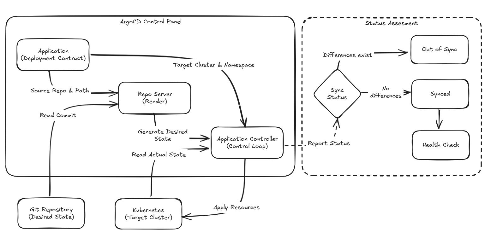

# Day 07 - 用 Argo CD 將 Git 的 YAML 同步到 Kubernetes

前一篇將 Git 定為環境期望狀態的來源，但 repository 不會自行讀取 commit，也不會呼叫 Kubernetes API。我們還需要一個常駐在叢集內的 controller：知道該讀取哪個 Git repository、把差異同步到叢集，並回報資源是否真的準備好。

Argo CD 處理的就是這段工作。它不會取代 `Deployment` 等 Kubernetes controller，而是在外面補上一層 GitOps 控制迴路：讀取 Git 的 manifest、比對叢集現況，再依同步政策執行 `reconcile`。

## Argo CD 怎麼同步 Git 與 Kubernetes？

第一次接觸 Argo CD，很容易把它看成附帶 Web UI 的 `kubectl apply`。兩者最大的差異在於，`kubectl apply` 是一次性命令；Argo CD 會持續追蹤 Git revision 與叢集狀態。

`Application` 是 Argo CD 的部署合約。它指定 Git source、manifest path、目標叢集與 Namespace，讓 controller 知道一組資源應該從哪裡來、要被部署到哪裡。

```text
Git commit
    │
    ▼
Repo Server 取回並渲染 Kustomize、Helm 或 YAML
    │
    ▼
Application Controller 比對 Repo Server 的期望狀態與 K8s 叢集現況
    │
    ├── OutOfSync：存在差異，等待或執行同步
    └── Synced：受管資源已套用至指定 revision
             │
             ▼
       Health assessment：資源是否已準備好 (Ready)
```

ArgoCD 的 API Server 與 Web UI 讓人或自動化工具建立、查詢 `Application`；Repo Server 負責讀取與渲染 Git 內容；Application Controller 則比對並同步資源。repository credential 應只授予讀取權限，而 Argo CD 可操作哪些 Namespace 和資源，必須同時由 `AppProject` 與 Kubernetes RBAC 限制。



## 安裝 Argo CD 並建立部署合約

本日範例將既有 Todo 的 Kubernetes manifest 交給 Argo CD 管理。`AppProject` 限定可讀取的 repository 與部署目的地；`Application` 則指定 Todo manifest 的 Git 路徑，將資源同步到 `todo` Namespace。

先透過官方 Helm Chart 安裝 Argo CD：

```bash
helm repo add argo https://argoproj.github.io/argo-helm
helm repo update
helm upgrade --install argocd argo/argo-cd \
  --namespace argocd \
  --create-namespace
```

安裝完成後，將上述 `AppProject` 與 `Application` 分別存成 `project.yaml` 與 `todo.yaml` 後套用：

```bash
kubectl apply -f project.yaml -f todo.yaml
```

`AppProject` 先定義可接受的範圍。這裡的 `sourceRepos` 只允許本 repository，`destinations` 只允許叢集內的 `todo` Namespace。`clusterResourceWhitelist` 額外允許 Todo manifest 中的 `Namespace` 資源；其他 cluster-scoped 資源不在這個 project 的權限範圍。

```yaml
apiVersion: argoproj.io/v1alpha1
kind: AppProject
metadata:
  name: todo
  namespace: argocd
spec:
  sourceRepos:
    - https://github.com/yrw9281/IT30.Platform.Engineering.git
  destinations:
    - namespace: todo
      server: https://kubernetes.default.svc
  clusterResourceWhitelist:
    - group: ""
      kind: Namespace
  namespaceResourceWhitelist:
    - group: "*"
      kind: "*"
```

`Application` 再將這個範圍內的 Git 路徑與部署目標綁定在一起：

```yaml
apiVersion: argoproj.io/v1alpha1
kind: Application
metadata:
  name: todo
  namespace: argocd
  finalizers:
    - resources-finalizer.argocd.argoproj.io
spec:
  project: todo
  source:
    repoURL: https://github.com/yrw9281/IT30.Platform.Engineering.git
    targetRevision: main
    path: src/1-kubernetes/kind
  destination:
    server: https://kubernetes.default.svc
    namespace: todo
  syncPolicy:
    automated:
      prune: true
      selfHeal: true
```

`source` 和 `destination` 都是部署邊界。`source` 指出 Argo CD 信任哪個 repository、revision 與路徑；`destination` 限制資源可以被同步到哪個叢集與 Namespace。`finalizers` 則讓刪除 `Application` 時，Argo CD 先刪除它管理的資源；是否要保留受管資源，必須在建立 Application 前決定。

## `Synced` 不等於服務已可使用

Argo CD 的同步狀態與健康狀態回答不同問題：

- `Synced`：指定 Git revision 的資源宣告已成功套用，且與目前的受管資源沒有差異。
- `Healthy`：Argo CD 依資源的 health assessment 判斷它們已達可用狀態。

例如 image 無法拉取時，`Deployment` 仍可能已經建立。因此 Application 可以是 `Synced`，但 Pod 無法 ready，整體 health 會停在 `Progressing` 或變成 `Degraded`。看到 `Synced` 時，仍要確認 health 狀態。

一次正常的同步過程會經過下列變化：

```text
Git revision 改變
  -> Application 偵測到新 revision
  -> OutOfSync
  -> 資源套用完成
  -> Synced + Progressing
  -> Pod ready
  -> Synced + Healthy
```

## 自動同步前要先確認資源邊界

`automated.prune` 會刪除 Git 已移除的受管資源；`selfHeal` 則會讓手動變更回到 Git 宣告。它們能避免 drift 長期留在叢集，但也會放大錯誤變更的影響範圍。

例如，當你重命名一個 Deployment，或者將資源搬移到另一個 Application 的資料夾時，若開啟了自動 prune，Argo CD 會視為「舊資源被移除、新資源被建立」，可能在無意間將線上服務直接刪除重啟。Argo CD 不知道你的架構變更意圖，所以資源應由哪個 Application 管理、哪些資源可以被刪除，都必須在啟用自動同步前規劃清楚。

## 測試與驗證

套用 Application 後，從 Argo CD CLI 確認它讀取的來源、部署目的地與目前狀態：

```bash
# 執行 argocd CLI 前，需先透過 argocd admin initial-password 取得預設密碼，並進行 Port-forwarding 與登入 (argocd login)。
argocd app get todo --refresh
argocd app wait todo --sync --health --timeout 300
kubectl get application todo -n argocd
```

驗證時至少要區分三種情況：Git 有新 revision 但尚未同步、資源已套用但 Pod 尚未健康，以及所有受管資源都已健康。若 `argocd app wait` 逾時，先查看 Application 的事件，再追到對應的 Deployment 或 Pod：

```bash
kubectl describe application todo -n argocd
kubectl get deployment,pod -n todo
```

現在，一份 `Application` 已能把一個 Git 路徑同步到固定目標。下一篇會處理服務與環境增加後，如何用 `ApplicationSet` 避免重複維護相似的 `Application`。
