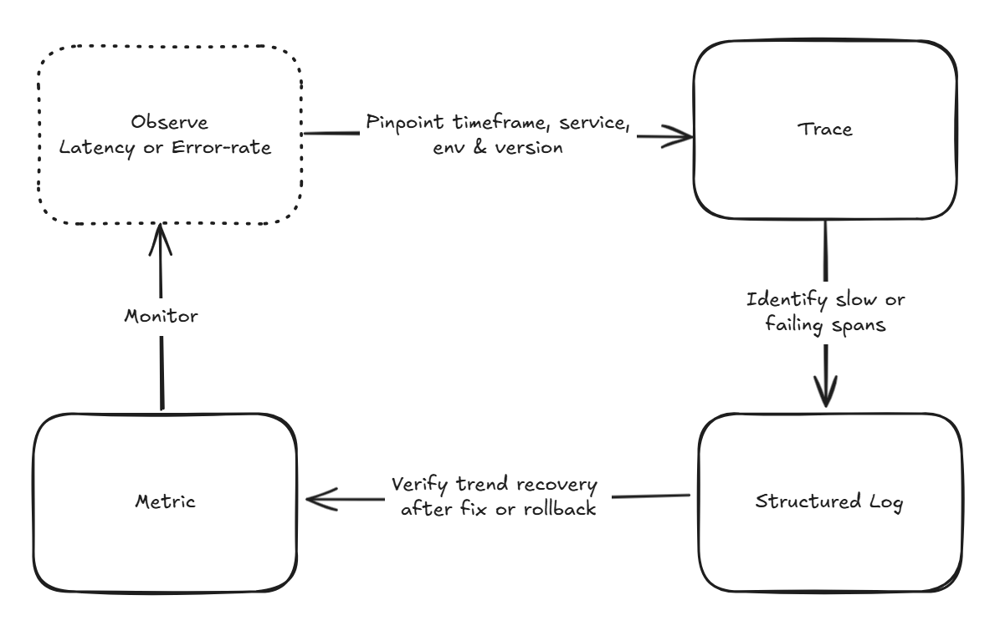

# Day 09 - Metrics、Logs、Traces：可觀測性怎麼用

前面先用 Kubernetes 定義服務要維持的狀態。Pod 停止時，Deployment controller 會建立替代副本；副本數被手動改掉，也能回到宣告的設定。接著透過 Argo CD 與 `ApplicationSet`，讓叢集持續讀取 Git 中已審查的設定，將服務同步到正確的環境。

這些機制能確保叢集朝著我們宣告的意圖收斂，卻不會告訴我們服務本身發生了什麼事。假設 `todo-api` 的新版已同步到 Staging，Pod 都是 `Running`、首頁也能開啟，測試人員卻回報有些新增待辦事項的請求很慢。Deployment 存在，不代表請求正常；Argo CD 顯示 `Healthy`，也不能指出延遲出在哪一段。

團隊仍需要知道：異常從什麼時候開始？是否只發生在特定版本或環境？請求卡在 BFF、`todo-api`，還是資料庫？當時留下了什麼錯誤資訊？

**可觀測性（Observability，O11y）** 處理的就是這條調查路徑。它不是多裝一套 dashboard，而是讓系統在執行時留下可關聯的訊號，使工程師能從症狀一路追到原因。

## Monitoring 與 Observability

**監控（Monitoring）** 適合處理已知風險。團隊先定義門檻，例如五分鐘內的 5xx 比例超過 1%，就通知值班者。它回答的是：「現在是否需要介入？」

**可觀測性** 則用系統輸出的資料，調查尚未預先寫成警報條件的問題。警報發生後，我們還要知道錯誤集中在哪個 route、哪個服務版本或哪個下游依賴；這些問題通常沒有單一固定門檻可以回答。

| 情境 | Monitoring 先回答 | Observability 接著釐清 |
| --- | --- | --- |
| `todo-api` 的失敗率升高 | 是否超過警報門檻？ | 哪個 route、版本或下游依賴造成？ |
| 建立待辦事項變慢 | p95 latency 是否異常？ | 時間耗在 BFF、`todo-api`、資料庫，還是重試？ |
| 某筆請求失敗 | 是否留下 error log？ | 它經過哪些服務？每一步發生了什麼事？ |

兩者不是替代關係。沒有 Monitoring，團隊可能要等使用者回報才知道服務異常；沒有 Observability，警報只告訴我們「有事發生」，卻沒有足夠線索開始排查。

## Metrics、Logs、Traces 從不同角度看同一個請求

可觀測性最常見的三種遙測資料是 Metrics、Logs 和 Traces。它們各自適合回答不同問題：

| Signal | 適合回答的問題 | `Create Todo` 的例子 |
| --- | --- | --- |
| Metrics | 問題是否正在擴大？影響範圍多大？ | Staging 在 10:08 到 10:13 的 p95 latency 是否升高？ |
| Logs | 單一事件留下了哪些上下文與錯誤？ | 儲存 Todo 失敗時，資料庫回傳哪種錯誤分類？ |
| Traces | 一筆請求經過哪些元件？時間花在哪裡？ | BFF、`todo-api` 和資料庫分別花了多久？ |

Metrics 是可聚合的數值序列，適合觀察錯誤率、延遲、流量與 Pod restart 次數等趨勢。它能讓團隊快速看出問題的時間窗和影響範圍，但不適合保存每一筆請求的細節。

Logs 記錄單一事件的上下文，例如錯誤分類、服務版本或操作結果。若 Log 只有一句「database timeout」，仍不足以找回當時的請求；它需要能和其他遙測資料對上的識別資訊。

Traces 將同一筆請求在不同服務中的處理串成時間線。一次建立待辦事項的請求可能先進入 BFF，再呼叫 `todo-api`，最後寫入資料庫。Trace 中每一段工作都是 span，因此可以直接看出最慢或失敗的是哪一段。

單看其中一種訊號很容易誤判。Metric 能指出 Staging 的延遲何時上升；Trace 能找出資料庫 span 花了 1.8 秒；Log 再補上錯誤分類與當時必要的上下文。三者要能互相跳轉，才能形成可用的調查路徑。

## 先決定三種訊號共用的查詢條件

資料收得越多，不代表越容易排查。假如 `todo-api` 的 Log 寫著資料庫逾時，Trace 用了另一個服務名稱，Metric 也沒有環境標籤，查詢時仍然無法確認它們是否來自同一個問題。

Todo 系統需要在三種訊號中維持一致的服務身分：

| 欄位 | 用途 |
| --- | --- |
| `service.name` | 用同一個服務名稱查詢 Metrics、Logs 與 Traces，例如 `todo-api`。 |
| `deployment.environment.name` | 區分 Staging 與其他環境，避免不同環境的資料混在一起。 |
| `service.version` | 比較不同部署版本的錯誤率與延遲。 |
| `trace_id` | 從一筆 Log 回到對應的請求 Trace。 |

這些欄位不是任意加上的 metadata，而是後續調查時的座標。服務名稱、環境與版本讓我們能先縮小範圍；`trace_id` 讓我們從失敗事件回到完整呼叫鏈。

資料最小化也要在這個階段一起決定。使用者 email、完整 Todo 內容、`Authorization` header 和 access token 都不應因為除錯方便而送進遙測資料。資料一旦進入集中式 backend，保留期限、查詢權限和外洩範圍都會擴大。

Metric label 特別需要克制。`service.name`、環境、正規化 route 和 status code 都是有限集合，適合作為聚合維度；request ID、trace ID、user ID 與原始 URL path 幾乎每次請求都不同，會產生高基數（high cardinality）的時間序列，增加 metrics backend 的儲存與查詢成本。個別識別值應留在 Trace 或 Log。

## 從警報走到根因的調查順序

回到一開始的情境：`todo-api` 在 Staging 的建立待辦事項請求變慢。調查可以沿著下列順序進行：

先從 Metric 看起，確認這只是單一請求變慢，還是整體延遲正在升高。接著用相同的時間窗和服務條件查 Trace，看看時間花在 BFF、`todo-api` 還是資料庫。有了 `trace_id`，就能找到同一筆請求的 structured log，確認錯誤分類和部署資訊。

修正或回退後，再回到 Metric 看趨勢。單一請求成功，不代表問題已經消失；延遲和錯誤率都回到預期範圍，才能確認這次處置有效。

## 結語

瞭解了甚麼是 Oberservability 之後，下一篇會介紹 OpenTelemetry（OTel）如何定義共用的資料格式與元件，讓 BFF、Account 與 Todo 不必各自綁定不同 vendor 的 SDK。
