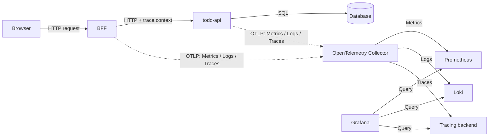

# Day 10 - OpenTelemetry 的資料格式與元件

昨天我們用 Metrics、Logs 與 Traces 追查 `todo-api:0.1.1` 在 Staging 變慢的原因。先從 p95 latency 確認延遲是否真的升高，再用 Trace 看時間花在 BFF、`todo-api` 還是資料庫，最後以 Log 確認錯誤分類與當時的資訊。

這樣的查詢方式，需要所有服務留下能互相對照的資料。假設 BFF 將服務名稱寫成 `TodoBff`，`todo-api` 寫成 `todo-service`，兩邊的 Trace 又沒有關聯，即使資料都送進 observability backend，還是很難確認它們是不是同一筆請求。

**OpenTelemetry（OTel）** 是一套開放原始碼的 observability framework，用來產生、收集與匯出 Metrics、Logs 和 Traces。它不負責儲存資料，也不提供 dashboard；Prometheus、Loki、Jaeger 與各種 SaaS backend 仍負責保存資料，Grafana 則負責查詢與呈現。OTel 提供的是共用的資料格式、欄位命名與傳輸方式，讓 application 不必各自綁定特定 vendor 的 SDK。

## 一筆請求與遙測資料如何流動

以建立待辦事項為例，瀏覽器先呼叫 BFF，BFF 再呼叫 `todo-api`，最後由 `todo-api` 寫入資料庫。這是使用者請求實際走過的路。

BFF 與 `todo-api` 同時會把執行過程產生的 Metrics、Logs 和 Traces，以 OpenTelemetry Protocol（OTLP）送到 OpenTelemetry Collector。Collector 處理完資料後，再分別送到各種 backend。



<!-- TODO(assets): 補上 Browser、BFF、todo-api、Database、OpenTelemetry Collector 與三種 backend 的架構圖；實線表示請求流，虛線表示 telemetry 資料流。 -->

Collector 不會處理 BFF 呼叫 `todo-api` 的 HTTP request。它收到的是服務額外送出的 telemetry。這也是為什麼服務發生錯誤時，Collector 可以幫助我們看見問題，但不會讓原本失敗的請求自動成功。

## Trace Context 如何跨服務傳遞

一筆請求的 Trace 由多個 span 組成。BFF 處理 HTTP request 時會建立一個 span；它呼叫 `todo-api` 時，`todo-api` 會建立另一個 span；資料庫操作也能成為 span。這些 span 共享同一個 `trace ID`，backend 才能把它們排成同一條呼叫路徑。

BFF 不會把整份 Trace 傳給 `todo-api`，而是把目前的 context 寫進 HTTP header。`todo-api` 讀取這個 context 後，會將新 span 接到 BFF 的 span 之下。OTel 預設使用 W3C Trace Context 定義的 `traceparent` header；常見的 HTTP instrumentation library 能自動注入與讀取這個 header。

```text
Browser -> BFF
           trace ID: 4bf92f...
           span:     BFF Create Todo

BFF -> todo-api
       traceparent: 4bf92f... / BFF span ID

todo-api
  -> todo-api Create Todo span
     -> database INSERT span
```

如果 context 沒有傳過去，BFF 和 `todo-api` 還是會各自留下 Trace，只是 backend 會把它們當成兩筆不相干的請求。後面實作 distributed tracing 時，要分別檢查 span 是否建立，以及 context 是否有跨服務傳遞。

## API、SDK、OTLP 與 Collector 各自做什麼

OTel 將 application 產生 telemetry 的方式，和資料要送到哪裡分開處理：

| 元件 | 工作 | Todo 系統中的用途 |
| --- | --- | --- |
| API | 提供建立 span、metric 與 log 的程式介面 | application 以相同介面記錄業務事件 |
| SDK | 實作 API，負責抽樣、處理與匯出 | BFF 與 `todo-api` 啟動時設定 resource 與 exporter |
| Instrumentation library | 為 HTTP framework、資料庫 client 等常用套件產生 telemetry | 建立 HTTP 與 SQL 等通用 span |
| Semantic Conventions | 定義常見 operation 與 attribute 的名稱和語意 | 讓不同服務對 HTTP method、route、資料庫操作使用同一組欄位 |
| OTLP | 定義 telemetry 的資料格式與傳輸方式 | application 與 Collector 之間的通訊協定 |
| Collector | 接收、處理及轉送 telemetry | 處理 retry、batch、脫敏與 backend 連線設定 |

Instrumentation 可以從兩個地方開始。若使用的 HTTP framework 或資料庫 client 已有支援，加入對應的 instrumentation library 後，通常可以取得 HTTP request 和 SQL 呼叫等資料。這適合先建立服務的基本觀測能力。

另一部分只有 application 自己知道。例如「建立待辦事項被拒絕，因為標題不符合規則」不是 HTTP framework 能判斷的事件，需要在程式碼中主動建立 span、log 或 metric。自動 instrumentation 和程式碼 instrumentation 可以一起使用；前者處理共通元件，後者補上業務語意。

## 服務名稱、環境與版本要使用相同欄位

OTel 的資料格式相同，不代表欄位內容就會一致。`todo-api` 的 HTTP method、route 和資料庫操作等欄位，可以依 Semantic Conventions 命名；服務名稱、部署環境和版本則應以 resource attributes 表示。

resource attributes 描述的是產生 telemetry 的服務或工作負載，通常在 application 啟動時決定。每次 HTTP request 都不同的 route、response status 與錯誤類型，則是 span、metric datapoint 或 log record 的 attributes。

Todo 系統先使用下面這組 resource attributes。目前專案尚未加入 OTel SDK 或 Collector，這是實作時要維持的約定，不是可直接套用的設定：

```yaml
# 規劃片段：Todo 服務共用的 OTel resource attributes
service.name: todo-api
service.namespace: todo
service.version: "0.1.1"
deployment.environment.name: staging
```

| 欄位 | 用途 |
| --- | --- |
| `service.name` | 查詢同一服務的 Metrics、Logs 與 Traces，例如 `todo-api`。應明確設定，避免 SDK 使用 `unknown_service`。 |
| `service.namespace` | 區分邏輯上的服務群組；不必等同 Kubernetes Namespace。 |
| `service.version` | 比較不同部署版本的錯誤率與延遲。 |
| `deployment.environment.name` | 區分 Staging 與其他環境，避免資料混在一起。 |

`trace_id` 用來識別單一請求，不應放在 resource attributes。它應出現在 Trace 和相關的 Log 中，讓工程師能從 Log 回到完整的呼叫路徑。

Metric label 也不能放入每次請求都不同的值。將 `trace_id`、request ID、user ID 或原始 URL path 做成 label，會產生高基數（high cardinality）時間序列，增加 metrics backend 的儲存與查詢成本。這些資訊應留在 Trace 或 Log。

資料最小化同樣要在 application 端處理。request body、`Authorization` header、token、email 和 Todo 內容不應送進 telemetry。這些資料送到集中式 backend 後，查詢權限、保留時間和外洩範圍都會擴大。

## Collector 將共用設定放在同一個地方

小型或本機環境中，application 可以直接將 telemetry 送到 backend。不過服務一多，每個服務都要各自設定 retry、batch、敏感欄位過濾，以及 Metrics、Logs 和 Traces 的 backend endpoint。設定很容易逐漸不同。

Collector 接收 OTLP 與其他格式的 telemetry，處理或過濾後，再送到一個或多個 backend。application 只要設定 OTLP endpoint，不必知道 Prometheus、Loki 或 tracing backend 的連線細節。

Collector 可以在資料送出前移除敏感 attribute，但這不代表 application 可以先把敏感資料寫進 span 或 log。application 不建立不必要的資料，Collector 再檢查和過濾，兩者缺一不可。

OTLP 的回應只表示相鄰兩個節點之間的一次傳輸是否被接受。例如 application 收到 Collector 的成功回應，不能據此判斷資料已寫入最終 backend。Collector 到 backend 的傳輸仍需要各自處理。

## 下一篇：設定 Collector pipeline

下一篇會以這篇定下來的資料流為基礎，設定 Collector 的 Receiver、Processor 與 Exporter。application 將資料送進 OTLP receiver，Collector 再依序處理記憶體保護、共同屬性、敏感欄位與批次轉送。

## 延伸閱讀

- [OpenTelemetry 官方文件：What is OpenTelemetry?](https://opentelemetry.io/docs/what-is-opentelemetry/)
- [OpenTelemetry 官方文件：Context propagation](https://opentelemetry.io/docs/concepts/context-propagation/)
- [OpenTelemetry 官方文件：Resources](https://opentelemetry.io/docs/concepts/resources/)
- [OpenTelemetry 官方文件：Collector](https://opentelemetry.io/docs/collector/)
