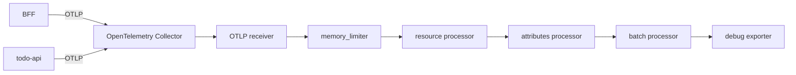

# Day 11 - 部署與設定 OpenTelemetry Collector

Day 10 已經定義 application 要以 OTLP 傳送 telemetry，也約定了 `service.name`、環境與版本等 resource attributes。不過，若 BFF、`todo-api` 和之後新增的服務各自設定 retry、batch、敏感欄位過濾，以及三種 backend 的連線位置，這些設定很快就會分岔。

這篇部署一個 OpenTelemetry Collector Gateway。服務只需要將 Metrics、Logs 和 Traces 傳到同一個 OTLP endpoint；Collector 再統一補上平台欄位、移除指定的敏感 attribute、批次處理，並轉送給 backend。這裡先使用 `debug` exporter 驗證資料處理結果，還沒有接上 Prometheus、Loki 或 tracing backend。

## Gateway 接收服務送來的 OTLP

Collector 常見的部署方式有三種：

| 模式 | Kubernetes 部署方式 | 適合處理的資料 |
| --- | --- | --- |
| Agent | 每個 Node 一個 `DaemonSet` | container log、Node 資訊等靠近主機的資料 |
| Gateway | 集中的 `Deployment` | application 主動傳送的 OTLP 資料 |
| Hybrid | Agent 將資料再送往 Gateway | Node 資料與 application telemetry 都需要集中處理的環境 |

Todo 系統的服務會主動傳送 OTLP，因此先使用 Gateway。這組設定部署一個 `Deployment`，並透過 `Service` 提供 OTLP/gRPC 的 `4317` port 和 OTLP/HTTP 的 `4318` port。



<!-- TODO(assets): 補上 BFF、todo-api、OTLP receiver、memory_limiter、resource processor、attributes processor、batch processor 與 backend 的資料流，並標示資料由左至右依序處理。 -->

`Service` 只負責把資料送到 Collector Pod；資料進入 Collector 後，會依 `service.pipelines` 中列出的順序經過 receiver、processor 和 exporter。設定檔裡宣告 processor 還不夠，必須放進 pipeline 才會執行。

## 建立 Namespace 和 Collector 設定

先建立一個獨立的 Namespace：

```yaml
apiVersion: v1
kind: Namespace
metadata:
  name: observability
```

接著建立 `otel-collector-config.yaml`。OTLP receiver 同時開啟 gRPC 和 HTTP；三種訊號各有一條 pipeline，處理順序相同。

```yaml
apiVersion: v1
kind: ConfigMap
metadata:
  name: otel-collector-config
  namespace: observability
data:
  config.yaml: |
    extensions:
      health_check:
        endpoint: 0.0.0.0:13133

    receivers:
      otlp:
        protocols:
          grpc:
            endpoint: 0.0.0.0:4317
          http:
            endpoint: 0.0.0.0:4318

    processors:
      memory_limiter:
        check_interval: 1s
        limit_mib: 192
        spike_limit_mib: 64
      resource/platform:
        attributes:
          - key: platform.name
            value: todo-platform
            action: upsert
      attributes/remove-sensitive:
        actions:
          - key: enduser.id
            action: delete
          - key: authorization
            action: delete
          - key: http.request.header.authorization
            action: delete
      batch:
        timeout: 5s
        send_batch_size: 1024

    exporters:
      debug:
        verbosity: detailed

    service:
      extensions: [health_check]
      pipelines:
        traces:
          receivers: [otlp]
          processors: [memory_limiter, resource/platform, attributes/remove-sensitive, batch]
          exporters: [debug]
        metrics:
          receivers: [otlp]
          processors: [memory_limiter, resource/platform, attributes/remove-sensitive, batch]
          exporters: [debug]
        logs:
          receivers: [otlp]
          processors: [memory_limiter, resource/platform, attributes/remove-sensitive, batch]
          exporters: [debug]
```

`memory_limiter` 依 Collector 的可用記憶體限制接收量，避免大量 telemetry 讓 Pod 因記憶體不足而重啟。`resource/platform` 將 `platform.name=todo-platform` 加到每筆資料的 resource attributes。`attributes/remove-sensitive` 在資料交給 exporter 前移除列出的欄位，`batch` 則把已處理的資料合併後送出。

這份範例的 `debug` exporter 會將處理後的資料寫入 Collector log，方便檢查 pipeline。它不應作為正式環境的 telemetry backend；正式環境應改成對應 Prometheus、Loki 與 tracing backend 的 exporter。

## 部署 Collector 與 Service

以下 manifest 將設定檔掛載到 Collector container，並提供 OTLP 的兩個 port。health check 僅供 Kubernetes probe 使用，不對其他 Pod 建立 Service port。

```yaml
apiVersion: apps/v1
kind: Deployment
metadata:
  name: otel-collector
  namespace: observability
spec:
  replicas: 1
  selector:
    matchLabels:
      app: otel-collector
  template:
    metadata:
      labels:
        app: otel-collector
    spec:
      securityContext:
        runAsNonRoot: true
        seccompProfile:
          type: RuntimeDefault
      containers:
        - name: otel-collector
          image: otel/opentelemetry-collector:0.161.0
          args:
            - --config=/conf/config.yaml
          ports:
            - name: otlp-grpc
              containerPort: 4317
            - name: otlp-http
              containerPort: 4318
            - name: health
              containerPort: 13133
          resources:
            requests:
              cpu: 100m
              memory: 128Mi
            limits:
              cpu: 500m
              memory: 256Mi
          readinessProbe:
            httpGet:
              path: /
              port: health
          livenessProbe:
            httpGet:
              path: /
              port: health
            initialDelaySeconds: 10
          securityContext:
            allowPrivilegeEscalation: false
            capabilities:
              drop:
                - ALL
            readOnlyRootFilesystem: true
            runAsUser: 10001
            runAsGroup: 10001
          volumeMounts:
            - name: config
              mountPath: /conf
              readOnly: true
      volumes:
        - name: config
          configMap:
            name: otel-collector-config
---
apiVersion: v1
kind: Service
metadata:
  name: otel-collector
  namespace: observability
spec:
  selector:
    app: otel-collector
  ports:
    - name: otlp-grpc
      port: 4317
      targetPort: otlp-grpc
    - name: otlp-http
      port: 4318
      targetPort: otlp-http
```

部署時依序套用三份檔案：

```bash
kubectl apply -f namespace.yaml
kubectl apply -f otel-collector-config.yaml
kubectl apply -f otel-collector.yaml

kubectl rollout status deployment/otel-collector -n observability
kubectl get deployment,service -n observability
```

叢集內的 application 可使用下列 endpoint：

```text
otel-collector.observability.svc:4317
http://otel-collector.observability.svc:4318
```

## 送入測試 Trace 並檢查處理結果

先確認健康檢查 endpoint：

```bash
kubectl port-forward service/otel-collector 13133:13133 -n observability
curl --fail http://127.0.0.1:13133/
```

接著安裝官方的 `telemetrygen`，並將一筆 Trace 送到 Collector。若命令在叢集外執行，開啟另一個終端機轉送 gRPC port：

```bash
kubectl port-forward service/otel-collector 4317:4317 -n observability
```

```bash
go install github.com/open-telemetry/opentelemetry-collector-contrib/cmd/telemetrygen@latest
$(go env GOPATH)/bin/telemetrygen traces \
  --otlp-insecure \
  --otlp-endpoint 127.0.0.1:4317 \
  --service todo-api \
  --traces 1
```

查看 Collector log：

```bash
kubectl logs deployment/otel-collector -n observability
```

`debug` exporter 的輸出應包含 `service.name: todo-api` 和 `platform.name: todo-platform`。若 application 或測試工具送入 `enduser.id`、`authorization` 或 `http.request.header.authorization`，輸出不應包含這些 attribute。這組檢查確認資料有進入 receiver、依序經過 processor，最後才交給 exporter。

`debug` exporter 的輸出本身也可能包含 telemetry 內容，因此只適合在受控的開發環境使用。真正的服務仍不應把 password、token、email、`Authorization` header 或 Todo 內容寫入 telemetry。

## 下一篇：讓 Trace 跨服務串起來

Collector 已能接收與處理 telemetry，但 BFF 和 `todo-api` 還需要正確傳遞 `traceparent`，才能讓 backend 將兩個服務的 span 視為同一筆請求。下一篇會從這個 HTTP context propagation 開始，建立跨服務的 Trace。
