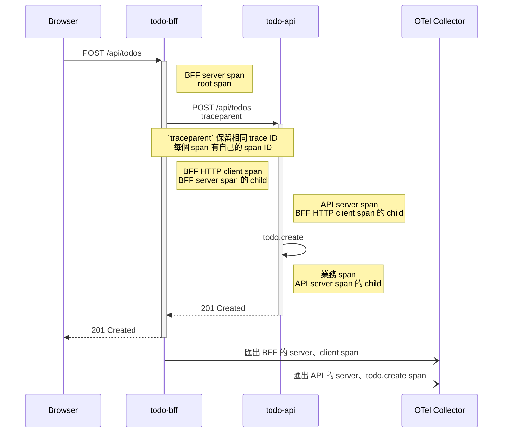

# Day 12 - 用 Distributed Tracing 找出微服務的瓶頸

## 同一個操作，為什麼會散在好幾個服務裡

前一篇已經讓 OpenTelemetry Collector 收到資料，但 Collector 不知道 BFF 呼叫 `todo-api` 的兩段 HTTP 請求是不是同一件事。假設使用者新增一筆待辦事項後，畫面等了兩秒才有回應。

BFF 和 `todo-api` 各自都有一筆 log，單看時間戳，很難判斷時間是花在轉送請求、API 邏輯，還是更下游的資源。

**Distributed Tracing（分散式追蹤）** 用一個 Trace 把這次操作串起來。Trace 裡的每個 Span 代表一段工作，會記錄開始時間、結束時間、名稱、狀態與父子關係。這次的範例先從瀏覽器經過 BFF 到 `todo-api`；目前 Todo 資料存在記憶體，沒有資料庫，因此不會假裝有 database span。



如果 Context 有正確傳遞，這條 Trace 會有一個 BFF server span、BFF 呼叫 API 的 HTTP client span，以及 API 的 server span。`todo.create` 是 API 額外建立的業務 span，用來標記建立待辦事項的程式區段。看到最長的 Span，才有足夠線索決定下一步要查哪一層。

## `traceparent` 是跨服務關聯的關鍵

服務之間預設會透過 W3C Trace Context 規範的 `traceparent` HTTP header 來傳遞目前的追蹤狀態。這是一組由連字號 (`-`) 分隔的 16 進位字串，標準格式包含四個部分：

```text
traceparent: 00-4bf92f3577b34da6a3ce929d0e0e4736-00f067aa0ba902b7-01
             |  |                                |                |
      Version-  Trace ID                         - Parent ID      - Trace Flags
```

各段落的意義如下：

- Version (00)：目前的 W3C 規範版本，固定為 00（佔 1 byte）。
- Trace ID (4bf9...4736)：整條 Trace 的全域唯一識別碼（佔 16 bytes）。這組 ID 會從 BFF 一路傳到 API 與資料庫，所有關聯的 Span 都會共用這個 Trace ID。
- Parent ID (00f0...02b7)：發起這個請求的「Span ID」（佔 8 bytes）。當 BFF 呼叫 API 時，這裡填入的會是 BFF 端的 Client Span ID；API 收到後，就會把它當作自己的 Parent，藉此建立精準的父子層級。
- Trace Flags (01)：標記這個 Trace 的控制狀態（佔 1 byte）。最常見的是 01，代表這個請求被採樣（Sampled），下游服務看到 01 就會跟著記錄並將 Span 匯出給 Collector；若是 00 則代表不記錄，藉此節省資源。

入口收到沒有 `traceparent` 的請求時，instrumentation 會建立新的 root span。收到有效 header 時，BFF 就以其中的 `trace-id` 建立自己的 server span。BFF 再呼叫 `todo-api` 時，`HttpClient` instrumentation 會把目前 Context 寫進 outgoing request。API 的 ASP.NET Core instrumentation 讀取 header 後，建立同一條 Trace 底下的 child span。

這裡不需要自行拼接 header。ASP.NET Core 和 `HttpClient` 已經涵蓋這兩個 HTTP 邊界，手動處理反而容易漏掉格式、採樣旗標或 Context。

訊息佇列、background worker、gRPC 或自行處理的非同步工作則是另一回事，導入時要另外測 propagation 是否完整。

`traceparent` 只用來傳遞追蹤關係，不能拿來驗證身分。Baggage 是與 Trace Context 搭配的另一個 W3C 標準，用於在服務之間傳遞 application-defined 的 key-value 資訊。它也會跟著請求往下游傳遞，所以 password、JWT、email、使用者名稱與未驗證輸入都不應放進去。

## 讓 BFF 與 API 匯出 Trace

兩個服務使用相同的 Resource attributes，讓後端可以按服務、版本與環境查詢；兩者的 OTLP endpoint 都指向 Collector 的 gRPC service。

```yaml
env:
  - name: OTEL_SERVICE_NAME
    value: todo-bff
  - name: OTEL_SERVICE_VERSION
    value: "0.1.0"
  - name: DEPLOYMENT_ENVIRONMENT
    value: development
  - name: OTEL_EXPORTER_OTLP_ENDPOINT
    value: http://otel-collector.observability.svc:4317
```

BFF 註冊 ASP.NET Core 與 `HttpClient` instrumentation；API 則註冊 ASP.NET Core instrumentation，並把自訂的 `ActivitySource` 加入 tracing provider。下方的 `serviceName`、`serviceVersion` 與 `deploymentEnvironment` 分別從前段 YAML 宣告的環境變數讀取；未設定時，程式會使用服務的預設值。

```csharp
builder.Services.AddOpenTelemetry()
    .ConfigureResource(resource => resource
        .AddService(serviceName: serviceName, serviceVersion: serviceVersion)
        .AddAttributes([
            new KeyValuePair<string, object>("service.namespace", "todo"),
            new KeyValuePair<string, object>(
                "deployment.environment.name", deploymentEnvironment)
        ]))
    .WithTracing(tracing => tracing
        .AddAspNetCoreInstrumentation()
        .AddHttpClientInstrumentation()
        .AddOtlpExporter());
```

`todo-api` 在建立 Todo 的 handler 中，另外建立 `todo.create` activity：

```csharp
using var activity = activitySource.StartActivity("todo.create");

if (string.IsNullOrWhiteSpace(request.Title))
{
    activity?.SetStatus(ActivityStatusCode.Error, "Todo title is empty.");
    return Results.ValidationProblem(new Dictionary<string, string[]>
    {
        ["title"] = ["待辦事項不可空白。"]
    });
}
```

這類手動 span 適合補上 instrumentation 看不到的業務區段。不要把完整 Todo 內容、email 或 `Authorization` header 設成 tag；Trace 通常會被匯出到集中式後端，能描述問題的欄位應維持低敏感度與低基數。

## 用固定 Trace ID 驗證 Context 是否連得起來

部署 Collector、BFF 與 API 後，先轉送 BFF service：

```bash
kubectl port-forward service/todo-bff 8080:8080 -n todo
```

在另一個終端機送出 Create Todo 請求。這裡指定固定的 Trace ID，方便在 Collector log 找到同一條 Trace：

```bash
curl --fail \
  -H 'content-type: application/json' \
  -H 'traceparent: 00-4bf92f3577b34da6a3ce929d0e0e4736-00f067aa0ba902b7-01' \
  --data '{"title":"trace-test"}' \
  http://127.0.0.1:8080/api/todos
```

接著查看 Collector：

```bash
kubectl logs deployment/otel-collector -n observability
```

`debug` exporter 應輸出相同的 `Trace ID` `4bf92f3577b34da6a3ce929d0e0e4736`，並看得到 `todo-bff` 的 server、client span 與 `todo-api` 的 server、`todo.create` span。若 BFF 和 API 出現不同 Trace ID，優先檢查 BFF 是否真的透過 `HttpClient` 呼叫 API、服務是否啟用了對應 instrumentation，以及 Collector endpoint 是否可連線。

Span 的耗時不能直接相加。BFF server span 已經包含它等待下游 API 回應的時間；要找瓶頸，應看同一層級的 Span，或找出真正佔用最久的 child span。加入資料庫 client instrumentation 後，資料庫操作才會以 child span 出現在這條 Trace 裡。

下一篇會把這些 Trace 與 Metrics、Logs 放到同一個查詢介面，讓排查不必只靠 Collector log。
