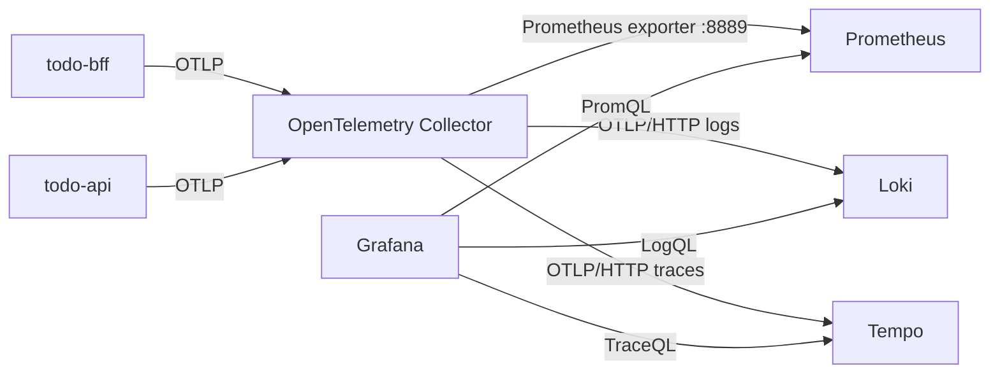

# Day 13 - 在 Grafana 查看 Prometheus、Loki 與 Trace 資料

前一篇已經把一次 Create Todo 串成一條 Trace。不過只在 Collector 的 `debug` log 裡找 `Trace ID`，只能確認資料有送進來；要知道延遲從什麼時候開始、影響哪個服務，還是得回到時間序列和查詢介面。

這篇部署 Prometheus、Loki、Tempo 和 Grafana，讓 Todo 系統的 Metrics、Logs、Traces 有固定的查詢位置。環境刻意維持單一副本，資料放在 `emptyDir`，適合本機或測試叢集驗證資料流；Pod 重建後資料會消失，不能直接拿去當正式環境的儲存設計。

## 讓 Collector 將三種資料送往不同 backend

Todo API 和 BFF 將 OTLP 資料送到 Collector。Collector 依訊號將 Metrics、Logs 和 Traces 送往不同 backend：



<!-- TODO(assets): 補上 Todo 服務、OpenTelemetry Collector、Prometheus、Loki、Tempo 與 Grafana 的資料流。標示 Metrics 由 Prometheus scrape、Logs 與 Traces 由 Collector 以 OTLP/HTTP 送出，以及 Grafana 的三條查詢方向。 -->

Prometheus 不接收 application 直接推送的 OTLP Metrics。Collector 的 Prometheus exporter 將 Metrics 暴露在 `:8889`，Prometheus 每 15 秒 scrape 一次。為了讓 dashboard 能以服務名稱篩選，exporter 將 resource attributes 轉為 Prometheus labels；例如 `service.name` 會變成 `service_name`。

Loki 原生支援 OTLP logs，Collector 將 logs 送到它的 `/otlp` endpoint。`service.name`、環境等穩定欄位適合用來縮小查詢範圍；`trace_id`、Todo title、`Authorization` header 和使用者資料不應變成 label。Tempo 則保存完整 Trace，讓我們查看 BFF 和 API 的 span 關係。

## Grafana 預先建立 datasource 與 dashboard

Grafana 啟動時會載入三個 datasource。dashboard 不需要知道叢集裡的實際 Pod IP，只使用 Kubernetes Service 名稱：

```yaml
datasources:
  - name: Prometheus
    uid: prometheus
    type: prometheus
    url: http://prometheus.observability.svc:9090
  - name: Loki
    uid: loki
    type: loki
    url: http://loki.observability.svc:3100
  - name: Tempo
    uid: tempo
    type: tempo
    url: http://tempo.observability.svc:3200
```

這組設定同時把 Tempo 的 Trace-to-Logs 連到 Loki。從 Trace 詳細頁點選 Logs 時，Grafana 會帶入 `service.name` 和 Trace ID；資料是否查得到仍取決於 application 有沒有真的送出對應 log。

第一張 dashboard 只放四個和 Create Todo 有關的問題：

| Panel | 要回答的問題 | 查詢資料 |
| --- | --- | --- |
| HTTP request rate | 哪個 route 的流量正在變化？ | Prometheus |
| HTTP request duration p95 | 95% 的請求在多久內完成？ | Prometheus histogram |
| HTTP 5xx ratio | 失敗是否正在擴大？ | Prometheus counter |
| Application logs | 同一時間窗留下了什麼事件？ | Loki |

`service` 與 `route` 都是 dashboard 變數。以下是 p95 panel 使用的 PromQL；`http_route` 是 ASP.NET Core instrumentation 提供的正規化 route，不會把每個 Todo ID 變成新的時間序列。

```promql
histogram_quantile(
  0.95,
  sum by (le, http_route) (
    rate(
      http_server_request_duration_seconds_bucket{
        service_name=~"$service",
        http_route=~"$route"
      }[$__rate_interval]
    )
  )
)
```

5xx ratio 以相同的 counter 計算，不把 `trace_id` 或 request ID 放進 Metric label：

```promql
sum(
  rate(
    http_server_request_duration_seconds_count{
      service_name=~"$service",
      http_route=~"$route",
      http_response_status_code=~"5.."
    }[$__rate_interval]
  )
)
/
sum(
  rate(
    http_server_request_duration_seconds_count{
      service_name=~"$service",
      http_route=~"$route"
    }[$__rate_interval]
  )
)
```

Dashboard JSON 將這些 panel、變數與 datasource UID 一起保存。匯入後的標題是 `Todo service overview`，不用再手動建立 panel：

```json
{
  "title": "Todo service overview",
  "uid": "todo-service-overview",
  "templating": {
    "list": [
      {
        "name": "service",
        "definition": "label_values(http_server_request_duration_seconds_count, service_name)"
      },
      {
        "name": "route",
        "definition": "label_values(http_server_request_duration_seconds_count{service_name=~\"$service\"}, http_route)"
      }
    ]
  }
}
```

## 建立資料並在 Grafana 查詢

先確認 Collector、Prometheus、Loki、Tempo 和 Grafana 都已就緒：

```bash
kubectl get deployment -n observability
```

開啟 Grafana：

```bash
kubectl port-forward service/grafana 3000:3000 -n observability
```

瀏覽器開啟 `http://127.0.0.1:3000`，以測試環境的帳密 `admin`／`admin` 登入。進入 `Todo service overview` 後，先選擇 `todo-api` 或 `todo-bff`。沒有資料時，確認服務確實已將 OTLP endpoint 指向 Collector，並等待至少一個 15 秒 scrape interval。

<!-- TODO(assets): 補上 Grafana 的 `Todo service overview` dashboard 截圖，畫面要包含 Service、Route 篩選器，以及 request rate、p95、5xx ratio 與 application logs 四個 panel。 -->

接著轉送 BFF service，建立幾筆測試資料：

```bash
kubectl port-forward service/todo-bff 8080:8080 -n todo
```

```bash
for title in trace-one trace-two trace-three; do
  curl --fail \
    -H 'content-type: application/json' \
    --data "{\"title\":\"$title\"}" \
    http://127.0.0.1:8080/api/todos
done
```

回到 dashboard 選擇 `todo-api` 和 `/api/todos`。request rate 會出現 POST 流量，`todo-api` 在建立 Todo 時會寫入 `Todo created.`，因此同一時間窗的 Application logs panel 應該會看得到三筆事件。這個範例不會把 Todo title 寫進 log。p95 和 5xx ratio 使用 `rate()` 計算；只有零星幾筆請求時，p95 可能暫時沒有值，請多送幾筆請求或拉長 dashboard 的時間範圍再判讀。沒有 5xx 時，5xx ratio 沒有序列可顯示，不代表查詢失敗。

<!-- TODO(assets): 補上持續送出 Create Todo 請求後的 dashboard 截圖。畫面需顯示 `todo-api`、`/api/todos`、request rate、p95 與 `Todo created.` log；沒有 5xx 時，5xx ratio panel 可能沒有資料。 -->

## 從 Grafana 開啟 Trace

dashboard 用 Metrics 確認影響範圍，Trace 則負責拆開單一請求的時間。從 Grafana 的 Explore 選擇 Tempo datasource，使用 TraceQL 找 `todo-api` 的 Trace：

```traceql
{ resource.service.name = "todo-api" }
```

選擇剛剛建立的 Trace，應能看見 `todo-bff` 的 HTTP server span、BFF 呼叫 API 的 HTTP client span、`todo-api` 的 HTTP server span，以及 `todo.create` activity。這四段共用同一個 Trace ID。點選 Trace-to-Logs 後，Grafana 會交給 Loki 查詢同一個服務與 Trace ID 的 logs。

目前 Todo 資料保存在記憶體，因此 Trace 裡沒有資料庫 span；這不是 dashboard 漏資料。真正接上資料庫後，才需要在資料庫 client instrumentation、查詢欄位與保留政策上增加對應的設計。

<!-- TODO(assets): 補上 Grafana Explore 的 Tempo Trace 詳細頁截圖，標示 BFF server span、HTTP client span、todo-api server span、`todo.create`，以及 Trace-to-Logs 入口。 -->

## 這組環境的限制

這裡的 Prometheus、Loki、Tempo、Grafana 都是單一 Pod，也沒有持久化 Volume。它們的用途是確認 OpenTelemetry 資料能被接收、保存和查詢，而不是處理 production 的容量、HA、retention、帳號權限或 backup。

另外，這個 dashboard 只顯示目前服務實際產生的 HTTP metrics 和 `Todo created.` log。沒有資料庫、部署版本或 GitOps revision 的 telemetry 時，不能先加一個看似完整的 panel。新增這些資料來源後，再讓 dashboard 回答相對應的問題。

下一篇會把程式碼在合併前應通過的檢查放進 CI，避免來源無法建置或測試失敗的變更直接進入交付流程。
