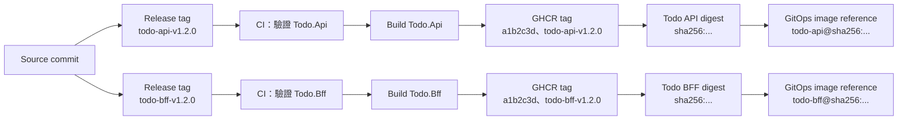

# Day 15 - 在 CI 建置 Docker Image，並管理 Tag

## 從通過檢查的原始碼，交出可部署的 image

Day 14 的 Pull Request（PR）CI 會對 `Todo.Api` 與 `Todo.Bff` 執行 restore、test 和 build。通過檢查後，程式碼還不能直接交給 GitOps：Kubernetes 的 `Deployment` 需要的是可拉取的 Container Image。

image 建出來後，版本識別會立刻變成問題。若有人說 Production 執行的是 `todo-api:v1.2.0`，我們仍不知道目前的 container 是否正是當初檢查過的那份內容。Container registry 的 tag 可以被重新指向；`v1.2.0`、Git SHA tag，甚至 `latest` 都不是不可變的內容識別。

這篇以服務名稱作為 release tag 的前綴。建立 `todo-api-v1.2.0` 時，GitHub Actions 只建置並推送 `Todo.Api`；建立 `todo-bff-v1.2.0` 時，才處理 `Todo.Bff`。workflow 同時保留 release tag、source commit 的 SHA tag 與 image digest，讓後續的 GitOps 變更能選定一份確切內容。

## Tag 用來查找，digest 用來部署

同一份 image 可以有多個 tag，但 tag 和 digest 的用途不同：

| 識別方式 | 主要用途 | 內容是否可變 |
| --- | --- | --- |
| Release tag，例如 `todo-api-v1.2.0` | release note、版本溝通，並指定要發布的服務 | 可變 |
| Git SHA tag，例如 `a1b2c3d` | 從 image 回查 source revision | 可變 |
| Digest，例如 `sha256:...` | 部署時指定確切的 image manifest | 不可變 |

Git SHA tag 與 release tag 是追蹤索引，方便人閱讀；兩者仍可能被重新推送。部署設定應使用 `image@sha256:...`，因為 registry 會依內容計算 digest。就算同一個 tag 之後被覆寫，已經 merge 的設定仍會指向原本 review 過的 image。

下面以 Todo API 與 BFF 說明這條對應關係。兩個服務可以從同一個 source commit 發布，但各自使用 release tag、Git SHA tag 與 digest；建立 API 的 release tag 不會順便發布 BFF。



## 現有 Dockerfile 如何產生 runtime image

Todo API 與 BFF 各自有一份 multi-stage Dockerfile。build stage 使用 `.NET SDK` restore 和 publish；最後的 stage 改用 ASP.NET runtime image，只複製 `/app/publish` 的輸出。

以下是 `Todo.Api` Dockerfile 的關鍵部分：

```dockerfile
FROM mcr.microsoft.com/dotnet/sdk:8.0 AS build
WORKDIR /src
COPY Todo.Api.csproj .
RUN dotnet restore
COPY . .
RUN dotnet publish --configuration Release --output /app/publish

FROM mcr.microsoft.com/dotnet/aspnet:8.0
WORKDIR /app
COPY --from=build /app/publish .
ENV ASPNETCORE_URLS=http://+:8080
EXPOSE 8080
ENTRYPOINT ["dotnet", "Todo.Api.dll"]
```

`Todo.Bff` 使用相同的分層方式，只是 project 與 entry point 分別是 `Todo.Bff.csproj` 和 `Todo.Bff.dll`。SDK、原始碼與 NuGet 快取不會被複製到最後的 runtime stage；不過 multi-stage build 本身不會處理 secret。token、password 和其他敏感值不能透過 `ARG` 或 `ENV` 寫進 build layer。

在本機可先確認兩個 image 能建置：

```bash
docker build \
  -t ghcr.io/yrw9281/it30-todo-api:local \
  src/0-todo-microservices/Todo.Api

docker build \
  -t ghcr.io/yrw9281/it30-todo-bff:local \
  src/0-todo-microservices/Todo.Bff
```

這兩個 command 的 build context 是各自的專案目錄，與 Dockerfile 裡的 `COPY Todo.Api.csproj .`、`COPY Todo.Bff.csproj .` 相符。

## Release workflow 先驗證，再推送 GHCR

PR workflow 維持 `contents: read`，不應擁有發佈權限。發佈工作由服務專屬的 release tag 觸發：`todo-api-v*` 只檢查並推送 API，`todo-bff-v*` 則只處理 BFF。這讓服務可以獨立發布和回滾，不必因為 API 的修正重建 BFF。

```yaml
name: todo-image

on:
  push:
    tags:
      - "todo-api-v*"
      - "todo-bff-v*"

permissions:
  contents: read

jobs:
  validate-todo-api:
    if: startsWith(github.ref_name, 'todo-api-v')
    runs-on: ubuntu-latest
    steps:
      - uses: actions/checkout@v4
      - uses: actions/setup-dotnet@v4
        with:
          dotnet-version: 8.0.x
      - run: dotnet restore src/0-todo-microservices/Todo.Api/Todo.Api.csproj
      - run: dotnet test src/0-todo-microservices/Todo.Api/Todo.Api.csproj --configuration Release --no-restore
      - run: dotnet build src/0-todo-microservices/Todo.Api/Todo.Api.csproj --configuration Release --no-restore

  push-todo-api:
    if: startsWith(github.ref_name, 'todo-api-v') && needs.validate-todo-api.result == 'success'
    needs: validate-todo-api
    runs-on: ubuntu-latest
    permissions:
      contents: read
      packages: write
    steps:
      - uses: actions/checkout@v4
      - uses: docker/setup-buildx-action@v3
      - uses: docker/login-action@v3
        with:
          registry: ghcr.io
          username: ${{ github.actor }}
          password: ${{ secrets.GITHUB_TOKEN }}
      - id: image
        uses: docker/build-push-action@v6
        with:
          context: ./src/0-todo-microservices/Todo.Api
          push: true
          tags: |
            ghcr.io/yrw9281/it30-todo-api:${{ github.sha }}
            ghcr.io/yrw9281/it30-todo-api:${{ github.ref_name }}
          provenance: true
          sbom: true
      - run: 'echo "todo-api digest: ${{ steps.image.outputs.digest }}"'

  validate-todo-bff:
    if: startsWith(github.ref_name, 'todo-bff-v')
    runs-on: ubuntu-latest
    steps:
      - uses: actions/checkout@v4
      - uses: actions/setup-dotnet@v4
        with:
          dotnet-version: 8.0.x
      - run: dotnet restore src/0-todo-microservices/Todo.Bff/Todo.Bff.csproj
      - run: dotnet test src/0-todo-microservices/Todo.Bff/Todo.Bff.csproj --configuration Release --no-restore
      - run: dotnet build src/0-todo-microservices/Todo.Bff/Todo.Bff.csproj --configuration Release --no-restore

  push-todo-bff:
    if: startsWith(github.ref_name, 'todo-bff-v') && needs.validate-todo-bff.result == 'success'
    needs: validate-todo-bff
    runs-on: ubuntu-latest
    permissions:
      contents: read
      packages: write
    steps:
      - uses: actions/checkout@v4
      - uses: docker/setup-buildx-action@v3
      - uses: docker/login-action@v3
        with:
          registry: ghcr.io
          username: ${{ github.actor }}
          password: ${{ secrets.GITHUB_TOKEN }}
      - id: image
        uses: docker/build-push-action@v6
        with:
          context: ./src/0-todo-microservices/Todo.Bff
          push: true
          tags: |
            ghcr.io/yrw9281/it30-todo-bff:${{ github.sha }}
            ghcr.io/yrw9281/it30-todo-bff:${{ github.ref_name }}
          provenance: true
          sbom: true
      - run: 'echo "todo-bff digest: ${{ steps.image.outputs.digest }}"'
```

workflow 以 `github.ref_name` 判斷要執行哪一對驗證與發布 job。雖然兩組步驟相似，服務各自的 job 名稱、project 路徑與 image repository 都清楚列出，review 時能直接確認一個 release tag 會影響哪個服務。`GITHUB_TOKEN` 是 repository workflow 的短期 token；它只在需要推送的 job 取得 `packages: write`，不需要改用長期 Personal Access Token（PAT）。

`provenance: true` 與 `sbom: true` 會要求 Buildx 建立 provenance 和 Software Bill of Materials（SBOM）attestation。它們提供可供後續驗證的建置資訊，但不代表 image 已通過弱點掃描，也不會自行決定哪些依賴風險可以接受。

## 將 digest 當作 promotion 的交接內容

假設 workflow 為 API 產生下列對應：

```text
source commit: a1b2c3d
release tag:   todo-api-v1.2.0
image tag:     ghcr.io/yrw9281/it30-todo-api:a1b2c3d
image digest:  ghcr.io/yrw9281/it30-todo-api@sha256:******
```

Promotion 到 Staging 或 Production 時，應帶走最後一行的 digest，而不是讓環境重新解析 `todo-api-v1.2.0`。rollback 也只要將部署設定改回一個已知正常的 digest，不必重新建置舊版 source。

目前的 GHCR manifest 仍使用 `:0.1.0` tag。它能讓本機或測試叢集拉取既有 image，還不具備以 digest promotion 的 GitOps 設定；下一篇會把 CI 產生的 digest 寫成一筆可 review 的設定變更，而不是讓 CI 直接呼叫 Kubernetes API。

若 GHCR package 設為 private，叢集必須用自己的唯讀身分拉取 image。這份憑證不是 CI 的 `GITHUB_TOKEN`，應限縮為目標 package 的 `read:packages`，並以目標 Namespace 的 image pull Secret 提供給 workload。GHCR manifest 的 README 已列出建立與引用 `ghcr-pull-secret` 的方式。

## 驗證 image 與來源是否可回查

release workflow 推送完成後，以 tag 查看 registry 回報的 digest：

```bash
docker buildx imagetools inspect \
  ghcr.io/yrw9281/it30-todo-api:todo-api-v1.2.0
```

驗收時要能從部署中的 digest 回查 image manifest、對應的 GitHub Actions run 和 source commit；反向也要能回答某個 source commit 是否已經產生指定 image。只靠 tag 猜測版本時，這條交付鏈仍然缺少不可變的依據。

## 下一步

CI 現在能產出可追溯的 image，但它不應直接部署。下一篇會將 digest 寫入 GitOps configuration 的 Pull Request，讓 review 和 Argo CD 決定它何時進入哪個環境。
