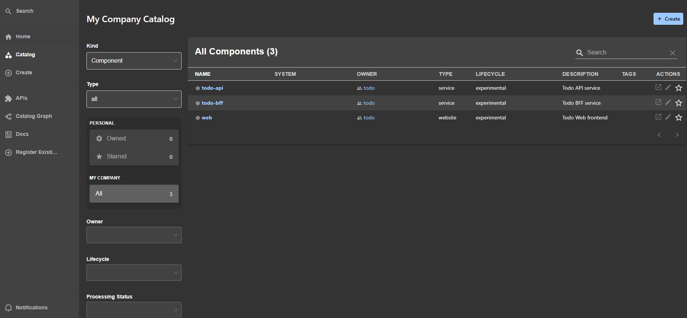
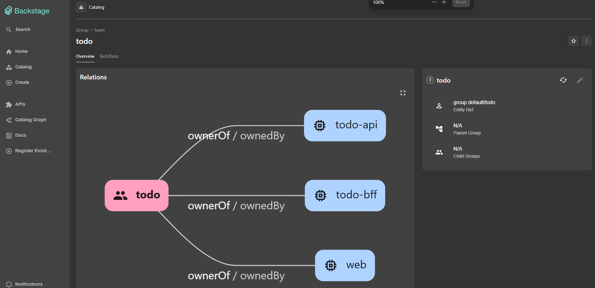
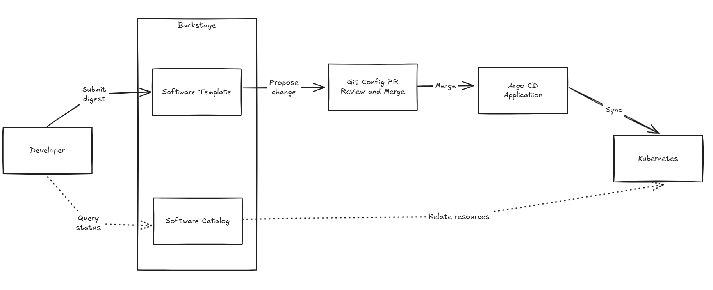

# Day 17 - 從 Backstage 到 Kubernetes：IDP 的控制流程

## 前言

Day 16 將 CI 與部署分開：Todo API 的 release workflow 產出 image digest，部署流程再透過 GitOps 設定 Pull Request（PR）提出版本變更，經過 review 與合併後，才交給 Argo CD 同步。目前 workflow 還沒有自動建立設定 PR，不過雙方要交接的內容已經清楚了。

假設 Todo 團隊現在要把 `todo-api` 的新版本送進 Dev，開發者仍得找到環境設定、修改正確的欄位、請有權限的人審查，再到 Argo CD 和 Kubernetes 確認結果。這些工作都有工具可以處理，但開發者還是要自己記住工具之間怎麼接。這篇用 Backstage 作為入口，整理從提出需求到查詢狀態的控制流程；完整路徑仍是設計，尚未串接完成。

## IDP 要讓開發者決定哪些事？

回到 Day 01 的問題，服務團隊想表達的是：哪個服務要使用哪份 image、在哪個 port 提供服務，以及要部署到哪個環境。至於 `Deployment` 的 label、`Service` selector、健康檢查與 OpenTelemetry 設定，應由平台提供一致的做法，不必在每次更新版本時重新決定。

**內部開發者平台（Internal Developer Platform，IDP）** 就是讓團隊能依這些規則交付、查詢和維護服務的一組能力。它包含開發者使用的入口，也包含背後的設定檢查、審查、同步與狀態回報。本系列選擇 Backstage 提供服務目錄與表單，Git 保存經審查的部署設定，Argo CD 與 Operator 則各自處理叢集內的資源。

所以，安裝 Backstage 只會先得到一個入口。表單送到哪裡、誰能核准變更、哪個 controller 會處理，以及畫面上的狀態從哪裡取得，仍要逐一接好。

## Backstage 的服務目錄與表單各做什麼？

Backstage 的 **Software Catalog（軟體目錄）** 整理服務名稱、擁有者與相關資訊。開發者可以在目錄中找到 `todo-api`，知道它由哪個團隊維護。這裡的 `Component` 是 Backstage 保存的服務紀錄，和 Kubernetes 裡的 `Microservice` 是兩種不同資源；把服務登錄進 Catalog，不會在叢集建立工作負載。

Catalog 也能以 **Catalog Graph** 畫出資源之間的關係，例如下圖顯示 `todo` 這個 Group 透過 `ownerOf` / `ownedBy` 關係，對應到它擁有的三個 Component。這類關聯圖幫助開發者快速找到某個團隊名下有哪些服務，但呈現的仍只是 Catalog 裡登錄的中介資料，不代表叢集內資源的即時狀態。

**Software Templates（軟體範本）** 則用來收集輸入，並執行模板定義的步驟。以更新 `todo-api` 的 Dev 版本為例，服務與環境已經固定，表單只需要收集 CI 產出的 digest。模板將輸入寫入 `Microservice` 設定，再提出 Git PR，讓審查者看到這次要換哪個版本。

這需要安裝並設定 Backstage 的 GitHub Scaffolder module，讓模板能執行提出 PR 的 action；它和用來建置 image 的 GitHub Actions workflow 是不同的執行機制。Git 憑證應留在受限的後端，瀏覽器不應取得 token，也不應任意指定 Git 路徑、目標分支或 Kubernetes Namespace。這些值應由平台的受控設定與已驗證的團隊身分決定。

固定表單欄位只是減少可輸入的範圍。後端仍要確認提交者是否有權更新 Todo 團隊的服務；digest 格式正確，也不代表它確實由授權的 CI 產出。設定儲存庫仍需要獨立檢查、review 與受保護分支，不能只相信表單已經驗證過。

## 一次版本更新如何經過 Git、Argo CD 與 Operator？

沿著 `todo-api` 更新 Dev 版本的需求，規劃中的交付流程可以分成四段：

1. 開發者在 Backstage 提交 digest，Software Template 產生設定變更並建立 PR。這一步提出的是部署需求，還沒有修改叢集。
2. 設定檢查與 reviewer 確認 image 來源、目標環境和變更範圍，通過後合併到受保護分支。合併後的設定才是 Dev 應採用的版本。
3. Argo CD 的 `Application` 讀取這份設定，依同步政策將 `Microservice` 自訂資源（Custom Resource，CR）同步到目標 Namespace。API Server 依自訂資源定義（Custom Resource Definition，CRD）的 schema 驗證並儲存它。
4. Operator 讀取 `Microservice.spec`，依平台規則建立或更新 `Deployment`、`Service`，並將觀察結果寫回 `status`。`Deployment` 底下的版本更新與 Pod 副本維護，仍由 Kubernetes 原生 controller 處理。

這裡延續了 Day 05 的分工：CRD 定義 Kubernetes 接受什麼資料，Operator 才負責收到資料後要做什麼。Argo CD 不會替 `Microservice` 產生 `Deployment`；Operator 也不負責決定誰能核准 Git 變更。兩者都以控制迴路（Control Loop）運作，但每次執行 `reconcile` 時，比對的是各自負責的設定與資源。

這條設定變更路徑把開發者的需求送進 Kubernetes；Backstage 的狀態查詢則從 Kubernetes 讀取觀察結果，讓開發者知道處理到哪裡。查詢不會再送出一次部署，兩者是不同的流程。

下圖呈現規劃中的控制流程。實線是設定與資源的交接路徑，虛線是狀態查詢路徑；圖中的 Kubernetes 代表 `Microservice` CR、Operator 與其建立的 `Deployment`／`Service`／Pod 這段處理。

目前為止，我們只有 Template 收集 digest 並產生設定這段有範例；Git 設定儲存庫、讀取它的 Argo CD `Application`、Operator 與 Catalog 的 Kubernetes plugin 都還沒接上，未來會陸續補上。

## 表單送出後，要到哪裡確認結果？

從 Backstage 按下「建立」後，模板任務完成只表示它指定的步驟已完成。如果最後一步是提出 PR，任務成功代表 PR 已建立，不能直接顯示成「部署成功」。每個交接點都有自己的觀察結果：

| 要確認的事情 | 應查看的結果 |
| --- | --- |
| 版本變更是否已提出、是否獲准？ | Git PR 的設定差異、檢查結果、review 與合併紀錄 |
| 核准的設定是否已同步到叢集？ | Argo CD `Application` 的 revision 與 `Synced` 狀態 |
| Operator 是否處理了這份服務設定？ | `Microservice.status` 回報的處理進度與受管資源 |
| 工作負載是否已準備好？ | `Deployment` 的更新進度、可用副本數與 Pod 的 `Ready` 狀態 |

例如，Argo CD 已經同步新的 image 設定，但 Pod 拉不到 image，服務仍然無法更新完成。`Synced` 和 `Ready` 回答的是不同問題；即使 Pod 已就緒，也還要透過實際請求與 Grafana 中的 Metrics、Logs、Traces 確認應用程式的行為。

若要在 Backstage 查看工作負載，需要安裝 Kubernetes 的前端與後端 plugin、設定可讀取叢集的身分，再把 Catalog 服務與目標資源關聯起來。這能讓開發者從服務入口查詢資源現況，但不會自動保存從 PR 審查到每次健康變化的完整事件時間線。查詢目前狀態和保存交付歷史，需要的資料並不相同。

## 目前哪些部分還沒接起來？

現有 release workflow 能推送 image 並輸出 digest，Argo CD 的 `Application` 也有明確的來源設定，但它讀取的是原生 Kubernetes 資源，沒有同步 `Microservice`。CRD 已定義 `image`、`port` 與初版 `status`；沒有 Operator 時，API Server 接受 CR 後，不會因此建立工作負載，也沒有 controller 回寫觀察結果。

Backstage 已有 Catalog 與 Software Template 的設定範例，但尚未完成執行環境、Git 權限與 Kubernetes plugin 的整合。Catalog 範例關聯的是 `todo` Namespace 的既有 `todo-api` 資源；Template 則以規劃中的 Dev 環境為目標，兩者還不是同一條已接通的交付路徑。獨立的設定儲存庫、讀取該設定的 Argo CD `Application` 與 Operator 也尚未建立。

因此，驗收這條流程時，必須能從一筆 `todo-api` PR 找到 Argo CD 同步的 revision、叢集中的 `Microservice`，以及 Operator 管理的工作負載；Backstage 查到的資源也必須對應同一個服務與環境。只有模板能產生設定，還不足以確認這些交接都已完成。

下一篇會從現有 `Microservice` CRD 的 `image`、`port` 合約開始，說明它能驗證哪些輸入，以及環境變數與健康狀態需要補上哪些欄位。
