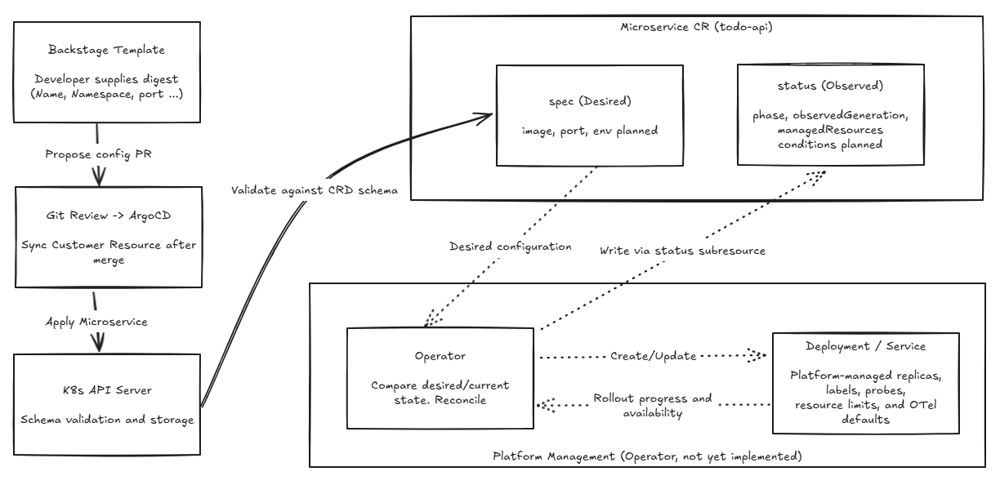

# Day 18 - 設計 `Microservice` CRD：把 Kubernetes 設定收進平台合約

前一篇用 Backstage 整理了 `todo-api` 更新 Dev 版本的路徑：開發者填入 CI 產出的 digest，模板提出 Git 設定變更，經 review 與合併後，由 Argo CD 將 `Microservice` 同步到 Kubernetes。這條路徑還沒接通，不過表單要產生什麼資料、Operator 要讀取什麼設定，得先有共同的定義。

Day 05 定義的 `Microservice` 自訂資源定義（Custom Resource Definition，CRD），已經有 `image`、`port` 與初版 `status`。這次沿用這份合約，看它能擋下哪些輸入錯誤，再處理兩個需求：服務需要環境變數時，哪些設定可以開放？換了 image 後，又要怎麼知道狀態是否對應到新版？`env` 與 `conditions` 仍是設計，這篇不會把它們當成已經可用的欄位。

## 現有 CRD 能擋下哪些錯誤？

現有 `Microservice` 是 Namespace 範圍內的資源，API group 為 `platform.example.io`，版本是 `v1alpha1`。`todo` 與 `todo-dev` 中可以各有一筆名為 `todo-api` 的資源，但它們是不同環境的部署需求，不能混用狀態。以下節錄 CRD 的版本與 schema 設定，不是完整的安裝檔：

```yaml
spec:
  group: platform.example.io
  scope: Namespaced
  versions:
    - name: v1alpha1
      served: true
      storage: true
      subresources:
        status: {}
      schema:
        openAPIV3Schema:
          type: object
          properties:
            spec:
              type: object
              required:
                - image
                - port
              properties:
                image:
                  type: string
                  minLength: 1
                port:
                  type: integer
                  minimum: 1
                  maximum: 65535
```

在 `spec` 內，`image` 必須是非空字串，`port` 必須是 `1` 到 `65535` 的整數。`port: 65536` 的 YAML 語法沒有問題，但 API Server 應依 schema 拒絕它；寫成字串 `"8080"` 也不符合型別。

不過，`minLength: 1` 只檢查字串長度，沒有檢查 image 來源或版本格式。現有 `todo-api` 範例使用 `ghcr.io/yrw9281/it30-todo-api:0.1.0`，這個 tag 可以通過驗證；填入不存在的 image 名稱，也可能通過。前一篇的模板雖然固定 repository 並收集 digest，CRD 本身仍接受 tag，不能把表單的限制當成 Kubernetes API 已有的規則。

若要限定核准的 GHCR repository 與 digest 格式，輸入層、Git 設定檢查和叢集政策都需要對應規則。至於 digest 是否由授權 CI 產出、提交者是否屬於 Todo 團隊，就不是這份 schema 能確認的事。

## 哪些設定要開放給服務團隊？

CRD 有 `port`，不代表每次更新版本都得讓開發者重新填一次。以 `todo-api` 的 Dev 模板為例，服務名稱固定為 `todo-api`、Namespace 是 `todo-dev`、`port` 是 `8080`，開發者只填 digest。這些值沒有出現在表單上，產生的 `Microservice` 仍要包含它們。

服務合約與操作入口的責任可以這樣區分：

| 設定或結果 | 由誰決定 | 如何表達 |
| --- | --- | --- |
| 服務名稱、image、port | 服務團隊提出需求，模板可固定不需變動的值 | `metadata.name`、`spec.image`、`spec.port` |
| Namespace、目標環境與 Git 位置 | 平台依團隊身分與環境規則限制 | 受控的模板與部署設定，不開放任意填寫 |
| 副本數、label、probe、資源限制與 OpenTelemetry 預設 | 平台制定規則，規劃由 Operator 套用 | Operator 應建立或更新的 `Deployment`、`Service` 等資源 |
| 受管資源的處理進度與可用狀態 | 規劃由 Operator 觀察後回報 | `status`，不由服務團隊自行填寫 |

環境變數也需要同樣的取捨。假設 `todo-api` 支援從 `LOG_LEVEL` 讀取 log 層級，服務團隊就有理由透過合約調整它。這個名稱得先由應用程式支援；只在 YAML 補上一個值，不會讓應用程式自動知道該怎麼使用它。

若增加 `spec.env`，可以用 string map 表達非敏感設定，不必開放整段 Kubernetes `PodSpec`。設計時還要決定哪些名稱允許覆寫、value 是否一律為字串，以及未填寫時採用什麼預設。既有 `todo-api` 的 `Deployment` 已設定 `OTEL_SERVICE_NAME` 與 `OTEL_EXPORTER_OTLP_ENDPOINT` 等環境變數；若這些值由平台管理，就不應讓一般輸入蓋掉，否則同一服務的遙測資料可能被送到不同位置。

Token、密碼與 connection string 也不能放進這份 map 或 Git。敏感值需要另外設計 Secret 的引用方式與存取權限。目前的 CRD 沒有 `spec.env`，也沒有 Secret 引用欄位，所以這裡只決定合約應開放到哪裡，不提供尚未支援的 YAML。

合約的邊界如下：服務團隊提出 `spec`，API Server 檢查並儲存，Operator 再依平台規則處理工作負載，把觀察結果寫回 `status`。其中 `env`、`conditions` 與 Operator 都尚未實作。

下圖呈現這份合約的責任分工：Backstage 經 Git review 與 Argo CD 提交設定，Kubernetes API Server 依 CRD schema 驗證並儲存；虛線則標示尚未實作的 Operator 處理與狀態回報。完整交付路徑仍未串接完成。



## `status` 應回報哪一版資源的結果？

現有 `status` 定義了 `phase`、`observedGeneration` 與 `managedResources`。`phase` 用來概括處理階段，`managedResources` 記錄受管的 `Deployment`、`Service` 名稱；但光靠這兩者，還不能判斷狀態對應哪一次更新。

假設 `todo-api` 原本已就緒，團隊剛把 `spec.image` 換成新的 digest。此時舊 Pod 可能還能提供服務，但新 Pod 尚未啟動。如果畫面只沿用原本的就緒狀態，開發者就會誤以為這次更新已經完成。

這也是 `status.observedGeneration` 的用途。`metadata.generation` 由 Kubernetes 維護，`spec` 變更時會增加；Operator 則應將這次觀察結果所對應的 generation 寫入 `status.observedGeneration`。兩者不同時，狀態還沒有反映最新的服務設定，不能拿來判定新版已就緒。

兩者相同也只代表狀態對應到新版，並不保證工作負載已可用。因此，規劃中的合約會增加 `status.conditions`，表達是否就緒以及原因。例如已更新 `Deployment`、仍在等待新 Pod 時，應回報 `Ready=False`；image 拉取失敗時，也要留下可診斷的原因，不能把 API 接受更新當成服務已就緒。

Operator 必須依同一版 `spec` 的實際處理結果更新 `status.observedGeneration` 與 `status.conditions`，不能只讀到新設定，就保留舊的 `Ready=True`。讀取狀態的工具才能分辨「尚未處理新設定」和「已處理，但工作負載還沒就緒」。

前面 CRD 的 `subresources.status` 讓 `status` 有獨立的更新介面，平台可以透過 RBAC 另外授予 Operator 寫入權限；啟用這個介面本身，不會自動限制所有使用者，也不會產生觀察結果。目前沒有實作處理 `Microservice` 的 Operator，即使 API Server 已儲存資源，也不會因此建立 `Deployment` 或填入狀態。

## 讓 API Server 檢查 `todo-api` 的輸入

Day 05 的操作已包含安裝這份 CRD，再以 dry-run 檢查範例 CR。若沿用當時的叢集，`Microservice` 資源型別應已存在，這裡不需要重新安裝。操作前仍確認目前連線的叢集有這份 CRD 與 `todo` Namespace，並具備在該 Namespace 提交 `Microservice` 的權限：

```bash
kubectl get crd microservices.platform.example.io
kubectl get namespace todo
```

若 CRD 回傳 `NotFound`，代表目前連線的叢集沒有這份資源型別，需要補上 Day 05 的完整 CRD 安裝步驟。只對 CRD 定義執行 dry-run，也不會讓 API Server 開始接受 `Microservice`。以下輸入已在安裝這份 CRD 的叢集以 server-side dry-run 實測，沒有儲存任何 CR。

將以下內容存成 `todo-api.yaml`。這裡沿用 `todo` Namespace 的 tag 範例，目的是檢查既有合約；它不是前一篇模板產生的 `todo-dev` 版本更新：

```yaml
apiVersion: platform.example.io/v1alpha1
kind: Microservice
metadata:
  name: todo-api
  namespace: todo
  labels:
    app.kubernetes.io/owner: todo-team
spec:
  image: ghcr.io/yrw9281/it30-todo-api:0.1.0
  port: 8080
```

用 server-side dry-run 將資料交給 API Server 驗證，不儲存這筆資源：

```bash
kubectl apply --server-side --dry-run=server -f todo-api.yaml
```

這筆輸入通過驗證，指令回傳 exit code `0`。要測試拒絕情境，可以複製成 `invalid-todo-api.yaml`，將 `metadata.name` 改為 `invalid-todo-api`，並把 `port` 改成 `65536`，其餘內容不變：

```bash
kubectl apply --server-side --dry-run=server -f invalid-todo-api.yaml
```

API Server 拒絕這筆輸入，指出 `spec.port` 必須小於或等於 `65535`，指令回傳 exit code `1`。其他欄位也可以用同樣方式一次改一個值，避免不知道是哪個限制擋下資料。以下各項都已用相同方式實測：

| 輸入變化 | 目前 schema 的實測結果 |
| --- | --- |
| 使用原有 image，`port` 為 `8080` | 通過 |
| `port` 分別為 `1`、`65535` | 通過，兩個邊界值都包含在範圍內 |
| `port` 為 `0` 或 `65536` | 拒絕，超出範圍 |
| `port` 為字串 `"8080"` | 拒絕，型別不是整數 |
| `image` 為空字串 | 拒絕，不符合最小長度 |
| 保留 `spec`，但移除其中的 `image` 或 `port` | 拒絕，缺少 `spec` 內的必填欄位 |
| 移除整個 `spec` | 目前 schema 不會因缺少 `spec` 而拒絕 |

最後一列是現有合約的缺口：`required` 寫在 `spec` 的 schema 裡，根層卻沒有把 `spec` 列為必填。只要有 `spec`，就必須包含 `image` 與 `port`；但整個 `spec` 沒送進來時，這段規則就不會要求它出現。若要強制每筆資源都有部署需求，根層也要把 `spec` 列為必填；修改合約前，還要檢查既有 CR 是否符合新增的限制。

dry-run 通過只表示 API 接受這份資料，無法驗證 Operator 是否建立工作負載。`env` 擴充需要測非字串 value 與平台保留名稱的處理規則；`conditions` 則需要配合 Operator，測新版尚未就緒時是否還殘留舊的就緒狀態。這些情境不能只靠一次 schema 驗證確認。

下一篇會以 Kopf 說明 Operator 如何接收 `Microservice` 事件，以及設定變更、受管資源被刪除或狀態改變時，為什麼都需要觸發 `reconcile`。
