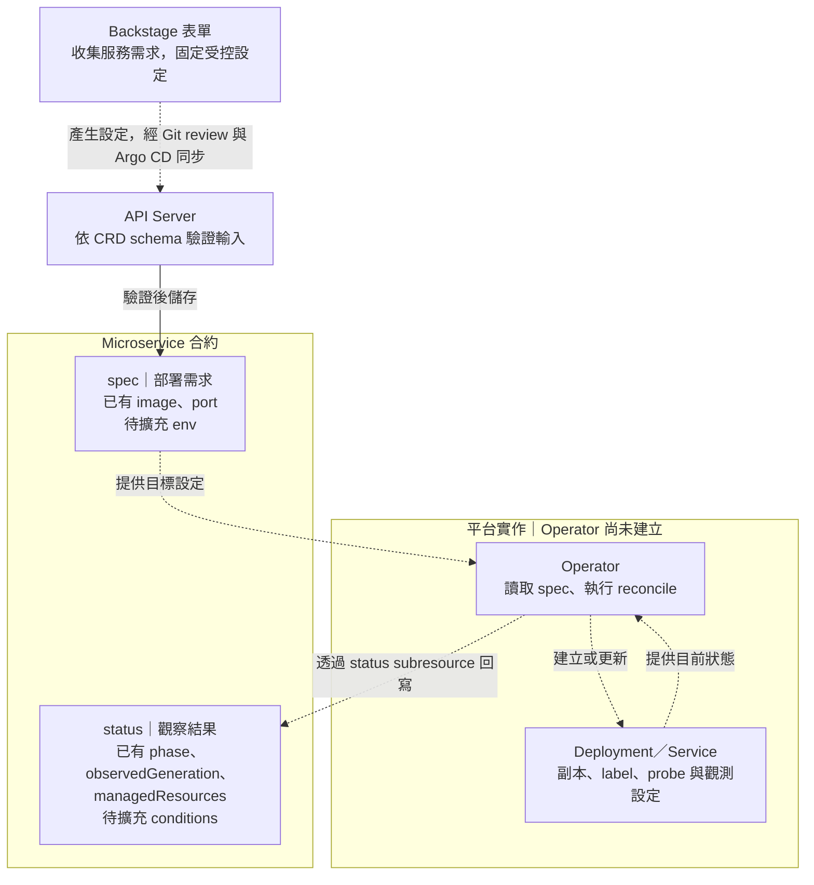

# Day 18 - 設計 `Microservice` CRD：把 Kubernetes 設定收進平台合約

## 前言

Day 17 規劃由開發者透過 Backstage 提出 `todo-api` 的版本變更，經 Git review 後，由 Argo CD 將 `Microservice` 同步到 Kubernetes。這條路徑還沒串接完成，但它已經決定了一個介面：表單產生的設定與 Operator 讀取的輸入，都要符合 `Microservice` 的合約。

Day 05 的 `Microservice` 自訂資源定義（Custom Resource Definition，CRD）已有 `image`、`port` 與初版 `status`。不過，服務若需要環境變數，或開發者想知道新版是否就緒，這份合約還不夠。這篇先確認現有欄位能驗證什麼，再整理要擴充的內容；環境變數、`conditions` 與 Operator 都尚未實作。

## 現有 CRD 能擋下哪些錯誤？

現有 `Microservice` 是 Namespace 範圍內的資源，API group 為 `platform.example.io`，版本是 `v1alpha1`。以下節錄 CRD 的版本與 schema 設定；`required` 和型別限制定義了 `spec` 內的輸入規則，不是一份完整的安裝檔：

```yaml
spec:
  group: platform.example.io
  scope: Namespaced
  versions:
    - name: v1alpha1
      served: true
      storage: true
      subresources:
        status: {}
      schema:
        openAPIV3Schema:
          type: object
          properties:
            spec:
              type: object
              required:
                - image
                - port
              properties:
                image:
                  type: string
                  minLength: 1
                port:
                  type: integer
                  minimum: 1
                  maximum: 65535
```

在 `spec` 內，`image` 必須是非空字串，`port` 必須是 `1` 到 `65535` 的整數。例如 `port: 65536` 超過上限，即使 YAML 語法正確，仍不符合這份 schema。

不過，`minLength: 1` 沒有檢查 image 的來源或版本格式。現有 `todo-api` 範例使用 `ghcr.io/yrw9281/it30-todo-api:0.1.0`，這個 tag 可以通過驗證；換成一個不存在的 image 名稱，也可能通過。若要限定核准的 GHCR repository 與 digest 格式，輸入層、Git 設定檢查和叢集政策都需要對應規則。至於 digest 是否由授權 CI 產出、提交者是否屬於 Todo 團隊，就不是這份 schema 能確認的事。

## 哪些設定要開放給服務團隊？

CRD 裡有一個欄位，不表示每張表單都必須開放它。以 `todo-api` 的 Dev 版本更新為例，Backstage 模板可以固定服務名稱、Namespace 和 `port`，只讓開發者填入 digest；模板產生的資源仍然要包含合約要求的 `image` 與 `port`。

服務合約與操作入口的責任可以這樣區分：

| 設定或結果 | 由誰決定 | 如何表達 |
| --- | --- | --- |
| 服務名稱、image、port | 服務團隊提出需求，模板可固定不需變動的值 | `metadata.name`、`spec.image`、`spec.port` |
| Namespace、目標環境與 Git 位置 | 平台依團隊身分與環境規則限制 | 受控的模板與部署設定，不開放任意填寫 |
| 副本數、label、probe、資源限制與 OpenTelemetry 預設 | 平台制定規則，由 Operator 套用 | 產生的 `Deployment`、`Service` 等資源 |
| 受管資源的處理進度與可用狀態 | Operator 觀察後回報 | `status`，不由服務團隊自行填寫 |

如果 `todo-api` 要透過非敏感的 `LOG_LEVEL` 調整 log 層級，且應用程式確實支援讀取它，合約可以增加 `spec.env`。這不需要把整段 Kubernetes `PodSpec` 開放給表單。若採用 string map，就要明確限制每個 value 都是字串，並決定哪些名稱能由服務團隊覆寫；例如平台管理的 OpenTelemetry 設定，不應被一般輸入蓋掉。Token、密碼與 connection string 也不應放進這份設定或 Git。

下圖將合約分成輸入與觀察結果。`env` 和 `conditions` 是待擴充的欄位；虛線標示尚未串接的 Backstage 輸入流程，以及尚未實作的 Operator 行為。



`subresources.status` 讓 `status` 有獨立的更新介面，平台可以另外授予 Operator 寫入權限。它不會自動產生狀態；目前沒有 Operator，即使 API Server 已接受並儲存 `Microservice`，也不會因此建立 `Deployment` 或填入觀察結果。

## `status` 應回報哪一版資源的結果？

假設 `todo-api` 原本已就緒，團隊剛把 `spec.image` 換成新的 digest。此時舊 Pod 可能還能提供服務，但新 Pod 尚未啟動。如果畫面只沿用原本的就緒狀態，開發者就會誤以為這次更新已經完成。

這也是 `status.observedGeneration` 的用途。`metadata.generation` 由 Kubernetes 維護，`spec` 變更時會增加；Operator 則應將這次觀察結果所對應的 generation 寫入 `status.observedGeneration`。兩者不同時，狀態還沒有反映最新的服務設定，不能拿來判定新版已就緒。

兩者相同也只代表狀態對應到新版，並不保證工作負載已可用。因此，規劃中的合約會增加 `status.conditions`，補上是否就緒及原因，例如等待新 Pod 時回報 `Ready=False`；若已判定無法自行恢復，就明確留下卡住的原因。Operator 必須依同一版 `spec` 的實際處理結果更新 `status.observedGeneration` 與 `status.conditions`，不能只讀到新設定，就保留舊的 `Ready=True`。

讀取這份合約的工具，才能分辨「尚未處理新設定」與「已處理，但工作負載還沒就緒」，不必從單一 `phase` 猜測更新進度。

## 檢查合約時，要測哪些輸入？

檢查現有 schema 時，可以固定 `todo-api` 的其他設定，只改一個輸入。以下是依目前規則應得到的結果，不是叢集實測紀錄：

| 輸入變化 | 目前 schema 的預期結果 |
| --- | --- |
| 使用原有 image，`port` 為 `8080` | 通過 |
| `port` 分別為 `1`、`65535` | 通過，兩個邊界值都包含在範圍內 |
| `port` 為 `0` 或 `65536` | 拒絕，超出範圍 |
| `port` 為字串 `"8080"` | 拒絕，型別不是整數 |
| `image` 為空字串 | 拒絕，不符合最小長度 |
| 保留 `spec`，但移除其中的 `image` 或 `port` | 拒絕，缺少 `spec` 內的必填欄位 |
| 移除整個 `spec` | 目前 schema 不會因缺少 `spec` 而拒絕 |

最後一列是現有合約的缺口：`required` 寫在 `spec` 的 schema 裡，根層卻沒有把 `spec` 列為必填。因此，不能只看見 `required` 就認為所有缺漏都已擋下；若要強制每筆資源都有部署需求，根層也需要補上這個限制。

安裝 CRD 後，可用 Kubernetes API 的 server-side dry-run 檢查這些輸入。dry-run 不會儲存資源，也無法驗證 Operator 是否建立了工作負載。擴充 `env` 與 `conditions` 時，則需要新增非字串環境變數、覆寫平台保留設定、舊版就緒狀態殘留等案例，分別驗證 schema、輸入層與 Operator 的處理結果。

下一篇會以 Kopf 說明 Operator 如何接收 `Microservice` 事件，並在設定變更或受管資源出現差異時執行 `reconcile`。
