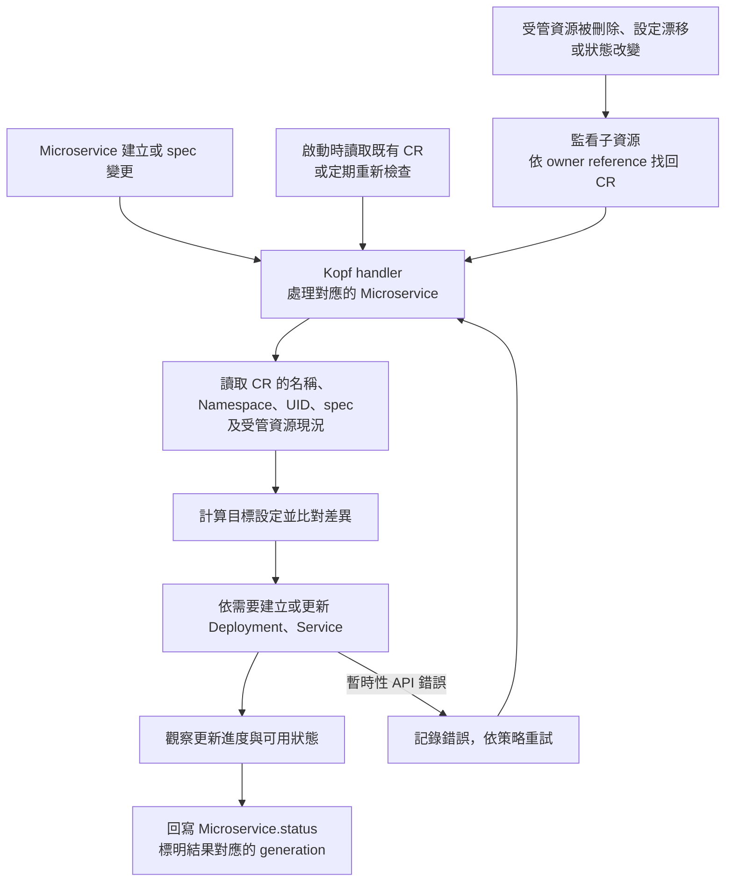

# Day 19 - Operator 模式與 Kopf：怎麼處理 CRD 事件

## CR 已經建立，Deployment 在哪裡？

Day 18 的 `Microservice` 可以把 `todo-api` 的 image 與 port 存進 Kubernetes，但 API Server 不會因此替它建立工作負載。有人修改 `spec.image`、手動刪除受管 Service，或讓 Pod 卡在 image pull 時，誰要發現並處理差異？

這是 Operator 要做的事。它在一次 `reconcile` 中讀取 `Microservice.spec` 與叢集現況，計算應有的 `Deployment`、`Service`，再處理差異。持續觀察與處理的整體模式，就是前面介紹的**控制迴路（Control Loop）**。目前只有 CRD 和範例 CR，尚未實作 Operator；這篇先決定事件該如何觸發處理，以及失敗後要怎麼重試。

## 為什麼選 Kopf？

無論用哪種語言，controller 都需要接收事件、呼叫 Kubernetes API 並處理失敗。Go 的 controller-runtime 與 Kubebuilder 提供強型別 API 和 controller 開發工具；本系列則規劃使用 Python 的 Kopf（Kubernetes Operator Pythonic Framework），把重點放在 `Microservice` 的欄位所有權、重試與狀態回報。

Kopf 讓我們用 handler 表達收到事件後的處理邏輯，減少一些框架樣板。但它不會替我們決定資源該長什麼樣子，也不會自動補齊 RBAC、部署設定或測試。

## 哪些事件需要觸發 `reconcile`？

`Microservice` 建立或 `spec` 變更時，可以由 Kopf handler 接手。不過，只監看這兩種變化還不夠。假設有人刪除了受管的 `Service`，CR 的 `spec` 沒有改變，Operator 不一定會收到新的 CR 事件。

要補回 `Service`，就得另外監看受管子資源（child resources），將事件對回所屬 CR，或設定有明確頻率與成本的重新檢查機制。`Deployment` 的狀態變化也需要觸發觀察，否則新 Pod 已就緒，CR 的 `status` 卻可能一直停在等待中。Operator 啟動後，也應重新處理既有 CR，而不是只等新資源建立。

下圖是規劃中的處理流程。子資源監看、重新檢查與重試都需要明確實作，不能因為選了 Kopf，就假設它們已經接好。

handler 不能假設事件只會送一次。API 呼叫可能暫時失敗，process 也可能在處理到一半時重啟；再次處理同一筆 CR，仍應收斂到同一組資源。已存在且由這筆 CR 管理的 `Deployment` 應更新成目標設定，不要建立第二份，也不要只因「已存在」就讓整次處理失敗。

| 觀察到的事 | Operator 應如何處理 | 不能誤報成什麼 |
| --- | --- | --- |
| 第一次建立 CR | 建立受管 Deployment 與 Service | CR 通過 schema 就等於服務就緒 |
| 更新 `spec.image` | 更新同一個 Deployment，等待新 Pod ready | 舊版 Pod 已可用，所以新版也成功 |
| Service 遭刪除 | 重新建立受管 Service，並留下可觀察原因 | 因沒有 CR 更新就忽略 |
| image 無法拉取 | 維持尚未就緒，回報明確原因 | API 已接受資源，所以 `Ready=True` |

現有 CRD 的 `status` 只有 `phase`、`observedGeneration` 與受管資源名稱；表中的 `Ready` condition 是規劃中的擴充，不是目前能由 Kopf 回寫的既有欄位。

## 資源所有權與失敗重試

專屬的 `Deployment`、`Service` 應透過 `ownerReferences` 指向所屬 `Microservice` 的 UID，讓 Kubernetes 能依所有權進行垃圾回收。名稱相同卻屬於另一筆資源時，Operator 應回報衝突，不能直接接管或覆寫。若有外部 DNS 或資料庫需要額外清理，再評估 finalizer，避免刪除一直卡在無法完成的外部呼叫。

API Server 暫時不可用時，handler 應留下明確錯誤並依重試策略再試；輸入若已確定不合規，則回報可診斷的失敗，不要用廣泛的 `except` 把它吞掉。status 也要誠實：送出建立 Deployment 的請求，不等於 Deployment 已 available。

## 怎麼驗證它是一個 controller？

目前還不能執行 Operator 演練。實作後，可以沿用上表的情境，反覆送出同一筆 CR、修改 image、刪除受管 `Service`，並讓新 Pod 拉不到 image。除了確認資源與狀態符合預期，也要在處理途中重啟 Operator，確認它會重新讀取既有 CR，接著完成未完成的工作。第一次建立成功，還不足以證明 controller 能持續維持狀態。

下一篇將這份責任拆到資源欄位：`Microservice` 的 image、port 如何對應到 Deployment 與 Service，哪些預設應留給 Operator。
