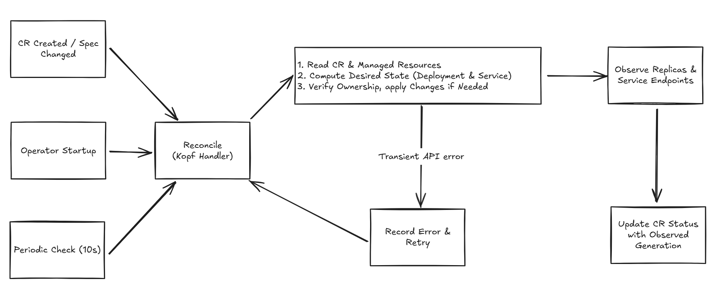

# Day 19 - Operator 與 Kopf：從服務合約到控制迴路

前一篇讓 Kubernetes 認識了 `Microservice`：服務團隊可以用 `image`、`port` 表達部署需求，API Server 也能檢查資料格式。不過，就算這筆自訂資源（Custom Resource，CR）通過驗證，既有的 `todo-api` 也不會跟著更新。我們還缺一個讀取需求、修改工作負載的程式。

這段程式會用 Operator 的方式實作。在動手前，先回答一個問題：前面已經有 Helm 和 Argo CD，為什麼還要自己寫程式管理部署？

## 有 Helm 和 Argo CD，還需要 Operator 嗎？

如果需求只是填入 image、產生 `Deployment` 和 `Service`，再經 Git review 部署，Helm 搭配 Argo CD 就能做到。Backstage 的表單也可以設計成產生 Helm values，不一定要提交 CR。建立內部開發者平台（Internal Developer Platform，IDP），不一定需要自己寫 Operator。

這個系列選擇 `Microservice`，是要讓 Kubernetes 裡也有一份服務合約。開發者提交 image 和 port，平台依這份需求維持副本數、健康檢查與 OpenTelemetry（OTel）設定，並把處理結果整理回同一筆 CR。後續查詢工具讀取它，就能知道服務正在更新、已就緒，還是遇到錯誤。

代價是我們得維護另一個 controller，包括 API 權限、錯誤重試與狀態回報。如果只需要把幾份 YAML 參數化，這份成本未必划算；本系列選這條路，是要實作從 CR 讀取需求、維持資源到回報狀態的過程。

## Operator 和一般部署腳本有什麼不同？

部署腳本通常執行完就結束。假設腳本建立了 `Service`，隔天有人把它刪掉，腳本不會自己再跑一次。Operator 則是帶有應用程式管理規則的 controller，會持續觀察資源，處理需求與現況的差異。

以 Todo API 為例，一次 `reconcile` 會讀取 `Microservice` 與目前的 `Deployment`、`Service`，算出應有的設定，再建立缺少的資源或更新不同的欄位。之後重新觀察結果，這就是前面介紹的控制迴路（Control Loop）。同一筆需求可能被處理多次，所以每次都要收斂到同一組資源，不能多跑一次就多建立一個 `Deployment`。

Operator 不必自己建立 Pod。它提交 `Deployment` 後，rollout、Pod 建立與副本維持仍由 Kubernetes 原生 controller 處理。我們寫的程式只負責服務合約，以及由這份合約產生的資源。

## Operator 開發框架幫我們處理什麼？

不用框架也能寫 controller，但除了部署規則，還得處理 Kubernetes API 的事件監看、連線中斷後的恢復、處理進度與重試。Operator 開發框架提供這些共通機制，讓我們把程式集中在收到事件後要做的事。

這裡要區分兩個名稱。「Operator 開發框架」泛指這類工具；**Operator Framework** 則是特定專案，包含 Operator SDK 與 Operator Lifecycle Manager（OLM）等工具。Kopf 是另一個 Python 框架，不是該專案裡的元件。

常見選擇可以這樣看：

- **Kubebuilder／controller-runtime**：Go 生態的開發工具與函式庫。Kubebuilder 協助建立專案、API 型別與相關檔案，controller-runtime 提供 controller 執行所需的機制。
- **Operator SDK**：Operator Framework 的開發工具，提供 Go、Ansible、Helm 等開發方式，也涵蓋打包與生命週期管理的工作。
- **Kopf**：Kubernetes Operator Pythonic Framework。用 Python 的 decorator 註冊 handler，指定 CR 建立、欄位修改或程式啟動時要執行哪個函式。

本系列選 Kopf，主要是為了讓實作容易跟著讀。下一篇只要看一個 Python 函式與幾個 decorator，就能理解 CR 事件怎麼進入程式，不必同時學 Go 的專案骨架與程式碼產生工具。

這不代表 Kopf 適合所有團隊。若既有 controller 都用 Go，沿用 controller-runtime 可能比較容易維護。選 Python 也沒有省掉 Kubernetes API 的知識；建立資源、判斷所有權與觀察 rollout，仍要自己寫。

## Kopf handler 如何處理 Todo API？

我們會先註冊一個 handler，接收 CR 建立與 `spec` 修改事件。Operator 重啟時，也讓 Kopf 對既有 CR 執行 resume handler，接續處理，不必等人再改一次 image。

但這些事件只告訴程式「有一筆需求要處理」。Kopf 不知道 Todo API 要用幾個副本、`Service` 要選哪些 Pod，或什麼時候才能回報就緒。這些規則會由後面的 Python 程式決定：

| 要處理的事 | Todo API 的做法 |
| --- | --- |
| 產生工作負載 | 將 `spec.image`、`spec.port` 放進 `Deployment`、`Service`，套用平台預設 |
| 避免改到別人的資源 | 用 `ownerReferences` 確認資源屬於這筆 CR，遇到同名外部資源就回報衝突 |
| 資源被刪除或設定被改動 | 定期讀取現況，補回缺少的資源與平台管理的設定 |
| 判斷更新結果 | 觀察新版 rollout 與 `Service` endpoint，將結果寫回 CR 的 `status` |

`Service` 被刪除時，CR 的 `spec` 沒有變；Pod 剛就緒時，也不會因此觸發一次 CR 設定更新。這個範例用每十秒的定期檢查處理它們，暫時不另外監看每種子資源。做法比較容易追蹤，但會增加 API 呼叫，也有等待時間，不能保證十秒內修復。

下圖是後續要完成的流程。Kopf 負責觸發 handler；中間讀取、比對資源與觀察健康的部分，則是我們要寫的程式邏輯。

API 暫時失敗時，handler 可以透過 Kopf 的 `TemporaryError` 要求稍後重試；輸入不符合服務規則時，則記錄原因並回報錯誤，避免一直重送相同操作。框架提供重試機制，哪些錯誤要重試仍由程式判斷。

這個 Operator 只先支援既有 Todo API。它會沿用 Todo 的健康端點與 OTel 設定，不能拿任意 image 就當成通用服務部署；同名的既有資源也要先明確移交，不能直接覆寫。換版後的狀態則必須標記對應的 generation，避免把舊 Pod 可用誤認成新版成功。這些細節會在資源管理與健康回報時分別實作。

下一篇先不改動 Todo 工作負載，只讓 Kopf 在 `todo` Namespace 收到 CR，留下 log 並回寫 `Accepted`。確認這一步能運作後，再加入資源建立與更新。

## 延伸閱讀

- [Kopf 官方文件](https://docs.kopf.dev/en/stable/)：handler、錯誤重試與控制迴路的實作方式。
- [Operator Framework 專案介紹](https://operatorframework.io/about/)：Operator SDK 與生命週期管理工具的範圍。
