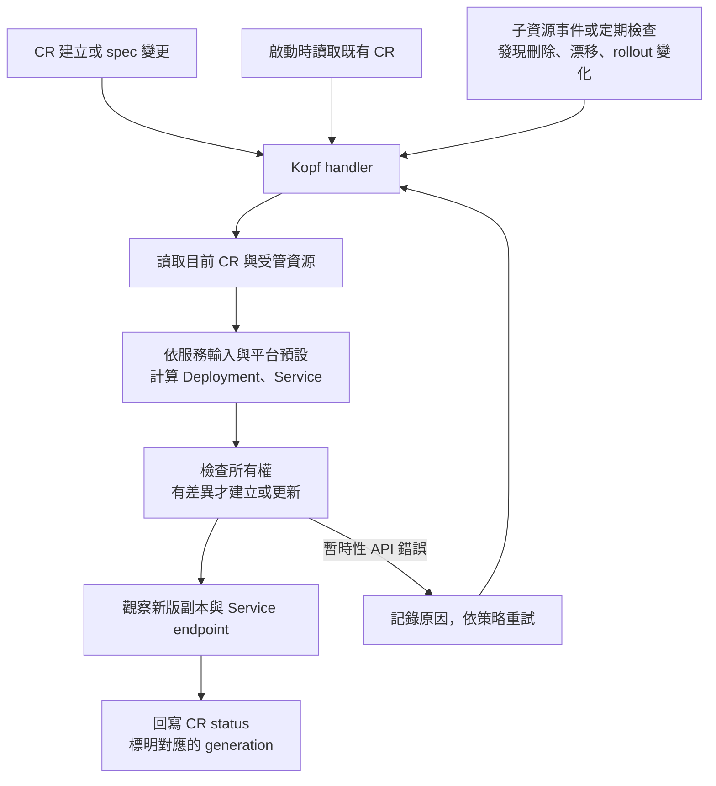

# Day 19 - Operator 與 Kopf：從服務合約到控制迴路

前一篇的 `Microservice` 已經能表達 Todo API 要使用的 image 與 port，也能讓 API Server 檢查欄位。但建立一筆 CR，並不會多出 Deployment。設定換版、Service 被刪除，或新 Pod 拉不到 image 時，還需要有人讀取現況、處理差異並回報結果。

Operator 就負責這段工作。它每次執行 `reconcile`，會讀取 CR 與受管資源，計算目標設定，再建立或更新資源。持續觀察、處理、再觀察的整體模式，是前面介紹的控制迴路（Control Loop）。

## Kopf 接事件，資源規則仍由我們決定

不論使用哪種語言，controller 都需要監看 Kubernetes API、處理事件與失敗。Go 的 controller-runtime 與 Kubebuilder 提供型別與開發工具；這個系列選用 Python 的 Kopf（Kubernetes Operator Pythonic Framework），以 handler 接收事件，減少框架樣板。

Kopf 可以把 CR 建立、`spec` 變更或啟動時的恢復處理接到 Python 函式，也提供錯誤重試的機制。不過，它不知道 Todo API 應使用幾個副本、Service 要選哪些 Pod，或什麼情況才能回報 ready。這些都要由平台合約與程式明確定義。

只接 create 與 update 還不夠。Service 被刪除時，CR 的 `spec` 沒有變；新 Pod 剛就緒，也不會自動形成一次 CR 設定更新。Operator 必須監看受管子資源，或以定期檢查補上這些變化。重啟後也要重新處理既有 CR，不能只等下一筆新資源。

下圖呈現需要接上的處理方向。定期檢查是另一個觸發來源，不是 `reconcile` 函式裡永不結束的迴圈。

## image 和 port 之外，哪些值留給平台？

既有 Todo API 使用 `app: todo-api` 的 Pod label，Service 把 `8080` 的流量轉給 container 的具名 `http` port。CR 只有 image 和 port，Operator 就得一起維持名稱、label、selector 與 port 的對應，不能只換其中一個欄位。

| 來源 | 應落到哪裡 | 要維持的關係 |
| --- | --- | --- |
| CR 名稱與 Namespace | Deployment／Service 的名稱和位置 | 不跨環境建立資源 |
| CR 的 UID | child resource 的 owner reference | 只管理這筆 CR 擁有的資源 |
| `spec.image` | container image | 原樣使用輸入的 reference，不重新挑 tag |
| `spec.port` | container port、Service port | Service 的 `targetPort` 對應 container 的具名 port |
| 平台預設 | 副本數、probe、資源額度與 OTel 設定 | 不要求開發者每次換版都重填 |

健康檢查不能只因 Todo API 有 `/health/ready`、`/health/live`，就套用到所有 image。服務必須支援這些介面，否則 Pod 可能一直無法 ready。同樣地，加入 OpenTelemetry（OTel）環境變數，也不會替沒有 SDK 或 instrumentation 的程式產生遙測資料。

服務名稱、部署環境與 Collector endpoint 可以由平台決定；版本則不能在換 image 後還留著固定的 `0.1.0`。digest 能識別 image 內容，但不能直接推得 release version。合約沒有這份發布資訊時，就要交代使用的識別方式與限制，不憑空補一個版本。

## 名稱相同，不代表可以接管

handler 可能收到重複事件，API 呼叫也可能完成到一半就遇到重啟。再次處理同一筆 CR，應收斂到同一組資源；不能每次建立一份新的 Deployment，也不能把「已存在」都視為成功。

資源的 `ownerReferences` 應指向所屬 CR 的 UID。若同名 Deployment 已由別的方式管理，Operator 要回報衝突，而不是直接覆寫。要從既有 manifest 移交，必須另外做明確的接管，並避免 Argo CD 與 Operator 同時維持同一份 child 設定。

所有權也影響刪除：CR 被刪除後，Kubernetes 可以垃圾回收它擁有的 child resources。若另外管理外部 DNS 或資料庫，才需要進一步設計清理與 finalizer，不能把外部呼叫無限重試，讓刪除永遠卡住。

## 狀態要回答的是哪一次更新

送出 Deployment 建立請求，並不代表 Pod 已可用。換 image 後，舊 Pod 可能仍在接流量，新 Pod 卻卡在拉取 image；只看可用副本數，就可能誤報新版成功。

Operator 應先確認資源設定符合目前 CR，再檢查 rollout 與 Service endpoint。回寫 `status` 時，`observedGeneration` 要指出結果對應的 CR 版本；CR 與 Deployment 各自有 generation，兩個數字不能直接相比。

| 情境 | Operator 要做的事 | 狀態不能誤報成什麼 |
| --- | --- | --- |
| 更新 image | 更新同一個 Deployment，觀察新版副本 | 舊 Pod 可用，所以新版成功 |
| Service 被刪除 | 重新建立這筆 CR 的 Service | CR 沒改，所以不處理 |
| image 拉取失敗 | 保留可診斷原因，繼續觀察 | API 接受設定，所以 ready |
| Operator 重啟 | 重新讀取既有 CR，接續處理 | 沒有新 create 事件，就忽略既有服務 |

這些情境也會成為實作時的檢查項目。一次建立成功，只確認第一個動作完成，還沒有證明 controller 能維持狀態。

下一篇先把 Kopf 跑進既有的 `todo` Namespace，透過 log 與 `Accepted` 確認事件確實送進 handler。
