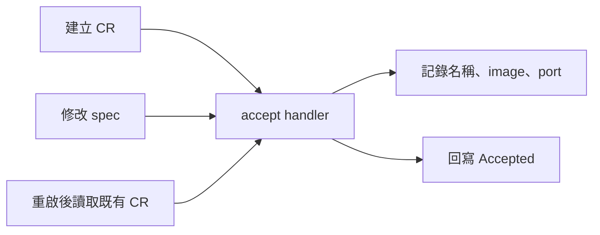

# Day 20 - 用 Kopf 接收 `Microservice` 事件並部署 Operator

前一篇選定用 Kopf 實作 Operator。今天先看最小的事件處理：收到 `Microservice` 後，印出 image、port，並把 `status.phase` 改成 `Accepted`。

暫時不修改 `Deployment` 或 `Service`。CR 沒有反應時，我們就能先確認程式有沒有收到事件，不必同時排查工作負載。以下聚焦 handler 與部署方式，不列出完整安裝設定；觀察指令適用於已部署這個觀察版本的測試環境。

## 用 decorator 指定事件

Kopf 的 decorator 寫在函式上方，用來指定何時執行函式。下面節錄事件處理部分，三種事件共用一個 `accept`：

```python
@kopf.on.create("platform.example.io", "v1alpha1", "microservices")
@kopf.on.update("platform.example.io", "v1alpha1", "microservices", field="spec")
@kopf.on.resume("platform.example.io", "v1alpha1", "microservices")
def accept(name, namespace, spec, logger, patch, **_):
    logger.info("Accepted %s/%s: image=%s port=%s", namespace, name,
                spec.get("image"), spec.get("port"))
    patch.status["phase"] = "Accepted"
```

`name`、`namespace`、`spec` 是 Kopf 從 CR 取出的資料。`logger` 記錄訊息，`patch.status` 收集要寫回 API Server 的狀態變更；我們不需要在這個函式裡自行送出 status patch。

| decorator | 觸發時機 | 用途 |
| --- | --- | --- |
| `on.create` | CR 建立 | 接收第一次提交的需求 |
| `on.update`，限定 `field="spec"` | `spec` 改變 | 處理新需求，回寫 `status` 不會再觸發它 |
| `on.resume` | Operator 啟動時發現既有 CR | 重啟後接續處理，不必請人再修改設定 |

只註冊 create，不能涵蓋重啟與換版。反過來，如果沒有指定 `field="spec"`，handler 的處理範圍就不再只限於需求欄位。

`Accepted` 只表示 handler 已收到輸入。這段程式沒有建立 Pod，也不知道 image 能不能拉取，不能用它判斷部署成功。

## Operator 在叢集裡怎麼執行？

Operator 本身也是一個 `Deployment`，沿用既有的 `todo` Namespace。這個範例使用 Kopf `1.38.0` 與 Kubernetes Python client `34.1.0`；程式透過 `ConfigMap` 掛載，init container 從 PyPI 安裝套件，主 container 再啟動 Kopf。

下面是 Deployment 的副本與更新策略節錄：

```yaml
spec:
  replicas: 1
  strategy:
    type: Recreate
```

Kopf 使用 `--standalone --namespace=todo`，只監看這個 Namespace，沒有多副本協調。保持單一副本並用 `Recreate` 更新，可避免新舊程式同時執行；代價是更新期間會停止觀察，這不是高可用部署，但既有 Todo Pod 不會因此停止。

存取 API 使用 Pod 的 `ServiceAccount`，需要讀取 CR、修改 annotation 與 `status` 的權限，不必把 kubeconfig 放進 Pod。Kopf 的進度與輸入快照存於 annotation，避免被 CRD 的 status schema 剪裁。

此範例關閉動態 Namespace／CRD 掃描與 Kopf 的 Kubernetes Event 發送，錯誤仍保留在 log。Namespace 內的 `Role` 也不等於只授權 `todo-api`；後面程式的所有權檢查不能取代 RBAC。

每次重建 Operator Pod 都要連到 PyPI，適合教學環境；正式部署應先把程式與依賴建進 image。Pod 的健康 probe 只能證明 Kopf 程序可回應，不能證明 handler 已讀到 CR。

## 用 log 與 status 確認事件處理

先確認目前連線是測試叢集，且已安裝 `Microservice` CRD、部署這個觀察版本：

```bash
kubectl config current-context
kubectl get namespace todo
kubectl get crd microservices.platform.example.io
kubectl logs deployment/microservice-operator -n todo -c operator
kubectl get microservice todo-api -n todo -o yaml
```

以服務合約中的 `todo-api` CR 為例，image 是 `ghcr.io/yrw9281/it30-todo-api:0.1.0`、port 是 `8080`。handler 處理後，log 應包含這些輸入值：

```text
Accepted todo/todo-api: image=ghcr.io/yrw9281/it30-todo-api:0.1.0 port=8080
```

CR 的 `status.phase` 則應為 `Accepted`。若沒有這兩項，先查 Operator 啟動、API 權限與 handler 錯誤，不要只因 Pod 是 Running 就認定事件已處理。

三種事件要分別看證據：

| 情境 | 要確認的結果 |
| --- | --- |
| 建立 CR | log 出現該 CR 的輸入，status 成為 `Accepted` |
| 修改 `spec` | log 出現修改後的值；原本的 `Accepted` 不能證明這次已處理 |
| 重啟 Operator | 新 Pod 的 log 再次出現既有 CR；不能只看重啟前的 status |

在只有觀察 handler 的環境，可以修改 port 來確認 update：

```bash
kubectl patch microservice todo-api -n todo --type=merge \
  -p '{"spec":{"port":9090}}'
kubectl logs deployment/microservice-operator -n todo -c operator --tail=20
```

patch 與 handler 執行是非同步的，稍後應看到 `port=9090`。測完還原，並等 log 出現 `port=8080`：

```bash
kubectl patch microservice todo-api -n todo --type=merge \
  -p '{"spec":{"port":8080}}'
```

**不要在已啟用資源管理的版本照做這個 port 測試**，否則會真的改動 Todo 的監聽與流量設定。

重啟測試使用下面的指令，再查看新 Pod 的 log，確認 resume 有處理既有 CR：

```bash
kubectl rollout restart deployment/microservice-operator -n todo
kubectl rollout status deployment/microservice-operator -n todo --timeout=300s
kubectl logs deployment/microservice-operator -n todo -c operator --tail=20
```

這個階段的流程只有事件、handler、log 與 status，尚未進入工作負載管理：



<!-- TODO(assets): 補上 Operator Pod、Accepted 狀態與 create／spec update／resume log 的操作畫面。 -->

下一篇把 `accept` 換成會管理資源的 `reconcile`，讓 CR 的 image、port 真正影響 Todo API。
