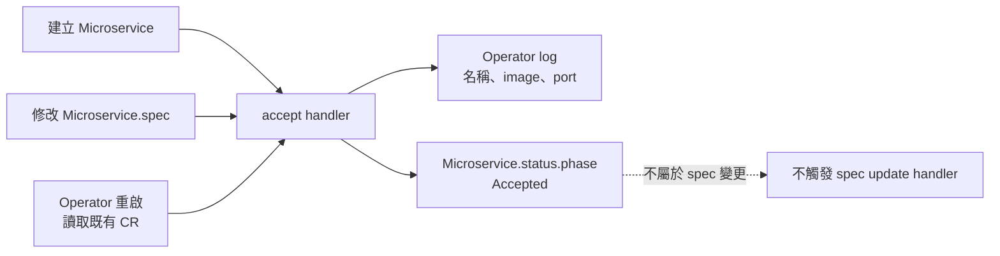

# Day 20 - 用 Kopf 接收 `Microservice` 事件並部署 Operator

前一篇整理了 Kopf handler、資源所有權與控制迴路的分工。`Microservice` 已經能保存 `todo-api` 的 image 和 port，但仍需要一個 process 讀取它；API Server 不會自行把 CR 轉成 `Deployment`，也不會替它回報服務是否就緒。

今天先讓處理這筆資料的 Python process 跑進 Kubernetes。它會接收 CR 建立、`spec` 修改與重啟後的恢復事件，留下 log，並回寫 `Accepted`。這個狀態只表示 handler 已讀取輸入，還沒有管理工作負載；`todo` 裡原有的 Todo API、BFF 和 Web 都維持原本的部署方式。

## 用 Kopf 註冊 handler

controller 都需要監看事件、呼叫 Kubernetes API，並處理失敗。Go 的 controller-runtime 與 Kubebuilder 提供型別和開發工具；這裡選用 Python 的 Kopf（Kubernetes Operator Pythonic Framework），用 decorator 註冊 handler，讓程式集中在收到事件後要做的事。

Kopf 不會替我們決定 `Deployment` 的內容。把函式掛上 decorator，只是把事件接到 Python 函式；資源所有權、更新方式和健康判斷，仍要自己寫。

先準備 `requirements.txt`：

```text
kopf==1.38.0
kubernetes==34.1.0
```

再將下面的程式存成 `handlers.py`：

```python
import kopf


@kopf.on.startup()
def configure(settings, **_):
    settings.persistence.progress_storage = kopf.AnnotationsProgressStorage()
    settings.persistence.diffbase_storage = kopf.AnnotationsDiffBaseStorage()
    settings.execution.max_workers = 1
    settings.posting.enabled = False
    settings.scanning.disabled = True


@kopf.on.create("platform.example.io", "v1alpha1", "microservices")
@kopf.on.update("platform.example.io", "v1alpha1", "microservices", field="spec")
@kopf.on.resume("platform.example.io", "v1alpha1", "microservices")
def accept(name, namespace, spec, logger, patch, **_):
    logger.info("Accepted %s/%s: image=%s port=%s", namespace, name,
                spec.get("image"), spec.get("port"))
    patch.status["phase"] = "Accepted"
```

三個 decorator 都指向同一個 `accept` 函式：

| decorator | 何時執行 | 為什麼需要 |
| --- | --- | --- |
| `on.create` | 建立一筆 CR | 接收第一次提交的需求 |
| `on.update`，限定 `field="spec"` | `spec` 改變 | 回寫 `status` 不會再觸發同一個 update handler |
| `on.resume` | Operator 啟動時發現既有 CR | 重啟後不必等人再修改一次設定 |

`patch.status` 由 Kopf 送到 API Server；函式結束前，不代表這筆 patch 已經寫入。因此後面仍要查詢 CR，不能只看到 log 就當成狀態已更新。

啟動設定也有幾個用途。Kopf 的處理進度與前次輸入快照放在 annotation，避免它們被沒有對應欄位的 `status` schema 剪裁。`max_workers = 1` 限制同步 handler 的執行緒數量，讓這個小範例比較容易觀察，不代表取得分散式鎖。

我們只操作已知的 `todo` Namespace 和已安裝的 CRD，因此關閉動態 Namespace／CRD 掃描，不需要為了掃描而給 cluster-wide 權限。也關閉 Kopf 發送 Kubernetes Event 的功能，錯誤仍會留在 Operator log；這不影響 kubelet 或 Deployment controller 產生的事件。

## 只給 `todo` 裡需要的權限

沿用既有環境，不另外建立 Namespace。先確認目前的連線與資源型別：

```bash
kubectl config current-context
kubectl get namespace todo
kubectl get crd microservices.platform.example.io
```

本篇的前提是 `todo` 與 `Microservice` CRD 已存在。缺少其中一項時，先完成 Kubernetes 環境與 CRD 安裝，不直接把下面的 Namespace 名稱換成任意正式環境。

將下面的內容存成 `rbac.yaml`。Role 包含讀取 CR、更新 `status`，以及處理工作負載所需的權限；沒有 Secret、Namespace 或 CRD 的寫入權限。

```yaml
apiVersion: v1
kind: ServiceAccount
metadata:
  name: microservice-operator
  namespace: todo
---
apiVersion: rbac.authorization.k8s.io/v1
kind: Role
metadata:
  name: microservice-operator
  namespace: todo
rules:
  - apiGroups: [platform.example.io]
    resources: [microservices]
    verbs: [get, list, watch, patch]
  - apiGroups: [platform.example.io]
    resources: [microservices/status]
    verbs: [get, patch]
  - apiGroups: [apps]
    resources: [deployments]
    verbs: [get, create, update]
  - apiGroups: [""]
    resources: [services]
    verbs: [get, create, update]
  - apiGroups: [""]
    resources: [pods]
    verbs: [get, list]
  - apiGroups: [discovery.k8s.io]
    resources: [endpointslices]
    verbs: [get, list]
---
apiVersion: rbac.authorization.k8s.io/v1
kind: RoleBinding
metadata:
  name: microservice-operator
  namespace: todo
subjects:
  - kind: ServiceAccount
    name: microservice-operator
    namespace: todo
roleRef:
  apiGroup: rbac.authorization.k8s.io
  kind: Role
  name: microservice-operator
```

Role 的邊界是整個 `todo`，不是只有 `todo-api`。程式會檢查所有權，但 Kubernetes 不會因此阻止這個 ServiceAccount 修改 Namespace 內其他 Deployment。這是教學環境的權限範圍，不能把它說成每個服務都有獨立隔離。

## 把 Python process 放進 Pod

這次用 ConfigMap 掛載非敏感的 Python 程式，init container 將套件裝到 `emptyDir`，主 container 再啟動 Kopf。這樣不必先建立 Operator 的 image 發布流程，但每次重建 Pod 都需要連到 PyPI；正式部署應將程式與依賴建進經驗證的 image，而不是依賴啟動時安裝。

將下面的內容存成 `operator.yaml`：

```yaml
apiVersion: apps/v1
kind: Deployment
metadata:
  name: microservice-operator
  namespace: todo
spec:
  replicas: 1
  strategy:
    type: Recreate
  selector:
    matchLabels:
      app: microservice-operator
  template:
    metadata:
      labels:
        app: microservice-operator
    spec:
      serviceAccountName: microservice-operator
      securityContext:
        runAsNonRoot: true
        runAsUser: 10001
        runAsGroup: 10001
        fsGroup: 10001
        seccompProfile:
          type: RuntimeDefault
      initContainers:
        - name: install-dependencies
          image: python:3.12.12-slim
          command: [python, -m, pip]
          args: [install, --no-cache-dir, --disable-pip-version-check, --target=/deps, -r, /code/requirements.txt]
          env:
            - name: PYTHONDONTWRITEBYTECODE
              value: "1"
          resources:
            requests:
              cpu: 25m
              memory: 128Mi
            limits:
              cpu: "1"
              memory: 512Mi
          securityContext:
            allowPrivilegeEscalation: false
            readOnlyRootFilesystem: true
            capabilities:
              drop: [ALL]
          volumeMounts:
            - name: code
              mountPath: /code
              readOnly: true
            - name: dependencies
              mountPath: /deps
            - name: temporary
              mountPath: /tmp
      containers:
        - name: operator
          image: python:3.12.12-slim
          command: [python, -m, kopf]
          args: [run, --standalone, --namespace=todo, --liveness=http://0.0.0.0:8081/healthz, /code/handlers.py]
          env:
            - name: USER
              value: operator
            - name: PYTHONPATH
              value: /deps:/code
            - name: PYTHONDONTWRITEBYTECODE
              value: "1"
          ports:
            - name: health
              containerPort: 8081
          readinessProbe:
            httpGet:
              path: /healthz
              port: health
          livenessProbe:
            httpGet:
              path: /healthz
              port: health
          resources:
            requests:
              cpu: 25m
              memory: 128Mi
            limits:
              cpu: 500m
              memory: 256Mi
          securityContext:
            allowPrivilegeEscalation: false
            readOnlyRootFilesystem: true
            capabilities:
              drop: [ALL]
          volumeMounts:
            - name: code
              mountPath: /code
              readOnly: true
            - name: dependencies
              mountPath: /deps
              readOnly: true
            - name: temporary
              mountPath: /tmp
      volumes:
        - name: code
          configMap:
            name: microservice-operator-code
        - name: dependencies
          emptyDir: {}
        - name: temporary
          emptyDir: {}
```

`USER` 讓 Kopf 能在沒有對應 `/etc/passwd` 帳號的 UID 下取得 process 身分；`PYTHONPATH` 則讓它找到安裝好的套件。ServiceAccount 的 Token 與 CA 由 Kubernetes 掛載，不需要把 kubeconfig 複製進 ConfigMap，也不要關閉 TLS 憑證檢查。

`--standalone` 沒有提供多副本間的協調，因此保持一個副本，更新策略使用 `Recreate`，避免新舊 Operator 同時處理資源。更新期間會短暫停止觀察，既有 Todo Pod 不會跟著停止。這個部署沒有高可用性。

`25m` 是小型測試環境的 CPU request，不是效能量測結果，也不是 CPU 使用上限。若 Pod 因資源不足停在 `Pending`，仍要檢查節點容量；換一個 Namespace 不會增加 CPU。

在存放這幾份檔案的目錄執行：

```bash
kubectl create configmap microservice-operator-code -n todo \
  --from-file=handlers.py --from-file=requirements.txt \
  --dry-run=client -o yaml | kubectl apply -f -

kubectl apply -f rbac.yaml -f operator.yaml
kubectl rollout status deployment/microservice-operator -n todo --timeout=300s
```

若停在 init container，先看套件安裝的錯誤；若 Kopf 無法啟動，再看主 container：

```bash
kubectl logs deployment/microservice-operator -n todo -c install-dependencies
kubectl logs deployment/microservice-operator -n todo -c operator
```

probe 成功只表示 Kopf 的健康端點可回應，還不能證明它有權限監看 CR。接下來要真的送進一筆資源。

## 建立、修改，再重啟一次

將以下內容存成 `todo-api.yaml`。它和既有 Deployment 同名，但屬於不同的資源型別；目前的 handler 不會碰 Deployment。

```yaml
apiVersion: platform.example.io/v1alpha1
kind: Microservice
metadata:
  name: todo-api
  namespace: todo
  labels:
    app.kubernetes.io/owner: todo-team
spec:
  image: ghcr.io/yrw9281/it30-todo-api:0.1.0
  port: 8080
```

```bash
kubectl apply -f todo-api.yaml
kubectl wait microservice/todo-api -n todo \
  --for=jsonpath='{.status.phase}'=Accepted --timeout=60s
kubectl logs deployment/microservice-operator -n todo -c operator --tail=20
```

這次部署後，CR 回報 `Accepted`，log 包含以下內容：

```text
Accepted todo/todo-api: image=ghcr.io/yrw9281/it30-todo-api:0.1.0 port=8080
Handler 'accept' succeeded.
```

再改一次 port，確認 update handler 能收到變更：

```bash
kubectl patch microservice todo-api -n todo --type=merge \
  -p '{"spec":{"port":9090}}'
kubectl logs deployment/microservice-operator -n todo -c operator --tail=20
```

等 log 出現 `port=9090` 後，將 port 改回來，並重啟 Operator：

```bash
kubectl patch microservice todo-api -n todo --type=merge \
  -p '{"spec":{"port":8080}}'
kubectl rollout restart deployment/microservice-operator -n todo
kubectl rollout status deployment/microservice-operator -n todo --timeout=300s
kubectl logs deployment/microservice-operator -n todo -c operator --tail=20
```

重啟後，Kopf 會對已存在的 CR 執行 resume handler。這段流程的觸發來源如下；`status` 更新不會再觸發限定 `spec` 的 update handler。



<!-- TODO(assets): 補上 microservice-operator Pod 已就緒、Microservice 回報 Accepted，以及 create／spec update／resume log 的操作畫面。 -->

今天的 `Accepted` 沒有宣稱新版已就緒，也沒有把既有 Deployment 標成受管資源。下一篇會加入真正的 `reconcile`，明確處理既有 Todo API 的所有權，再讓 Operator 維持 Deployment 與 Service。
