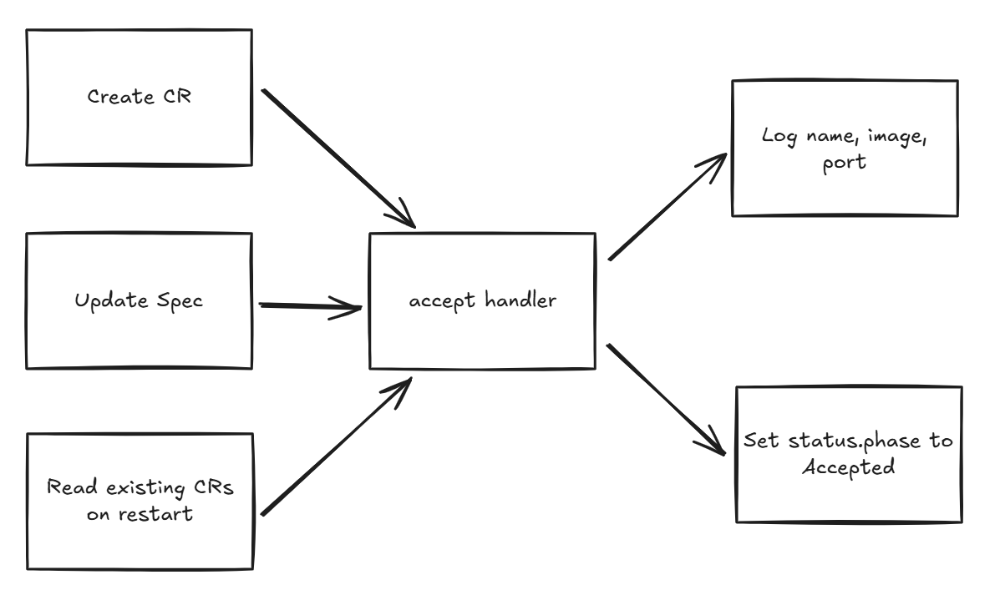
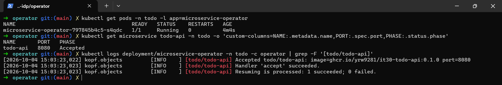
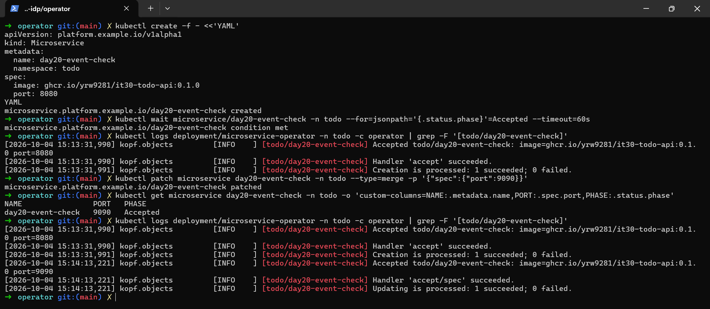

# Day 20 - 用 Kopf 接收 `Microservice` 事件並部署 Operator

前一篇我們選定用 Kopf 實作 Operator。今天我們從事件處理開始看：當 `Microservice` 建立或設定改變時，Kopf 如何呼叫我們寫的函式？我們會讓這個函式記錄收到的 `image`、`port`，並將 CR 的 `status.phase` 設為 `Accepted`，確認需求確實進入程式。

這一步只確認 Operator 能收到需求，還不會依照需求修改 Todo API 的 `Deployment` 或 `Service`。把事件接收與資源管理分開，沒有看到預期的 log 或狀態時，就能先排查事件處理，不必同時檢查工作負載。

## 用 Kopf 的 decorator 註冊事件處理函式

我們需要處理 CR 建立、`spec` 修改，以及 Operator 重啟後讀到既有 CR 這三種情境。Kopf 透過 decorator 將處理函式（handler）註冊到對應的觸發時機。下面將同一個 `accept` 函式註冊給這三種情境；不論由哪一種觸發，都會記錄輸入並回寫 `Accepted`：

```python
@kopf.on.create("platform.example.io", "v1alpha1", "microservices")
@kopf.on.update("platform.example.io", "v1alpha1", "microservices", field="spec")
@kopf.on.resume("platform.example.io", "v1alpha1", "microservices")
def accept(name, namespace, spec, logger, patch, **_):
    logger.info("Accepted %s/%s: image=%s port=%s", namespace, name,
                spec.get("image"), spec.get("port"))
    patch.status["phase"] = "Accepted"
```

Kopf 呼叫 `accept` 時，會將 CR 的名稱、Namespace 與需求欄位分別傳入 `name`、`namespace`、`spec`。函式用 `logger` 記錄這些輸入，並透過 `patch.status` 指定要回寫的狀態。Kopf 負責將這些狀態變更寫回 API Server，我們不需要在函式裡自行送出 status patch。

| decorator | 觸發時機 | 用途 |
| --- | --- | --- |
| `on.create` | CR 建立 | 接收第一次提交的需求 |
| `on.update`，限定 `field="spec"` | `spec` 改變 | 處理新需求，回寫 `status` 不會再觸發它 |
| `on.resume` | Operator 啟動時發現既有 CR | 重啟後接續處理，不必請人再修改設定 |

如果只註冊 `on.create`，既有 CR 的 `spec` 更新時就不會執行這個函式，Operator 重啟後也缺少接續處理的入口。因此這裡同時註冊 `on.update` 和 `on.resume`，並用 `field="spec"` 將更新處理限定在需求欄位；沒有這個限制，handler 的處理範圍就不再只限於 `spec`。

`Accepted` 只表示 handler 已收到輸入。這段程式沒有建立 Pod，也不知道 image 能不能拉取，不能用它判斷部署成功。

## Operator 在叢集裡怎麼執行？

寫好 handler 後，我們用一個 `Deployment` 在既有的 `todo` Namespace 執行 Operator。這個範例使用 Kopf `1.38.0` 與 Kubernetes Python client `34.1.0`，透過 `ConfigMap` 將程式掛載到 Pod。Pod 啟動時，init container 從 PyPI 安裝套件，主 container 再啟動 Kopf，由 Kopf 呼叫已註冊的 handler。

這裡只說明部署方式，不列出完整安裝設定。下面節錄 `Deployment` 的副本數與更新策略：

```yaml
spec:
  replicas: 1
  strategy:
    type: Recreate
```

啟動 Kopf 時，`--namespace=todo` 將監看範圍限定在 `todo` Namespace，`--standalone` 則表示不使用多副本協調。因此我們保持單一副本，並用 `Recreate` 在更新時先停止舊 Pod，再啟動新 Pod，避免新舊 Operator 同時執行。代價是更新期間會停止觀察，所以這不是高可用部署；不過，既有 Todo Pod 不會因 Operator 暫停而停止。

Operator 使用 Pod 的 `ServiceAccount` 存取 API，不必把 kubeconfig 放進 Pod。除了讀取 CR 與回寫 `status`，它還需要修改 annotation 的權限，因為 Kopf 會在 annotation 保存處理進度與輸入快照。這些內部資料不放在 `status`，可避免被 CRD 的 status schema 剪裁。

將 `Role` 放在 `todo` Namespace，不代表權限只適用於名為 `todo-api` 的 CR。下一篇的所有權檢查，是程式決定能否修改某個資源的規則，不能取代 RBAC 的 API 授權。

Kopf 的其他設定也配合這個範例的範圍：關閉動態 Namespace／CRD 掃描，以及 Kubernetes Event 發送，但錯誤仍會記錄在 log。

每次重建 Operator Pod 都要連到 PyPI，這種方式適合教學環境；正式部署應先把程式與依賴建進 image。

## 用 log 與 status 確認事件處理

Operator Pod 啟動、健康 probe 通過，只能證明 Kopf 程序可回應，還不能證明 `accept` 已處理 CR。我們接著查看 log 與 `status.phase`，確認需求有進入函式。

以下指令需要已安裝 `Microservice` CRD，並部署只記錄輸入、回寫 `Accepted` 的 Operator。執行前先確認目前連線是測試叢集，再查看相關資源與 log：

```bash
kubectl config current-context
kubectl get namespace todo
kubectl get crd microservices.platform.example.io
kubectl logs deployment/microservice-operator -n todo -c operator
kubectl get microservice todo-api -n todo -o yaml
```

以 `todo-api` CR 為例，它的 `spec.image` 是 `ghcr.io/yrw9281/it30-todo-api:0.1.0`，`spec.port` 是 `8080`。`accept` 執行後，預期會留下以下 log：

```text
Accepted todo/todo-api: image=ghcr.io/yrw9281/it30-todo-api:0.1.0 port=8080
```

CR 的 `status.phase` 也應成為 `Accepted`。若缺少對應的 log 或狀態，先檢查 Operator 是否正常啟動、API 權限是否足夠，以及 handler 是否回報錯誤，不要只因 Pod 是 `Running` 就認定事件已處理。

不過，`Accepted` 一旦寫入，就可能一直留在 CR 上。修改 `spec` 或重啟 Operator 後，單看這個狀態，無法知道 handler 是否又執行了一次。我們要分別確認前面註冊的三種情境，並查看這次操作對應的 log：

| 情境 | 要確認的結果 |
| --- | --- |
| 建立 CR | log 出現該 CR 的輸入，status 成為 `Accepted` |
| 修改 `spec` | log 出現修改後的值；原本的 `Accepted` 不能證明這次已處理 |
| 重啟 Operator | 新 Pod 的 log 再次出現既有 CR；不能只看重啟前的 status |

接著測試 `on.update`：將 CR 的 `spec.port` 暫時從 `8080` 改成 `9090`，查看 log 是否記錄新值。這個版本只記錄輸入，不會修改 Todo API 的工作負載。

**不要在已啟用資源管理的版本照做這個 port 測試**，否則會真的改動 Todo 的監聽與流量設定。

```bash
kubectl patch microservice todo-api -n todo --type=merge \
  -p '{"spec":{"port":9090}}'
kubectl logs deployment/microservice-operator -n todo -c operator --tail=20
```

送出 patch 後，handler 不一定已經執行完；如果 log 還沒出現 `port=9090`，稍後再查看。確認新值出現後，將 `spec.port` 還原為 `8080`，再查看 log 是否出現 `port=8080`：

```bash
kubectl patch microservice todo-api -n todo --type=merge \
  -p '{"spec":{"port":8080}}'
```

最後測試 `on.resume`：不修改 CR，直接重啟 Operator，確認它是否仍會處理既有的 `todo-api`。下面的指令會等待 Operator 更新完成，再查看 log；這次要確認新 Pod 的 log 出現該 CR 的輸入，不能只看重啟前留下的 `Accepted`：

```bash
kubectl rollout restart deployment/microservice-operator -n todo
kubectl rollout status deployment/microservice-operator -n todo --timeout=300s
kubectl logs deployment/microservice-operator -n todo -c operator --tail=20
```

把前面的處理串起來：CR 建立、`spec` 修改，或 Operator 重啟後讀到既有 CR，都會觸發 `accept`，由它記錄輸入並回寫 `Accepted`：



簡單操作一下，驗證我們今天的 Handler 有好好工作：



上面的操作畫面顯示 Operator Pod 為 1/1 Running，todo-api 的狀態為 Accepted。log 中的 Resuming is processed 則確認 Operator 啟動後，已透過 on.resume 處理既有 CR，並記錄收到的 image 與 port。

另外用一筆暫時的 `day20-event-check` CR 測試建立與修改。畫面中的 `Creation is processed` 顯示建立事件已處理；將 `spec.port` 從 `8080` 改成 `9090` 後，log 記錄了新值，並出現 `Updating is processed`，確認 `on.update` 已處理這次修改。



完成上述檢查後，我們能確認 Operator 在這三種情境下都會讀取 CR 並執行 handler。不過，目前即使修改 CR 的 `image` 或 `port`，Todo API 的部署也不會跟著改變。下一篇會加入資源管理邏輯，依照 CR 建立或更新 `Deployment`、`Service`，並處理既有 Todo API 的所有權移交。
