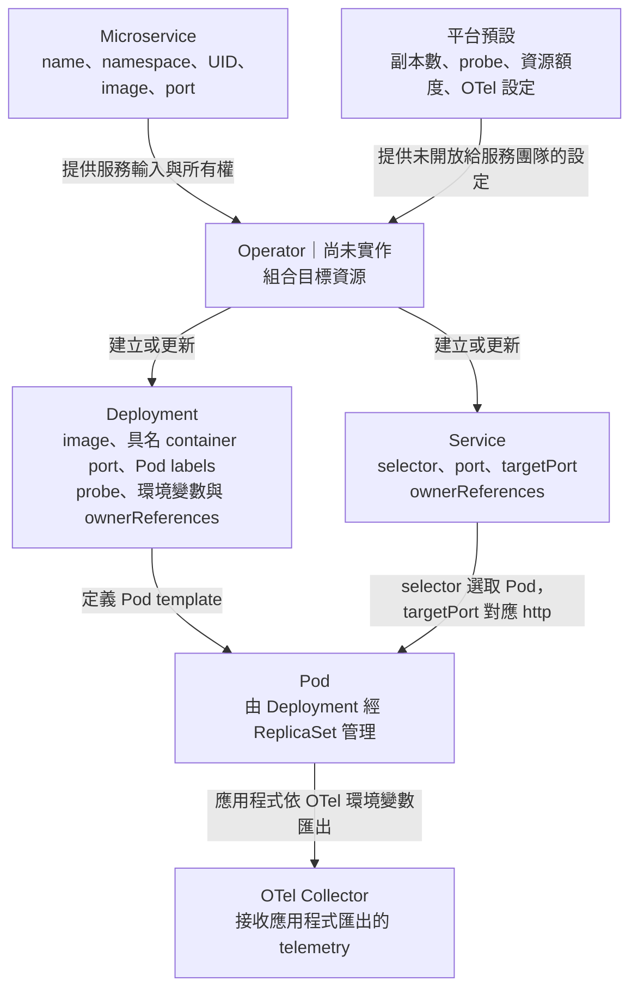

# Day 20 - 從 `Microservice` 到 Deployment：Operator 應建立哪些資源

## 先從現有 Todo API 設定看差異

Day 19 說明了 Operator 如何接收事件、重試並維持受管資源。要實作這些 handler，還有一個問題要先回答：`todo-api` 的 CR 只有 image 和 port，`Deployment`、`Service` 與 OpenTelemetry（OTel）的其他設定要從哪裡來？

現有 Todo API 的原生 Kubernetes 設定已包含 Deployment、Service、probe 與 OTel 環境變數；它不是 Operator 產物。可以拿它當對照，檢查平台從服務意圖產生資源時，哪些欄位必須由 Operator 統一決定，哪些來自 `Microservice.spec`。

## `Microservice` 的欄位要落在哪裡？

| CR 中的資料 | 預期寫入的 Kubernetes 欄位 | 不能省略的判斷 |
| --- | --- | --- |
| `metadata.name` | Deployment／Service 名稱、受管 label、OTel `service.name` | 同一個服務在不同資源裡要使用一致名稱 |
| `metadata.namespace` | Deployment／Service 所屬 Namespace | 不跨到表單使用者不能操作的 Namespace |
| `metadata.uid` | child resource 的 owner reference | 只清理這筆 CR 擁有的資源 |
| `spec.image` | Deployment container image | 原樣使用已審查的 reference，不在 Operator 內重新挑 tag |
| `spec.port` | container port、Service port | `targetPort` 使用的名稱必須對應 container port |
| 規劃中的 `spec.env` | container 的非敏感環境變數 | 現有 CRD 尚未支援，不能先當成可輸入欄位 |

下圖把欄位來源分成 CR 與平台預設。這是 Operator 應產生的資源關係，目前還沒有程式執行這段轉換。

使用 GHCR 的既有 `Deployment` 指定 `ghcr.io/yrw9281/it30-todo-api:0.1.0`，`Service` 的 selector 則選取 `app: todo-api` 的 Pod，將 Service port `8080` 轉給 container 的 `http` port。這個具名 port 對應 `containerPort: 8080`，所以 Operator 必須一起維持 port 名稱、數值與 selector 的關係。GitOps 設定若改用 digest，也應原樣帶進 `Deployment`，不要重新解析 tag。

## 平台預設與服務輸入要分開

`replicas`、readiness／liveness probe、CPU／memory requests 和 limits、OTel exporter endpoint 都不是目前 CRD 開放給服務團隊的欄位。Operator 必須另有受審查的預設值。既有 `todo-api` 設定使用兩個副本，但尚未設定 requests 和 limits；不能直接複製它，就認為平台預設已經完整。

以現有 `todo-api` 為例，readiness probe 使用 `/health/ready`、liveness probe 使用 `/health/live`。若新服務沒有這些 endpoint，原封不動套用同一預設會讓 Pod 永遠無法 ready。因此 Operator 的合約還必須決定：平台是否要求服務遵守相同健康介面？不符合時要拒絕建立，還是另有受控設定？這個問題尚未在 CRD 與程式中解決，不能把現有 Todo manifest 當成所有服務的通用模板。

## OTel 設定要跟著部署內容改變

既有 `Deployment` 設定了 `OTEL_SERVICE_NAME`、`OTEL_SERVICE_VERSION`、`DEPLOYMENT_ENVIRONMENT` 與 `OTEL_EXPORTER_OTLP_ENDPOINT`。Operator 可以從 CR 名稱取得服務名稱，從受控的環境設定取得環境與 Collector endpoint；這些平台管理的值，不應被一般環境變數輸入覆蓋。

版本則需要另外決定來源。image 已更新時，`OTEL_SERVICE_VERSION` 不能繼續沿用固定的 `0.1.0`，否則 Grafana 看到的版本會和實際工作負載不同。digest 能識別 image 內容，卻不能直接推得人容易閱讀的 release version；兩者的對應關係仍要由發布資訊提供。

設定環境變數也不會替任意 image 加上 instrumentation。Todo API 已有 OTel SDK，會讀取這些值並匯出資料；其他服務若沒有相同支援，Operator 只加入環境變數，Collector 仍收不到 telemetry。

## 建立資源不代表已可用

Operator 把 `Deployment` 與 `Service` 送到 API Server 後，還需要確認 rollout 是否完成。這裡有兩層版本：CR 的 generation 代表服務需求的版本，`Deployment` 的 generation 則代表它自己的設定版本，兩個數字不能直接比較。

Operator 應先確認 `Deployment` 的設定符合目前 CR，再檢查 Deployment controller 是否已觀察到該 `Deployment` 的 generation、新版副本是否完成更新並可用，以及 `Service` 是否選得到就緒的 Pod。只看 `availableReplicas`，可能把仍在接流量的舊版副本當成新版已完成。

這些觀察結果才適合回寫到 CR 的 `status`，並標明對應的 CR generation。目前只有初版 `status` schema，`Ready`／`Stalled` conditions 與回寫它們的 Operator 都還沒實作。

## 怎麼驗收這份資源合約？

現階段能做的是對照 Todo API 的 CR 與原生 manifest，核對欄位關係；還不能執行「由 Operator 建立資源」的測試。實作時，除了前一篇的事件與重試情境，還要檢查以下輸出：

| 檢查對象 | 預期結果 |
| --- | --- |
| 資源位置與所有權 | `Deployment`、`Service` 和 CR 位於同一 Namespace，owner reference 指向該 CR 的 UID |
| image 與 port | image reference 與 CR 相同，`Service.targetPort` 能對應 container 的具名 port |
| Pod labels 與 selector | `Deployment` 和 `Service` 都選到該服務的 Pod，不選到其他服務 |
| OTel 身分 | 服務名稱、版本與環境對應本次部署，Collector endpoint 來自平台設定 |
| 更新中的狀態 | 舊 Pod 可用但新版尚未完成 rollout 時，不回報 `Ready=True` |

資源輸入與輸出清楚後，開發者也不該為每次更新自己手寫 CR、找設定儲存庫目錄。下一篇改看 Backstage 如何讓服務團隊提供必要資訊，以及它的服務目錄與表單各負責什麼。
