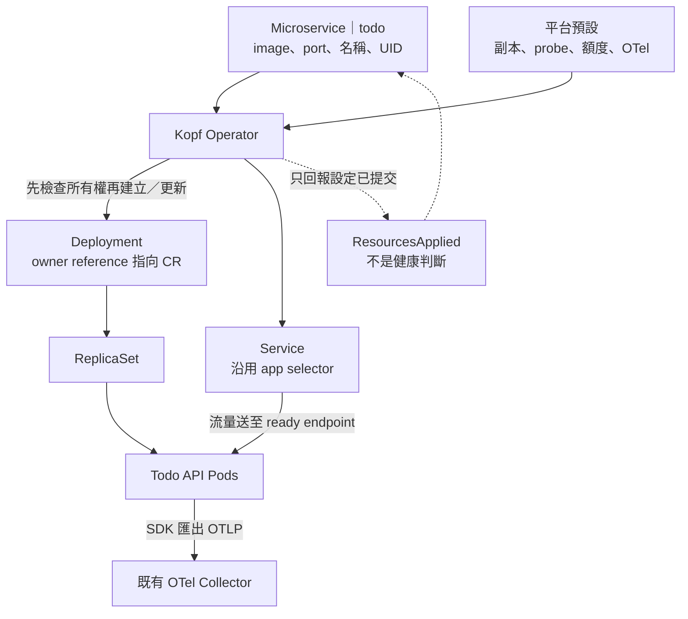

# Day 21 - 讓 Operator 管理 Todo API 的 Deployment 與 Service

前一篇的 Kopf process 已能接收 `Microservice`，但只回報 `Accepted`。修改 CR 的 image，Todo API 仍使用原來的版本；Service 被刪除，也沒有人補回。今天把 CR 展開成 Deployment 與 Service，讓 Operator 開始維持它們。

沿用 `todo` 裡的 Todo API，不另建 Namespace 或常駐副本。既有資源沒有指向 CR 的 owner reference，不能因為名稱相同就直接覆寫。我們會另外執行一次明確的接管，之後再由 Operator 管理。

## 把 Todo API 的部署規則收進合約

服務團隊仍只提供 `image`、`port`。平台固定兩個副本、probe、資源額度與 OpenTelemetry（OTel）設定；目前僅支援既有 ASP.NET Core Todo API，沒有開放 `env` 或 Secret 引用。

| 來源 | 產生的內容 |
| --- | --- |
| CR 名稱與 Namespace | 同名、同 Namespace 的 Deployment／Service |
| CR UID | owner reference 與受管 Pod 的 UID label |
| `spec.image` | container image，原樣保留 tag 或 digest |
| `spec.port` | container 的 `http` port、Service port、ASP.NET Core 監聽設定 |
| 平台預設 | 兩個副本、健康端點、requests／limits、OTel endpoint |

Deployment selector 保留既有的 `app: todo-api`，避免修改不可變欄位；Service 也沿用它，rollout 時仍可選到原有的 ready Pod。額外的 CR UID label 用來辨識 Operator 管理的 Pod。

將下面的程式存成 `resources.py`：

```python
from datetime import datetime, timezone
import re
from typing import Any

Json = dict[str, Any]
API_VERSION = "platform.example.io/v1alpha1"
LABEL = "platform.example.io/microservice-uid"


class InvalidSpec(ValueError):
    pass


class OwnershipConflict(ValueError):
    pass


def desired_resources(cr: Json) -> tuple[Json, Json]:
    meta, spec = cr["metadata"], cr.get("spec", {})
    image, port = spec.get("image"), spec.get("port")
    if not isinstance(image, str) or not image.strip():
        raise InvalidSpec("spec.image must be a non-empty string")
    if type(port) is not int or not 1 <= port <= 65535:
        raise InvalidSpec("spec.port must be an integer between 1 and 65535")
    name, namespace, uid = meta["name"], meta["namespace"], meta["uid"]
    if len(name) > 63 or not re.fullmatch(r"[a-z0-9]([-a-z0-9]*[a-z0-9])?", name):
        raise InvalidSpec("metadata.name must be a DNS label of at most 63 characters")
    labels = {"app": name, LABEL: uid}
    owner = {"apiVersion": API_VERSION, "kind": "Microservice", "name": name,
             "uid": uid, "controller": True, "blockOwnerDeletion": False}
    metadata = {"name": name, "namespace": namespace, "labels": labels,
                "ownerReferences": [owner]}
    container = {
        "name": name, "image": image, "imagePullPolicy": "IfNotPresent",
        "ports": [{"name": "http", "containerPort": port}],
        "env": [
            {"name": "ASPNETCORE_URLS", "value": f"http://+:{port}"},
            {"name": "OTEL_SERVICE_NAME", "value": name},
            {"name": "OTEL_SERVICE_VERSION", "value": image},
            {"name": "DEPLOYMENT_ENVIRONMENT", "value": "development"},
            {"name": "OTEL_EXPORTER_OTLP_ENDPOINT",
             "value": "http://otel-collector.observability.svc:4317"},
        ],
        "readinessProbe": {"httpGet": {"path": "/health/ready", "port": "http"}},
        "livenessProbe": {"httpGet": {"path": "/health/live", "port": "http"},
                          "initialDelaySeconds": 10},
        "resources": {"requests": {"cpu": "25m", "memory": "128Mi"},
                      "limits": {"cpu": "500m", "memory": "256Mi"}},
    }
    deployment = {
        "apiVersion": "apps/v1", "kind": "Deployment", "metadata": metadata,
        "spec": {
            "replicas": 2, "progressDeadlineSeconds": 120,
            "selector": {"matchLabels": {"app": name}},
            "template": {"metadata": {"labels": labels},
                         "spec": {"automountServiceAccountToken": False,
                                  "containers": [container]}},
        },
    }
    service = {
        "apiVersion": "v1", "kind": "Service", "metadata": metadata,
        "spec": {"type": "ClusterIP", "selector": {"app": name},
                 "ports": [{"name": "http", "port": port, "targetPort": "http"}]},
    }
    return deployment, service


def check_owner(current: Json, cr: Json) -> None:
    owners = current["metadata"].get("ownerReferences", [])
    if not any(owner.get("uid") == cr["metadata"]["uid"]
               and owner.get("apiVersion") == API_VERSION
               and owner.get("kind") == "Microservice"
               and owner.get("controller") is True for owner in owners):
        raise OwnershipConflict(
            f'{current["kind"]}/{current["metadata"]["name"]} is not owned by this CR')


def contains(current: Any, desired: Any) -> bool:
    if isinstance(desired, dict):
        return isinstance(current, dict) and all(
            key in current and contains(current[key], value)
            for key, value in desired.items())
    if isinstance(desired, list):
        return isinstance(current, list) and len(current) == len(desired) and all(
            contains(actual, target) for actual, target in zip(current, desired))
    return current == desired
```

CR 名稱還得能用作 container 名稱與 label value，因此補上不超過 63 字元的 DNS label 檢查。`contains` 只比對平台指定的欄位，容許 API Server 補上 `protocol` 等預設值，避免每次檢查都重新寫入。

CPU request `25m`、memory request `128Mi` 是小型測試環境的起點，不是效能承諾。兩個 probe 也要求服務具備對應端點；任意 image 不會因為有這份設定就能使用。

`OTEL_SERVICE_VERSION` 先用完整 image reference，避免換版後仍回報固定的 `0.1.0`。digest 是內容識別，不是 Semantic Version；可變 tag 也不能證明 image bytes 不變。Todo API 已有 SDK，這些環境變數不會替沒有 instrumentation 的程式產生遙測。

下圖把資源設定與實際副本分開。Operator 提交 Deployment，Pod 的建立與 rollout 仍由原生 controller 處理。



## 讀取、比對，有差異才寫入

替換 `handlers.py`。以下三個 Python 區塊依序組成完整檔案；保留既有 `requirements.txt`、RBAC 與 Operator Deployment。

第一段在載入 Pod 的 ServiceAccount 設定後才建立 SDK client。只有 `404` 當成 child 不存在，不能把 `403` 或連線失敗當成空清單。

```python
import logging
from copy import deepcopy

import kopf
from kubernetes import client, config
from kubernetes.client.exceptions import ApiException
from urllib3.exceptions import HTTPError

from resources import (
    Json, InvalidSpec, OwnershipConflict, check_owner, contains, desired_resources,
)

GROUP, VERSION, PLURAL = "platform.example.io", "v1alpha1", "microservices"
TIMEOUT = (5, 20)
api: client.ApiClient
apps: client.AppsV1Api
core: client.CoreV1Api
custom: client.CustomObjectsApi


@kopf.on.startup()
def configure(settings, **_):
    global api, apps, core, custom
    config.load_incluster_config()
    api = client.ApiClient()
    apps = client.AppsV1Api(api)
    core = client.CoreV1Api(api)
    custom = client.CustomObjectsApi(api)
    settings.persistence.progress_storage = kopf.AnnotationsProgressStorage()
    settings.persistence.diffbase_storage = kopf.AnnotationsDiffBaseStorage()
    settings.execution.max_workers = 1
    settings.posting.enabled = False
    settings.scanning.disabled = True


def read_cr(namespace: str, name: str) -> Json:
    return custom.get_namespaced_custom_object(
        GROUP, VERSION, namespace, PLURAL, name, _request_timeout=TIMEOUT)


def read_child(kind: str, namespace: str, name: str) -> Json | None:
    read = apps.read_namespaced_deployment if kind == "Deployment" else core.read_namespaced_service
    try:
        return api.sanitize_for_serialization(read(name, namespace, _request_timeout=TIMEOUT))
    except ApiException as error:
        if error.status == 404:
            return None
        raise
```

接著加入 `ensure` 和狀態回寫。Deployment 的整份 `spec` 交給 Operator，不和其他工具共同編輯；Service 保留原有 ClusterIP 等配置，只更新指定欄位。更新帶著 `resourceVersion`，遇到衝突就重新讀取。

```python
def ensure(desired: Json, current: Json | None, cr: Json, logger: logging.Logger) -> None:
    kind = desired["kind"]
    namespace, name = cr["metadata"]["namespace"], cr["metadata"]["name"]
    if current is None:
        create = (apps.create_namespaced_deployment if kind == "Deployment"
                  else core.create_namespaced_service)
        create(namespace, desired, _request_timeout=TIMEOUT)
        logger.info("Created %s/%s", kind, name)
        return
    check_owner(current, cr)
    if contains(current, desired):
        return
    replacement = deepcopy(current)
    replacement["metadata"]["labels"] = {
        **current["metadata"].get("labels", {}), **desired["metadata"]["labels"]}
    if kind == "Deployment":
        replacement["spec"] = desired["spec"]
        replace = apps.replace_namespaced_deployment
    else:
        replacement["spec"].update(desired["spec"])
        replace = core.replace_namespaced_service
    replacement.pop("status", None)
    replace(name, namespace, replacement, _request_timeout=TIMEOUT)
    logger.info("Updated %s/%s", kind, name)


def write_phase(cr: Json, logger: logging.Logger, phase: str, managed: bool) -> None:
    meta = cr["metadata"]
    latest = read_cr(meta["namespace"], meta["name"])
    if (latest["metadata"]["uid"] != meta["uid"]
            or latest["metadata"]["generation"] != meta["generation"]
            or latest["metadata"].get("deletionTimestamp")):
        logger.info("Skipping stale status for %s", meta["name"])
        return
    status = {
        "phase": phase, "observedGeneration": latest["metadata"]["generation"],
        "managedResources": {"deployment": meta["name"], "service": meta["name"]} if managed else {},
        "conditions": [],
    }
    if latest.get("status") != status:
        # Merge-patch null removes old resource names; [] removes stale Ready conditions.
        body = {**status, "managedResources": status["managedResources"] if managed else None}
        custom.patch_namespaced_custom_object_status(
            GROUP, VERSION, meta["namespace"], PLURAL, meta["name"],
            {"metadata": {"resourceVersion": latest["metadata"]["resourceVersion"]},
             "status": body}, _request_timeout=TIMEOUT)
```

`write_phase` 回寫前再讀一次 CR，避免把舊 generation 或舊 UID 的觀察寫到新需求。這個階段不檢查健康，因此清掉可能殘留的 conditions；初版 schema 沒有這個欄位時，API Server 會剪裁它。

最後接上事件與每十秒的定期檢查。先確認 Deployment、Service **兩者**的所有權，才修改其中任何一個，避免操作到一半才發現另一個資源不能碰。

```python
@kopf.on.create(GROUP, VERSION, PLURAL)
@kopf.on.update(GROUP, VERSION, PLURAL, field="spec")
@kopf.on.resume(GROUP, VERSION, PLURAL)
@kopf.timer(GROUP, VERSION, PLURAL, interval=10)
def reconcile(namespace, name, logger, **_):
    try:
        cr = read_cr(namespace, name)
        if cr["metadata"].get("deletionTimestamp"):
            return
        try:
            desired_deployment, desired_service = desired_resources(cr)
            deployment = read_child("Deployment", namespace, name)
            service = read_child("Service", namespace, name)
            # Check both names before modifying either resource.
            for resource in (deployment, service):
                if resource is not None:
                    check_owner(resource, cr)
            ensure(desired_deployment, deployment, cr, logger)
            ensure(desired_service, service, cr, logger)
            write_phase(cr, logger, "ResourcesApplied", managed=True)
            logger.info("ResourcesApplied for %s/%s; readiness is not checked", namespace, name)
        except (InvalidSpec, OwnershipConflict) as error:
            logger.error("%s: %s", type(error).__name__, error)
            write_phase(cr, logger, "Failed", managed=False)
            raise kopf.PermanentError(str(error)) from error
    except ApiException as error:
        if error.status == 404:
            try:
                read_cr(namespace, name)
            except ApiException as missing:
                if missing.status == 404:
                    logger.info("CR %s/%s no longer exists", namespace, name)
                    return
                logger.error("Kubernetes API returned HTTP %s", missing.status)
                raise kopf.TemporaryError(
                    f"Kubernetes API returned HTTP {missing.status}", delay=10) from missing
            except HTTPError as missing:
                logger.error("Kubernetes API connection failed: %s", missing)
                raise kopf.TemporaryError("Kubernetes API connection failed", delay=10) from missing
        logger.error("Kubernetes API returned HTTP %s", error.status)
        raise kopf.TemporaryError(f"Kubernetes API returned HTTP {error.status}", delay=10) from error
    except HTTPError as error:
        logger.error("Kubernetes API connection failed: %s", error)
        raise kopf.TemporaryError("Kubernetes API connection failed", delay=10) from error
```

輸入或所有權錯誤會記錄原因，以 `PermanentError` 結束該次處理；API 與連線問題用 `TemporaryError` 重試。timer 仍會持續觀察，也能發現 CR 沒變、Service 卻被刪除的情境。執行時間與重試會影響間隔，不是十秒內修復的保證。

## 接管前，先停止其他工具管理相同資源

若 Argo CD 正同步這兩份原生 manifest，先從它的管理範圍移出，避免它和 Operator 反覆改寫。同時備份現況：

```bash
kubectl get deployment todo-api -n todo -o yaml > todo-api-deployment.before.yaml
kubectl get service todo-api -n todo -o yaml > todo-api-service.before.yaml
```

將以下一次性操作存成 `adopt.py`。它只接管 `todo/todo-api`，檢查兩個資源後才增加 owner reference，不修改 `spec`，也不會被 Kopf 自動呼叫。

```python
"""Explicit, one-time adoption of the existing Todo API; never called by Kopf."""
from copy import deepcopy

from kubernetes import client, config

from resources import check_owner, desired_resources


def adopt() -> None:
    config.load_kube_config()
    api = client.ApiClient()
    apps, core = client.AppsV1Api(api), client.CoreV1Api(api)
    cr = client.CustomObjectsApi(api).get_namespaced_custom_object(
        "platform.example.io", "v1alpha1", "todo", "microservices", "todo-api")
    desired, _ = desired_resources(cr)
    deployment = api.sanitize_for_serialization(apps.read_namespaced_deployment("todo-api", "todo"))
    service = api.sanitize_for_serialization(core.read_namespaced_service("todo-api", "todo"))
    if deployment["spec"]["selector"] != desired["spec"]["selector"]:
        raise ValueError("Existing Deployment selector differs; adoption would require replacement")
    if service["spec"].get("type") != "ClusterIP":
        raise ValueError("This example only adopts a ClusterIP Service")
    for resource in (deployment, service):
        if resource["metadata"].get("deletionTimestamp"):
            raise ValueError("Cannot adopt a resource that is being deleted")
        if resource["metadata"].get("ownerReferences"):
            check_owner(resource, cr)
        annotations = resource["metadata"].get("annotations", {})
        labels = resource["metadata"].get("labels", {})
        if ("argocd.argoproj.io/tracking-id" in annotations
                or "argocd.argoproj.io/instance" in labels):
            raise ValueError("Remove these children from Argo CD management before adoption")
    for resource, replace in ((deployment, apps.replace_namespaced_deployment),
                              (service, core.replace_namespaced_service)):
        resource["metadata"]["ownerReferences"] = deepcopy(desired["metadata"]["ownerReferences"])
        resource.pop("status", None)
        replace("todo-api", "todo", resource, _request_timeout=(5, 20))
        print(f'Adopted {resource["kind"]}/todo-api in todo')


if __name__ == "__main__":
    adopt()
```

這不是偵測所有 GitOps 工具的通用方法，管理者仍要確認來源；兩次 API 更新也不是一筆交易。若第二次失敗，重新檢查後再執行，不能假設第一個資源已自動 rollback。

使用具有這兩個資源寫入權的 kubeconfig 執行，不用 Backstage 的查詢身分：

```bash
python3 -m venv .venv
.venv/bin/pip install -r requirements.txt
.venv/bin/python adopt.py

kubectl create configmap microservice-operator-code -n todo \
  --from-file=handlers.py --from-file=resources.py --from-file=requirements.txt \
  --dry-run=client -o yaml | kubectl apply -f -
kubectl rollout restart deployment/microservice-operator -n todo
kubectl rollout status deployment/microservice-operator -n todo --timeout=300s
```

ConfigMap 更新不會讓 Python process 重新 import，必須重啟 Pod。resume handler 會接著處理既有 CR。這次接管保留了原 Deployment UID 與 Service ClusterIP，沒有另建常駐環境。

**接管後刪除 CR，Kubernetes 也會刪除它擁有的 Deployment 與 Service。** 若要退出管理，先停止 Operator、移除這兩個資源指向 CR 的 owner reference，再恢復原本的管理方式，不要拿刪除 CR 當停用按鈕。

## 設定已提交，再看原生 rollout

查詢這個階段的狀態與工作負載：

```bash
kubectl get microservice todo-api -n todo -o yaml
kubectl rollout status deployment/todo-api -n todo --timeout=180s
kubectl get deployment,service -n todo -l app=todo-api
```

`ResourcesApplied` 表示建立／更新請求已完成，不代表 Pod 就緒；`Failed` 時到 Operator log 查看 `InvalidSpec` 或 `OwnershipConflict`。不要在這個階段等待 CR 的 `Ready` condition。

要測補回，將 `todo-api.yaml` 複製成 `operator-repair-check.yaml`，只把 `metadata.name` 改為 `operator-repair-check`。這會短暫建立測試資源，不要求它在容量不足時也完成 rollout；不刪既有 Todo API Service。

```bash
kubectl apply -f operator-repair-check.yaml
kubectl wait microservice/operator-repair-check -n todo \
  --for=jsonpath='{.status.phase}'=ResourcesApplied --timeout=60s
kubectl get service operator-repair-check -n todo -o jsonpath='{.metadata.uid}{"\n"}'
kubectl delete service operator-repair-check -n todo
kubectl get service operator-repair-check -n todo --watch
```

等待 `ResourcesApplied` 後才記錄 Service UID，不把 CR apply 完成當成 child 已建立。這次實測補回的新 UID 不同，ClusterIP 也不保證相同。停止 watch 後，在 Operator 還運行時清理：

```bash
kubectl delete microservice operator-repair-check -n todo --wait=true
kubectl get deployment,service -n todo -l app=operator-repair-check
```

確認兩個 child 都被垃圾回收，不要把測試資源留在叢集。Kopf timer 會加入框架 finalizer，若先移除 Operator，CR 刪除可能卡住，不能不分來源地清掉所有 finalizer。另一項同名 Service 衝突測試則確認 Operator 回報 `OwnershipConflict`，沒有覆寫 Service，也沒有先建立 Deployment。

<!-- TODO(assets): 補上 todo-api 的 owner reference、Deployment 與 Service 標籤畫面，證明接管的是既有資源而非另建 Namespace。 -->

下一篇把 `ResourcesApplied` 換成新版 rollout 與 Service endpoint 的觀察結果，讓 CR 自己說明現在是等待、就緒，還是卡在更新。
