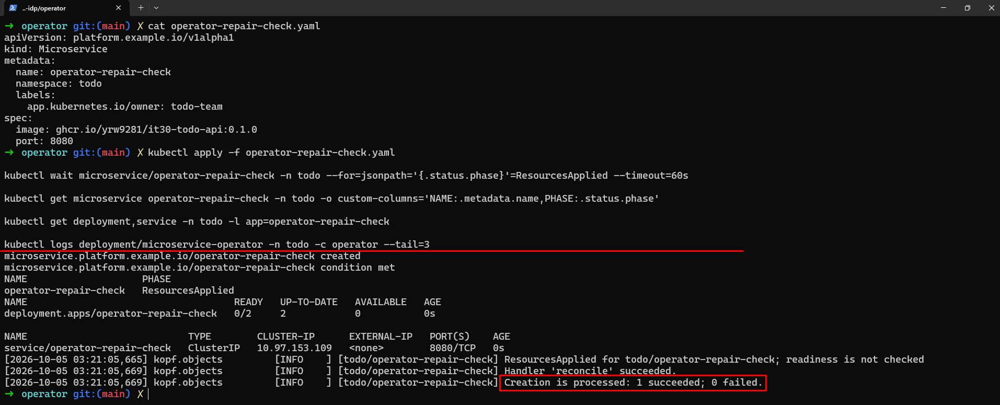
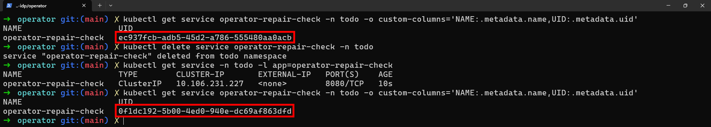

# Day 21 - 讓 Operator 管理 Todo API 的 Deployment 與 Service

前一篇的 `accept` 會記錄收到的 `image`、`port`，並回寫 `Accepted`，但 Todo API 的部署還不會跟著改變。今天我們加入資源管理，讓 Operator 依照 CR 建立或更新 `Deployment`、`Service`。

這次由 Operator 重新建立 Todo API 的工作負載。我們會先看一次 `reconcile` 如何建立資源、檢查所有權與更新設定，再用刪除測試 `Service` 的方式，確認它能補回缺少的資源。

## 把服務輸入轉成工作負載

服務團隊仍只提供 `image`、`port`，其餘設定由平台提供。`desired_resources(cr)` 讀取 CR，產生 `Deployment`、`Service` 的設定；這個函式不會直接呼叫 API Server，後面才由其他函式將設定寫入叢集：

| 來源 | 產生的內容 |
| --- | --- |
| CR 名稱與 Namespace | 同名、同 Namespace 的 `Deployment`、`Service` |
| CR UID | 指向 CR 的 `ownerReferences`，以及受管 Pod 的 UID label |
| `spec.image` | container image，原樣保留 tag 或 digest |
| `spec.port` | container 的 `http` port、`Service` port、`ASPNETCORE_URLS` |
| 平台預設 | 兩個副本、probe、requests／limits、OpenTelemetry（OTel）設定 |

例如 `spec.port` 是 `8080`，Operator 就將 container port、`Service` port 設為 `8080`，並透過 `ASPNETCORE_URLS` 讓 Todo API 監聽同一個 port。這些設定要一起調整，因為只改 container port，不會讓 ASP.NET Core 自動改變監聽位置。

這些預設是依既有 Todo API 設計的：probe 使用 `/health/ready`、`/health/live`，OTel endpoint 指向既有 Collector，應用程式也必須已加入 SDK 或 instrumentation。目前沒有開放 `env` 或 `Secret` 引用，不能只換成任意 image，就期待它能依照相同設定正常運作。

`OTEL_SERVICE_VERSION` 使用完整 image reference，讓我們能從遙測資料對照部署設定，不會另外解析出 release version。CPU request `25m`、memory request `128Mi` 則先沿用小型測試環境的設定，實際需要多少資源仍要依工作負載確認。

## 一次 `reconcile` 怎麼處理差異？

假設我們修改 `todo-api` CR 的 `spec.image`，Operator 要先算出新的資源設定，再讀取叢集裡的 `Deployment`、`Service`。確認兩個資源都能修改後，才將差異寫入。下面是 `reconcile` 裡負責這段工作的程式：

```python
desired_deployment, desired_service = desired_resources(cr)
deployment = read_child("Deployment", namespace, name)
service = read_child("Service", namespace, name)
# Check both names before modifying either resource.
for resource in (deployment, service):
    if resource is not None:
        check_owner(resource, cr)
ensure(desired_deployment, deployment, cr, logger)
ensure(desired_service, service, cr, logger)
write_phase(cr, logger, "ResourcesApplied", managed=True)
```

`desired_deployment`、`desired_service` 是依 CR 產生的目標設定；`deployment`、`service` 則是讀取到的現況，資源不存在時會是 `None`。接下來的處理取決於兩件事：資源是否屬於這筆 CR，以及目前設定是否符合目標。

| 資源現況 | 處理方式 |
| --- | --- |
| 不存在 | 建立目標資源 |
| 屬於這筆 CR，設定相符 | 不寫入 |
| 屬於這筆 CR，設定不同 | 更新同一個物件 |
| 已存在，但不屬於這筆 CR | 回報 `OwnershipConflict`，不覆寫 |

### `read_child`：讀取目前的 `Deployment` 或 `Service`

同樣是讀取資源，Kubernetes Python client 對 `Deployment`、`Service` 提供的是不同方法。`read_child` 讓呼叫端只要傳入 Kind、Namespace 和名稱，就能取得後續比對需要的 dictionary：

```python
def read_child(kind: str, namespace: str, name: str) -> Json | None:
    read = apps.read_namespaced_deployment if kind == "Deployment" else core.read_namespaced_service
    try:
        return api.sanitize_for_serialization(read(name, namespace, _request_timeout=TIMEOUT))
    except ApiException as error:
        if error.status == 404:
            return None
        raise
```

這裡只處理 `Deployment`、`Service`。`apps`、`core` 與 `api` 是 Operator 啟動時建立的 API client；`Json` 是 `dict[str, Any]` 的型別別名。Python client 回傳的是資源物件，`sanitize_for_serialization` 將它轉成 dictionary，後面就能用 `resource["metadata"]`、`resource["spec"]` 讀取欄位。`TIMEOUT` 設為 `(5, 20)`，分別限制連線與讀取的等待時間，單位是秒。

如果 API 回傳 `404`，函式回傳 `None`，讓 `ensure` 知道需要建立資源。其他 `ApiException` 則由最後的 `raise` 往外拋，連線錯誤也不會在這裡被吞掉。權限不足和資源不存在需要不同處理，不能因為讀不到，就嘗試建立一份新的。

### `check_owner`：同名資源不一定能修改

讀到 `todo-api` 後，還要確認它是不是這筆 CR 管理的資源。`check_owner` 會檢查 `ownerReferences`，找出指向目前 CR 的 controller reference：

```python
def check_owner(current: Json, cr: Json) -> None:
    owners = current["metadata"].get("ownerReferences", [])
    if not any(owner.get("uid") == cr["metadata"]["uid"]
               and owner.get("apiVersion") == API_VERSION
               and owner.get("kind") == "Microservice"
               and owner.get("controller") is True for owner in owners):
        raise OwnershipConflict(
            f'{current["kind"]}/{current["metadata"]["name"]} is not owned by this CR')
```

`API_VERSION` 是 `platform.example.io/v1alpha1`。這段程式同時核對 CR 的 UID、API version、Kind，以及 `controller: true`，不能只看名稱。即使刪除後又建立同名 CR，它的 UID 也會不同，因此不能直接修改舊 CR 擁有的資源。找不到符合條件的 reference 時，就拋出 `OwnershipConflict`，由 handler 記錄原因並回報失敗。

前面的 `for` 會在寫入前檢查兩個已存在的資源，避免改了 `Deployment` 才發現 `Service` 是別人的。這只是預先檢查，兩次 API 寫入仍是分開的操作，不會因此變成一起成功或一起還原。

### `ensure`：不存在就建立，有差異才更新

定期檢查每十秒都會執行，但我們不希望每次都重新寫入相同設定。如果 `todo-api` 已經符合 CR，這次處理就應該略過寫入；只有資源不存在或設定不同時，才需要呼叫 API。`ensure` 接收目標設定 `desired`、目前資源 `current`，以及提供名稱、Namespace 和所有權依據的 `cr`：

```python
def ensure(desired: Json, current: Json | None, cr: Json, logger: logging.Logger) -> None:
    kind = desired["kind"]
    namespace, name = cr["metadata"]["namespace"], cr["metadata"]["name"]
    if current is None:
        create = (apps.create_namespaced_deployment if kind == "Deployment"
                  else core.create_namespaced_service)
        create(namespace, desired, _request_timeout=TIMEOUT)
        logger.info("Created %s/%s", kind, name)
        return
    check_owner(current, cr)
    if contains(current, desired):
        return
    replacement = deepcopy(current)
    replacement["metadata"]["labels"] = {
        **current["metadata"].get("labels", {}), **desired["metadata"]["labels"]}
    if kind == "Deployment":
        replacement["spec"] = desired["spec"]
        replace = apps.replace_namespaced_deployment
    else:
        replacement["spec"].update(desired["spec"])
        replace = core.replace_namespaced_service
    replacement.pop("status", None)
    replace(name, namespace, replacement, _request_timeout=TIMEOUT)
    logger.info("Updated %s/%s", kind, name)
```

`current is None` 時，函式選擇對應的 create 方法，送出目標設定並記錄 `Created`，然後結束。如果資源已存在，則再次呼叫 `check_owner`，讓 `ensure` 本身也保有所有權檢查，不只依賴呼叫端。

接著的 `contains(current, desired)` 會比對目標設定列出的內容。dictionary 裡額外的欄位不會被當成差異；list 則會核對長度與各位置的內容。因此，API Server 在 dictionary 補入的預設欄位不一定需要覆寫，但 image、port 或平台指定的 label 不同時，就會進入更新。設定相符時直接 `return`，重複處理同一筆 CR 不會多建立資源，也不會每次都送出更新。

更新時先用 `deepcopy` 複製目前資源，再合併 metadata labels，保留其他 label，並讓平台指定的值符合目標。`Deployment` 會將整個 `spec` 換成目標設定，不會逐欄保留外部加入的設定；`Service` 則用 `update` 修改目標設定列出的欄位，保留 API Server 已配置的 `ClusterIP` 等欄位。這裡的 `update` 不是逐層合併，例如 `ports` 仍會整份替換。

`replacement.pop("status", None)` 移除複製來的狀態，因為這次要提交的是資源設定，不是自行宣告工作負載的觀察結果。最後的 `replace` 會更新同一個物件，不是刪掉再建立；複製時也保留了讀取到的 `resourceVersion`。如果讀取後有人又修改資源，API Server 就會拒絕這次過期的寫入，Operator 必須重新讀取再重試。

### 設定提交後，回報結果或錯誤

兩次 `ensure` 都完成後，`write_phase` 才寫入 `ResourcesApplied`，並記錄受管資源的名稱。這只表示設定已提交，程式還沒有檢查 image 是否能拉取、Pod 是否就緒。狀態回寫前也會重新讀取 CR，核對 UID、generation 與刪除狀態，避免把舊需求的處理結果寫到新需求上。

如果輸入不符合規則，`desired_resources` 會拋出 `InvalidSpec`；資源不屬於 CR 時，`check_owner` 則會拋出 `OwnershipConflict`。下面節錄 handler 捕捉這兩種錯誤後的處理，`error` 是捕捉到的例外：

```python
logger.error("%s: %s", type(error).__name__, error)
write_phase(cr, logger, "Failed", managed=False)
raise kopf.PermanentError(str(error)) from error
```

先記錄錯誤類型與原因，再將 CR 設為 `Failed`，並清除 `status.managedResources` 中先前記錄的名稱，這不會刪除工作負載。`PermanentError` 告訴 Kopf，不要針對這次 handler 失敗繼續重試相同操作；它不會停止整個 Operator，之後的 `spec` 更新或定期檢查仍可能再次觸發處理。

API 權限不足、版本衝突或連線失敗則由外層錯誤處理記錄 log，透過 `TemporaryError` 要求稍後重試，重新讀取資源後再判斷。這個版本不會替管理者修正權限，只會明確留下錯誤，不能把失敗當成 `ResourcesApplied`。

和前一篇一樣，CR 建立、`spec` 修改，以及 Operator 重啟後讀到既有 CR 時，都會執行處理函式，這次執行的是 `reconcile`。另外每十秒檢查一次：即使 CR 沒改，只要它管理的 `Deployment` 或 `Service` 被刪除、設定被改動，也能在檢查時處理。API 延遲與重試都會影響時間，不能保證十秒內修復。

## 確認設定已提交，再觀察資源補回

首次啟用資源管理版本前，請先確認 `todo` Namespace 中沒有同名的 `todo-api` Deployment、Service，讓 Operator 依照既有 CR 重新建立。若資源由 Argo CD 或其他 controller 管理，也要先解除管理，避免刪除後又被建立。

以下操作使用 AI 做的 Operator 建立資源的測試環境。前面的程式節錄只說明處理流程，不能單獨執行成一個完整 Operator。

```bash
kubectl get microservice todo-api -n todo -o yaml
kubectl get deployment,service -n todo -l app=todo-api
kubectl rollout status deployment/todo-api -n todo --timeout=180s
```

CR 應回報 `ResourcesApplied`，`managedResources` 中的 `deployment`、`service` 則都記錄名稱 `todo-api`。這表示 Operator 已提交兩個資源的設定，Pod 是否就緒還要另外查看 rollout。若 CR 回報 `Failed`，應查看 Operator log 中的 `InvalidSpec` 或 `OwnershipConflict`，不能把這次處理當成部署完成。

我們用暫時的測試資源確認定期檢查（timer）能否補回 `Service`，不刪除原本 Todo 的 `Service`。先確認 CR、`Deployment`、`Service` 都沒有 `operator-repair-check` 這個名稱，再將 Day 18 的 `Microservice` 設定 `todo-api.yaml` 複製成 `operator-repair-check.yaml`，只改 `metadata.name`，沿用 Todo 的 image、port。這會短暫增加測試工作負載，需要預留容量：

```bash
kubectl apply -f operator-repair-check.yaml
kubectl wait microservice/operator-repair-check -n todo \
  --for=jsonpath='{.status.phase}'=ResourcesApplied --timeout=60s
```

下圖中，測試 CR 已回報 `ResourcesApplied`，同名的 `Deployment`、`Service` 也已建立，log 顯示 `reconcile` 已成功處理建立事件。不過，當時 Deployment 的 `READY` 仍是 `0/2`，也就是設定已提交，Pod 還沒就緒。



確認設定已提交後，記錄並刪除測試 `Service`：

```bash
kubectl get service operator-repair-check -n todo -o jsonpath='{.metadata.uid}{"\n"}'
kubectl delete service operator-repair-check -n todo
kubectl get service -n todo -l app=operator-repair-check --watch
```

Operator 的 timer 應補回同名 `Service`。看到它重新出現後，按 `Ctrl+C` 停止 watch，再次執行前面的 UID 查詢指令，比對刪除前後的 UID。新物件的 UID 應不同，`ClusterIP` 也不保證相同；這次只確認資源能被補回，不要求測試 Pod 完成 rollout。

下面的操作畫面顯示，刪除後又查到了同名 `Service`，但前後 UID 不同。這表示 Operator 建立了新的資源，並非原本的物件仍留在叢集裡。



測試結束後，讓 Operator 保持運作，再刪除測試 CR：

```bash
kubectl delete microservice operator-repair-check -n todo --wait=true
kubectl get deployment,service -n todo -l app=operator-repair-check
```

刪除 CR 後，垃圾回收不一定立刻完成，要等 `Deployment`、`Service` 都消失。Kopf 的 timer 會使用 finalizer，讓 CR 在相關處理完成前不會被刪除。如果先停掉 Operator，它可能無法完成 finalizer 的處理，CR 的刪除就會卡住；不要直接清除 finalizer 來跳過這一步。

確認同名 `Service` 被補回後，我們就能看到 Operator 在 CR 沒改變時，仍會處理資源的差異。不過，`ResourcesApplied` 還沒回答「這次更新能用了嗎」。下一篇加入 rollout 與 `Service` endpoint 的觀察，回報新版是否就緒。
