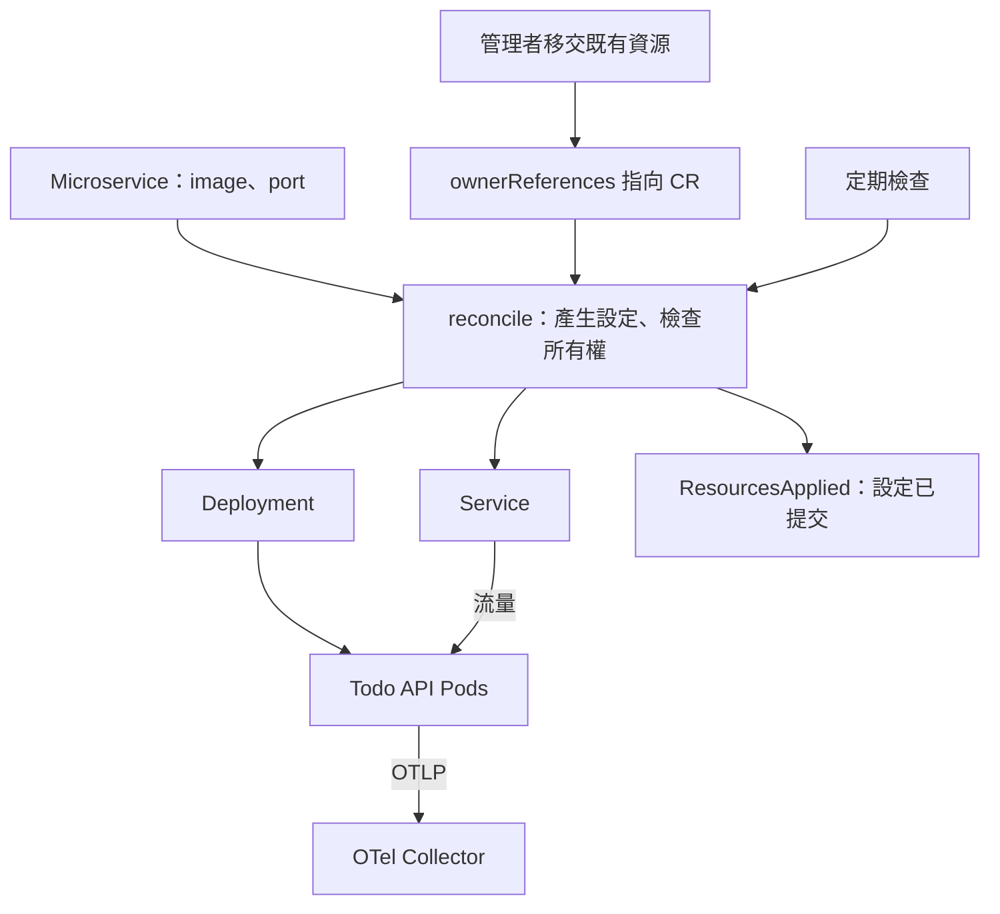

# Day 21 - 讓 Operator 管理 Todo API 的 Deployment 與 Service

前一篇的 `accept` 只確認收到 CR。現在要把它換成資源管理：CR 指定哪個 image，Operator 就讓 `Deployment` 使用它，並維持對應的 `Service`。

先看每次 `reconcile` 如何處理資源，再看既有 Todo API 的一次性移交。兩者要分開：我們不希望程式一看到同名資源，就認定那是自己可以修改的物件。

## 把服務輸入轉成工作負載

服務團隊仍只提供 `image`、`port`，其餘由平台預設。`desired_resources(cr)` 根據這份合約產生兩份資源資料，不直接呼叫 API：

| 來源 | 產生的內容 |
| --- | --- |
| CR 名稱與 Namespace | 同名、同 Namespace 的 `Deployment`、`Service` |
| CR UID | 指向 CR 的 `ownerReferences`，以及受管 Pod 的 UID label |
| `spec.image` | container image，原樣保留 tag 或 digest |
| `spec.port` | container 的 `http` port、`Service` port、`ASPNETCORE_URLS` |
| 平台預設 | 兩個副本、probe、requests／limits、OpenTelemetry（OTel）設定 |

例如 port 是 `8080`，應用程式的監聽設定與流量設定就一起使用它。只改 container port，不會讓 ASP.NET Core 自動改變監聽位置。

這份合約只適用既有 Todo API：probe 使用 `/health/ready`、`/health/live`，OTel endpoint 指向既有 Collector，應用程式也必須已加入 SDK 或 instrumentation。目前沒有開放 `env` 或 `Secret` 引用，不能把任意 image 都當成相同服務。

`OTEL_SERVICE_VERSION` 使用完整 image reference，方便對回部署設定，不是解析出的 release version。CPU request `25m`、memory request `128Mi` 則是小型測試環境的起點，不是容量保證。

## 一次 `reconcile` 怎麼處理差異？

下面節錄資源管理的核心。API 存取、狀態回寫與錯誤處理沒有列在這段裡：

```python
desired_deployment, desired_service = desired_resources(cr)
deployment = read_child("Deployment", namespace, name)
service = read_child("Service", namespace, name)
# Check both names before modifying either resource.
for resource in (deployment, service):
    if resource is not None:
        check_owner(resource, cr)
ensure(desired_deployment, deployment, cr, logger)
ensure(desired_service, service, cr, logger)
write_phase(cr, logger, "ResourcesApplied", managed=True)
```

`read_child` 讀取現況，`check_owner` 確認控制者是這筆 CR，`ensure` 才決定是否寫入：

| 資源現況 | 處理方式 |
| --- | --- |
| 不存在 | 建立目標資源 |
| 屬於這筆 CR，設定相符 | 不寫入 |
| 屬於這筆 CR，設定不同 | 更新同一個物件 |
| 已存在，但不屬於這筆 CR | 回報 `OwnershipConflict`，不覆寫 |

兩個物件都通過所有權檢查後，才開始修改，避免改了 `Deployment` 才發現 `Service` 是別人的。所有權使用 CR 的 UID；同名 CR 刪除後重建，UID 不同，就不能直接沿用原本的所有權。

`Deployment.spec` 由 Operator 維持；更新 `Service` 時則保留原本的 `ClusterIP` 等配置。寫入帶著 `resourceVersion`，並行修改造成衝突時要重新讀取再重試，不能覆蓋別人的新資料。

只有 API 的 `404` 可以當成物件不存在。權限或連線錯誤必須留下 log 並回報、重試，不能用「建立一份新的」掩蓋讀取失敗。

create、spec update、resume 都會執行 `reconcile`。另外每十秒定期檢查一次，處理 CR 沒改、子資源卻被刪除或修改的情況；API 延遲與重試都會影響時間，不保證十秒內修復。

## 既有 Todo API 要先移交

全新的 CR 可以由 Operator 建立資源，但 `todo/todo-api` 已經存在，還沒有指向 CR 的 owner reference。這時正確行為是拒絕修改，再由管理者確認來源、備份並明確移交，而不是讓 handler 自動接管。

**如果 Argo CD 還管理這兩個資源，必須先退出原本的管理方式並保留叢集物件。** 只暫停自動同步不夠，人工 sync 仍可能寫回；開著 prune 就從 Git 刪掉 manifest，也可能把服務刪掉。不能只清掉 tracking 標記來繞過檢查。

一次性接管會核對 selector、`ClusterIP` 類型、既有所有權與 Argo CD tracking 標記，再加入指向 CR 的 `ownerReferences`，不改 `spec`。這些檢查無法偵測所有外部 controller，管理者仍須確認沒有另一方繼續寫入。

接管保留 `app=todo-api` selector，Operator 另加 CR UID label 辨識受管 Pod。兩個 API 更新不是交易；第二次失敗時，必須排查再重跑，第一次不會自動 rollback。

移交後才啟用資源管理版本。資源 UID 沒變，不代表 Pod 沒換：加入 UID label、調整 OTel 設定仍會觸發 rollout。Todo 資料存在各程序的記憶體，換 Pod 會遺失該程序的資料，副本間也沒有共享資料。

**刪除 CR 會連帶垃圾回收它擁有的 `Deployment`、`Service`。** 要退出 Operator 管理，應先停止它、解除 owner reference，再恢復原本的管理方式；不要拿刪除 CR 當停用按鈕。

下圖把移交與持續管理分開。Operator 提交 `Deployment`，Pod 仍由 Kubernetes 原生 controller 建立：



<!-- TODO(assets): 補上既有 todo-api 的 owner reference、Deployment／Service 標籤畫面，呈現資源移交與 Pod 關聯。 -->

## 確認設定已提交，再觀察資源補回

以下觀察方式適用於已完成移交、啟用資源管理版本的測試環境。這篇的程式節錄不能單獨當成完整 Operator 執行。

```bash
kubectl get microservice todo-api -n todo -o yaml
kubectl get deployment,service -n todo -l app=todo-api
kubectl rollout status deployment/todo-api -n todo --timeout=180s
```

CR 應回報 `ResourcesApplied`，`managedResources` 指向 `todo-api` 的兩個資源。它只代表設定已提交；Pod 是否就緒，要另外看 rollout。若回報 `Failed`，查看 Operator log 的 `InvalidSpec` 或 `OwnershipConflict`，不要當成服務已完成部署。

驗證 timer 時，不刪正式 Todo 的 `Service`。先確認 CR、`Deployment`、`Service` 都沒有 `operator-repair-check` 這個名稱，再將服務合約的 `todo-api.yaml` 複製成 `operator-repair-check.yaml`，只改 `metadata.name`，沿用 Todo 的 image、port。這會短暫增加測試工作負載，需要預留容量：

```bash
kubectl apply -f operator-repair-check.yaml
kubectl wait microservice/operator-repair-check -n todo \
  --for=jsonpath='{.status.phase}'=ResourcesApplied --timeout=60s
```

確認設定已提交後，記錄並刪除測試 `Service`：

```bash
kubectl get service operator-repair-check -n todo -o jsonpath='{.metadata.uid}{"\n"}'
kubectl delete service operator-repair-check -n todo
kubectl get service operator-repair-check -n todo --watch
```

timer 應補回同名 `Service`。按 `Ctrl+C` 停止 watch，再用同一個 UID 查詢指令核對：新物件的 UID 應不同，`ClusterIP` 也不保證相同。這裡驗證資源補回，不要求測試 Pod 完成 rollout。

測完在 Operator 仍運行時清理：

```bash
kubectl delete microservice operator-repair-check -n todo --wait=true
kubectl get deployment,service -n todo -l app=operator-repair-check
```

垃圾回收是非同步的，要等兩個子資源都消失。Kopf timer 使用 finalizer，先停掉 Operator 可能讓 CR 刪除卡住，不要直接清除 finalizer。

資源已經能維持，但 `ResourcesApplied` 還沒回答「這次更新能用了嗎」。下一篇加入 rollout 與 `Service` endpoint 的觀察，回報新版是否就緒。
