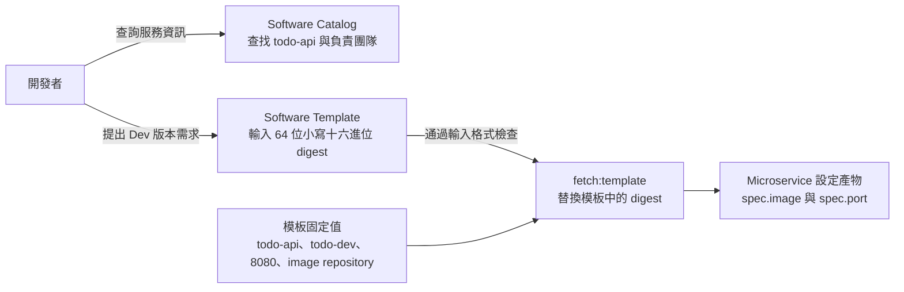

# Day 21 - 用 Backstage Software Templates 收集服務設定

## 讓開發者選 image，不必先找 YAML

前一篇整理了 `Microservice` 到 `Deployment` 的欄位關係，Operator 的輸入與輸出已經有了設計。不過，若每次更新 image 都要開發者手寫 CR，他還是得知道 Git 設定放在哪裡、哪個環境能改，以及哪些欄位不能動。

Backstage 的 **Software Catalog（軟體目錄）** 讓人找到服務與擁有者，**Software Templates（軟體範本）** 則收集輸入並執行指定步驟。這篇用既有設定範例，說明如何把 Todo API 的 Dev 更新限制為一個 digest 輸入；目前尚未完成 Backstage 執行環境與權限整合。

## Catalog 描述服務，CR 描述部署意圖

為 `todo-api` 建立 Catalog `Component` 時，可以記錄服務名稱、負責團隊，以及關聯 Kubernetes 資源的查詢條件。以下是服務紀錄的關鍵設定：

```yaml
apiVersion: backstage.io/v1alpha1
kind: Component
metadata:
  name: todo-api
  annotations:
    backstage.io/kubernetes-namespace: todo
    backstage.io/kubernetes-label-selector: app=todo-api
spec:
  type: service
  lifecycle: experimental
  owner: todo
```

`owner: todo` 記錄負責團隊，對應的 Catalog 團隊實體仍需另外建立。這是服務資料，不是提交者的授權依據；即使能修改 `owner`，也不應因此取得部署權限。

兩個 annotation 預留了 Kubernetes 資源的查詢條件：在 `todo` Namespace 查找 `app=todo-api`。既有 Pod template 有這個 label，但 `Deployment` 與 `Service` 本身的 `metadata.labels` 沒有，因此不能假設同一 selector 已能查到所有資源。這份 Catalog 紀錄也不會產生 `Microservice` CR；後者才是 Operator 要讀取的部署意圖。

## Template 先只開放一個受控輸入

第一個 Software Template 鎖定 Todo API 的 Dev 更新。Git repository、branch、Namespace 與服務名稱都由模板固定，使用者只提供 CI 發布的 image digest。以下是模板的參數區塊，用來擋下長度或字元不符的 SHA-256 字串：

```yaml
parameters:
  - title: Image from the release workflow
    required:
      - digest
    additionalProperties: false
    properties:
      digest:
        title: Image digest (64 lowercase hex characters, without sha256:)
        type: string
        minLength: 64
        maxLength: 64
        pattern: "^[0-9a-f]{64}$"
```

CI 的輸出通常寫成 `sha256:` 加 64 位十六進位字元；這裡只填後半段，產生設定時再固定加上 `sha256:`。這段 schema 只檢查格式，不會查詢 GHCR 或 CI 紀錄。

Template 的 `fetch:template` 步驟會以這個值渲染一份受控的 `Microservice` YAML。服務名稱、Namespace、port 和 image repository 都由模板決定，產物的關鍵欄位是：

```yaml
apiVersion: platform.example.io/v1alpha1
kind: Microservice
metadata:
  name: todo-api
  namespace: todo-dev
spec:
  image: ghcr.io/yrw9281/it30-todo-api@sha256:{{ values.digest }}
  port: 8080
```

`{{ values.digest }}` 會在渲染時被替換，這段模板不能直接提交 Kubernetes。它的目標是 `todo-dev`，而前面的 Catalog 紀錄指向既有的 `todo`；兩者不是同一個部署環境。Dev 的設定儲存庫、Namespace、Argo CD `Application` 與 Operator 都尚未建立。

下圖只畫出輸入到設定產物的關係。Catalog 提供服務資訊，並不是產生 CR 的必要處理步驟；實際填表與渲染仍需 Backstage 執行環境。



<!-- TODO(assets): 補上 Backstage Catalog 的 todo-api 服務紀錄、Software Template 的 digest 欄位及渲染出 Microservice 意圖的畫面；尚無 Backstage 執行環境時保留 TODO，不使用假截圖。 -->

## 提交前應在哪裡驗證？

Software Template 的表單 schema 能減少填錯 digest，但 request 也可能由 API 送入，後端仍需驗證輸入。固定目標則只限制「這份模板能改什麼」，不會回答「誰能執行它」；平台要根據已驗證的身分，限制使用者能操作的服務與環境。

digest 格式正確，也不代表它真的是 Todo API 的 image。採用前要確認 digest 對應的 GHCR package 與受信任 CI run，不能只憑長度和字元判斷來源。

目前的本機檢查會解析 Catalog 與 Template YAML，確認 digest 欄位必填、長度為 64，以及 pattern 能區分小寫十六進位字元和大寫或非法字元。它再以測試值替換模板，檢查 image、Namespace 與 `spec` 欄位。這不是 Backstage 的實際渲染，也沒有完整執行 CRD schema 驗證，更沒有提出 PR 或呼叫 Kubernetes。表單畫面、後端驗證與權限仍要在執行環境備妥後另外確認。

下一篇看模板的第二步：怎麼把產出的設定提出 Pull Request，並讓 Git 設定檢查與人工 review 決定它能否進入部署來源。
