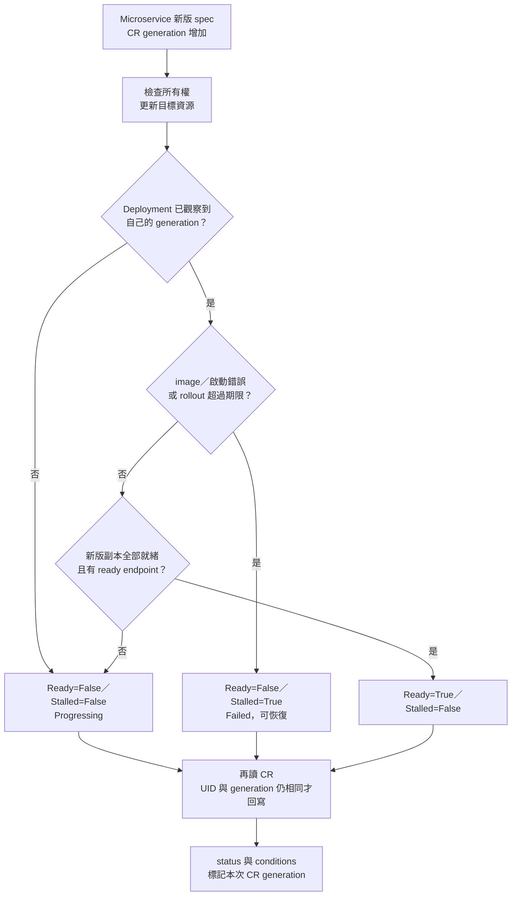

# Day 22 - 讓 Operator 回報新版是否就緒

前一篇的 Operator 已能維持 Deployment 與 Service，但 `ResourcesApplied` 只代表設定已提交。換 image 時，舊 Pod 可能還在接請求，新 Pod 卻拉不到 image；如果只看可用副本數，就會把舊版可用誤報成新版成功。

今天在相同的 Operator 加上 rollout、Pod 與 Service endpoint 的觀察。沿用 `todo`、兩個副本、既有的資源合約與 RBAC，不另外建立平台元件。

## 健康判斷要認得新版

先確認 Deployment controller 已觀察到 **Deployment 自己**的 generation，再檢查以下結果：

- 總副本、新版副本、ready 與 available 副本，都等於目標副本數。
- 有 ready 的 Service endpoint，且它指向目前受管 Pod 的 UID。
- 目標 image 沒有出現拉取、container 設定或啟動失敗，rollout 也未超過進度期限。

將下列函式接在 `resources.py` 後面，沿用既有的 `Json`、`datetime`、`timezone`：

```python
def health(deployment: Json, slices: list[Json], pods: list[Json],
           image: str) -> tuple[bool, bool, str, str]:
    status = deployment.get("status", {})
    if status.get("observedGeneration", 0) < deployment["metadata"]["generation"]:
        return False, False, "Reconciling", "Deployment controller has not observed this version"
    for pod in pods:
        for container in pod.get("spec", {}).get("containers", []):
            if container["image"] != image:
                continue
            for observed in pod.get("status", {}).get("containerStatuses", []):
                if observed["name"] != container["name"]:
                    continue
                waiting = observed.get("state", {}).get("waiting", {})
                if waiting.get("reason") in {
                    "ErrImagePull", "ImagePullBackOff", "InvalidImageName",
                    "CrashLoopBackOff", "CreateContainerConfigError",
                }:
                    return False, True, waiting["reason"], "Inspect managed Pod events and logs"
    if any(condition.get("type") == "Progressing"
           and condition.get("status") == "False"
           and condition.get("reason") == "ProgressDeadlineExceeded"
           for condition in status.get("conditions", [])):
        return False, True, "ProgressDeadlineExceeded", "Deployment rollout exceeded its deadline"
    replicas = deployment["spec"]["replicas"]
    complete = all(status.get(key, 0) == replicas for key in
                   ("replicas", "updatedReplicas", "readyReplicas", "availableReplicas"))
    pod_uids = {pod["metadata"]["uid"] for pod in pods
                if any(container["image"] == image
                       for container in pod.get("spec", {}).get("containers", []))}
    endpoints = any(endpoint.get("conditions", {}).get("ready") is True
                    and endpoint.get("addresses")
                    and endpoint.get("targetRef", {}).get("uid") in pod_uids
                    for item in slices for endpoint in (item.get("endpoints") or []))
    if complete and endpoints:
        return True, False, "RolloutComplete", "All updated replicas and Service endpoints are ready"
    return False, False, "RolloutPending", "Waiting for updated replicas and ready Service endpoints"


def make_status(cr: Json, ready: bool, stalled: bool, reason: str,
                message: str, managed: bool) -> Json:
    generation = cr["metadata"]["generation"]
    previous = {item["type"]: item for item in cr.get("status", {}).get("conditions", [])}
    conditions = []
    for kind, value in (("Ready", ready), ("Stalled", stalled)):
        state = "True" if value else "False"
        old = previous.get(kind, {})
        transition = old.get("lastTransitionTime") if old.get("status") == state else None
        conditions.append({
            "type": kind, "status": state, "observedGeneration": generation,
            "reason": reason, "message": message,
            "lastTransitionTime": transition or datetime.now(timezone.utc).isoformat(
                timespec="seconds").replace("+00:00", "Z"),
        })
    name = cr["metadata"]["name"]
    return {
        "phase": "Ready" if ready else "Failed" if stalled else "Progressing",
        "observedGeneration": generation, "conditions": conditions,
        "managedResources": {"deployment": name, "service": name} if managed else {},
    }
```

`Ready=False` 不一定失敗，可能仍在等待 rollout。`Stalled=True` 則指出目前看到的失敗，例如 `ErrImagePull`；修正 image 後仍會繼續觀察，不是永久失敗。Pod 尚未排程時先維持等待，超過 `progressDeadlineSeconds: 120` 才可能得到 `ProgressDeadlineExceeded`；這個期限不是自動 rollback。

每次回報都一起更新 conditions 與 CR 的 `observedGeneration`。`lastTransitionTime` 只有 True／False 改變才更新，不因 timer 每次執行就跳動。健康判斷使用 Deployment 的 generation，狀態回寫使用 CR 的 generation，兩者不能直接比較。

下圖呈現版本與狀態的關係。讀到舊版 `Ready=True` 時，要先看 generation，不能跳過版本檢查。



## 先讓 API Server 保留 conditions

Python 寫入新欄位前，要更新 `microservice-crd.yaml`，否則 schema 會剪裁它。保留原有 CRD 的 group、version、`spec` 欄位與 `status` subresource，在 `openAPIV3Schema` 根層加上 `required: [spec]`，並將其 `properties.status` 改為以下內容：

```yaml
type: object
properties:
  phase:
    type: string
  observedGeneration:
    type: integer
  managedResources:
    type: object
    properties:
      deployment:
        type: string
      service:
        type: string
  conditions:
    type: array
    x-kubernetes-list-type: map
    x-kubernetes-list-map-keys: [type]
    items:
      type: object
      required: [type, status, reason, message, lastTransitionTime, observedGeneration]
      properties:
        type:
          type: string
        status:
          type: string
          enum: ["True", "False", Unknown]
        reason:
          type: string
        message:
          type: string
        lastTransitionTime:
          type: string
          format: date-time
        observedGeneration:
          type: integer
          minimum: 0
```

`conditions` 以 `type` 為 map key。這只是 schema，不會代替 Operator 產生狀態。根層要求 `spec` 必填，也補上初版「整個 `spec` 缺少時仍可能通過」的缺口。

CRD 是 cluster-scoped，更新影響所有 Namespace 的 `Microservice`。先核對既有 CR；CRD 的 dry-run 不會替你逐筆驗證已存的 CR。

```bash
kubectl get microservices -A -o yaml
kubectl apply --dry-run=server -f microservice-crd.yaml
kubectl apply -f microservice-crd.yaml
kubectl wait --for=condition=Established \
  crd/microservices.platform.example.io --timeout=60s
```

## 更新 handler，觀察後再回寫

保留 `handlers.py` 的 SDK client 初始化、`read_cr`、`read_child`、`ensure` 與共用常數。加入 `import json`，將 `from resources import (...)` 換成：

```python
from resources import (
    Json, LABEL, InvalidSpec, OwnershipConflict, check_owner, contains,
    desired_resources, health, make_status,
)
```

另外宣告 `discovery: client.DiscoveryV1Api`；在 `configure` 的 `global` 加入 `discovery`，並在建立其他 client 後加入：

```python
discovery = client.DiscoveryV1Api(api)
```

把 `write_phase` 換成 `report`。它重新讀 CR，拒絕過期 UID、generation 或正在刪除的需求；patch 帶上最新 `resourceVersion`，處理檢查後又發生變更的衝突。

```python
def report(cr: Json, logger: logging.Logger, *, ready: bool = False,
           stalled: bool = False, reason: str, message: str, managed: bool = False) -> None:
    meta = cr["metadata"]
    latest = read_cr(meta["namespace"], meta["name"])
    if (latest["metadata"]["uid"] != meta["uid"]
            or latest["metadata"]["generation"] != meta["generation"]
            or latest["metadata"].get("deletionTimestamp")):
        logger.info("Skipping stale status for %s", meta["name"])
        return
    status = make_status(latest, ready, stalled, reason, message, managed)
    if latest.get("status") != status:
        body = {**status, "managedResources": status["managedResources"] if managed else None}
        custom.patch_namespaced_custom_object_status(
            GROUP, VERSION, meta["namespace"], PLURAL, meta["name"],
            {"metadata": {"resourceVersion": latest["metadata"]["resourceVersion"]},
             "status": body}, _request_timeout=TIMEOUT)
```

沒有確認管理成功時，用 merge-patch 的 `null` 清除舊資源名稱；空物件不會刪掉舊值。接著替換完整 `reconcile`，保留 create、spec update、resume 與 timer 的觸發方式：

```python
@kopf.on.create(GROUP, VERSION, PLURAL)
@kopf.on.update(GROUP, VERSION, PLURAL, field="spec")
@kopf.on.resume(GROUP, VERSION, PLURAL)
@kopf.timer(GROUP, VERSION, PLURAL, interval=10)
def reconcile(namespace, name, logger, **_):
    try:
        cr = read_cr(namespace, name)
        if cr["metadata"].get("deletionTimestamp"):
            return
        try:
            desired_deployment, desired_service = desired_resources(cr)
            deployment = read_child("Deployment", namespace, name)
            service = read_child("Service", namespace, name)
            # Check both names before modifying either resource.
            for resource in (deployment, service):
                if resource is not None:
                    check_owner(resource, cr)
            if (deployment is None or service is None
                    or not contains(deployment, desired_deployment)
                    or not contains(service, desired_service)):
                report(cr, logger, reason="Reconciling", message="Applying current service settings")
            ensure(desired_deployment, deployment, cr, logger)
            ensure(desired_service, service, cr, logger)
            deployment = read_child("Deployment", namespace, name)
            if deployment is None:
                raise kopf.TemporaryError("Deployment disappeared during reconcile", delay=10)
            selector = f'{LABEL}={cr["metadata"]["uid"]}'
            pods = api.sanitize_for_serialization(core.list_namespaced_pod(
                namespace, label_selector=selector, _request_timeout=TIMEOUT))["items"]
            # Kubernetes 1.30 can return endpoints:null, which SDK models reject.
            response = discovery.list_namespaced_endpoint_slice(
                namespace, label_selector=f"kubernetes.io/service-name={name}",
                _request_timeout=TIMEOUT, _preload_content=False)
            try:
                slices = json.loads(response.data)["items"]
            finally:
                response.release_conn()
            ready, stalled, reason, message = health(deployment, slices, pods, cr["spec"]["image"])
            report(cr, logger, ready=ready, stalled=stalled, reason=reason,
                   message=message, managed=True)
        except (InvalidSpec, OwnershipConflict) as error:
            logger.error("%s", error)
            report(cr, logger, stalled=True, reason=type(error).__name__, message=str(error))
            raise kopf.PermanentError(str(error)) from error
    except ApiException as error:
        if error.status == 404:
            try:
                read_cr(namespace, name)
            except ApiException as missing:
                if missing.status == 404:
                    logger.info("CR %s/%s no longer exists", namespace, name)
                    return
                logger.error("Kubernetes API returned HTTP %s", missing.status)
                raise kopf.TemporaryError(
                    f"Kubernetes API returned HTTP {missing.status}", delay=10) from missing
            except HTTPError as missing:
                logger.error("Kubernetes API connection failed: %s", missing)
                raise kopf.TemporaryError("Kubernetes API connection failed", delay=10) from missing
        logger.error("Kubernetes API returned HTTP %s", error.status)
        raise kopf.TemporaryError(f"Kubernetes API returned HTTP {error.status}", delay=10) from error
    except HTTPError as error:
        logger.error("Kubernetes API connection failed: %s", error)
        raise kopf.TemporaryError("Kubernetes API connection failed", delay=10) from error
```

觀察 EndpointSlice 時讀原始 JSON，是因為這次 Kubernetes 1.30 的空 slice 可能回傳 `endpoints: null`，SDK model 會拒絕反序列化。它表示目前沒有 endpoint，不應用廣泛的 `except` 假裝查詢成功。

輸入錯誤回報本身也可能遇到 API 或連線問題，因此放在外層重試保護內。只有再次確認 CR 確實不存在，才結束這次處理，不把其他 `404` 都當成 CR 已刪除。

更新 ConfigMap 並重啟：

```bash
kubectl create configmap microservice-operator-code -n todo \
  --from-file=handlers.py --from-file=resources.py --from-file=requirements.txt \
  --dry-run=client -o yaml | kubectl apply -f -
kubectl rollout restart deployment/microservice-operator -n todo
kubectl rollout status deployment/microservice-operator -n todo --timeout=300s
kubectl wait microservice/todo-api -n todo --for=condition=Ready --timeout=180s
kubectl get microservice todo-api -n todo -o yaml
```

第一次執行後，CR 應有 `Ready`／`Stalled`，以及與 `metadata.generation` 相同的 `status.observedGeneration`。單看 `phase` 不夠，conditions 才帶有原因與版本。

## 用錯誤 image 區分新舊版本

以下操作會觸發真實 rollout，只在測試環境執行。保留原 image，再指定不存在的 tag：

```bash
original_image=$(kubectl get microservice todo-api -n todo -o jsonpath='{.spec.image}')
kubectl patch microservice todo-api -n todo --type=merge \
  -p '{"spec":{"image":"ghcr.io/yrw9281/it30-todo-api:operator-missing-image"}}'
kubectl wait microservice/todo-api -n todo --for=condition=Stalled --timeout=180s
kubectl get microservice todo-api -n todo -o yaml
kubectl get deployment,pods -n todo -l app=todo-api
```

這次實測新 Pod 無法拉取 image，CR 回報 `Ready=False`、`Stalled=True`，reason 為 `ErrImagePull` 或之後的 `ImagePullBackOff`。原有兩個副本仍可用，並沒有讓健康判斷誤認新版成功。

還原後等待，並一起看 generation：

```bash
kubectl patch microservice todo-api -n todo --type=merge \
  -p "{\"spec\":{\"image\":\"$original_image\"}}"
kubectl wait microservice/todo-api -n todo --for=condition=Ready --timeout=180s
kubectl get microservice todo-api -n todo \
  -o jsonpath='{.metadata.generation}{"\n"}{.status.observedGeneration}{"\n"}{.status.conditions}{"\n"}'
```

兩個 generation 相同且 `Ready=True`，才表示這次還原完成。剛 patch 後可能短暫讀到舊 `Ready=True`；`kubectl wait` 不比較 generation，若它立即返回，仍要繼續查看，不能當成新版已完成。

<!-- TODO(assets): 補上錯誤 image 的 Pod 事件與 CR conditions，保留舊副本仍 available 的畫面，並截取還原後 generation 相同、Ready=True 的結果。 -->

## CR 健康、HTTP 回應與重啟是不同證據

在一個終端機轉送 Service：

```bash
kubectl port-forward service/todo-api 8080:8080 -n todo
```

另一個終端機確認基本端點：

```bash
curl --fail http://127.0.0.1:8080/health/ready
curl --fail http://127.0.0.1:8080/api/todos
```

這次從叢集內呼叫同一個 Service，兩個端點都得到 HTTP `200`。CR 健康判斷沒有代替這些請求，更沒有驗證所有 Todo 業務功能。

重啟測試要看 **新 Pod** 的 resume log，不能只看 CR 仍保留 `Ready=True`：

```bash
kubectl rollout restart deployment/microservice-operator -n todo
kubectl rollout status deployment/microservice-operator -n todo --timeout=300s
kubectl logs deployment/microservice-operator -n todo -c operator --tail=30
```

這次 log 出現 `Resuming is processed: 1 succeeded; 0 failed.`。另外已用目前 Pod 的 image digest 更新 CR，確認 reference 原樣進入 Deployment、兩個 child 的 UID 都未改變；Service 補回與 owner 衝突演練也已完成。短暫測試資源已刪除，原 image 已還原。

現在的 Operator 仍是單一副本、十秒定期檢查的 Todo 範例，沒有 HA、通用服務或多環境設定；init container 也需要下載 Python 套件。下一篇看 Backstage 如何收集 digest，產生受控的 CR 設定，但模板產生 YAML 還不等於部署。
