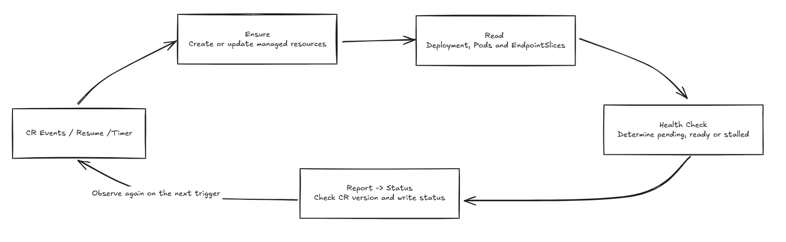
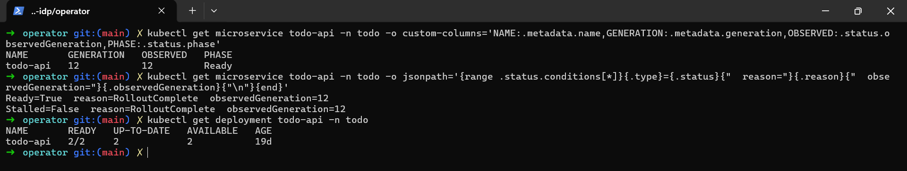

# Day 22 - 讓 Operator 回報新版是否就緒

前一篇的 Operator 已經能建立、更新 `Deployment` 和 `Service`，也能補回被刪除的資源。不過，`ResourcesApplied` 只表示設定已提交。Todo API 換了 image 後，新 Pod 可能拉取失敗，舊 Pod 卻仍能回應請求，不能因此認定這次更新成功。

今天在既有的 `reconcile` 加入健康判斷，確認新版副本與 `Service` endpoint，再將結果寫回 CR。資源建立與所有權檢查沿用原本的做法，服務團隊仍只提供 `image`、`port`。

## 新版就緒要看哪些狀態？

`health(deployment, slices, pods, image)` 接收目前的 `Deployment`、`EndpointSlice`、受管 Pod 與目標 image，回傳 `ready`、`stalled`、`reason`、`message`。它只判斷傳入的資料，不直接呼叫 API Server；以下兩段是這個函式內依序執行的程式。

先確認 Deployment controller 已觀察目前的設定，再找出目標 image 的 Pod 是否有啟動錯誤，或 rollout 是否長時間沒有進展：

```python
status = deployment.get("status", {})
if status.get("observedGeneration", 0) < deployment["metadata"]["generation"]:
    return False, False, "Reconciling", "Deployment controller has not observed this version"
for pod in pods:
    for container in pod.get("spec", {}).get("containers", []):
        if container["image"] != image:
            continue
        for observed in pod.get("status", {}).get("containerStatuses", []):
            if observed["name"] != container["name"]:
                continue
            waiting = observed.get("state", {}).get("waiting", {})
            if waiting.get("reason") in {
                "ErrImagePull", "ImagePullBackOff", "InvalidImageName",
                "CrashLoopBackOff", "CreateContainerConfigError",
            }:
                return False, True, waiting["reason"], "Inspect managed Pod events and logs"
if any(condition.get("type") == "Progressing"
       and condition.get("status") == "False"
       and condition.get("reason") == "ProgressDeadlineExceeded"
       for condition in status.get("conditions", [])):
    return False, True, "ProgressDeadlineExceeded", "Deployment rollout exceeded its deadline"
```

例如新 Pod 回報 `ImagePullBackOff`，函式就回傳 `ready=False`、`stalled=True`，並留下錯誤原因。舊 Pod 即使仍可用，也不能抵銷新版的錯誤。`ProgressDeadlineExceeded` 則沿用 Deployment 的進度判斷；平台設定的 `progressDeadlineSeconds: 120` 不是從提交 CR 起算的固定部署時限，也不會自動 rollback。

沒有看到明確阻礙後，接著檢查新版副本與 endpoint：

```python
replicas = deployment["spec"]["replicas"]
complete = all(status.get(key, 0) == replicas for key in
               ("replicas", "updatedReplicas", "readyReplicas", "availableReplicas"))
pod_uids = {pod["metadata"]["uid"] for pod in pods
            if any(container["image"] == image
                   for container in pod.get("spec", {}).get("containers", []))}
endpoints = any(endpoint.get("conditions", {}).get("ready") is True
                and endpoint.get("addresses")
                and endpoint.get("targetRef", {}).get("uid") in pod_uids
                for item in slices for endpoint in (item.get("endpoints") or []))
if complete and endpoints:
    return True, False, "RolloutComplete", "All updated replicas and Service endpoints are ready"
return False, False, "RolloutPending", "Waiting for updated replicas and ready Service endpoints"
```

Todo API 的目標是兩個副本，`replicas`、`updatedReplicas`、`readyReplicas`、`availableReplicas` 都要是 `2`。這樣不只確認有可用副本，也確認副本已更新成目前的 Pod template，沒有把仍在服務的舊副本算成新版成功。

`EndpointSlice` 還要至少有一個具備位址、`ready: true` 的 endpoint，且 `targetRef.uid` 對應到目標 image 的受管 Pod。副本檢查與 endpoint 檢查都通過，才回報就緒；否則繼續等待。這項判斷不會呼叫業務 API，也不保證資料一致性或外部 Ingress 正常。

## 將觀察結果寫回 CR

`health` 的結果交給 `make_status`，產生 `Ready`、`Stalled` 兩筆 condition，以及概括處理階段的 `phase`：

| 觀察結果 | `Ready` | `Stalled` | `phase` |
| --- | --- | --- | --- |
| 尚未完成更新，沒有明確錯誤 | `False` | `False` | `Progressing` |
| 新版副本就緒，且有符合條件的 endpoint | `True` | `False` | `Ready` |
| image／啟動錯誤，或 rollout 超過進度期限 | `False` | `True` | `Failed` |

下面的 `Json` 是 `dict[str, Any]` 的型別別名，`datetime`、`timezone` 來自 Python 標準函式庫。`make_status` 將這次判斷與 CR generation 一起放進回報內容：

```python
def make_status(cr: Json, ready: bool, stalled: bool, reason: str,
                message: str, managed: bool) -> Json:
    generation = cr["metadata"]["generation"]
    previous = {item["type"]: item for item in cr.get("status", {}).get("conditions", [])}
    conditions = []
    for kind, value in (("Ready", ready), ("Stalled", stalled)):
        state = "True" if value else "False"
        old = previous.get(kind, {})
        transition = old.get("lastTransitionTime") if old.get("status") == state else None
        conditions.append({
            "type": kind, "status": state, "observedGeneration": generation,
            "reason": reason, "message": message,
            "lastTransitionTime": transition or datetime.now(timezone.utc).isoformat(
                timespec="seconds").replace("+00:00", "Z"),
        })
    name = cr["metadata"]["name"]
    return {
        "phase": "Ready" if ready else "Failed" if stalled else "Progressing",
        "observedGeneration": generation, "conditions": conditions,
        "managedResources": {"deployment": name, "service": name} if managed else {},
    }
```

`Ready=False` 不一定是失敗；要一起看 `Stalled` 與 `reason`，才能分辨仍在等待，還是需要排查。`Stalled=True` 也不表示 Operator 停止處理，修正 image 後仍會再次觀察。condition 的 `status` 沒變時，程式保留原本的 `lastTransitionTime`，不會每次檢查都刷新。

結果必須對應目前設定。CR 的 `metadata.generation`、`status.observedGeneration` 與 condition 的 `observedGeneration` 要一致，否則 `Ready=True` 可能是上一版留下的。Deployment 的 generation 則由它自己的 controller 觀察，不能和 CR 的 generation 互相比數字。

CRD 的 `status` schema 也要允許 `conditions` 與其中的欄位，API Server 才會保留回報。`report` 寫入前會再確認 CR 的 UID、generation 與刪除狀態，略過過期結果，並以 `resourceVersion` 保護寫入。這些 conditions 保存的是現況，不是每次更新的事件歷史。

## 健康觀察接在哪裡？

兩次 `ensure` 完成後，Operator 重新讀取 `Deployment`，以 CR UID label 查詢受管 Pod，再取得同名 `Service` 的 `EndpointSlice`。Operator 需要相應的讀取權限，API 錯誤仍由既有錯誤處理記錄並重試。取得資料後，`reconcile` 呼叫健康判斷與回報：

```python
ready, stalled, reason, message = health(deployment, slices, pods, cr["spec"]["image"])
report(cr, logger, ready=ready, stalled=stalled, reason=reason,
       message=message, managed=True)
```

一次 `reconcile` 不會一直等到 rollout 完成。它回報當下的觀察結果，再由 CR 事件、resume 或每十秒的 timer 觸發下一次處理。資源提交、健康判斷與回寫的關係如下：



載入健康回報版本並更新 CRD schema 後，可以用以下指令查看 generation、conditions 與原因。若仍只有 `ResourcesApplied`，應先確認 Operator 版本與 schema，不能當成健康判斷已執行：

```bash
kubectl get microservice todo-api -n todo -o yaml
```

下圖將查詢結果整理成欄位：CR 與兩筆 condition 的 generation 都是 `12`，回報 `Ready=True`、`Stalled=False`，原因為 `RolloutComplete`；Deployment 的兩個副本也都已更新並就緒。



下一篇用 Backstage 表單收集 digest，產生 `Microservice` 設定；服務名稱、Namespace、port 與 image repository 由模板固定，開發者不用每次手寫 CR。
