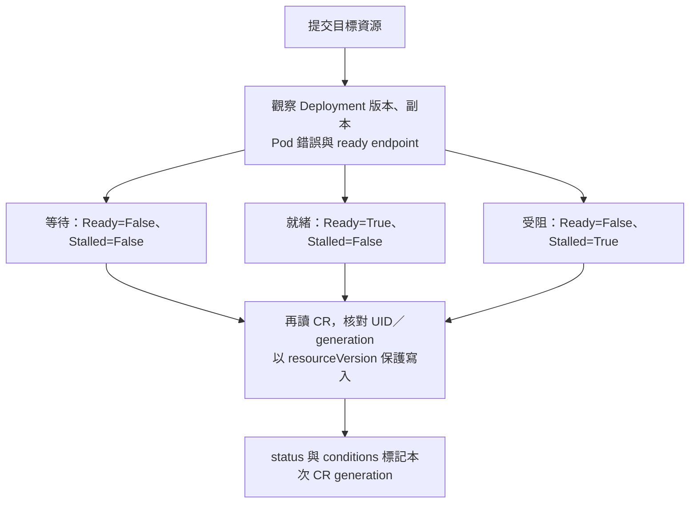

# Day 22 - 讓 Operator 回報新版是否就緒

前一篇的 `ResourcesApplied` 表示設定已提交。不過，image 寫進 `Deployment` 後，新 Pod 可能拉取失敗，舊 Pod 卻仍能回應請求。服務還能用，不等於這次更新已完成。

今天我們讓同一個 Operator 繼續觀察工作負載，回報這次更新是還在等待、已經就緒，還是遇到錯誤。以下會說明判斷方式，再操作一次正常更新與錯誤 image 的演練；操作前需要已載入健康回報版本的 Operator，並讓 CRD 支援 `conditions`，這裡不列出完整安裝步驟。

## 新版就緒需要哪些證據？

Operator 先確認 `Deployment` controller 已讀取目前這一版設定，再檢查副本是否完成更新。下面節錄 `health` 函式中的副本判斷，`status` 指的是 `Deployment.status`：

```python
replicas = deployment["spec"]["replicas"]
complete = all(status.get(key, 0) == replicas for key in
               ("replicas", "updatedReplicas", "readyReplicas", "availableReplicas"))
```

以目標兩個副本為例，下面四個欄位都要是 `2`，才通過這段檢查：

- `replicas`：目前的副本總數。
- `updatedReplicas`：使用目前 Pod template 的副本數。
- `readyReplicas`：已就緒的副本數。
- `availableReplicas`：已達到可用條件的副本數。

`updatedReplicas` 讓我們確認副本已換成目前的 Pod template。只看 `availableReplicas`，可能把仍在服務的舊副本算成這次更新成功。

Operator 也會讀取 `EndpointSlice`，確認至少有一個 ready endpoint，其對應的 Pod UID 屬於使用目標 image 的受管 Pod。副本完成更新，而且 `Service` 有符合這個條件的 endpoint，才回報 `Ready`。

若使用目標 image 的 Pod 出現 `ErrImagePull`、`ImagePullBackOff`、`CrashLoopBackOff` 等錯誤，Operator 就回報這個阻礙，不能因為舊 Pod 還能接請求就判定新版就緒。

`Deployment` 回報 `ProgressDeadlineExceeded` 時，也會被判定為失敗。這裡的 `progressDeadlineSeconds: 120` 是 Deployment 判斷更新長時間沒有進展的設定，不是從提交 CR 起算的固定部署時限；超過期限也不會自動 rollback。

這些判斷來自 Kubernetes 資源狀態，不會逐一呼叫業務 API，也不保證資料一致性或外部 Ingress 正常。

## 用 conditions 區分等待與失敗

同樣是尚未就緒，新版可能還在等待 Pod 啟動，也可能已經遇到 image 拉取錯誤。只看 `phase` 不容易分辨原因，所以我們加入 `Ready`、`Stalled` 這兩種 condition：

| 觀察結果 | `Ready` | `Stalled` | `phase` |
| --- | --- | --- | --- |
| 新版仍在 rollout，尚未看到明確錯誤 | `False` | `False` | `Progressing` |
| 新版副本就緒，且有符合條件的 endpoint | `True` | `False` | `Ready` |
| image／啟動錯誤，或 rollout 超過進度期限 | `False` | `True` | `Failed` |

`Ready=False` 不一定代表失敗，也可能只是更新尚未完成。若同時看到 `Stalled=True`，才表示目前有阻礙需要排查；例如修正錯誤 image 後，Operator 仍會繼續處理，不會永久停止。

每個 condition 都帶有 `type`、`status`、`reason`、`message`、`lastTransitionTime` 與 `observedGeneration`。`observedGeneration` 記錄這個結果對應哪一版 CR 設定；`lastTransitionTime` 則記錄該 condition 的 `status` 在 `True`、`False` 之間改變的時間，不會每次定期檢查都更新。

CRD 的 `status` schema 必須先允許這些欄位，API Server 才會保留它們。`conditions` 使用 `type` 作為 map key，讓 `Ready`、`Stalled` 各自有一筆狀態；schema 只定義格式，內容仍由 Operator 觀察後寫入。這個版本也補上根層的 `spec` 必填要求。因為 CRD 適用整個叢集，更新前要確認各 Namespace 的既有 CR 都符合新要求，不能只檢查 `todo`。

## `Ready=True` 也可能是上一版的結果

假設 CR 的 `spec` 已更新，`metadata.generation` 從 `3` 增加到 `4`，但 Operator 還沒處理。此時可能暫時看到下面的狀態節錄：

```yaml
metadata:
  generation: 4
status:
  phase: Ready
  observedGeneration: 3
  conditions:
    - type: Ready
      status: "True"
      observedGeneration: 3
```

這裡的 generation 是 CR 設定的版本，不是 image 的 release version。畫面上的 `Ready=True` 仍是第 `3` 版的結果，不能拿來判定第 `4` 版已完成。要確認這次更新就緒，`metadata.generation`、`status.observedGeneration`、`Ready` condition 的 `observedGeneration` 都要是 `4`，而且 `Ready=True`。

`Deployment` 也有自己的 generation，但它和 CR 的 generation 是分開計算的，不能互相比數字。判斷 rollout 時，Operator 核對的是 `Deployment.metadata.generation` 與 `Deployment.status.observedGeneration`；將結果寫回 CR 時，才記錄這次 CR 設定的 generation。

回寫前，Operator 會重新讀取 CR，確認 UID、generation 沒變，也沒有正在刪除。它再用這次讀取的 `resourceVersion` 寫入；如果檢查後 CR 又被修改，API Server 就會拒絕這次寫入，避免留下過期結果。`resourceVersion` 用來保護寫入，和前面判讀結果所用的 generation 不同。

`kubectl wait --for=condition=Ready` 只等待 condition，不會核對這些 generation，可能立即讀到上一版的 `Ready=True`，因此不能單獨用來證明新版完成。

下圖顯示從工作負載觀察到 CR 回報的流程：



## 觀察一次更新，再測試失敗與恢復

以下操作會改動 Todo 工作負載，只在測試環境執行。先確認目前版本就緒，在同一個終端機保存原 image：

```bash
original_image=$(kubectl get microservice todo-api -n todo -o jsonpath='{.spec.image}')
```

若查詢失敗或原 image 是空值，先停止並排查，不要繼續演練。

正常更新時，將服務合約的 `todo-api.yaml` 中 `spec.image` 改為 CI 產出的完整 digest reference，包含 image repository、`@sha256:` 與 64 位小寫十六進位 digest。要先核對 GHCR package 與受信任 CI run；格式正確不代表來源可信，reference 也必須與目前不同才會觸發更新。

```bash
kubectl apply -f todo-api.yaml
kubectl get deployment todo-api -n todo \
  -o jsonpath='{.spec.template.spec.containers[0].image}{"\n"}'
kubectl get microservice todo-api -n todo \
  -o jsonpath='{.metadata.generation}{"\n"}{.status.observedGeneration}{"\n"}{.status.conditions}{"\n"}'
```

`kubectl apply` 回傳後，Operator 不一定已處理完成。記下這次 CR 的 `metadata.generation`，重複查詢，直到 `Deployment` 使用指定的 image，CR 的 `status.observedGeneration` 與 `Ready` condition 的 `observedGeneration` 都等於記下的值，而且 `Ready=True`。若等待期間又有人改了 `spec` 或重建 CR，要停止並核對新需求，不要把另一筆結果算成這次成功。

接著使用不存在的 tag：

```bash
kubectl patch microservice todo-api -n todo --type=merge \
  -p '{"spec":{"image":"ghcr.io/yrw9281/it30-todo-api:operator-missing-image"}}'
kubectl get microservice todo-api -n todo -o yaml
kubectl get deployment,pods -n todo -l app=todo-api
```

預期新 Pod 會因為拉不到 image 而回報錯誤。和正常更新一樣，先記下 patch 後的 CR generation，再確認 `status.observedGeneration` 與 conditions 的 `observedGeneration` 都已更新到這個值。這一版應是 `Ready=False`、`Stalled=True`，`reason` 為 `ErrImagePull` 或 `ImagePullBackOff`。即使舊副本仍可用，也不能回報新版就緒；若遲遲沒有新狀態，要查 Operator log 與 Pod 事件，不要只憑舊 condition 判斷。

無論演練成功或遇到錯誤，都要還原原 image：

```bash
kubectl patch microservice todo-api -n todo --type=merge \
  -p "{\"spec\":{\"image\":\"$original_image\"}}"
```

還原 image 也會產生一個新的 CR generation。再次查詢，確認 `status.observedGeneration` 與 conditions 的 `observedGeneration` 都等於還原後的 `metadata.generation`，且 `Ready=True`、`Stalled=False`。也把本機 `todo-api.yaml` 的 image 還原，避免下次 apply 又送出測試版本。

<!-- TODO(assets): 補上錯誤 image 的 Pod 事件、CR 的 Ready／Stalled 與 generation，保留舊副本仍 available 的畫面，再截取還原後新版就緒的結果。 -->

前一篇的資源補回仍由 timer 處理。如果要確認 Operator 重啟後有接續處理，應查看新 Operator Pod 的 resume log；CR 上的 `Ready=True` 可能是重啟前留下的，不能證明這次 handler 已執行。

這些操作確認的是 Operator 如何處理部署需求與回報結果，CI、Backstage、Git PR 與 Argo CD 還沒有接成完整部署流程。下一篇用 Backstage 表單收集 digest，產生 CR 設定，讓開發者不必手寫整份 CR，也不能任意修改服務名稱、Namespace 或 port。
