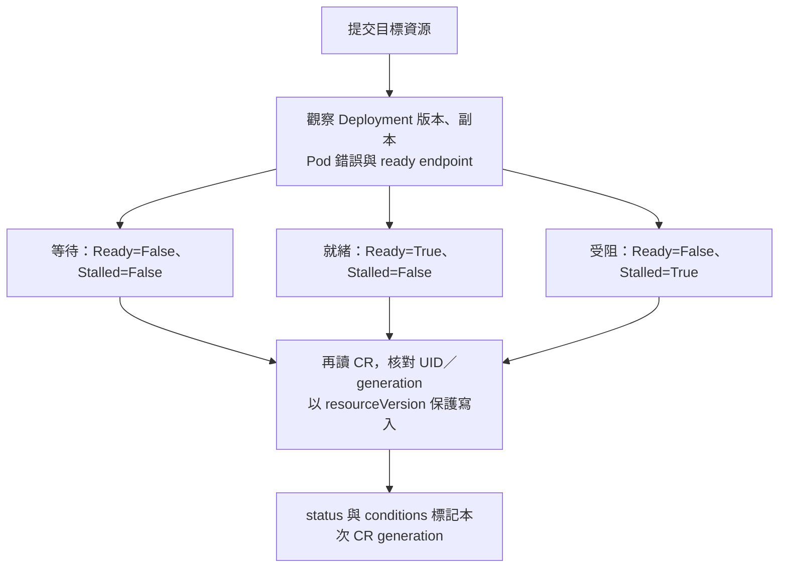

# Day 22 - 讓 Operator 回報新版是否就緒

前一篇的 `ResourcesApplied` 表示設定已提交。不過，image 寫進 `Deployment` 後，新 Pod 可能拉取失敗，舊 Pod 卻仍能回應請求。服務還能用，不等於這次更新已完成。

今天讓同一個 Operator 回報新版結果。下面節錄健康判斷，說明狀態的讀法；觀察指令以測試環境已載入這個版本、CRD 已支援 conditions 為前提，不是完整安裝步驟。

## 新版就緒需要哪些證據？

Operator 先確認 `Deployment` controller 已觀察到目前設定，再檢查副本數。下面是 `health` 的節錄，`status` 指的是 `Deployment.status`：

```python
replicas = deployment["spec"]["replicas"]
complete = all(status.get(key, 0) == replicas for key in
               ("replicas", "updatedReplicas", "readyReplicas", "availableReplicas"))
```

這四個數字都要等於目標副本數。`updatedReplicas` 確認新的 Pod template 已套用；只看 `availableReplicas`，可能把還在服務的舊副本算成新版成功。

Operator 也會讀取 `EndpointSlice`，要求至少有一個 ready endpoint，指向目標 image 的受管 Pod UID。副本完成更新、有就緒的流量目的地，才回報 `Ready`。

若目標 image 的 Pod 出現 `ErrImagePull`、`ImagePullBackOff`、`CrashLoopBackOff` 等錯誤，則回報目前的阻礙。`Deployment` 的 `ProgressDeadlineExceeded` 也是失敗原因；`progressDeadlineSeconds: 120` 是未取得進展的期限，不是提交 CR 後精準倒數，也不會自動 rollback。

這些判斷來自 Kubernetes 資源狀態，不會逐一呼叫業務 API，也不保證資料一致性或外部 Ingress 正常。

## 用 conditions 區分等待與失敗

只有 `phase` 不容易說明卡在哪裡，因此加入 `Ready`、`Stalled`：

| 觀察結果 | `Ready` | `Stalled` | `phase` |
| --- | --- | --- | --- |
| 新版仍在 rollout，尚未看到明確錯誤 | `False` | `False` | `Progressing` |
| 新版副本就緒，且有符合條件的 endpoint | `True` | `False` | `Ready` |
| image／啟動錯誤，或 rollout 超過進度期限 | `False` | `True` | `Failed` |

`Ready=False` 可能只是等待。`Stalled=True` 表示現在有阻礙，修正 image 後仍能恢復，不是 Operator 永久停止處理。

每個 condition 帶有 `type`、`status`、`reason`、`message`、`lastTransitionTime` 與 `observedGeneration`。最後一個欄位標記結果對應的 CR 版本；轉換時間只在 True／False 改變時更新，不因每次定期檢查就改變。

CRD 的 status schema 必須先允許這些欄位，API Server 才會保留它們。`conditions` 以 `type` 作為 map key；schema 只定義資料格式，不會自行產生狀態。這個版本也補上根層的 `spec` 必填要求。CRD 是叢集範圍的資源，更新前要核對各 Namespace 的既有 CR，不能只看 `todo`。

## `Ready=True` 也可能是上一版的結果

假設 CR 的 `spec` 已更新，`metadata.generation` 從 `3` 增加到 `4`，但 Operator 還沒處理。此時可能暫時看到下面的狀態節錄：

```yaml
metadata:
  generation: 4
status:
  phase: Ready
  observedGeneration: 3
  conditions:
    - type: Ready
      status: "True"
      observedGeneration: 3
```

這筆 `Ready` 回答的是第 3 版。要判定第 4 版完成，CR 的 generation、`status.observedGeneration`、`Ready` condition 的 `observedGeneration` 都要是 `4`，而且 `Ready=True`。

CR 與 `Deployment` 各自有 generation，不能互相比數字。健康判斷比較 `Deployment` 自己的 generation 與 observed generation；回寫 CR 時，才標記這次服務需求的 generation。

回寫前，Operator 重新讀取 CR，確認 UID、generation 沒變，也沒有進入刪除。寫入帶著最新 `resourceVersion`，避免檢查後又發生變更。`kubectl wait --for=condition=Ready` 不會核對這些版本，不能單獨用來證明新版完成。

下圖顯示從工作負載觀察到 CR 回報的流程：



## 觀察一次更新，再測試失敗與恢復

以下操作會改動 Todo 工作負載，只在測試環境執行。先確認目前版本就緒，在同一個終端機保存原 image：

```bash
original_image=$(kubectl get microservice todo-api -n todo -o jsonpath='{.spec.image}')
```

若查詢失敗或原 image 是空值，先停止並排查，不要繼續演練。

正常更新時，將服務合約的 `todo-api.yaml` 中 `spec.image` 改為 CI 產出的完整 digest reference，包含 image repository、`@sha256:` 與 64 位小寫十六進位 digest。要先核對 GHCR package 與受信任 CI run；格式正確不代表來源可信，reference 也必須與目前不同才會觸發更新。

```bash
kubectl apply -f todo-api.yaml
kubectl get deployment todo-api -n todo \
  -o jsonpath='{.spec.template.spec.containers[0].image}{"\n"}'
kubectl get microservice todo-api -n todo \
  -o jsonpath='{.metadata.generation}{"\n"}{.status.observedGeneration}{"\n"}{.status.conditions}{"\n"}'
```

提交與處理是非同步的。記下本次 CR generation，重複查詢，直到 Deployment image 符合需求，且 status 與 `Ready=True` condition 都對應這一版。若等待期間又有人改了 `spec` 或重建 CR，要停止並核對新需求，不要把另一筆結果算成這次成功。

接著使用不存在的 tag：

```bash
kubectl patch microservice todo-api -n todo --type=merge \
  -p '{"spec":{"image":"ghcr.io/yrw9281/it30-todo-api:operator-missing-image"}}'
kubectl get microservice todo-api -n todo -o yaml
kubectl get deployment,pods -n todo -l app=todo-api
```

預期新 Pod 無法拉取 image，這一版的 `Ready=False`、`Stalled=True`，reason 是 `ErrImagePull` 或 `ImagePullBackOff`。舊副本仍可用，也不能因此回報新版就緒。若遲遲沒有新狀態，要查 Operator log 與 Pod 事件，不要只憑舊 condition 判斷。

無論演練成功或遇到錯誤，都要還原原 image：

```bash
kubectl patch microservice todo-api -n todo --type=merge \
  -p "{\"spec\":{\"image\":\"$original_image\"}}"
```

再次查詢 CR 的 generation、status 與 conditions，等它們對應還原後的新版本，且 `Ready=True`、`Stalled=False`。也把本機 `todo-api.yaml` 的 image 還原，避免下次 apply 又送出測試版本。

<!-- TODO(assets): 補上錯誤 image 的 Pod 事件、CR 的 Ready／Stalled 與 generation，保留舊副本仍 available 的畫面，再截取還原後新版就緒的結果。 -->

前一篇的資源補回仍由 timer 處理；重啟恢復則要查看新 Operator Pod 的 resume log，不能只看留下來的 `Ready=True`。這些觀察不等於 CI、Backstage、Git PR 與 Argo CD 已串成完整部署流程。

下一篇用 Backstage 收集 digest，產生這份 CR 設定。Operator 處理部署需求與狀態，開發者入口則負責讓輸入更容易、限制能修改的欄位。
