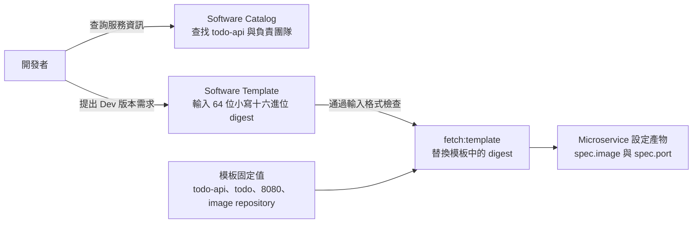

# Day 23 - 用 Backstage Software Templates 收集服務設定

## 用表單更新 Todo API 的 image digest

前一篇讓 Operator 在更新 Todo API 後，回報新版是否就緒。不過，每次更新 image 時，開發者仍要準備 CR，知道 Git 設定放在哪裡、哪個環境能改，以及哪些欄位不能動。服務名稱、Namespace 和 port 都沒有變，卻還是得在 YAML 裡確認一次。

Backstage 的 **Software Catalog（軟體目錄）** 讓人找到服務與擁有者，**Software Templates（軟體範本）** 則收集輸入並執行指定步驟。這次我們把 Todo API 的 Dev 設定收進模板，表單只留下 image digest 欄位，開發者填入 CI 發布的 digest，就能產生要提交的 CR 設定。

目前已有 Backstage 執行環境與 Kubernetes 查詢設定，但 Git PR 與 CR 部署路徑仍未接通。這篇先說明模板如何收集輸入、產生設定；能查詢既有工作負載，不代表已經能從表單完成部署。

## Catalog 描述服務，CR 描述部署意圖

為 `todo-api` 建立 Catalog `Component` 時，可以記錄服務名稱、負責團隊，以及關聯 Kubernetes 資源的查詢條件。以下是服務紀錄的關鍵設定：

```yaml
apiVersion: backstage.io/v1alpha1
kind: Component
metadata:
  name: todo-api
  annotations:
    backstage.io/kubernetes-namespace: todo
    backstage.io/kubernetes-label-selector: app=todo-api
spec:
  type: service
  lifecycle: experimental
  owner: todo
```

`owner: todo` 告訴我們 `todo-api` 由哪個團隊維護，對應的 Catalog 團隊實體仍需另外建立。這個欄位不會授予修改部署的權限；即使使用者能修改 `owner`，也不能因此取得部署權限。

兩個 annotation 指定 Kubernetes 資源的查詢條件：在 `todo` Namespace 查找 `app=todo-api`。Operator 目前會維持 `Deployment`、`Service` 與 Pod template 的 metadata labels，讓它們符合相同條件。Catalog 保存的是 `todo-api` 的服務資訊與查詢條件，不會因此產生 CR；要部署的 image、port 則放在 `Microservice.spec`，由 Operator 讀取並處理。

## Template 先只開放一個受控輸入

第一個 Software Template 用來更新 Todo API 的 Dev 版本，沿用既有 `todo` Namespace。Git repository、目標 branch、Namespace 與服務名稱都由模板固定，使用者只提供 CI 發布的 image digest。以下參數區塊要求 digest 是 64 位小寫十六進位字元，不接受長度或字元不符的 SHA-256 字串：

```yaml
parameters:
  - title: Image from the release workflow
    required:
      - digest
    additionalProperties: false
    properties:
      digest:
        title: Image digest (64 lowercase hex characters, without sha256:)
        type: string
        minLength: 64
        maxLength: 64
        pattern: "^[0-9a-f]{64}$"
```

CI 的輸出通常寫成 `sha256:` 加 64 位十六進位字元。填表時要去掉 `sha256:` 前綴，只填後面的 64 位字元；模板產生設定時會補回前綴。這段 schema 只檢查格式，不會查詢 GHCR 或 CI 紀錄。

Template 的 `fetch:template` 步驟會渲染 `Microservice` YAML，也就是將模板中的變數替換成表單輸入。這裡只替換 digest；服務名稱、Namespace、port 和 image repository 都由模板決定。下面可以看到 digest 要填入的位置：

```yaml
apiVersion: platform.example.io/v1alpha1
kind: Microservice
metadata:
  name: todo-api
  namespace: todo
spec:
  image: ghcr.io/yrw9281/it30-todo-api@sha256:{{ values.digest }}
  port: 8080
```

`{{ values.digest }}` 替換成輸入值後，`spec.image` 才會成為完整的 image reference，因此不能把上面這段模板直接提交 Kubernetes。模板、Catalog 與現有 Operator 都指向 `todo`，不另外建立環境。不過，Git PR 與 Argo CD 的 CR 同步仍未接通；即使既有 Pod 健康，也不能據此判斷表單填入的新 digest 已經部署。

下圖只畫出輸入到設定產物的關係。Catalog 提供服務資訊，並不是產生 CR 的必要處理步驟；實際填表與渲染仍需 Backstage 執行環境。



<!-- TODO(assets): 補上 Backstage Catalog 的 todo-api 服務紀錄、Software Template 的 digest 欄位及實際渲染結果；沒有這些操作畫面前保留 TODO。 -->

## 提交前應在哪裡驗證？

表單 schema 會檢查 digest 的格式，但輸入也可能直接透過 API 送到後端，因此後端仍需驗證，不能只依賴表單。模板固定了修改目標，也不代表所有使用者都有權執行；平台還要驗證提交者的身分，確認他能操作哪些服務與環境。

digest 格式正確，也不代表它真的是 Todo API 的 image。採用前要確認 digest 對應的 GHCR package 與受信任 CI run，不能只憑長度和字元判斷來源。

目前的本機檢查會解析 Catalog 與 Template YAML，確認 digest 欄位必填、長度為 64，且 `pattern` 接受小寫十六進位字元、拒絕大寫或非法字元。它會用測試字串替換模板中的 digest，再解析結果，檢查 image、Namespace 與 `spec` 欄位，確認 Namespace 是 `todo`，也和 Catalog 的查詢目標一致。

這項檢查只處理本機檔案與字串替換，尚未執行 Backstage 的實際渲染、完整 CRD schema 驗證、Git PR 或 Kubernetes 操作。表單畫面、後端驗證與權限，仍要在 Backstage 執行環境備妥後另外確認，不能把本機檢查通過當成部署完成。

下一篇會讓模板將產生的設定提出 Pull Request，再交給 Git 設定檢查與人工 review。通過審查並合併後，設定才會進入部署來源，建立 PR 本身不代表已經部署。
