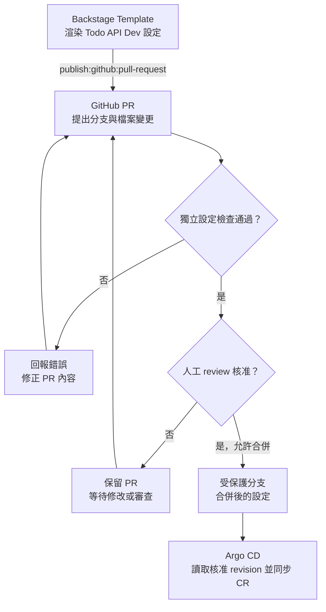

# Day 24 - 用 Backstage 提出 GitOps 設定 Pull Request

## 表單有了，變更要送去哪裡？

前一篇的 Software Template 用 digest 產生 Todo API 的 Dev 設定。接下來要決定這份 YAML 如何進入部署來源。如果 Backstage 直接寫入 Kubernetes，就會跳過 Git review，Git 裡也不會留下這次換版的設定變更。

因此，模板的下一個步驟是提出 Git Pull Request（PR）。審查者核准並合併後，Argo CD 才讀取設定，再由 Operator 處理 `Microservice`。目前只有模板設定與本機靜態檢查，還沒有透過 Backstage 建立 PR 或串接部署。

## 模板提出的變更

Software Template 先用 `fetch:template` 渲染固定的 Dev 設定，再交給 GitHub Scaffolder 的 `publish:github:pull-request` action：

```yaml
steps:
  - id: render
    name: Render the Microservice
    action: fetch:template
    input:
      url: ./skeleton
      values:
        digest: ${{ parameters.digest }}
  - id: propose
    name: Propose a config change
    action: publish:github:pull-request
    input:
      repoUrl: github.com?owner=yrw9281&repo=repo-config
      branchName: backstage/todo-api/dev/${{ parameters.digest }}
      targetBranchName: main
      sourcePath: .
      targetPath: apps/todo-api/overlays/dev
      title: Propose Todo API image for Dev
      description: Review the image digest and environment before merging.
```

`fetch:template` 將渲染結果放進任務的工作目錄，`publish:github:pull-request` 再從 `sourcePath` 取出檔案，向固定的 repository 與 `targetBranchName` 提出變更。`branchName` 包含 digest，`targetPath` 則限定為 Todo API 的 Dev 目錄；表單沒有開放修改這些目的地。Git 路徑中的 `dev` 表示環境用途，產生的 CR 仍部署到既有 `todo` Namespace，不由目錄名稱推導另一個 Namespace。

`repo-config` 是尚未建立的設定儲存庫，目標目錄也還不存在。`kustomization.yaml` 預定用來組裝這個目錄的資源，並沒有要求一定要建立多層 overlay；它不會驗證 CRD，也不會建立 Argo CD `Application`。現有 `Application` 仍只讀取原生 Kubernetes manifest，必須另行設定 CR 的同步來源。

接上 CR 同步前，還要完成原生 Todo API 資源的移交，讓 Argo CD 管理 `Microservice`，Operator 管理它的 Deployment 與 Service。現有 `Application` 開啟了 `selfHeal` 與 `prune`，不能讓兩者共管同一組資源，也不能直接從 Git 移除原生 YAML，任由 prune 刪掉要保留的工作負載。

第一次提出 Dev 設定時，diff 預期包含 `microservice.yaml` 與 `kustomization.yaml`。設定建立後，單純換版的 PR 才應只改 `Microservice.spec.image` 的 digest。reviewer 要比對來源 CI、目標環境與實際 diff；目前 PR description 只有固定說明，沒有自動附上 CI run、提出者或驗證結果。

下圖呈現設定如何進入部署來源。Backstage 已有執行環境，模板也描述了渲染與 PR action；Git 憑證、設定儲存庫、必要檢查與 CR 同步仍未接通。模板與現有 Operator 都以 `todo` 為目標，目的地一致仍不代表這些交接已完成。



## 有 PR 還不夠，設定儲存庫得自己檢查

有人可以不經 Backstage，直接向 Git 提 PR，所以設定儲存庫必須獨立驗證變更。準備好 `repo-config` 後，應將下列檢查設為 `main` 的合併條件：

1. 解析 YAML、檢查變更的路徑與檔案形狀，避免藉 PR 改到別的服務或環境。
2. 依實際 CRD 驗證 `Microservice` 的 group、version、schema 與必填欄位。更新後的 schema 已要求根層 `spec`，以及 `image`、`port` 必填；設定儲存庫的檢查要使用同一版 schema，不能沿用初版定義。需要叢集端驗證時，使用已安裝相同 CRD 的隔離環境，不拿 Production 當試驗場。
3. 檢查 image digest 是否來自受信任的 Todo API CI 輸出，並對照核准的目標環境；格式符合 `sha256` 不等於 image 可信。

這些規則都要另外實作。表單送出成功、Kustomize 能組裝 YAML，或 GitHub 已接受 PR，都不能代替這組檢查。

## 提出變更與核准變更要用不同權限

Backstage 後端需要安裝 GitHub Scaffolder module，並取得能向指定設定儲存庫提出 PR 的憑證。這份憑證不應傳到瀏覽器，也不需要 Kubernetes 寫入權限。

誰能執行模板，由 Backstage 的身分與授權設定限制；誰能合併，則由 Git 的分支保護、必要 checks 與 review 規則限制。能提出 PR 的自動化身分不應同時繞過這些條件。固定 `targetPath` 可以減少誤填，但還是要檢查實際 diff，才能確認變更沒有超出 Todo API Dev 的範圍。

## 怎麼確認這個範例目前做到哪裡？

除了前一篇的輸入與替換檢查，目前的本機檢查也會確認 action 的順序，以及固定的 Git repository、目標分支與目錄。它不會執行 `publish:github:pull-request`，所以還無法證明 Git 憑證有效、PR diff 正確，或 branch protection 真的擋下不合格變更。

執行環境備齊後，要以真實 PR 確認：一般換版只改 Todo API Dev 的 image，不合規變更無法合併，通過 review 的 commit 才會被對應的 Argo CD `Application` 讀取。這些結果必須分別查看 PR diff、checks、合併紀錄與同步 revision，不能只看 Backstage 任務成功。

下一篇要處理另一個容易誤判的狀態：即使 Git 變更已同步，`Microservice` 管理的 Pod 也未必可用。
