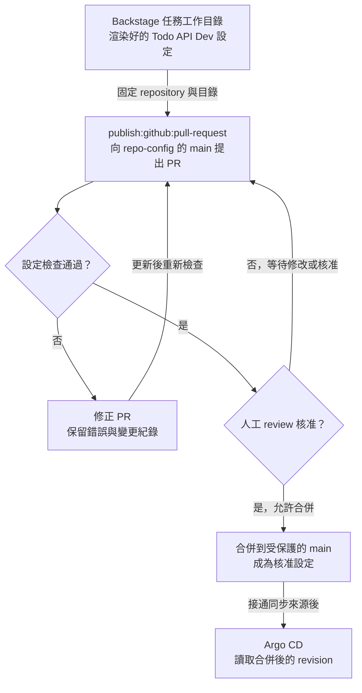

# Day 24 - 用 Backstage 提出 GitOps 設定 Pull Request

前一篇讓 Software Template 收集 digest，再用 `fetch:template` 產生 Todo API 的 `Microservice` YAML。不過，檔案還在 Backstage 任務的工作目錄裡，沒有進入 Git，也沒有更新叢集。接下來要怎麼把這份設定交出去？

Day 16 說過，image 建好後，應透過設定 Pull Request（PR）交給 GitOps，而不是直接部署。今天沿用這個做法，在同一份模板加入提出 PR 的步驟，讓審查者看見要換哪個版本、改到哪個環境，核准後才合併到部署來源。

## 將渲染結果送到固定的 Git 位置

先決定這份設定要放在哪裡。範例沿用 Day 16 的 `repo-config`，以 `main` 保存核准的設定，Todo API 的 Dev 檔案放在 `apps/todo-api/overlays/dev`。`repo-config` 仍是規劃中的設定儲存庫，使用這個 action 前，需要先建立 repository 與合併規則。

有了目的地，就能在 Template 的 `spec.steps` 裡接上 `publish:github:pull-request`。保留前一篇的 `render`，後面新增 `propose`，讓它取得渲染好的檔案並提出變更：

```yaml
steps:
  - id: render
    name: Render the Microservice
    action: fetch:template
    input:
      url: ./skeleton
      values:
        digest: ${{ parameters.digest }}
  - id: propose
    name: Propose a config change
    action: publish:github:pull-request
    input:
      repoUrl: github.com?owner=yrw9281&repo=repo-config
      branchName: backstage/todo-api/dev/${{ parameters.digest }}
      targetBranchName: main
      sourcePath: .
      targetPath: apps/todo-api/overlays/dev
      title: Propose Todo API image for Dev
      description: Review the image digest and environment before merging.
output:
  links:
    - title: Review the config change
      url: ${{ steps.propose.output.remoteUrl }}
```

`render` 先將檔案放進任務工作目錄，`propose` 再從 `sourcePath: .` 取出它們，放到目標 repository 的 `targetPath`。`repoUrl` 指定 GitHub 上的 `yrw9281/repo-config`；`branchName` 是提出變更的分支，名稱帶入這次的 digest；`targetBranchName: main` 則指定 PR 要合併到哪個分支。

這些位置都寫在模板裡，表單仍只收集 digest，不讓使用者重新指定 repository、分支或目錄。Git 路徑中的 `dev` 表示環境用途，產生的 `Microservice` 仍放在既有 `todo` Namespace，不會因資料夾名稱而建立另一個 Namespace。

PR 建立後，action 會回傳連結。`output` 和 `steps` 同樣放在 Template 的 `spec` 下，透過 `steps.propose.output.remoteUrl`，讓開發者能從任務結果開啟 PR，查看變更或等待審查。

要執行這個 action，Backstage 後端需要 GitHub Scaffolder module，以及能向指定 repository 提出 PR 的憑證。憑證留在後端，不傳給瀏覽器，也不需要 Kubernetes 的寫入權限；這個步驟只操作 Git。

## 這筆 PR 應該改到哪些內容？

有了 PR，審查者就能直接看檔案差異。第一次建立 Dev 設定時，範例會提出 `microservice.yaml` 與 `kustomization.yaml` 兩個檔案。前者是渲染好的服務需求，後者放在同一個 `skeleton` 目錄，讓 Kustomize 將這筆資源納入產物：

```yaml
apiVersion: kustomize.config.k8s.io/v1beta1
kind: Kustomization
resources:
  - microservice.yaml
```

`fetch:template` 會處理 `skeleton` 裡的檔案，所以這份 `kustomization.yaml` 也會和 `microservice.yaml` 一起交給 PR action。它只負責列出要組合的資源，不會檢查 CRD schema，也不會替我們建立 Argo CD 的同步設定。

等這兩個檔案已經存在，單純換版的 PR 就應只改 `Microservice.spec.image` 裡的 digest。服務名稱、Namespace 和 port 都沒有變更的理由，也不應順便改到其他服務或環境。固定 `targetPath` 可以減少誤填，但審查者仍要看實際 diff，確認變更範圍符合這次需求。

除了 diff，還要對照這個 digest 是由哪次 Todo API CI 產出。目前模板的 PR description 只有固定說明，沒有自動附上 CI run 或驗證結果，不能把這些證據當成 action 已經準備好。

## 把設定檢查與 review 設為合併條件

人工 review 可以確認變更目的，但固定規則也應自動檢查。況且有人可能不經 Backstage，直接向 `repo-config` 提 PR，所以不能只依賴表單的輸入限制，設定儲存庫需要自己的檢查：

1. YAML 能否解析，變更是否只落在 Todo API Dev 的允許範圍。
2. `Microservice` 是否符合實際 CRD 的 API group、version 與 schema，包含必填的 `spec`、`image`、`port`，以及欄位型別與範圍。
3. image 是否使用核准的 Todo API repository 與 digest，並能對應到受信任的 CI 輸出。

這裡沿用 Day 18 的合約概念，但驗證時要使用更新後的 CRD，不能拿初版 schema 檢查已演進的資源。若需要交給 Kubernetes API 驗證，使用已安裝相同 CRD 的隔離測試環境，不為了檢查設定而取得 Production 的寫入憑證。Kustomize 能產生 YAML，也不能代替 schema 或 image 來源檢查。

這些檢查仍需另外實作，並在 `main` 的分支保護中設為必要條件，再要求人工 review。Backstage 的自動化身分只負責提出 PR，不應繞過檢查或自行合併。誰能執行模板由 Backstage 授權設定限制，誰能合併則由 Git 規則限制，兩者要分開處理。

這樣提出一筆版本更新後，檢查不通過就留在 PR 修改，沒有獲得核准也不能合併。只有符合條件的設定，才會進入部署來源。從模板產物到核准設定，規劃中的交接如下：



<!-- TODO(assets): Git 交接接通後，補上 Todo API Dev PR 的檔案差異、設定檢查與 review 紀錄，以及 Backstage 任務結果中的 PR 連結。 -->

若想先看模板會送出哪些內容，可以在 Backstage 的 `Create` 頁面選擇「Todo API Dev PR Input Preview (D24)」，填入和前一篇相同的 digest。這個預覽用 `debug:log` 顯示渲染好的檔案，以及預計交給 PR action 的 repository、分支與目錄，不會呼叫 GitHub。它能幫助我們對照產物與目的地，但畫面不能當成已建立 PR 或完成審查的證明。

<!-- TODO(assets): 補上「Todo API Dev PR Input Preview (D24)」的任務 log 與目的地資訊，保留畫面中沒有建立 PR 的說明。 -->

## 合併後，才交給 Argo CD

PR 合併後，還需要有 Argo CD `Application` 讀取這個 repository 與目錄，才能將 `Microservice` 同步到 `todo`。Day 07 已介紹 `Application` 如何指定來源；現有設定仍讀取原生 Kubernetes manifest，尚未改成這條 CR 同步路徑。

接上這份來源時，也要確認資源由誰管理：Argo CD 同步 `Microservice`，Operator 再依它管理 `Deployment` 與 `Service`，不能讓兩者同時修改同一組工作負載。既有 `Application` 開啟了 `selfHeal` 與 `prune`，調整來源前要明確完成管理範圍的移交，不能直接從 Git 移除原生 YAML，讓 prune 刪掉要保留的資源。

目前已透過 Backstage 執行檔案渲染與 PR 輸入預覽，但尚未建立真實 PR，CR 同步也還沒接通。實際整合時，要從 PR 的差異、檢查與核准紀錄，一路對照到 Argo CD 讀取的 revision，確認它採用的是這筆核准設定。

今天在模板加入提出 PR 的步驟，讓前一篇產生的 YAML 能送進 Git 審查，經過檢查與核准後再交給 GitOps。接下來還有一個問題：設定已經同步，是否代表新版能用了？下一篇會讓 Argo CD 讀取 Operator 回報的狀態，判斷 `Microservice` 是否健康。
