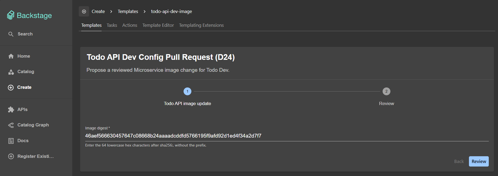
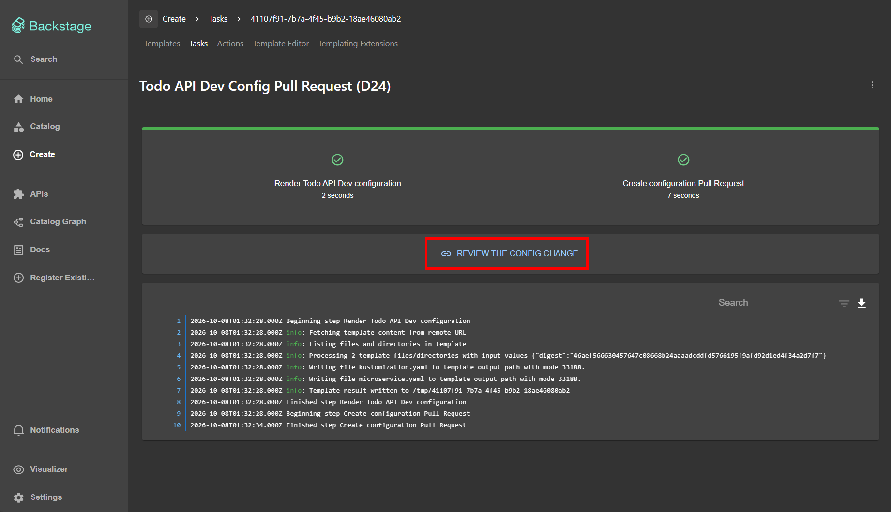
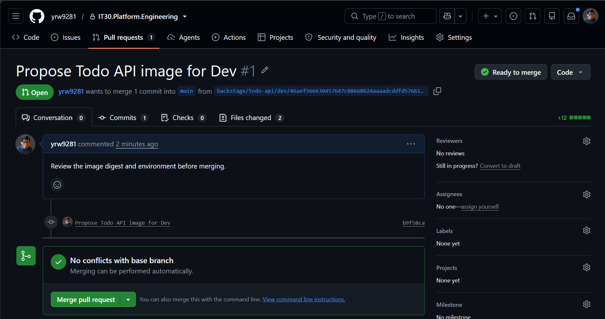
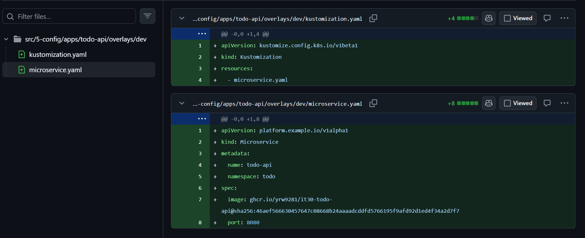
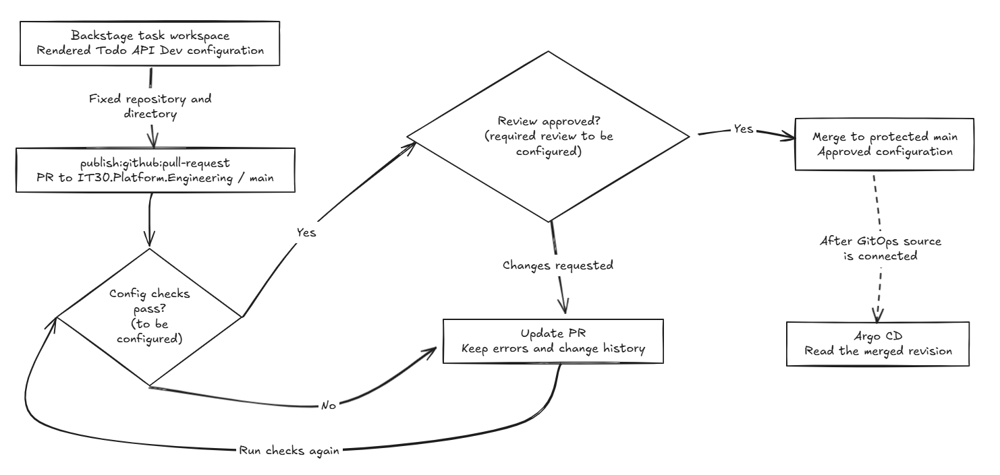

# Day 24 - 用 Backstage 提出 GitOps 設定 Pull Request

前一篇讓 Software Template 收集 digest，再用 `fetch:template` 產生 Todo API 的 `Microservice` YAML。不過，檔案還在 Backstage 任務的工作目錄裡，沒有進入 Git，也沒有更新叢集。接下來要怎麼把這份設定交出去？

Day 16 說過，image 建好後，應透過設定 Pull Request（PR）交給 GitOps，而不是直接部署。今天就在前一篇的渲染步驟後面接上 PR action：將檔案寫到提案分支，讓審查者看見要換哪個版本、改到哪個環境，核准後才合併到 `main`。

## 在渲染後接上提出 PR 的步驟

表單與 `render` 的產生邏輯沿用前一篇，每次任務仍先產生 `microservice.yaml` 與 `kustomization.yaml`。這次只要把顯示預覽的 `inspect` 換成 `propose`，就能用 `publish:github:pull-request` 將產物交給 GitHub。

以下節錄 Template 的 `spec.steps` 與 `spec.output`。表單仍只收集 digest，Git 目的地則固定在模板裡。設定可以和程式碼共用 repository，這次就將 Todo API 的 Dev 設定送到同一個 repository 的獨立目錄：

```yaml
steps:
  - id: render
    name: Render Todo API Dev configuration
    action: fetch:template
    input:
      url: ./skeleton
      values:
        digest: ${{ parameters.digest }}
  - id: propose
    name: Create configuration Pull Request
    action: publish:github:pull-request
    input:
      repoUrl: github.com?owner=yrw9281&repo=IT30.Platform.Engineering
      branchName: backstage/todo-api/dev/${{ parameters.digest }}
      targetBranchName: main
      sourcePath: .
      targetPath: src/5-config/apps/todo-api/overlays/dev
      title: Propose Todo API image for Dev
      description: Review the image digest and environment before merging.
output:
  links:
    - title: Review the config change
      url: ${{ steps.propose.output.remoteUrl }}
```

`propose` 從目前任務的工作目錄（`sourcePath: .`）取得 `render` 產生的兩份檔案，將它們提交到目標 repository 的 `targetPath`，不需要使用者下載後再手動提交。

檔案會寫入 `branchName` 指定的分支，並向 `targetBranchName: main` 提出 PR，不會直接改動 `main`。這裡讓分支名稱帶入 digest，方便辨認是哪次換版需求。

PR 建立後，action 會回傳 `remoteUrl`。`output.links` 用 `steps.propose.output.remoteUrl` 將連結放在任務結果中，讓開發者從 Backstage 直接開啟這筆 PR。

執行這個 action，需要 Backstage backend 安裝 GitHub Scaffolder module，並取得目標 repository 的 PR 權限。本例使用 GitHub Personal Access Token（PAT），由 backend 使用，不需填入服務表單。

## 從任務結果查看 PR 的變更

在 `Create` 頁面選擇 `Todo API Dev Config Pull Request (D24)`，表單仍只要求填寫 `Image digest`。填入 Todo API CI 產出的 64 位 digest，再點 `Review` 確認輸入並建立任務：



這次任務會依序執行 `Render Todo API Dev configuration` 與 `Create configuration Pull Request`。兩個步驟成功後，結果會出現 `Review the config change` 連結，讓我們直接開啟剛建立的 PR：



點進連結後，可以看到 `Propose Todo API image for Dev`，狀態是 `Open`，目標分支是 `main`，提案分支名稱則帶入表單的 digest。這筆 PR 有一個 commit、兩份檔案變更，還沒有合併：



切到 `Files changed`，就能查看模板提出的設定差異。這是第一次建立 Dev 設定，所以 PR 新增了 `microservice.yaml` 與 `kustomization.yaml`。前者指定 `todo-api`、`todo` Namespace、port `8080`，以及帶入 digest 的 image；後者讓 Kustomize 將這筆 `Microservice` 納入產物：



等這兩個檔案已經存在，單純換版的 PR 就應只改 `spec.image` 裡的 digest。服務名稱、Namespace 和 port 都沒有變更的理由，也不應順便改到其他服務或環境。模板固定了目的地，但 review 仍要確認實際 diff 是否符合這次需求。

如果 PR 步驟失敗，則查看 `Create configuration Pull Request` 的 log，不能將只有渲染完成的任務當成已送出 PR。

若需要追溯 image 的來源，也可以附上產出這個 digest 的 Todo API CI 執行連結。目前模板的 PR description 只有固定說明，尚未自動帶入這些資訊。

## 把設定檢查與 review 設為合併條件

PR 讓我們看見變更，卻不會自動保證內容正確。前一篇的表單只能檢查 digest 格式，而且有人也可能不經 Backstage，直接提出 PR，所以 Git 端仍需要獨立的設定檢查：

1. YAML 能否解析，變更是否只落在 Todo API Dev 的允許範圍。
2. `Microservice` 是否符合目前 CRD 的 API group、version 與 schema，包含必填欄位、型別與範圍。
3. image 是否來自核准的 Todo API repository，digest 是否能對應到受信任的 CI 輸出。

這些檢查確認設定是否符合規則，人工 review 則確認是否要將這個版本交付到 Dev。Backstage 只負責提出 PR，不自行合併，也不繞過合併條件。

這次示範尚未執行自動化設定檢查，PR 也沒有 review 紀錄。因此，畫面上的 `Ready to merge` 不代表設定檢查通過或已有審查者核准。

設定好合併條件後，檢查失敗或 review 要求修改，都留在 PR 處理，通過後才進入 `main`。下圖呈現這段交接：



## 合併後，才交給 Argo CD

要讓合併後的設定部署到叢集，Argo CD 的 `Application` 還必須讀取同一個 repository、分支與設定目錄。目前這個來源尚未接通，所以建立或合併 PR 都不會讓 Todo API 自動換版。

接通後，分工仍是 Argo CD 同步 `Microservice`，Operator 管理它的 `Deployment` 與 `Service`，由各自的控制器處理後續部署。

今天替模板產生的 YAML 接上 PR 步驟，讓換版需求留下可審查的 diff。但設定同步到叢集，還不代表新版已經能用。下一篇會讓 Argo CD 讀取 Operator 回報的狀態，判斷 `Microservice` 是否健康。
