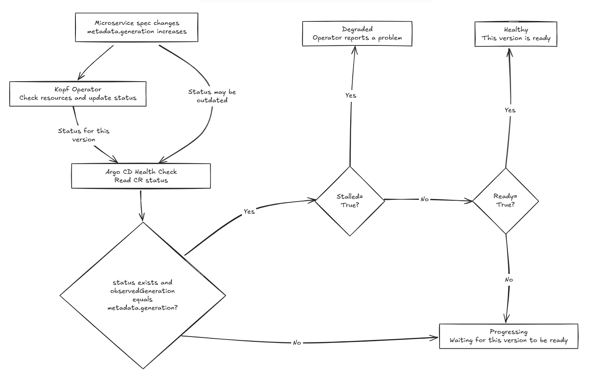

# Day 25 - 讓 Argo CD 判斷 `Microservice` 是否健康

前一篇已經能從 Backstage 提出 Todo API 的換版 Pull Request（PR），不過 Argo CD 還沒設定成讀取這份部署設定。即使之後接通了，能將合併的設定同步到叢集，也不代表 Operator 已完成更新：新的 `spec.image` 已經寫進 `Microservice`，新 Pod 卻可能還在啟動，甚至根本拉不到 image。這時，我們要從哪裡確認這次換版的結果？

這就接回 Day 07 區分的 `Synced` 與 `Healthy`。`Synced` 表示 Git 宣告和叢集中的受管設定一致，`Healthy` 則要看資源是否符合就緒條件。當時 Argo CD 同步的是 `Deployment` 等原生資源，可以使用內建的健康判斷；但 `Microservice` 是我們自訂的資源，Argo CD 並不知道它什麼時候才算就緒。

Day 22 的 Operator 已經會觀察新版 rollout、Pod 與 `Service` endpoint，將結果寫回自訂資源（Custom Resource，CR）的 `status`。因此，今天不用再做一套工作負載檢查，而是透過自訂健康檢查（Custom Health Check），把這份回報轉成 Argo CD 的健康狀態。今天會寫出這段健康判斷，並說明如何將它加入 Argo CD 的設定。

## 讓 Argo CD 讀取 Operator 的判斷

Argo CD 同步 `Microservice.spec` 後，Operator 才會依照需求建立或更新 `Deployment`、`Service`，再觀察工作負載。這兩段處理不會同時完成，所以 CR 已存在、設定也正確時，仍要讀取 Operator 寫入的 `status`，才能知道更新進度。目前自訂資源定義（Custom Resource Definition，CRD）已支援以下狀態欄位，Kopf Operator 也會回報它們：

| 欄位或 condition | 判斷用途 |
| --- | --- |
| `metadata.generation` | 目前 CR 的設定版本，不是 image 的 release version |
| `status.observedGeneration` | Operator 回報的觀察結果對應哪一版 CR |
| `Ready=True` | 該版本的副本已完成更新並就緒，且有符合條件的 `Service` endpoint |
| `Stalled=True` | 該版本遇到 image／啟動錯誤、rollout 超過進度期限等需要排查的問題 |

以 Todo API 換版為例，修改 `spec.image` 後，CR 的 `metadata.generation` 會增加，但 Operator 還沒處理時，`status` 可能仍是上一版的 `Ready=True`。為了避免把舊版就緒當成這次換版成功，Health Check 必須先比對 `status.observedGeneration` 與 `metadata.generation`；兩者相同，才讀取 conditions 判斷新版狀態。

版本相符後，還要分辨「正在更新」和「遇到錯誤」。新 Pod 尚未就緒時，Operator 會回報 `Ready=False`、`Stalled=False`，這時應顯示 `Progressing`，讓我們知道還在等待結果。如果回報 `Stalled=True`，則顯示 `Degraded`，並保留錯誤原因；只有新版符合就緒條件、沒有回報阻礙時，才顯示 `Healthy`。

這個判斷也依賴 Operator 正確回報版本。Day 22 的 `make_status` 會讓 `status.observedGeneration` 與兩筆 condition 的 `observedGeneration` 對應同一版 CR，寫入前再核對版本。下面的 Lua 會沿用這份合約，只比較外層的 generation，不逐筆檢查 condition 的版本；若其他寫入者只推進版本數字，卻保留舊的 `Ready=True`，仍可能誤報健康。

從設定變更到健康判斷的關係如下。工作負載仍由 Operator 管理，Health Check 只讀取回報，不會自行修復資源：



## 用 Lua 將 `status` 轉成 Argo CD health

`argocd-cm` 是 Argo CD 用來保存設定的 ConfigMap，位於 `argocd` Namespace。下面的 YAML 要在它的 `data` 裡新增一項設定：key 指定要判斷的資源種類，值則是完整的 Lua 程式。當這項設定寫入叢集中的 `argocd-cm`，Argo CD 評估 `Microservice` 的健康狀態時，就會使用這段 Lua。

設定 key 的格式是 `resource.customizations.health.<group>_<kind>`。`Microservice` 的 API group 是 `platform.example.io`，Kind 是 `Microservice`，所以這次的 key 是 `resource.customizations.health.platform.example.io_Microservice`。

這是 Argo CD 的共用設定，會套用到同一套 Argo CD 中所有相符 group／Kind 的資源，不只 Todo API。加入時要保留 ConfigMap 的其他設定；若由 Helm 管理，也要將變更放進 Helm 的設定來源，避免升級時被覆蓋。

Argo CD 執行 script 時，會透過 `obj` 傳入這筆 CR。程式讀取 `obj.metadata` 與 `obj.status`，將判斷結果放進 `hs.status`、說明放進 `hs.message`，最後回傳 `hs`。以下只列出要加入 ConfigMap 的 `data` 區塊：

```yaml
data:
  resource.customizations.health.platform.example.io_Microservice: |
    hs = {}

    if obj.status == nil or
       obj.status.observedGeneration ~= obj.metadata.generation then
      hs.status = "Progressing"
      hs.message = "Waiting for the operator to observe this generation"
      return hs
    end

    for _, condition in ipairs(obj.status.conditions or {}) do
      if condition.type == "Stalled" and condition.status == "True" then
        hs.status = "Degraded"
        hs.message = condition.message or condition.reason or "Reconciliation stalled"
        return hs
      end
    end

    for _, condition in ipairs(obj.status.conditions or {}) do
      if condition.type == "Ready" and condition.status == "True" then
        hs.status = "Healthy"
        hs.message = condition.message or "Managed resources are ready"
        return hs
      end
    end

    hs.status = "Progressing"
    hs.message = "Waiting for managed resources to become ready"
    return hs
```

程式開頭的 `if` 處理沒有 `status` 或版本不符的情況，直接回傳 `Progressing`，不再採用舊的 conditions。通過版本檢查後，兩個 `for` 分別尋找 `Stalled=True` 和 `Ready=True`，並在找到時回傳結果。這裡刻意先檢查 `Stalled`：即使回報同時包含 `Stalled=True` 與 `Ready=True`，也會判為 `Degraded`，不讓就緒訊號蓋過錯誤。回傳的 `message` 則取自 condition 的說明，讓我們能從健康狀態看到原因。

若既沒有 `Stalled=True`，也沒有 `Ready=True`，程式會走到最後的 `Progressing`。因此，`Ready=False`、`Ready=Unknown` 或沒有 conditions，都不會被當成健康。不過，顯示 `Progressing` 只表示還沒有就緒結果，不保證 Operator 正常執行；如果狀態一直沒有更新，就需要查看 Operator 的 log，而不是繼續等畫面變綠。

## 換版時，應該看到哪些狀態？

假設這次要更新 Todo API 的 image，當新的 `spec.image` 寫入 CR，Operator 的回報可能還停在上一版。這時 Health Check 應顯示 `Progressing`，即使舊版有 `Ready=True`，也不能當成新版已就緒。等 Operator 回報這一版設定的結果後，才有辦法知道：是還在更新、已經就緒，還是遇到了需要排查的錯誤。

把這些情況對照到 Lua 的判斷，就會得到以下結果：

| CR 的觀察結果 | 預期 health | 為什麼 |
| --- | --- | --- |
| 沒有 `status`，或 `status.observedGeneration` 與 `metadata.generation` 不同 | `Progressing` | 還沒有目前這一版設定的觀察結果，不能使用舊的 `Ready=True` |
| 目前這一版設定的 `Ready=True`，且沒有 `Stalled=True` | `Healthy` | Operator 已確認受管資源就緒 |
| 目前這一版設定的 `Stalled=True` | `Degraded` | Operator 已回報需要排查的問題 |
| 目前這一版設定同時有 `Ready=True` 與 `Stalled=True` | `Degraded` | 優先採用錯誤訊號 |
| 目前這一版設定沒有 `Ready=True`，也沒有 `Stalled=True` | `Progressing` | 尚未取得就緒結果，也沒有明確的錯誤回報 |

要讓 Argo CD 使用這段判斷，記得將設定加入叢集中的 `argocd-cm`，並讓 `Application` 同步 Todo API 的 `Microservice`。只有把 YAML 寫好，還不會改變 Argo CD 的健康判斷。

## `Synced` 與 `Healthy` 各自保證了什麼？

| 狀態 | 能確認什麼 | 不代表什麼 |
| --- | --- | --- |
| `Synced` | Git 宣告與叢集中的受管設定一致 | 新版已啟動或服務可用 |
| CR 的 `Healthy` | Operator 回報新版副本與 endpoint 符合就緒條件 | 整個 `Application` 都健康；業務操作正常 |
| `Application` 的 `Healthy` | 納入健康評估的資源符合各自的健康條件 | 建立 Todo 等實際操作一定成功 |

如果 image 無法拉取，設定仍可能是 `Synced`，CR 卻是 `Degraded`。Health Check 只呈現狀態，不會自動 rollback，仍需修改設定修正問題。

下一篇回到 Backstage，讓開發者從 Todo API 的服務頁面查看部署現況。至於這次換版由誰提出、誰核准，仍要回到 Git 的紀錄查詢。
