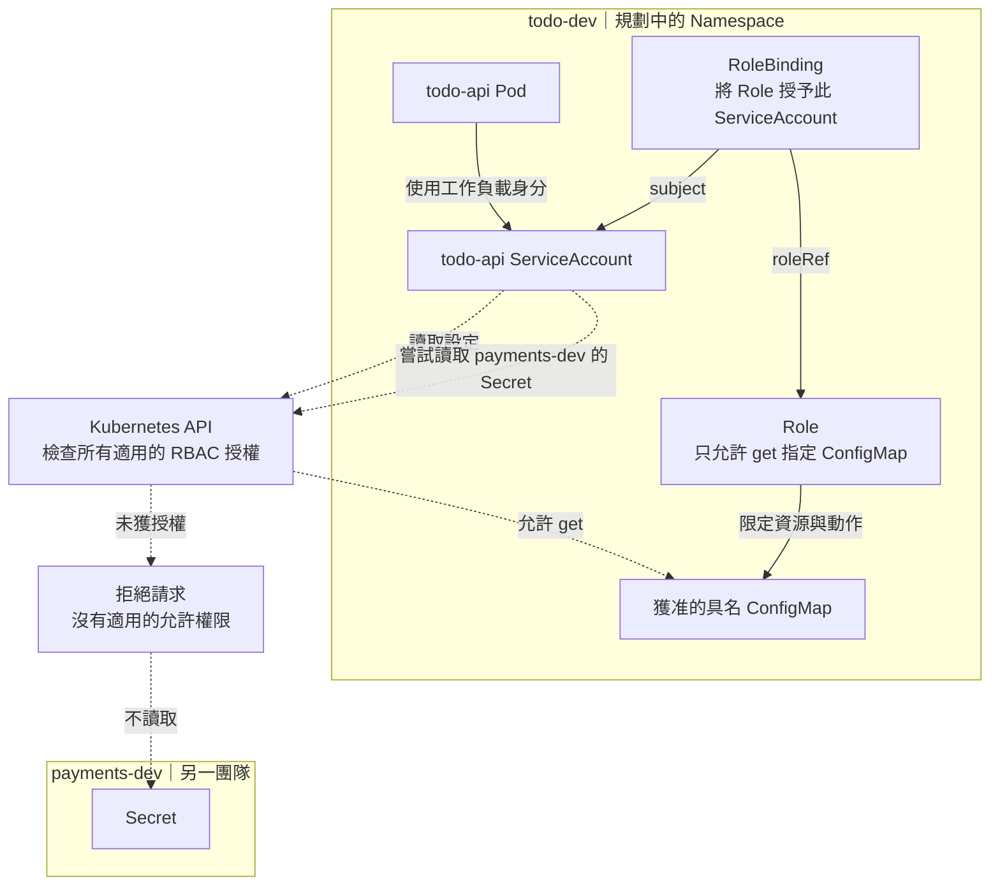

# Day 25 - Kubernetes RBAC 與 Namespace 能隔離什麼

前一篇整理了 Backstage 查詢資源現況所需的設定。查詢身分需要讀取權限，但不應因此取得修改工作負載的能力；Catalog 的 `owner` 也不能直接拿來授權。同樣地，執行中的 `todo-api`、建立資源的 Operator 與同步設定的 Argo CD，各自需要的權限都不同。

這篇用 Todo 團隊的 Dev 環境討論角色型存取控制（Role-Based Access Control，RBAC），看 Kubernetes 如何限制這些身分。目前尚未建立 Todo Dev 的 Namespace 與 RBAC 設定，也沒有權限測試結果；以下是設計與驗收情境。

## Namespace 劃範圍，RBAC 決定 API 動作

假設 `todo-dev` 與另一個團隊的 `payments-dev` 共用叢集。Namespace 讓多數資源的名稱與權限有各自的範圍，但光是建立兩個 Namespace，不會自動擋住跨 Namespace 的 API 存取，更不會隔離 Pod 對外的網路流量。

RBAC 要回答的是：「哪個身分，能對哪種 Kubernetes 資源，執行哪個動作？」`Role` 列出特定 Namespace 中允許的 API 動作，`RoleBinding` 再將這些權限授予使用者、群組或 `ServiceAccount`。例如，一份 `Role` 允許讀取某個具名 `ConfigMap`，但沒有 binding 指向 `todo-api` 的身分，它就不會因此取得權限。

`ClusterRole` 可定義重用的權限規則。透過 `RoleBinding` 授予其中 Namespace 範圍內的權限時，仍只作用於該 binding 所在的 Namespace；用 `ClusterRoleBinding` 則可授予叢集範圍的權限。

RBAC 的允許權限會累加，沒有一條 deny 規則可以抵銷另一份 binding 已授予的權限。因此，「這份 Role 沒有允許」不一定等於「這個身分會被拒絕」，還得一起檢查其他 binding。

下圖假設 `todo-api` 確實需要直接讀取一個具名 `ConfigMap`，而且沒有其他授權。實線表示身分與授權關係，虛線表示 API 請求；跨團隊存取的拒絕是預期結果，尚未部署驗證。

## 工作負載與平台元件不能共用一組權限

既有 `todo-api` 並不需要為了提供 Todo API 就讀取 Kubernetes 資源。沒有直接呼叫 Kubernetes API 的需求，就不必先授予權限，是否掛載 `ServiceAccount` token 也應依實際元件評估。上圖的 ConfigMap 讀取是額外需求的假設，不是 Todo API 已有的行為。

若某個服務真的只需透過 API 取得自己的具名 `ConfigMap`，授予指定資源的 `get`，比允許列出所有設定與 `Secret` 更符合需求。Operator 與 Argo CD 則有建立、更新資源的責任，不能和應用程式共用同一組權限：

| 身分 | 所需能力 | 應限制的範圍 |
| --- | --- | --- |
| `todo-api` 的 `ServiceAccount` | 依應用程式的實際 API 需求授權 | 不預先授予列出 Secret 或修改工作負載的權限 |
| Operator | 觀察 CR、管理受管資源、回寫 `status` | 授權的 Namespace、資源類型與動作 |
| Argo CD | 將已核准設定同步到叢集 | 允許的目的地與資源，不任意操作整個叢集 |
| Backstage 查詢後端 | 讀取服務關聯的資源現況 | 查詢所需的 Namespace 與資源，不取得部署寫入權 |
| Backstage 模板後端 | 向設定儲存庫提出 Git PR | Git 權限，不因提出部署需求就取得 Kubernetes 寫入權 |

## 別把所有隔離要求都交給 RBAC

RBAC 管的是 Kubernetes API，不決定 `todo-api` 能否透過網路連到別的 Service，也不限制 container 能使用多少 CPU 或記憶體。資源預算可由 `ResourceQuota` 等機制處理，網路隔離則需要 `NetworkPolicy` 等控制。把服務放進不同 Namespace，仍不代表 Node、網路與所有叢集資源都已隔離。

權限也要看實際使用的憑證。如果 Pod 取得另一個高權限 `ServiceAccount` 的 token，API Server 會依那個身分授權，原本替應用程式設計的限制就擋不住它。

## 如何確認允許與拒絕符合預期？

建立設定與測試身分後，要同時驗證兩邊：需要的工作能完成，不需要的操作被拒絕。以上圖的假設為例，服務應能讀取獲准的 `ConfigMap`，卻不能讀取 `payments-dev` 的 `Secret`，也不能修改其他服務的 `Deployment`。Operator 和 Argo CD 則應在各自的授權範圍內完成工作，超出範圍時被拒絕。

拒絕結果要連同實際身分與所有適用 binding 一起確認；只檢查一份 `Role` 的內容還不夠。這些是待執行的驗收情境，並非已在叢集取得的 `yes`／`no` 結果。

下一篇處理另一個問題：即使某個身分有權建立 `Deployment`，它提交的內容是否符合平台要求？
