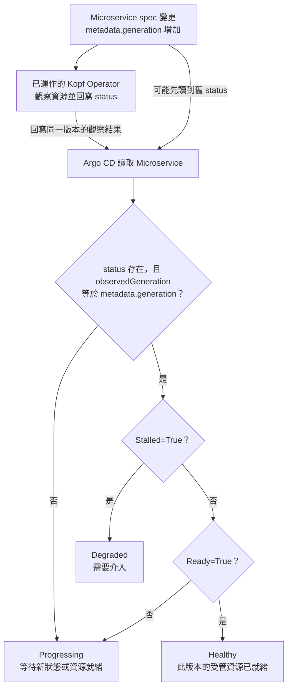

# Day 25 - 讓 Argo CD 判斷 `Microservice` 是否健康

## 設定同步了，服務就能用嗎？

前一篇將審查通過的設定交給 Argo CD。即使這條路徑接通，`Microservice` 已經 `Synced`，也可能只是新的 `spec.image` 寫進了 API Server；Operator 尚未處理，或新 Pod 還在等 image，服務都還沒更新完成。

Argo CD 能替標準資源判斷 health，卻不知道我們的 `Microservice` 什麼時候才算健康。要讓它判斷自訂資源，得先約定 Operator 如何寫入 status，再給 Argo CD 一段自訂 Health Check。

## Operator 必須提供當前版本的狀態

目前 CRD 已有 `conditions`，Kopf Operator 也會回寫 `Ready`、`Stalled` 與 `observedGeneration`。健康判斷直接沿用這份合約：

| 欄位或 condition | 判斷用途 |
| --- | --- |
| `metadata.generation` | 目前 CR 的設定版本 |
| `status.observedGeneration` | Operator 回報的觀察結果對應哪一版 CR |
| `Ready=True` | 該版本的受管工作負載已可用 |
| `Stalled=True` | 該版本遇到需要介入的錯誤 |

`Ready=False` 不一定代表失敗：Deployment 剛建立、Pod 尚未 ready 時，仍可能持續收斂。只有 Operator 明確設 `Stalled=True`，我們才把它判為 `Degraded`。若 `observedGeneration` 落後 `generation`，即使看到舊的 `Ready=True`，也只能回報 `Progressing`。

下圖是自訂 Health Check 的判斷順序。它只解讀 Operator 回報的狀態，不會自行檢查 Pod 或修復工作負載；Operator 已有實際輸出，Argo CD 的這段整合仍待驗證。



## 用 Lua 將 CR status 映射到 health

Argo CD 可在 `argocd-cm` 的 `resource.customizations.health.<group>_<kind>` 設定 Lua script。以下節錄既有但尚未套用的範例，依序判斷版本、`Stalled` 與 `Ready`：

```yaml
data:
  resource.customizations.health.platform.example.io_Microservice: |
    hs = {}

    if obj.status == nil or
       obj.status.observedGeneration ~= obj.metadata.generation then
      hs.status = "Progressing"
      hs.message = "Waiting for the operator to observe this generation"
      return hs
    end

    for _, condition in ipairs(obj.status.conditions or {}) do
      if condition.type == "Stalled" and condition.status == "True" then
        hs.status = "Degraded"
        hs.message = condition.message or condition.reason or "Reconciliation stalled"
        return hs
      end
    end

    for _, condition in ipairs(obj.status.conditions or {}) do
      if condition.type == "Ready" and condition.status == "True" then
        hs.status = "Healthy"
        hs.message = condition.message or "Managed resources are ready"
        return hs
      end
    end

    hs.status = "Progressing"
    hs.message = "Waiting for managed resources to become ready"
    return hs
```

`Stalled=True` 優先於 `Ready=True`，避免矛盾的 conditions 被解讀為健康。若沒有 condition，或 `Ready=False` 且未卡住，就維持 `Progressing`；`Ready=Unknown` 也不會通過健康判斷。

這段 script 假設 `status.observedGeneration` 與所有 conditions 描述同一版 CR。Operator 必須一起更新它們，不能只推進版本數字，卻留下上一版的 `Ready=True`。否則即使 Lua 的版本比較通過，仍可能誤報健康。CRD schema、Operator 寫入邏輯和 Health Check 必須遵守同一份合約。

還要留意 `argocd-cm` 是 Argo CD 的既有設定；套用範例中的整份 ConfigMap 可能覆蓋其他設定。整合時應把這個 key 併入現有設定並驗證 Argo CD 版本，而不是直接取代整份 ConfigMap。

## 用幾個狀態確認判斷邊界

| CR 的觀察結果 | 預期 health | 為什麼 |
| --- | --- | --- |
| 沒有 `status`，或 `observedGeneration` 與 generation 不同 | `Progressing` | 沒有可採用的當前版本狀態 |
| 當前版本 `Ready=True`、未卡住 | `Healthy` | Operator 已確認受管資源可用 |
| 當前版本 `Stalled=True` | `Degraded` | Operator 明確要求介入 |
| 當前版本同時有 `Ready=True` 與 `Stalled=True` | `Degraded` | 卡住的訊號優先，不能選擇性地只看健康 |
| 當前版本沒有上述真值 | `Progressing` | 尚不能宣稱完成或失敗 |

這些是 Lua 映射的預期結果，不是 Argo CD 的實測紀錄。Operator 已驗證正常 rollout 與錯誤 image 的 conditions，但自訂 Health Check 尚未套用，也沒有這條 CR 路徑的 Application health 聚合結果。可以先用表中的狀態測試 Lua 分支；整合後，再確認 Argo CD 讀取同樣的 CR 狀態時，資源 health 與 Application health 都符合預期。

`Healthy` 在這裡代表 Operator 約定的受管資源已就緒，不保證 Todo 的每個 API 行為正常。實際請求與遙測資料仍是應用程式驗證的依據，而 `Synced` 只回答 Git 設定是否已同步。

下一篇回到開發者的入口：Backstage 設定 Kubernetes plugin 後能查詢哪些資源狀態，又有哪些交付歷史不能從資源現況推得？
