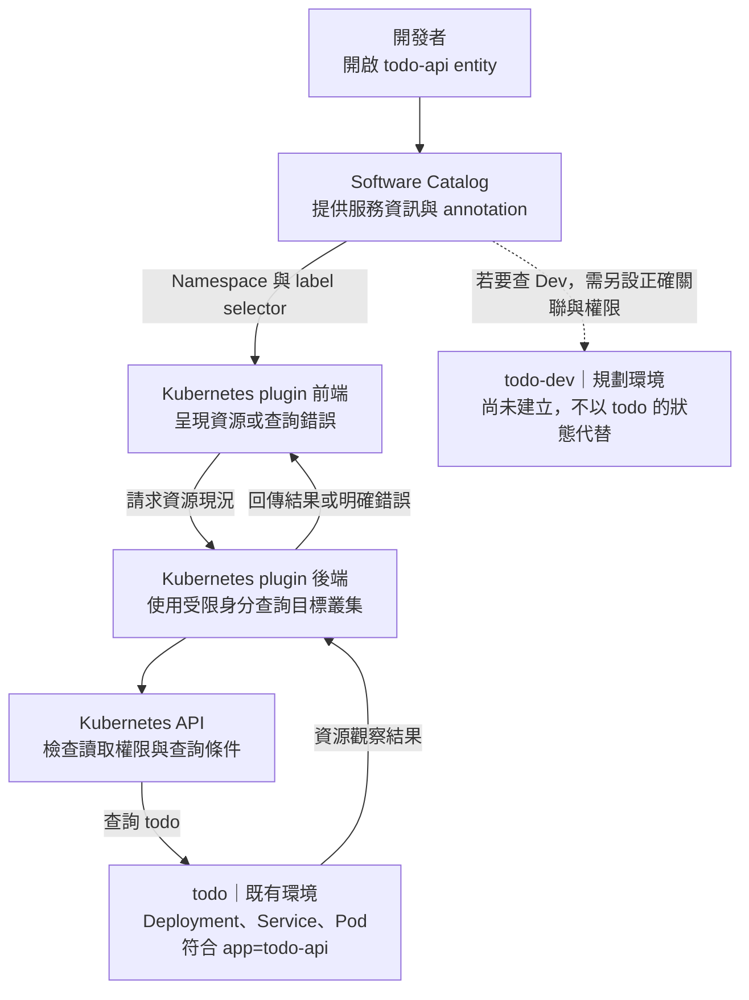

# Day 26 - 在 Backstage 查看服務與 Kubernetes 部署狀態

## 開發者現在能查到什麼？

前一篇將 Operator 的 `Ready`／`Stalled` 映射成 Argo CD health；Operator 已回寫狀態，自訂 health 設定仍未套用。Todo 的 Deployment、Service 與 Pod 則已經可以查詢，不必等 Git PR 到 CR 的整條路徑接通，才提供開發者入口。

Backstage 的 Software Catalog 讓人找到 `todo-api`，Kubernetes plugin 再查詢相關資源。執行環境已有 Catalog 與 plugin 的叢集連線設定，這篇整理它們如何關聯，以及資源現況能回答什麼。不需要為了這個查詢入口另外建立 Portal 或交付資料庫，也不把既有連線說成所有 UI 與錯誤情境都已測完。

## 先關聯已存在的 Todo API

Catalog 範例在 `todo-api` entity 上指定 Namespace 與 label selector，讓 Kubernetes plugin 知道要查詢哪組資源：

```yaml
metadata:
  name: todo-api
  annotations:
    backstage.io/kubernetes-namespace: todo
    backstage.io/kubernetes-label-selector: app=todo-api
```

這組條件指向 `todo` Namespace 中帶有 `app=todo-api` 的資源。Operator 已為 Deployment、Service 與 Pod template 維持相同的 metadata label，讓資源能一起被選到。`spec.selector` 用來選 Pod，不等於資源本身有相同 label；查詢關聯應檢查 `metadata.labels`。

即使 labels 已一致，還是要確認 selector 沒把其他服務一起選進來，以及 plugin 有權讀取需要的資源。標籤是查詢條件，不是安全邊界。

環境同樣不能混用。Software Template 的目標是 `todo-dev`，這份 Catalog 設定卻指向 `todo`。即使既有 Pod 看起來正常，也不能拿它當作 Dev 版本更新的結果；查詢新環境時，entity 的關聯條件與 plugin 可讀取的叢集、Namespace 都要一起確認。

## 查詢會經過哪些元件？

Kubernetes plugin 需要前端元件、後端 plugin、叢集連線與讀取權限。Catalog YAML 只提供關聯資訊，不會自行建立這些元件。下圖沿用現有 `todo` 的查詢方向，將尚未建立的 Dev 環境另外標示。



後端能讀取哪些資源，以及登入 Backstage 的人能看到哪些服務，也需要各自限制。Catalog 的 `owner` 只是負責團隊資訊，不能把它當成 Kubernetes 的授權規則。遇到權限不足、叢集無法連線或 selector 找不到資源時，畫面應能區分原因，不要一律顯示空白列表。

<!-- TODO(assets): 補上 todo-api Catalog entity 到 Kubernetes plugin 的 Deployment／Pod 查詢畫面，標出 todo（現有）與 todo-dev（規劃中）的 Namespace 差異；沒有實際 Backstage 畫面前保留 TODO。 -->

## 資源現況不等於交付歷史

完成關聯後，Kubernetes plugin 可以呈現支援的 `Deployment`、Pod 等資源與可觀察到的錯誤，但不會因此記錄每筆 PR 的 review、digest 驗證、合併與所有 health 轉換。自訂的 `Microservice` 和 Argo CD `Application` 也不能假設會自動出現在預設畫面，仍要確認 plugin 的資源支援與整合設定。

例如，`todo-api` 現在有兩個就緒 Pod，可以幫助判斷工作負載現況，卻不能回答誰核准了這個版本。後者要回到 Git PR；image 從哪個 commit 建出來要看 CI；核准設定是否同步則看 Argo CD 的 revision 與 health。Backstage 可以連結或整合這些來源，但查詢入口不等於歷史資料庫。

如果確實需要完整的交付時間線，就得另外定義事件來源、保存方式、漏收事件時的處理與維護責任。目前沒有這種事件儲存服務，也沒有完成 Backstage 與 Argo CD 的整合。

## 驗證範圍

現在可以核對 Catalog 的 Namespace、selector、Operator 產生的 labels，以及 plugin 的連線與只讀權限。畫面還需要分別確認以下情境：

| 情境 | 應確認的結果 |
| --- | --- |
| 查詢 `todo-api` | 只列出目標叢集、Namespace 中與服務相關的資源 |
| selector 沒有匹配 | 顯示找不到資源，不解讀為服務健康 |
| 查詢身分權限不足 | 顯示存取錯誤，能與沒有資源區分 |
| Pod 尚未就緒 | 呈現工作負載的實際狀態，不因 Git 已同步就宣稱健康 |
| 改查 `todo-dev` | 不沿用 `todo` 的資源，確認新的關聯與讀取範圍 |

這份表不是完整的 UI 測試紀錄；尤其 selector 無匹配、權限錯誤與切換環境的呈現仍需逐項確認，操作截圖也尚未補上。

下一篇會把查詢與部署所需的權限分開，說明 Kubernetes 的 Namespace 與 RBAC 如何限制各個身分能操作的資源。
