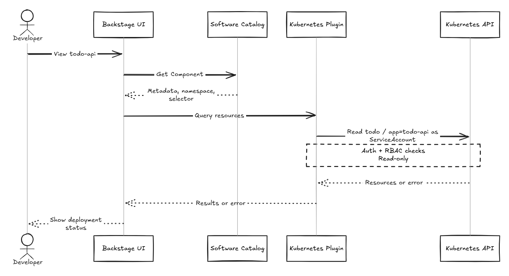

# Day 26 - 在 Backstage 查看服務與 Kubernetes 部署狀態

前一篇將 Operator 的回報轉成 Argo CD 的健康狀態。今天回到 Backstage，讓開發者從 `todo-api` 的服務頁面查看目前的 image、副本與 Pod 狀態。Software Catalog（軟體目錄）提供服務資訊，Kubernetes plugin 查詢相關工作負載；查詢不會觸發部署。

## 讓 Catalog 的服務對應到 Kubernetes 資源

Catalog 的 `Component` 不會只因名稱相同，就自動對應到 Kubernetes 的 `Deployment`。我們用兩個 annotation 指定 Namespace 與 label selector：

```yaml
apiVersion: backstage.io/v1alpha1
kind: Component
metadata:
  name: todo-api
  description: Todo API service
  annotations:
    backstage.io/kubernetes-namespace: todo
    backstage.io/kubernetes-label-selector: app=todo-api
spec:
  type: service
  lifecycle: experimental
  owner: todo
```

登錄這份定義後，plugin 會查詢 `todo` Namespace 中，`metadata.labels` 符合 `app=todo-api` 的資源。既有 Backstage 已載入這份服務定義；另一套 Backstage 則需先將 `catalog-info.yaml` 放到可讀取的位置，再匯入 Catalog。

注意，`Deployment.spec.selector` 和 `Service.spec.selector` 是用來選 Pod，不是資源本身的 label。前面的 Operator 已在 `Deployment`、`Service` 與 Pod template 加上 `app=todo-api`，因此都能被查到。其他資源若使用同一組 label，也可能一起出現；label 表達關聯，不是所有權。

## Kubernetes plugin 如何連到叢集？

實際呼叫 Kubernetes API 的是 plugin 後端。既有 Backstage 已啟用前端 `@backstage/plugin-kubernetes` 與後端 `@backstage/plugin-kubernetes-backend`，並在 `app-config.yaml` 設定叢集連線：

```yaml
kubernetes:
  serviceLocatorMethod:
    type: multiTenant
  clusterLocatorMethods:
    - type: config
      clusters:
        - url: ${K8S_API_URL}
          name: it30-cluster
          authProvider: serviceAccount
          serviceAccountToken: ${K8S_BACKSTAGE_TOKEN}
          caData: ${K8S_BACKSTAGE_CA_DATA}
          skipMetricsLookup: true
```

`multiTenant` 讓服務依已設定的叢集查詢，`clusterLocatorMethods` 列出連線資訊。`it30-cluster` 是 Backstage 顯示的名稱，不必與 `kubectl` context 同名。連線所需的 API 位址、token 與憑證授權單位（Certificate Authority，CA）資料，由 `backstage` Namespace 的 `backstage-k8s-conn` Secret 注入：

| Secret key | 環境變數 | 用途 |
| --- | --- | --- |
| `apiUrl` | `K8S_API_URL` | Backstage 後端能連到的 Kubernetes API 位址 |
| `token` | `K8S_BACKSTAGE_TOKEN` | `todo` Namespace 的 `backstage-k8s-reader` ServiceAccount token |
| `caData` | `K8S_BACKSTAGE_CA_DATA` | Base64 編碼的 CA 憑證資料，用來驗證 API Server 憑證 |

憑證留在後端，不放進 Catalog 或交給瀏覽器，也不要停用 TLS 驗證。`skipMetricsLookup: true` 略過 Kubernetes Metrics API，因此頁面不提供即時 CPU／memory 用量，但不影響 OpenTelemetry 與 Grafana。

查詢流程如下，讀取的是 Kubernetes 資源，不是呼叫 Todo API：



## 從服務頁面查看 Todo API 的現況

在 Catalog 開啟 `todo-api` 的 Kubernetes 檢視，核對叢集 `it30-cluster` 與 Namespace `todo`。結果應包含符合 label 的 `Deployment`、`Service`、Pod 與相關 `ReplicaSet`，主要查看：

| 要看什麼 | 能回答的問題 |
| --- | --- |
| `Deployment` 的目標 image | 目前設定要求使用哪個版本？ |
| 目標副本數與就緒副本數 | 已有多少副本達到就緒條件？ |
| Pod 的 image、就緒與重啟狀態 | 是否仍有舊版 Pod，或 container 反覆重啟？ |
| `Service` 的 selector 與 port | 流量要交給哪組 Pod、使用哪個 port？ |

<!-- TODO(assets): 截取 todo-api 服務頁面的 Kubernetes 檢視，保留 it30-cluster、todo Namespace、Deployment 與 Pod 的狀態；若需展示 image，確認實際頁面可查看的欄位後再截取。 -->

沒有看到資源，不一定是服務停止，也可能是查詢條件或連線出了問題：

| 畫面或錯誤 | 排查方向 |
| --- | --- |
| 沒有匹配的資源 | 核對 Namespace 與各資源自己的 `metadata.labels` |
| `Unauthorized` | 檢查查詢 token 是否有效或已到期 |
| `Forbidden` | 檢查查詢身分是否獲准讀取該資源 |
| 連線或憑證錯誤 | 檢查後端到 API Server 的連線、API 位址與 CA |
| 查得到 Pod，但尚未就緒 | 查看 Pod 狀態與錯誤資訊，不因資源存在就認定服務可用 |

token 存進 `Secret` 不會自動續期；更新後要重建 Backstage Pod，才會讀到新值。Backstage 自己的健康檢查通過，也不代表它仍能查詢 Kubernetes。

## 兩個 Pod 就緒，代表這次換版完成了嗎？

Operator 的目標是兩個副本，但 rollout 期間 Pod 數量可能增加，舊 Pod 也可能仍就緒。要確認換版結果，應對照核准的 image digest、`Deployment` 的目標 image 與新版副本進度，不能只看有幾個健康 Pod。

若要讀取 Operator 整理的結果，可另外查詢 `Microservice` 自訂資源（Custom Resource，CR）：

```bash
kubectl get microservice todo-api -n todo -o yaml
```

這個指令使用目前 `kubectl` 的身分。既有 plugin 沒有設定查詢 `Microservice`，後端身分也沒有它的讀取權限，所以頁面不會自動顯示 conditions。加入支援時，需要一起設定資源查詢、授權與呈現。

沿用 Day 22 的判斷：比對 CR 的 `metadata.generation` 與 `status.observedGeneration`，相同後再看 `Ready`、`Stalled` 與原因。這只能確認工作負載狀態，建立 Todo 等功能仍要透過實際請求與 Grafana 的遙測資料確認。

## 要追查誰核准版本，還是得回到 Git

Kubernetes plugin 顯示現況，不會自動收集 PR 審查、CI 結果或每次部署的歷史。要追查版本來源，仍需查看各工具的紀錄：

| 想確認的事情 | 應查看的來源 |
| --- | --- |
| 哪個版本被提出、誰 review、是否已合併？ | Git PR 的 diff、檢查與審查紀錄 |
| image 從哪個 source commit 建出來？ | CI run 與它產出的 image digest |
| 哪個設定 revision 已同步到叢集？ | 讀取該設定來源的 Argo CD `Application` 的 revision、sync 與 health |
| Operator 是否已處理目前的需求？ | CR 的 generation 與 conditions |
| 工作負載與業務請求現在是否正常？ | Kubernetes 資源，以及實際請求與遙測資料 |

CR 的 conditions 也只保存目前的觀察結果，`lastTransitionTime` 不是完整的換版紀錄。若要保存交付時間線，還需要收集事件，以 image digest、Git revision 關聯部署結果，並處理保存期限與漏收事件。

## 誰在使用查詢權限？

`backstage-k8s-reader` 透過 `Role` 與 `RoleBinding` 取得 `todo` Namespace 內指定資源的 `get`、`list`、`watch`，沒有部署寫入權或讀取 `Secret` 的權限。這是 API 授權，與 Catalog 的 selector 不同。

登入 Backstage 的使用者則是另一份身分。`owner: todo` 只是團隊資訊，不會限制誰能查看服務。示範使用 Guest 登入與允許所有操作的 Backstage permission policy，只適合受控的本機環境；正式入口還要設定使用者登入與服務存取規則。

下一篇會以 Namespace 與角色型存取控制（Role-Based Access Control，RBAC），說明查詢與部署身分各自需要哪些權限。
