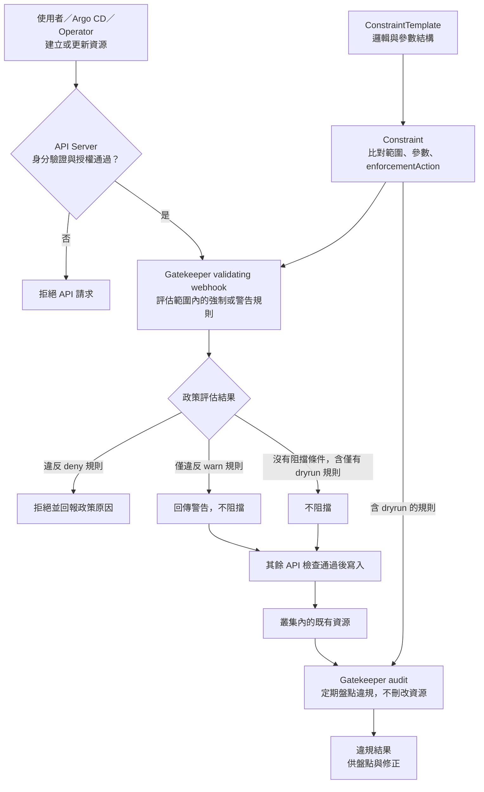

# Day 26 - Policy as Code：OPA Gatekeeper 怎麼檢查資源

前一篇用 RBAC 限制誰能在 `todo-dev` 建立 `Deployment`，但有權建立，不代表內容符合平台要求。Argo CD 和 Operator 即使使用合法身分，仍可能提交缺少必要設定的工作負載；這類問題需要在資源寫入前檢查。

政策即程式碼（Policy as Code）將規則寫成可版本管理、審查與測試的內容。Open Policy Agent（OPA）提供政策評估引擎，OPA Gatekeeper 則將政策接到 Kubernetes 的准入控制（Admission Control），檢查資源是否符合規則。目前尚未安裝 Gatekeeper，也沒有政策設定；這篇先說明它如何評估請求，以及何時適合啟用拒絕。

## Admission 管「這次要寫入的資源」

使用者、Argo CD 或 Operator 向 Kubernetes API 建立／更新資源時，請求通過身分驗證與授權後，還會經過 admission 階段。Gatekeeper 的 validating webhook 可以在這裡評估符合比對範圍的資源；設定為 `deny` 的規則若判定違規，就會拒絕該請求。

這和 CRD schema、RBAC 的問題不同：schema 問「欄位型別對不對」，RBAC 問「這個身分能不能執行動作」，Gatekeeper 則可問「這份有權提交且格式合法的 Deployment，是否滿足平台政策」。任何一層都不能取代另一層。

## 規則內容與適用範圍要分開

Gatekeeper 的 `ConstraintTemplate` 定義政策邏輯、參數結構與可使用的 constraint 類型；`Constraint` 是它的實例，決定比對哪些資源／Namespace、使用哪些參數與執行模式。以「Todo Dev 的 Deployment 必須有負責團隊 label」為例，Template 可描述怎麼判斷缺少 label，Constraint 再指定只檢查 `todo-dev` 的 Deployment。

只有 `ConstraintTemplate` 還不夠，還需要一筆 `Constraint` 才能指定實際規則。比對範圍若漏掉目標資源，該規則就不會擋下它。Operator 自己產生的 `Deployment` 也要接受相同檢查；遇到拒絕時，應將原因回報到 `Microservice.status`，不能把「有權建立」當成「已建立成功」。

下圖把請求當下的 admission 與另外執行的 audit 分開。這是預定的機制，不是已安裝的流程；圖中的「放行」只表示 Gatekeeper 不拒絕，資源仍須通過其他 Kubernetes 檢查。

## Audit 與執行模式不是同一件事

| 觀察點 | 想回答的問題 | 容易誤會的地方 |
| --- | --- | --- |
| Admission | 新的建立／更新請求能否通過？ | 不會自動修好既有資源 |
| Audit | 叢集內現有資源有哪些違規？ | 找到違規不等於已拒絕或刪除 |
| `dryrun` | 不阻擋請求時，哪些既有資源違規？ | 可透過 audit 觀察結果，不代表 admission 已強制執行 |
| `warn` | 能否在提交時提醒使用者？ | 回傳警告但不阻擋，仍須確認 client 能呈現警告 |
| `deny` | 要不要拒絕違規請求？ | 範圍設錯會連平台自身的資源也擋住 |

audit 處理的是已存在的資源。把規則改為 `deny`，不會立刻刪掉違規的 `Deployment`；它可能繼續執行，直到新的寫入請求被檢查。因此，導入時需要同時安排既有資源的修正，而不是只看新請求是否遭拒。

Gatekeeper 的 `dryrun` 是 `Constraint` 的執行模式，也不同於 Kubernetes API 的 server-side dry-run。前者讓政策不阻擋請求，後者讓 API 請求接受檢查但不儲存資源，不能混為一談。

啟用前還要決定檢查 `Deployment`、Pod 還是兩者，並確認 webhook 故障時的行為。連線失敗究竟要放行還是拒絕，取決於 webhook 的失效處理設定；它會影響安全範圍與部署可用性，需要連同 Gatekeeper 版本一起核對。

## 用什麼證據判斷能否改成拒絕？

若要將 Todo Dev 的一條規則切到 `deny`，驗收應同時看合規與違規請求：缺 label 的 Deployment 被擋住，補上 label 的請求可進入，其他不在範圍內的 Namespace 不受波及，Operator 產出的資源也能通過。還要確認使用者看得懂錯誤、平台能查到 policy 版本與命中的 Constraint。

目前尚未準備這些測試資料、政策與叢集結果。下一篇會用資源限制、特權容器與 image 來源三種情境，具體說明規則要檢查哪些輸入，以及遭拒後如何修正。
