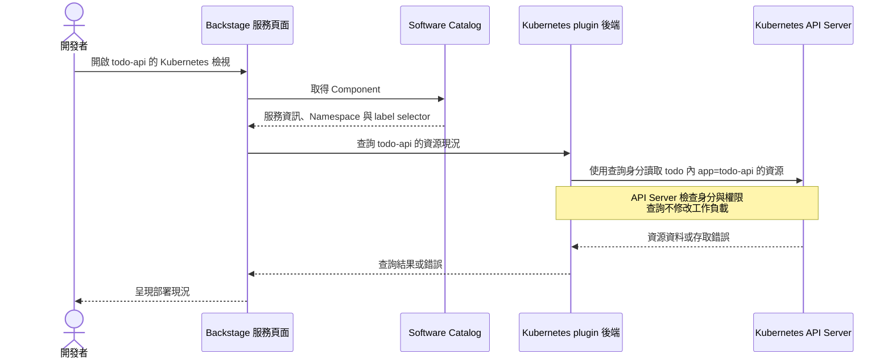

# Day 26 - 在 Backstage 查看服務與 Kubernetes 部署狀態

前一篇將 Operator 回報的 `Ready`、`Stalled` 轉成 Argo CD 的健康判斷，這份設定還沒套用。不過，Todo API 的工作負載已經由 Operator 管理，也能查到部署狀態。開發者要確認服務現在用了哪個 image、有幾個副本就緒，除了執行 `kubectl`，也可以從 Backstage 的服務頁面開始。

Day 17 已經介紹過 Software Catalog（軟體目錄）與 Kubernetes plugin 的分工：Catalog 保存服務身分與負責團隊，plugin 查詢叢集中的相關資源。今天沿用既有的 `todo-api`，把服務如何對應到工作負載、查詢需要哪些設定，以及讀到的狀態能回答什麼說清楚。Git PR 到 Argo CD 的部署來源還沒接通，但查詢既有資源不需要等這段流程完成。

## 讓 Catalog 的服務對應到 Kubernetes 資源

Catalog 裡的 `Component` 和 Kubernetes 裡的 `Deployment` 是不同物件。即使兩邊都叫 `todo-api`，plugin 也需要查詢條件，才能知道要從哪個 Namespace 找出相關資源。以下是 Todo API 的 Catalog 定義：

```yaml
apiVersion: backstage.io/v1alpha1
kind: Component
metadata:
  name: todo-api
  description: Todo API service
  annotations:
    backstage.io/kubernetes-namespace: todo
    backstage.io/kubernetes-label-selector: app=todo-api
spec:
  type: service
  lifecycle: experimental
  owner: todo
```

`spec` 描述這個服務在 Catalog 裡的分類與負責團隊；兩個 annotation 則提供 Kubernetes 的查詢條件。`backstage.io/kubernetes-namespace: todo` 限定 Namespace，`backstage.io/kubernetes-label-selector: app=todo-api` 選取帶有這組 label 的資源。把這份定義登錄到 Catalog，只會建立服務紀錄，不會部署 Todo API。

這裡容易忽略的是 label 的位置。`Deployment.spec.selector` 和 `Service.spec.selector` 用來選取 Pod，不代表 `Deployment`、`Service` 本身也有相同 label。plugin 依 label selector 查詢各種資源時，看的是各物件的 `metadata.labels`；如果只有 Pod 有 label，就可能查得到 Pod，卻找不到它的 `Deployment` 或 `Service`。

目前 Operator 會在 `Deployment`、`Service` 的 `metadata.labels`，以及 Pod template 上維持 `app=todo-api`，讓建立出來的 Pod 也帶有同一組 label。因此，這些資源能用相同條件查詢。若其他工作負載也用了這組 label，仍可能一起被選進來；label 表達的是關聯，不是所有權或存取權限。

## Kubernetes plugin 如何連到叢集？

Catalog 提供查詢條件，但實際呼叫 Kubernetes API 的是 plugin 後端。要讓服務頁面顯示結果，Backstage 必須同時有 Kubernetes 前端與後端 plugin、可連線的叢集設定，以及能讀取資源的憑證。以下節錄目前使用的叢集設定：

```yaml
kubernetes:
  serviceLocatorMethod:
    type: multiTenant
  clusterLocatorMethods:
    - type: config
      clusters:
        - url: ${K8S_API_URL}
          name: it30-cluster
          authProvider: serviceAccount
          serviceAccountToken: ${K8S_BACKSTAGE_TOKEN}
          caData: ${K8S_BACKSTAGE_CA_DATA}
          skipMetricsLookup: true
```

`clusterLocatorMethods` 在這裡直接列出目標叢集，名稱是 `it30-cluster`。API 位址、查詢用 token 與憑證授權單位（Certificate Authority，CA）的憑證資料，都由後端的環境變數取得；目前透過 Kubernetes `Secret` 注入，不把實際值寫進 Catalog，也不交給瀏覽器。CA 資料用來驗證 API Server 的憑證，連線失敗時應檢查位址與憑證設定，不要停用 TLS 驗證來繞過問題。

後端使用的是 `todo` Namespace 的 `backstage-k8s-reader` ServiceAccount。它的 `Role` 與 `RoleBinding` 只授予該 Namespace 內指定資源的 `get`、`list`、`watch`，沒有部署寫入權。`skipMetricsLookup: true` 則略過 Kubernetes Metrics API 的查詢，因此這個頁面不能期待有即時 CPU／memory 用量；這項設定不影響應用程式送往 OpenTelemetry 或 Grafana 的資料。

開發者開啟服務頁面後，查詢沿著下圖進行。Backstage 讀取的是 API Server 保存的現況，不會直接連到 Todo API 的 HTTP endpoint，也不會再觸發一次部署：



這裡有兩份不同的身分：登入 Backstage 的人，以及後端用來查詢 Kubernetes 的 ServiceAccount。Catalog 的 `owner: todo` 只是負責團隊資訊，不會讓 API Server 自動限制「只有 Todo 團隊能看」。目前示範環境使用 Guest 登入與允許所有操作的 Backstage permission policy，只適合受控的本機 port-forward；正式入口還需要設定登入與服務存取規則，不能把後端的只讀權限當成使用者隔離。

## 從服務頁面查看 Todo API 的現況

既有 Backstage 部署在 `backstage` Namespace，透過 `Service` 的 `7007` port 提供頁面。以下操作沿用已安裝 plugin、載入 Catalog 並設定叢集連線的環境，不是從零安裝 Backstage。先開啟 port-forward，讓瀏覽器能連到入口：

```bash
kubectl port-forward -n backstage service/backstage 7007:7007 --address=127.0.0.1
```

保持終端機開啟，在瀏覽器進入 `http://127.0.0.1:7007`，以 Guest 登入，在 Catalog 找到 `todo-api`，再開啟服務頁面的 Kubernetes 檢視。查看時要一起核對叢集 `it30-cluster`、Namespace `todo` 與資源名稱，避免只因服務名稱相同，就把不同環境的結果混在一起。

這次透過 Backstage 後端查詢 Catalog 與工作負載，已取得 `todo-api` 的 `Deployment`、`Service`、兩個 Pod，以及相關的 `ReplicaSet`，叢集查詢沒有回報錯誤。`Deployment` 的目標副本數與就緒副本數都是 `2`，兩個 Pod 也都就緒。這證明服務關聯與後端查詢能運作；瀏覽器的呈現與操作截圖仍待確認，不能把 API 查詢結果當成完整的 UI 測試紀錄。

<!-- TODO(assets): 截取 todo-api 服務頁面的 Kubernetes 檢視，保留 it30-cluster、todo Namespace、Deployment 與 Pod 的就緒狀態，以及可查看的 image 資訊；先確認實際 UI 呈現，不以後端查詢結果代替畫面。 -->

如果沒有看到資源，不能立刻判定 Todo API 已停止。查詢本身也可能失敗，要分辨下列情況：

| 情境 | 應確認的結果 |
| --- | --- |
| selector 沒有匹配 | 檢查 Namespace 與各資源的 `metadata.labels`；沒有結果不代表服務健康 |
| token 失效或權限不足 | 區分 `Unauthorized` 與 `Forbidden`，分別檢查憑證有效性與 API 授權 |
| API 無法連線或憑證驗證失敗 | 檢查後端到 API Server 的連線與 CA 設定，不解讀為沒有工作負載 |
| 查到 Pod，但 Pod 尚未就緒 | 查看實際狀態與可取得的錯誤資訊，不因資源存在就宣稱可用 |

這些是排查方向，尚未逐項取得對應的 UI 結果。目前查詢 token 由 `Secret` 注入環境變數，token 到期後不會因為存進 `Secret` 就自動續期；更新值也需要重建 Backstage Pod，執行中的 container 才會讀到新值。因此，Backstage 自己的健康檢查通過，不代表它仍能讀取 Kubernetes。

## 兩個 Pod 就緒，代表這次換版完成了嗎？

換版期間，舊 Pod 可能仍然就緒，新 Pod 卻卡在 image 拉取或啟動。這時只看「有兩個健康 Pod」仍不足以判斷更新完成，要對照 `Deployment` 的目標 image、rollout 進度與新版副本數。這次查到的目標 image 仍是 `ghcr.io/yrw9281/it30-todo-api:0.1.0`，不是 Backstage 設定 PR 提出的 digest；查詢入口已接上，不代表 PR 的版本已部署。

若要讀取 Operator 整理的判斷，則另外查看 `Microservice` 自訂資源（Custom Resource，CR）：

```bash
kubectl get microservice todo-api -n todo -o yaml
```

目前 plugin 的查詢身分沒有 `Microservice` 的讀取權限，也沒有將這種自訂資源加入查詢設定，所以不能假設服務頁面會自動顯示它的 conditions。上面的指令使用目前 `kubectl` 的身分，和 Backstage 後端是不同的權限來源。要整合 CR，必須一起處理資源支援、讀取授權與畫面呈現，只加一個 Catalog annotation 不夠。

這次另行查詢 CR，`metadata.generation` 與 `status.observedGeneration` 都是 `12`，回報 `Ready=True`、`Stalled=False`，原因為 `RolloutComplete`。這表示 Operator 的回報對應目前設定，且符合它的就緒條件。CR 與 `Deployment` 各自維護 generation，兩者的版本數字不需要相同；要比的是每個資源自己的目標版本與觀察版本。

<!-- TODO(assets): 補上另行查詢 todo-api CR 的 generation、observedGeneration、Ready／Stalled 與 reason 的結果；不要將它排成 Kubernetes plugin 已支援 CR 的畫面。 -->

即使新版就緒，仍要用實際 Todo 請求與 Grafana 的 Metrics、Logs、Traces 確認功能。plugin 顯示的是資源狀態，不會替我們執行建立待辦事項的測試。

## 要追查誰核准版本，還是得回到 Git

從服務頁面看到目標 image、副本數與 Pod 狀態，可以回答「現在部署成什麼樣子」，卻不能回答「誰核准這個版本」。這些資料分別由不同工具保存：

| 想確認的事情 | 應查看的來源 |
| --- | --- |
| 哪個版本被提出、誰 review、是否已合併？ | Git PR 的 diff、檢查與審查紀錄 |
| image 從哪個 source commit 建出來？ | CI run 與它產出的 image digest |
| 設定來源接通後，哪個 revision 已同步？ | Argo CD `Application` 的 revision、sync 與 health |
| Operator 是否已處理目前的需求？ | CR 的 generation 與 conditions |
| 工作負載與業務請求現在是否正常？ | Kubernetes 資源，以及實際請求與遙測資料 |

Backstage 可以把相關連結與查詢放在服務入口，讓我們從 `todo-api` 開始調查，不必為了這件事另外做一套 Portal。但 Kubernetes plugin 不會自動收集 PR review、CI 結果與每次健康變化，CR 的 conditions 也只保存目前的觀察結果。即使讀得到 `lastTransitionTime`，仍無法還原完整的交付事件時間線。

如果需要逐筆保存交付歷史，就得另外定義事件來源、版本如何關聯、保存多久，以及漏收事件時如何處理。目前沒有這種事件儲存服務，也沒有完成 Backstage 與 Argo CD 的整合，不能把現有查詢頁面當成完整的交付紀錄。

下一篇會把查詢與部署所需的權限分開，說明 Kubernetes 的 Namespace 與角色型存取控制（Role-Based Access Control，RBAC）如何限制各個身分能操作的資源。
