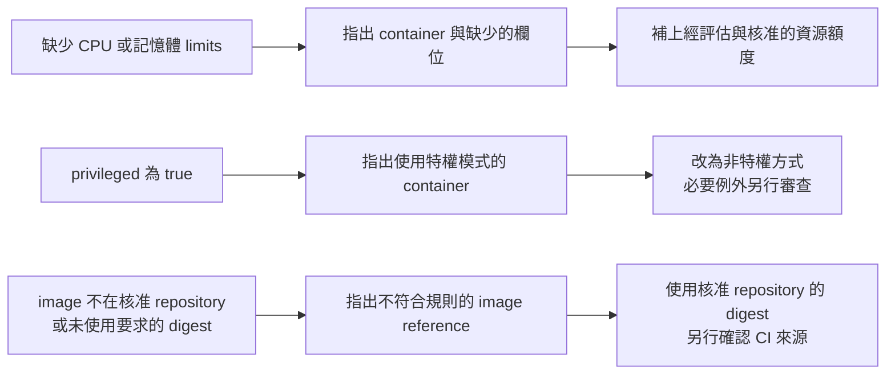

# Day 27 - 用 Gatekeeper 辨識高風險工作負載設定

前一篇說明了 Gatekeeper 的 admission 與 audit。現在要把政策寫清楚：哪些設定算違規、要檢查哪些工作負載，以及拒絕時應告訴開發者什麼。只安裝 Gatekeeper，不會自動得到符合 Todo 平台需求的規則。

這篇用 Todo 服務討論三種風險設定：缺少資源限制、使用特權容器、引用未核准的 image。目前沒有 Rego 政策、`ConstraintTemplate`、`Constraint` 或實際拒絕紀錄；以下是要檢查的輸入與預期修正方式。

## 資源限制要指出哪個 container 缺了什麼

假設平台要求每個 container 都有 CPU 與記憶體 `limits`，政策就不能只回覆「資源設定不合法」。它應指出哪個 container 缺少哪個欄位，讓服務團隊知道要補的是 CPU、記憶體，還是兩者都沒有。

CPU limit 和記憶體 limit 的執行效果不同：前者可能造成 CPU throttling，後者超限時可能觸發 OOM 終止。只檢查欄位存在，不能證明額度合理；requests 的排程需求與 limits 的上限，都要依服務使用情況評估。這條政策只表達平台要求的最低設定，不是效能保證。

## 特權容器需要明確的例外理由

`securityContext.privileged: true` 會大幅放寬 container 的隔離限制。一般 Todo API 不應只為了讓程式啟動，就取得這種權限。政策應指出使用特權模式的 container，要求改成非特權方式；如果是 Node 層級 agent 等確有需求的元件，再走獨立的例外審查。

擋下 privileged 也不等於 container 已經安全。它只是其中一項設定檢查，不能取代其餘執行權限與 image 風險的評估。

## 檢查 image 字串不等於驗證來源

比對 GHCR 時，不能只問 image 字串「是否包含」`ghcr.io/yrw9281`；相似的惡意名稱也可能混過。核准清單要明確到 repository 邊界，必要時要求 `@sha256:` 而非可移動的 tag。不過就算字串符合格式，也不能證明 image 由受信任的 CI run 建置、沒有被錯誤推送，或已獲環境核准。這些仍要回到 CI provenance、Git 設定檢查與 PR review。

以下把三種輸入和修正方向放在一起。圖中是政策應提供的回饋，不是已取得的 admission 拒絕畫面；修正後仍要重新接受完整檢查。

## 檢查 Deployment，還是檢查 Pod？

檢查 `Deployment` 的 Pod template，可以在提交工作負載時就回報錯誤；但它不涵蓋其他 controller 或直接建立的 Pod。Pod 層的 admission 則能檢查實際建立的 Pod，包括 controller 提出的建立請求，不只限於人手動建立的 Pod。

兩者的回饋時機不同。如果只在 Pod 層拒絕，`Deployment` 可能已被接受，但 ReplicaSet 建立 Pod 時才遇到錯誤。此時要從事件與工作負載狀態找原因，不能因為 `Deployment` 存在就認為政策沒生效。

政策也要列清楚檢查哪些 container 欄位，包含一般 `containers` 與 `initContainers`，不要只檢查陣列的第一筆。需要涵蓋其他容器類型或更新操作時，還得另行確認 API 與 webhook 的比對範圍。

## 先修正既有工作負載，再啟用拒絕

使用 GHCR 的既有 Todo API `Deployment` 位於 `todo` Namespace，仍使用 `:0.1.0` tag，也沒有 CPU／memory limits。若把「必須使用 digest 且具備 limits」的規則套到這個範圍，新建或更新請求就會和規則衝突；啟用 `deny` 本身不會停止已執行的資源。

因此，要先用 audit 盤點違規，修正工作負載與平台預設，再決定何時強制執行。規劃中的 `todo-dev` 和 Operator 產物都還不存在，不能把它們當成已通過政策的案例。

## 例外必須有邊界

例外至少要記錄誰核准、影響哪些資源與環境，以及何時重新檢討。不要為了某個維運元件需要特權，就讓整個 Namespace 永久略過所有政策。

驗收時，三條規則都要有合規、違規與修正後的案例，也要涵蓋一般 container、init container 和例外邊界。`dryrun` 搭配 audit 可盤點既有資源，`deny` 的新請求測試則確認違規被拒絕、合規能通過。這些測試尚未執行，不能將圖中的預期回饋視為測試結果。

Admission 管的是資源寫入時的設定；服務執行後能和誰通訊，是另一道邊界。下一篇從流量路徑理解 Istio Sidecar 能做什麼，以及採用它要付出的代價。
